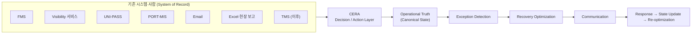

# 02. 제품 정의

- 상태: Draft (기획 v0.2)
- 최종 수정: 2026-09-11
- 관련 ADR: ADR-011(System of Decision 포지셔닝), ADR-010(초기 범위)

---

## 1. 정의

**CERA — Container Exception Recovery Agent**

> CERA는 수입 컨테이너 운영에서 생기는 상태 변화와 예외상황을 여러 데이터 소스에서 수집한다.
> 신뢰도를 기준으로 현재 운영상태를 확정한 뒤, D&D·창고 수용량·트럭 가용성·ODCY·계약조건 등의 제약을 고려해 최적의 Recovery Plan을 계산한다.
> 그리고 실행에 필요한 커뮤니케이션까지 지원하는 멀티에이전트형 물류 Operations 시스템이다.

제품의 본질:

> 여러 시스템과 사람에게 흩어진 물류 운영 사실을 **하나의 신뢰 가능한 상태**로 통합한다. 예외가 생기면 **비용 최소 복구안**을 계산하고, 필요한 이해관계자 **연락과 회신 반영**까지 수행하는 Agentic Operations System.

핵심 질문은 "컨테이너가 어디에 있는가?"가 아니라 **"지금 무엇을 믿을 수 있고, 무엇을 해야 총손실이 최소인가?"**다.

## 2. 문제

1. **사실이 흩어져 있다.** 통관 상태는 UNI-PASS, 선박은 PORT-MIS, 차량은 운송사 메일·전화, 창고 수용량은 창고 담당자, 요율은 계약서·견적 메일에 있다. 운영자는 이것을 엑셀과 기억으로 합친다.
2. **어느 출처도 혼자서는 믿을 수 없다.** 공공 API는 존재하지만 현실 이벤트가 몇 분 뒤에 반영되는지 하루 뒤에 반영되는지 확인된 SLA가 없다(R-1). 사람의 보고는 빠르지만 빠지거나 틀린다.
3. **예외가 생기면 계획이 무너진다.** 창고 설비 고장, 통관 지연, 트럭 부족, 수령 거부가 생기면 여러 컨테이너의 반출·보관·운송 계획을 동시에 다시 짜야 한다.
4. **여러 대가 걸리면 배분 문제가 된다.** 1~2대는 엑셀로 되지만 수십 대가 제한된 트럭·장치장·창고 슬롯을 나눠 쓰면 최적화가 필요하다.
5. **계획은 연락으로 끝나지 않는다.** 운송사·ODCY·창고에 묻고, 회신을 받고, 회신에 따라 계획을 다시 짜는 순환이 수작업이다.

## 3. 포지셔닝

**System of Record가 아니라 System of Decision / Action Layer**다.

이렇게 포지셔닝하지 **않는다**:

| 아님 | 이유 |
| --- | --- |
| AI 기반 컨테이너 추적 서비스 | 추적은 기존 Visibility 제품의 영역이다. CERA는 추적 데이터를 입력으로 쓴다 |
| D&D 알림 서비스 | D&D는 첫 번째 대표 Exception일 뿐이다 |
| B/L OCR 자동화 | 문서 구조화는 입력 수단이지 제품이 아니다 |
| 공공데이터 기반 컨테이너 상태조회 | 공공데이터는 진실원천이 아니다(`01_project-rules.md` 1절) |

경쟁 구도 (가설):

| 구분 | 글로벌 플랫폼(project44, FourKites 등) | 국내 FMS·Visibility 서비스 | CERA |
| --- | --- | --- | --- |
| 강점 | 글로벌 가시성, D&D 데이터, 일부 워크플로 | 국내 포워딩 업무 기록 | 여러 출처의 사실 통합 + 예외 복구 계산 + 연락 루프 |
| 관계 | 입력원 후보 | 입력원 후보 | 대체하지 않고 위에 얹는다 |

- 글로벌 제품이 "Visibility만 제공한다"고 주장하지 않는다. LFD, D&D 비용, Hold, Yard/Task orchestration 등 상당한 기능을 제공한다.
- `[TO VERIFY]` 국내 현장에 "결정·실행 레이어" 공백이 실제로 있는지는 Prototype 인터뷰로 확인한다(R-5).

## 4. 고객 가설

| 순위 | 고객 후보 | 문제 강도 | 데이터 접근 | 비고 |
| --- | --- | --- | --- | --- |
| 1 | 중소·중견 포워더 | 높음 | 중~높음 | 다선사·다화주, 반복 수작업 |
| 2 | 수입 화주 물류팀 | 중~높음 | 높음 | 자사 화물 중심, 창고 운영과 직결 |
| 3 | 3PL / 운송사 | 중간 | 높음 | 배차 자원 보유, D&D 책임 구조 확인 필요 |
| 장기 | 터미널 / 선사 | 높음 | 매우 높음 | 영업 주기가 길고 기존 시스템 장벽이 큼 |

`[TO VERIFY]` 첫 유료 고객 유형(R-2), 실제 D&D 발생 빈도(Q-31), 창고 수용량 관리 방식(Q-29).

## 5. 초기 범위 (ADR-010, 확대하지 않는다)

| 포함 | 제외 |
| --- | --- |
| 부산항 | 다른 국내항, 글로벌 항만 |
| Import FCL | Export, LCL, 항공, 철도 |
| 컨테이너 30대 안팎 | 대규모 운영 |
| 대표 Exception: Warehouse Capacity 감소 + D&D Exposure | 모든 예외 유형 |
| 트럭 5~10대, ODCY 2~3곳, 창고 1곳 | 차량 단위 경로 최적화(VRP) |
| Tariff Rule (계약 추출 + 사람 확인) | 전 선사 Tariff 자동 수집 |
| 이메일 커뮤니케이션 **시뮬레이션** (가상 메일함) | 실제 메일 발송 |
| Human Confirmation | 완전 자율 운영 |
| Three.js 2.5D Operations Simulator | 정밀 디지털 트윈 |

## 6. 제품 단계

| 단계 | 핵심 | 하지 않는 것 |
| --- | --- | --- |
| **PoC** | 시나리오 기반 Closed Loop 데모: 다중 출처 이벤트 → Canonical State → 위험 → 최적화 → 메일 초안·승인·가상 발송 → 회신 구조화 → 재최적화. 공공 API는 읽기 전용. 3D 시뮬레이터 | 실제 메일 발송, 외부 시스템 Write |
| **Pilot** | 실제 고객 1~2곳의 데이터, 실제 메일함 연동(읽기 + 사람 승인 후 발송), 운영 로그 기반 절감 측정 | 예약·배차 시스템 Write |
| **Scale** | 파트너 API·TMS·터미널 연동, 권한을 확보한 범위의 예약·배차 Write | 권한 없는 자동 실행 |

옛 V0.1~V2 명칭과의 대응은 `CHANGELOG.md` 5절.

## 7. KPI

| KPI | 정의 | 측정 시점 |
| --- | --- | --- |
| Time to Canonical State | 예외 발생(현실)부터 CERA 상태에 확정 반영될 때까지의 시간 | PoC(시뮬레이션) / Pilot(실측) |
| Conflict Detection Rate | 출처 간 충돌 중 CERA가 탐지한 비율 | Pilot |
| Verification Turnaround | 확인 요청부터 사람 응답까지의 시간 | Pilot |
| D&D Exposure | Baseline 계획대로 갈 때 예상되는 추가 D&D·보관 비용 | PoC~ |
| Potential Saving | Baseline 비용 − Recovery 비용 (시뮬레이션 기준) | PoC |
| Realized Saving | 실제 실행된 계획 기준 순절감액 | Pilot |
| Operator Acceptance Rate | 추천 계획이 (수정 없이/수정 후) 승인된 비율 | Pilot |
| Communication Cycle Time | 문의 발송부터 회신 반영·재계획까지의 시간 | PoC(시뮬레이션) / Pilot |
| Planning Time Reduction | 기존 수작업 대비 계획 시간 감소율 | Pilot |

## 8. 비즈니스 모델 가설

- **SaaS Subscription**: 관리 컨테이너 수·기능에 따른 월 구독.
- **Gain Sharing**: 검증 가능한 순절감액의 일부를 받는 성과 과금. 절감액 산정 기준(Baseline 정의)을 합의할 수 있는지 `[TO VERIFY]` Q-30.
- **Enterprise Integration**: TMS·EDI·ERP·터미널 연계 구축비.
- **하지 않음**: 초기에 ODCY·운송사 중개수수료를 핵심 BM으로 두지 않는다. 특정 공급자에게서 수수료를 받으면 추천의 중립성이 흔들린다.

## 9. Prototype-led Discovery

- 웹 조사로 이미 확인한 것: D&D 문제, Visibility 시장, Agentic Logistics 제품, 국내 포워딩 수작업, 공공데이터, 국내 물류 자동화 시장이 존재한다는 것. 시장조사를 더 길게 하지 않는다.
- 목표는 "우리 아이디어 어떻게 생각하세요?"가 아니라 **"우리가 이렇게 만들었는데, 실제 현장에서는 무엇이 틀렸습니까?"**를 물을 수 있는 수준까지 만드는 것이다.
- 인터뷰 도구: 3D 시뮬레이션, 30초 영상, 작동하는 Prototype(`09_mvp-scenario.md`, `10_simulation-spec.md`).
- 인터뷰로 검증할 가정은 `15_open-questions.md`의 R-2~R-7, Q-25~Q-32다.

## 10. 확정하지 않을 주장

`01_project-rules.md` 4절.
