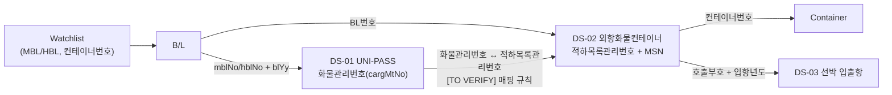
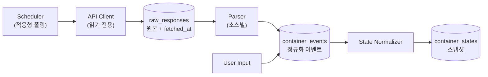

# 03. 데이터 확보 전략

- 상태: Draft v0.1
- 최종 수정: 2026-09-10
- 관련: `05_domain-model.md`(ContainerState), `06_architecture.md`(수집 모듈), `10_open-questions.md`

---

## 1. 핵심 전제

1. **공공 API는 "조회형"이다.** B/L 번호나 화물관리번호 같은 키를 넣어야 결과가 나온다. "우리 고객 컨테이너 전체"를 목록으로 받아오는 API는 없다. `[TO VERIFY]`
   → 사용자가 **감시 대상 목록(Watchlist: B/L, 컨테이너 번호)** 을 등록해야 수집이 시작된다. 온보딩의 첫 단계다.
2. **공공데이터만으로는 비용을 계산할 수 없다.** Free Time, 요율, D/O 발행 여부, 목적지 입고 가능량은 사용자 입력이나 Tariff 문서에서 온다.
3. **자원 데이터(ODCY, 트럭, VBS 슬롯)는 PoC 단계에서 가상값이다.** 시뮬레이터가 seed 기반으로 생성하고, 모든 값에 `SIMULATED` 출처를 붙인다.

## 2. 데이터 출처 카탈로그

### 2.1 공공 API

| ID | 데이터 | 제공 | 식별 키(입력) | 주요 출력 | PoC 용도 | 태그 |
| --- | --- | --- | --- | --- | --- | --- |
| DS-01 | 화물통관진행정보 (UNI-PASS API001) | 관세청 | 화물관리번호 또는 MBL/HBL + B/L 연도 | 통관진행상태, 진행상태코드, 장치장명, 입항일, 컨테이너 개수, 처리이력 | 통관 단계(S2/S3), 장치 위치, 반출 여부 | `[VERIFIED]` 존재 / `[TO VERIFY]` 필드 상세 |
| DS-02 | 외항화물컨테이너정보 | 해양수산부 | `[TO VERIFY]` (명세서 확인 필요) | 항만명, 입항년도, 호출부호, 선박명, 적하목록관리번호, BL번호, MSN, 입출항일시, 반출입구분, 컨테이너번호·규격·사이즈 | 컨테이너 단위 반출입 이벤트(S1, S5, S9) | `[VERIFIED]` 존재 / `[TO VERIFY]` 실시간성·파라미터 |
| DS-03 | 선박 입출항 정보 (PORT-MIS 계열) | 해양수산부 | 호출부호, 입항년도, 항만 | ETA/ATA, 입출항 일시, 선석 | 도착 전 단계(S0), 양하 시점 추정 | `[TO VERIFY]` 사용할 데이터셋 확정 필요 |
| DS-04 | 부산항 체인포털 | 부산항만공사 | `[TO VERIFY]` | 터미널 반출입, VBS 관련 정보 | 터미널 상태·슬롯 보조 | `[TO VERIFY]` 공개 API 여부 |

**DS-01 상세 (2026-09-10 조사)**

| 항목 | 내용 | 태그 |
| --- | --- | --- |
| 공공데이터포털 | `관세청_화물통관진행정보` (data.go.kr/data/15126268) | `[VERIFIED]` |
| 신청 | UNI-PASS 회원가입 및 인증키 필요. 개발단계 자동승인, 운영단계 심의승인. 무료 | `[VERIFIED]` 포털 표기 |
| 조회 범위 | 3년 이내 데이터만 조회 가능 | `[VERIFIED]` 포털 표기 |
| 형식 | XML | `[VERIFIED]` |
| 엔드포인트 | `https://unipass.customs.go.kr:38010/ext/rest/cargCsclPrgsInfoQry/retrieveCargCsclPrgsInfo` | `[TO VERIFY]` 2차 출처(블로그), 공식 연계가이드로 재확인 |
| 요청 파라미터 | `crkyCn`(인증키), `cargMtNo`(화물관리번호) 또는 `mblNo`/`hblNo` + `blYy`(B/L 연도) | `[TO VERIFY]` 2차 출처 |
| 응답 태그(일부) | `csclPrgsStts`(통관진행상태), `prgsStCd`(진행상태코드), `shedNm`(장치장명), `etprDt`(입항일), `cntrGcnt`(컨테이너 개수), `prnm`(품명), `dsprNm`/`dsprCd`(양륙항), `ldprCd`(적재항), `shipNat`, `cargTp` | `[TO VERIFY]` 2차 출처 |
| 처리이력 목록 | 반입·반출 등 처리 단계별 이력 목록이 있는 것으로 알려짐. 구조 미확인 | `[TO VERIFY]` |
| 공식 문서 | UNI-PASS "OPEN API 연계 가이드" (UNI-PASS 사이트 My메뉴 > 서비스관리 > OpenAPI 사용관리) | 확보 필요 (T-004) |

**DS-02 상세 (2026-09-10 조사)**

| 항목 | 내용 | 태그 |
| --- | --- | --- |
| 공공데이터포털 | `해양수산부_외항화물컨테이너정보` (data.go.kr/data/15131742). 등록 2024-08-12, 수정 2025-07-31 | `[VERIFIED]` |
| 원본 기획서 링크 | data.go.kr/dataset/15011649 → 2026-09-10 기준 404. 15131742가 후속·대체 데이터셋인지 확인 필요 | `[TO VERIFY]` Q-03 |
| 형식 / 트래픽 | XML / 개발계정 1,000건(단위 기간 확인 필요), 운영계정 증설 가능 | `[VERIFIED]` 포털 표기 |
| 신청 | 개발단계 자동승인, 운영단계 심의승인 | `[VERIFIED]` |
| 요청 파라미터·응답 필드 | 포털에서 명세서를 내려받아야 함 | `[TO VERIFY]` T-004 |
| 핵심 검증 포인트 | **이벤트 발생 뒤 API 반영까지 지연 시간**. 운영 State로 쓸 만큼 실시간인가? (기획서 리스크 1순위) | `[TO VERIFY]` R-1 |
| 참고 | 같은 포털에 `해양수산부_내항컨테이너반출입정보`(15058585)도 있음. 내항용이라 범위 밖 | — |

### 2.2 사용자 입력 / 문서

| ID | 데이터 | 확보 방식 | 태그 | 비고 |
| --- | --- | --- | --- | --- |
| UI-01 | Watchlist (B/L, 컨테이너 번호, 화주, 선사) | CSV 업로드 / 화면 입력 | `USER_INPUT` | 수집의 출발점 |
| UI-02 | 선사 Tariff (Free Time, D&D 요율) | 공개 Tariff 수기 구조화 → `TariffRule` | `TARIFF_DOC` `[TO VERIFY]` | 예: Maersk D&D terms. 화주 특약과 다를 수 있음 |
| UI-03 | 화주별 Free Time 특약 | 계약서 수기 입력(V0.2+에서 LLM 초안 + 사람 승인) | `USER_INPUT` | Combined/Split 규칙 포함 |
| UI-04 | 목적지 정보 (입고 가능 시간대, 일일 capacity, Reefer plug) | 화면 입력 | `USER_INPUT` `[TO VERIFY]` | 이후 WMS/ERP 연동 후보 |
| UI-05 | D/O(화물인도지시서) 발행·운임 결제 여부 | 화면 입력 | `USER_INPUT` | 공공데이터에 없음. 반출 가능 조건 |
| UI-06 | 예외 이벤트 (창고 만차, 수령 거부 등) | 화면 입력 | `USER_INPUT` | 예외 상태 트리거 |
| UI-07 | 현재 반출 계획(예정 픽업 시각) | 화면 입력 / CSV | `USER_INPUT` | Baseline 산정용 (Q-07) |

### 2.3 시뮬레이션 (PoC 가정값)

| ID | 데이터 | 생성 방식 | 태그 | 상용화 시 대체 |
| --- | --- | --- | --- | --- |
| SIM-01 | ODCY 잔여용량 | 시나리오 파일 + seed | `SIMULATED` `[ASSUMPTION]` | ODCY 제휴/API |
| SIM-02 | ODCY 보관료·핸들링료 | 시나리오 파일 | `SIMULATED` `[ASSUMPTION]` | 실제 견적 체계 |
| SIM-03 | 트럭 가용성·운임 | 시나리오 파일 + seed | `SIMULATED` `[ASSUMPTION]` | TMS/운송사 연동 |
| SIM-04 | VBS 슬롯 가용량 | 시나리오 파일 + seed | `SIMULATED` `[ASSUMPTION]` | 터미널/BPA 확인 |
| SIM-05 | 컨테이너 30~50대 상태 | 실제 응답 구조를 본뜬 합성 데이터 | `SIMULATED` | — |

시나리오 파일은 `data/sim/<scenario_id>.yaml`에 두고, 가정값마다 근거 주석을 단다.

## 3. 조인 키 설계



- 내부 기본 키: `container_no` + `bl_no` (한 B/L에 여러 컨테이너, LCL은 한 컨테이너에 여러 B/L이 있을 수 있음).
- `[TO VERIFY]` 화물관리번호와 적하목록관리번호·MSN의 관계는 T-004에서 실제 응답으로 확정한다(Q-04).
- 컨테이너 번호는 ISO 6346 체크디지트로 입력 단계에서 검증한다.
- PoC 범위는 FCL 수입 컨테이너로 한정한다(`[ASSUMPTION]`, LCL은 이후).

## 4. 수집 파이프라인



1. **Scheduler**: Watchlist의 활성 컨테이너만 폴링한다. 완료(S9)되면 멈춘다.
2. **적응형 폴링**: 개발계정 트래픽 한도(DS-02: 1,000건 기준) 안에서 위험도가 높을수록 자주 조회한다. `[ASSUMPTION]` 초기값:

   | 위험 등급 | 폴링 주기 |
   | --- | --- |
   | CRITICAL | 30분 |
   | HIGH | 1시간 |
   | WATCH | 3시간 |
   | LOW | 6시간 |
   | 도착 전(S0) | 12시간 |

   예: 50대를 모두 1시간 주기로 두 API에서 조회하면 하루 2,400건이므로 한도를 넘는다. 그래서 등급별 주기가 필요하다. 한도 단위(일/시간)는 Q-05에서 확인한다.
3. **원본 보존**: 응답 원문을 `raw_responses`에 그대로 저장한다(요청 파라미터 해시, `fetched_at`, HTTP 상태 포함). 실제 원본은 `data/raw/`에만 두며 커밋하지 않는다.
4. **파싱 → 이벤트**: 소스별 파서가 원본을 `ContainerEvent`(예: `DISCHARGED`, `CUSTOMS_CLEARED`, `GATE_OUT`)로 바꾼다. 이벤트는 `(container_no, event_type, occurred_at, source)`로 멱등 처리한다.
5. **정규화**: State Normalizer가 이벤트를 모아 `ContainerState` 스냅샷을 만든다. 규칙은 `05_domain-model.md` 3절.
6. **장애 처리**: API 오류·타임아웃이면 지수 백오프로 재시도하고, 마지막 성공 시각(`last_seen_at`)을 상태에 남긴다. 오래된 데이터(stale)는 UI에 표시한다.

## 5. 필드 사전 (Field Dictionary)

- T-004에서 `docs/data/field-dictionary.md`를 만든다.
- 형식: `소스 | 원본 필드 | 의미 | 예시(마스킹) | 내부 필드 | 변환 규칙 | 태그`.
- 코드값(예: 통관 진행상태, 반출입구분)은 코드표를 따로 둔다: `docs/data/code-tables.md`.

## 6. 출처 추적 (Provenance)

모든 파생 필드는 아래 메타데이터를 가진다.

```json
{
  "value": "2026-09-11T23:59:00+09:00",
  "provenance": {
    "kind": "DERIVED",
    "source": "tariff_rule:MAERSK-KRPUS-DRY-DEM-2026Q3",
    "inputs": ["event:DISCHARGED@DS-02", "tariff_rule:..."],
    "as_of": "2026-09-10T14:00:00+09:00",
    "tag": "TO VERIFY"
  }
}
```

UI는 값 옆에 출처 배지(`공공`, `입력`, `Tariff`, `가상`, `계산`)를 표시한다. 가상값이 섞인 계산 결과에는 반드시 "시뮬레이션 포함" 표시를 붙인다.

## 7. 데이터 확보 순서 (작업 연결)

| 순서 | 작업 | 태스크 |
| --- | --- | --- |
| 1 | 공식 명세서·연계가이드 확보, 필드 사전 초안 | T-004 |
| 2 | API 키 발급 (사람) | T-002 |
| 3 | UNI-PASS 실제 호출, 원본 fixture 확보 | T-005 |
| 4 | 해수부 외항화물컨테이너정보 실제 호출, 반영 지연 측정 | T-006 |
| 5 | 선사 1곳 Tariff 구조화 | T-008 |
| 6 | 시뮬레이션 데이터 생성기 | T-010 |

## 8. 참고 출처

- 관세청_화물통관진행정보: https://www.data.go.kr/data/15126268/openapi.do
- 해양수산부_외항화물컨테이너정보: https://www.data.go.kr/data/15131742/openapi.do
- 해양수산부_내항컨테이너반출입정보(범위 밖): https://www.data.go.kr/data/15058585/openapi.do
- UNI-PASS API 사용 예(2차 출처, 엔드포인트·태그 참고): https://www.autooffice.io/knowhow/unipass-bl-status-update
- 부산항 체인포털: https://www.chainportal.co.kr/main/ko
- Maersk D&D Terms: https://terms.maersk.com/dnd
