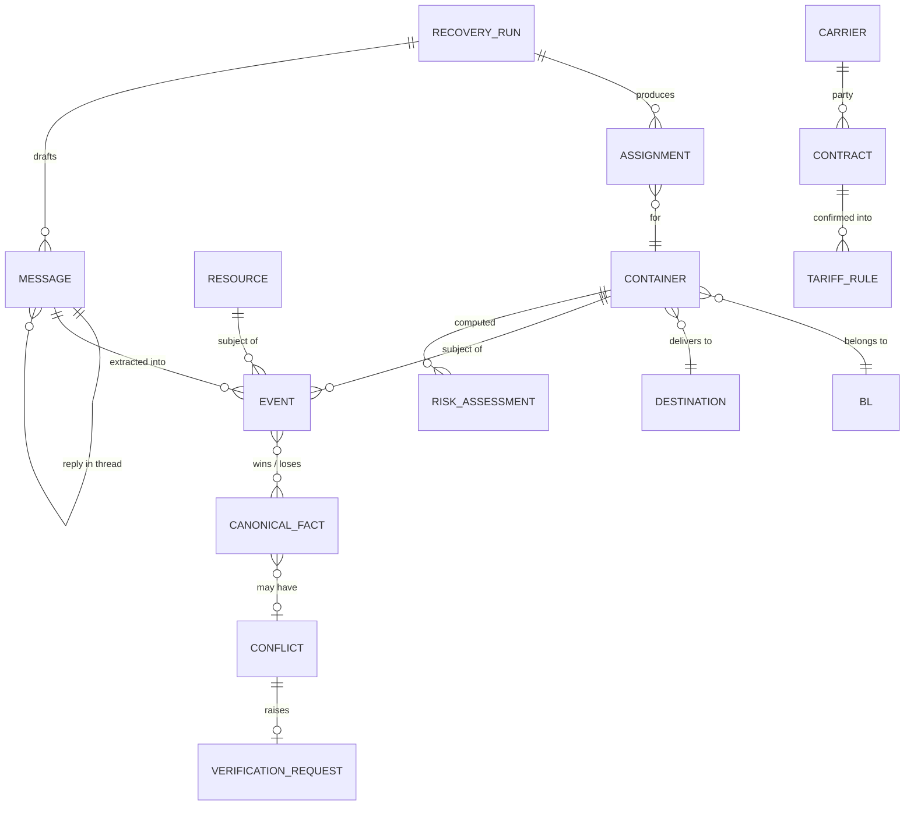

# 04. 도메인 모델

- 상태: Draft (기획 v0.2)
- 최종 수정: 2026-09-11 (T-032: 2절 컨테이너 상태 모델을 Hybrid로 확정안 작성, 3절 사실 키 정리)
- 관련: `05_event-and-state.md`(Event·Canonical State), `08_optimization-model.md`(최적화), ADR-005, ADR-006, ADR-019, ADR-021
- 스키마 확정: T-032(Event·Canonical State, 완료 대기 검토), T-033(Contract·Tariff)

이 문서는 **무엇을 다루는가**(엔티티, 상태, 비용, 위험)를 정의한다. 값이 **어떻게 믿을 만한 상태가 되는가**는 `05_event-and-state.md`가 정한다.

---

## 1. 엔티티



| 엔티티 | 설명 | 정의 위치 |
| --- | --- | --- |
| Container | 감시·운영 대상 컨테이너(ISO 6346 번호) | 이 문서 2절 |
| BL | B/L(MBL/HBL, 연도, 화물관리번호, 적하목록관리번호, MSN) | `data/field-dictionary.md` |
| Destination | 목적지(창고·공장). 입고 시간대, 일일 수용량 | 3절 |
| Resource | 창고 수용량, 트럭 풀, ODCY, VBS 슬롯 | 3절 |
| Contract / TariffRule / RateQuote | 계약 원문, 확정 규칙, 견적 | 4절 |
| Event | 출처·권한·신뢰도를 가진 사실 주장 (불변) | `05_event-and-state.md` 4절 |
| CanonicalFact | 사실 하나의 현재 결론: 값 + 차원별 상태 + 근거 | `05_event-and-state.md` 9절 |
| Conflict / VerificationRequest | 출처 충돌과 사람 확인 요청 | `05_event-and-state.md` 7·11절 |
| Planning Snapshot | 엔진 입력용으로 고정한 Canonical State | `05_event-and-state.md` 14절 |
| RiskAssessment | 위험 평가 결과(엔진 산출물, 사실 아님) | 6절 |
| RecoveryRun / Assignment | 최적화 실행과 배정 | `08_optimization-model.md` |
| Message | 발송·수신 메일(스레드, 승인 상태) | `06_agent-architecture.md` |

**사실(Event)과 산출물을 구분한다.** 위험 평가, 계획, 비용은 엔진이 계산한 산출물이며 Event Store에 "현실의 사실"로 넣지 않는다. 별도 테이블에 Run ID와 함께 저장한다.

## 2. 컨테이너 생애주기

### 2.1 모델 비교와 선택 (T-032, ADR-021 Proposed)

| 기준 | ① 단일 Lifecycle Enum (순차 전이) | ② Milestone Composition | ③ Hybrid (선택) |
| --- | --- | --- | --- |
| 구성 | 상태 하나를 전이 규칙으로 옮김 | 마일스톤 시각 사실들만 둠 | 마일스톤·통관 상태·위치 **사실** + 거기서 유도한 **단계(phase)** + **예외 오버레이** + 자원 **영향** |
| 순서가 바뀐 이벤트(입항 전 통관, 늦게 온 이력) | 약함. 전이 규칙이 거부하거나 되감아야 함 | 강함 | 강함 (사실은 순서 무관, 단계는 매번 다시 유도) |
| 여러 출처의 서로 다른 주장 | 상태 하나에 몰려 출처별 근거를 잃음 | 사실 단위로 Reconciliation 가능 | 사실 단위로 Reconciliation 가능 |
| 동시에 있는 예외 | 상태를 늘리거나 따로 둬야 함 | 따로 둬야 함 | 오버레이로 표현 |
| 화면·위험 판정의 단순함 | 좋음 | 나쁨 (사람이 조합을 읽어야 함) | 좋음 (단계 한 줄 + 근거 배지) |
| Q-22 (S1 도달 불가) | 전이표를 고쳐야 함 | 해당 없음 | 유도 규칙에서 해결 |
| 결정 | 폐기 | 단독으로는 부족 | **채택** |

- **엔진은 단계(phase)가 아니라 사실을 입력으로 쓴다.** 최적화·비용은 마일스톤과 `ready_at`(`05_event-and-state.md` 14.2)만 쓴다. 단계는 화면·위험 등급·필터용 요약이다.
- ADR-005(마일스톤 유도 + 예외 오버레이)를 이어받고, 사실의 출처가 Reconciliation이라는 점(ADR-019)과 위치·통관 상태·영향 층을 더한 것이다.

### 2.2 Hybrid 모델

**층 1 — 사실 (Canonical Fact, Reconciliation 대상)**

| 사실 | fact_kind | 비고 |
| --- | --- | --- |
| `milestone.ata`, `discharged_at`, `customs_declared_at`, `customs_cleared_at`, `do_released_at`, `gate_out_at`, `odcy_in_at`, `odcy_out_at`, `delivered_at`, `devanned_at`, `empty_returned_at` | MILESTONE | 한 번 일어나면 되돌아가지 않음 |
| `customs.status` | STATE (단조: NOT_DECLARED < DECLARED < CLEARED) | 공공 API처럼 시각 없이 상태만 주는 출처용 |
| `location` | STATE | 시뮬레이터·최적화 입력 |
| `exception.<CODE>` | STATE (bool) | 2.3 |
| `plan.pickup_at`, `plan.destination_day` | PLAN | CERA 사용자의 예정. 관측을 이기지 못함 |
| `forecast.eta` | FORECAST | 외부 예정·예상 또는 CERA 예측. `milestone.ata`와 다른 사실이며, 실제 입항이 생기면 판단에서 빠짐 |

**층 2 — 단계 (phase, 파생 뷰, 저장하지 않음)**

통관 단계 = `max(마일스톤이 말하는 단계, customs.status 값)`. 단계 유도 규칙(위에서부터 첫 번째로 맞는 것):

```text
empty_returned_at                                   → COMPLETED
devanned_at                                         → EMPTY_RETURN_PENDING
delivered_at                                        → DELIVERED
odcy_in_at 있고 (odcy_out_at 없음 또는 odcy_out_at < odcy_in_at) → TEMP_STORAGE
gate_out_at                                         → IN_TRANSIT
discharged_at, 통관 CLEARED, do_released_at           → PICKUP_READY
discharged_at, 통관 CLEARED                          → CUSTOMS_CLEARED
discharged_at, 통관 DECLARED                         → CUSTOMS_PENDING
discharged_at                                       → DISCHARGED      (통관 미신고 또는 통관 정보 없음)
그 외                                                → ARRIVING        (통관 CLEARED면 "통관 선완료" 배지)
```

- **Q-22 해결**: 옛 규칙은 `discharged_at`만 있으면 CUSTOMS_PENDING(S2)이 돼서 DISCHARGED(S1)에 도달할 수 없었다. 이제 CUSTOMS_PENDING은 **신고 근거**(`customs_declared_at` 또는 `customs.status = DECLARED`)가 있어야 하고, 통관 정보가 없거나 미신고면 DISCHARGED다. "모르는 것"을 "심사 중"으로 추정하지 않는다.
- 입항 전 통관: 양하 전인데 통관이 CLEARED면 ARRIVING + "통관 선완료" 배지. 순서가 바뀌어도 매번 사실에서 다시 유도하므로 결과는 같다(순서 무관성).
- 단계 옆에는 **근거 품질**을 함께 보여준다: 단계를 결정한 사실들 중 가장 나쁜 `decision_usability`와 출처 배지. 예: "IN_TRANSIT (근거: 운영자 확인)" vs "IN_TRANSIT (근거: 공공 API · STALE)".
- 옛 코드 S0~S9는 쓰지 않는다. 대응: S0 ARRIVING, S1 DISCHARGED, S2 CUSTOMS_PENDING, S3 CUSTOMS_CLEARED, S4 PICKUP_READY, S5 IN_TRANSIT, S6 TEMP_STORAGE, S7 DELIVERED, S8 EMPTY_RETURN_PENDING, S9 COMPLETED.
- `[TO VERIFY]` Q-32: 이 10단계가 현장에서 쓸모 있는 세분화인지. 1차 결론: PoC에는 충분하다(아래 최소 모델).

**Phase 1 구현을 위한 최소 모델**: 마일스톤 11개 + `customs.status` + `location` + `exception.CUSTOMS_HOLD`, `exception.RECEIVER_REJECT` + 위 단계 유도 규칙 + `ready_at`. 이것으로 MVP 시나리오(`09_mvp-scenario.md`)의 모든 장면을 표현할 수 있다.

### 2.3 예외 오버레이 (층 3·4)

예외는 단계와 **동시에** 있을 수 있다. 성격이 다른 세 가지를 섞지 않는다.

| 범위 | 무엇 | 저장 | 누가 만드나 |
| --- | --- | --- | --- |
| **컨테이너 예외** (층 3) | 그 컨테이너 자체의 사실 | `exception.<CODE>` Canonical Fact (Reconciliation 대상) | 출처 Event |
| **자원 조건** | 창고·트럭·ODCY·슬롯·터미널의 상태에서 나온 조건 | 자원 Canonical Fact에서 유도, 또는 `condition.<CODE>` 사실 | 자원 Event / 유도 |
| **영향** (층 4) | 자원 조건이 어느 컨테이너에 걸리는가 | 저장하지 않음. Entity View의 `impacts` | Risk Engine (결정론) |

| 코드 | 범위 | 판정 | PoC |
| --- | --- | --- | --- |
| `CUSTOMS_HOLD` | 컨테이너 예외 | `exception.CUSTOMS_HOLD = true` (DS-01 `[TO VERIFY]` 코드, 사람) → `ready_at = null` | 사용 |
| `RECEIVER_REJECT` | 컨테이너 예외 | `exception.RECEIVER_REJECT = true` (창고 담당자 A, 메일은 확인 필요) | 사용 |
| `DAMAGE_OR_SEAL` | 컨테이너 예외 | 사람 입력 | 예약 |
| `WAREHOUSE_CAPACITY_REDUCED` | 자원 조건 → 영향 | `capacity.day(D)`가 줄었고 그날 입고 예정 > 잔여 수용 | **MVP 핵심** |
| `TRUCK_SHORTAGE` | 자원 조건 → 영향 | 슬롯별 필요 트럭 > `available.slot` 합 | 사용 |
| `YARD_FULL` | 자원 조건 → 영향 | ODCY 규격별 용량 0 | 사용 |
| `VBS_UNAVAILABLE` | 자원 조건 → 영향 | 슬롯 가용 0 (가상값) | 사용 |
| `REEFER_RESOURCE_SHORTAGE` | 자원 조건 → 영향 | Reefer 플러그 부족 | 범위 밖 (예약) |
| `PORT_CONGESTION`, `WEATHER_DELAY` | 자원 조건 | `TERMINAL:<id> / condition.<CODE> = true` (사람·파트너 입력) → 리드타임 가정에 반영 | 예약 |
| `RATE_OR_CONTRACT_CONFLICT` | 자원 조건(상업) | 요율·계약 사실에 `conflict_status = OPEN`, 또는 견적과 확정 계약이 다름 | 사용 (T-033) |

- 옛 초안의 `WAREHOUSE_FULL`, `TRUCK_SHORTAGE`, `VBS_UNAVAILABLE`, `PORT_CONGESTION`, `WEATHER_DELAY`, `REEFER_CAPACITY_SHORTAGE`를 컨테이너 예외에서 **자원 조건**으로 옮겼다. 원인이 자원에 있고, 여러 컨테이너에 동시에 걸리기 때문이다. 어느 컨테이너가 영향을 받는지는 Risk가 계산한다(T-035).
- 위치(`location`)는 층 1 사실이다: `TERMINAL(t)`, `IN_TRUCK`, `ODCY(o)`, `WAREHOUSE(w)`, `EMPTY_DEPOT`. 값이 없으면 UNKNOWN이다.

## 3. 자원 모델

| 자원 | 사실 (fact_key 예) | PoC 출처 | 비고 |
| --- | --- | --- | --- |
| Warehouse (Destination) | `capacity.day(D)`: 그날 입고 가능 대수, `windows`: 입고 시간대, `accepts`: 사이즈·Reefer·DG | 창고 현장 액션, 창고 메일, 시나리오 | 시나리오: 하루 20 → 11:00에 8 |
| Truck Pool | `available.slot(s)`: 슬롯별 가용 대수, `rate.route(r)` | 시나리오(기본 8대), 운송사 회신 | 회신: "15시 2대, 17시 1대" |
| ODCY | `capacity.size_type(40DRY).day(D)`: 수용 가능 대수, `max_days`, `rate.storage_per_day(T)`, `rate.handling(T)` | 시나리오, ODCY 회신·견적 | 회신: "40FT Dry 4대, 2일, 일 35,000원" |
| VBS Slot | `available.slot(s)` (SLOT_POOL) | 시나리오 `SIMULATED` | 공개 Write API 없음 가정(R-4) |
| Terminal | `rate.storage_per_day(T)`, `condition.<CODE>`, 게이트 운영 시간 | 시나리오 `[ASSUMPTION]` | |

자원 사실도 Event로 들어온다. 메일 회신에서 LLM이 뽑은 값은 확인 전까지 `PROVISIONAL`이고, 기존 값을 크게 줄이는 내용이면 확인 전까지 보류(`HELD`)된다(`05_event-and-state.md` 8.3 R10, 부록 A.4). 전체 사실 키 카탈로그는 `05_event-and-state.md` 4.3절.

## 4. 계약·Tariff

### 4.1 흐름

```text
계약서 PDF / 메일 ──(Contract Agent, LLM)──▶ 추출 후보(DRAFT, 필드별 근거)
    ──(사람 최초 1회 확인)──▶ TariffRule 버전(CONFIRMED) ──▶ Tariff Rule Engine(결정론)
견적 메일 ──(Response Agent, LLM)──▶ RateQuote(PROVISIONAL) ──(사람 VERIFICATION 또는 권한 A 시스템 확인)──▶ CONFIRMED
                                    (계획 승인은 사실 확인이 아니다. 승인해도 PROVISIONAL로 남는다, `05` 11.5)
```

### 4.2 TariffRule (초안, T-033에서 확정)

```json
{
  "rule_id": "CARRIER_A-KRPUS-DRY20-DEM",
  "version": 1,
  "status": "DRAFT | CONFIRMED | RETIRED",
  "contract_ref": "contract:<id>",
  "carrier": "CARRIER_A",
  "port": "KRPUS",
  "equipment": { "size": "20", "type": "DRY" },
  "consignee_id": null,
  "charge_type": "DEMURRAGE | DETENTION | COMBINED_DND | STORAGE | HANDLING | TRANSPORT",
  "start_event": "DISCHARGED | GATE_OUT | ...",
  "end_event": "GATE_OUT | EMPTY_RETURNED | ...",
  "free_days": 5,
  "day_count": "CALENDAR | WORKING",
  "start_day_counts": true,
  "excluded_days": ["SUN", "KR_PUBLIC_HOLIDAY"],
  "rate_tiers": [
    { "from_day": 1, "to_day": 5,  "rate": 30, "currency": "USD", "unit": "PER_DAY" },
    { "from_day": 6, "to_day": null, "rate": 60, "currency": "USD", "unit": "PER_DAY" }
  ],
  "effective_from": "2026-07-01",
  "effective_to": null,
  "special_conditions": [],
  "priority": 100,
  "evidence": [ { "field": "free_days", "quote": "…", "page": 3 } ],
  "confirmed_by": null,
  "confirmed_at": null
}
```

- 숫자는 **자리표시 예시**다. 실제 요율이 아니다.
- 규칙 선택: 조건이 가장 구체적인 규칙이 먼저다(화주 특약 > 선사·항만·장비 > 선사 기본). 동률이면 `priority`로 정한다.
- `start_day_counts`, `day_count`, `excluded_days`, 만료 시각은 선사마다 다를 수 있다 `[TO VERIFY]` Q-08, Q-09.
- `DRAFT` 규칙은 계산에 쓰지 않는다(`01_project-rules.md` 3절).

### 4.3 RateQuote

```json
{ "quote_id": "...", "provider": "ODCY_A", "item": "STORAGE_PER_DAY", "equipment": "40DRY",
  "amount_krw": 35000, "valid_until": "...", "conditions": "최대 2일",
  "source_event_id": "...", "status": "PROVISIONAL | CONFIRMED | EXPIRED" }
```

## 5. 비용 모델

| 항목 | 계산 | 출처 |
| --- | --- | --- |
| Demurrage | Σ tier_rate × 초과일수 (기산 → 반출) | TariffRule |
| Detention | Σ tier_rate × 초과일수 (반출 → 공컨 반납) | TariffRule |
| Combined D&D | Σ tier_rate × 초과일수 (기산 → 공컨 반납) | TariffRule |
| Terminal Storage | 터미널 보관료 | `[TO VERIFY]` 터미널 요율, PoC는 `[ASSUMPTION]` |
| Terminal→ODCY 운송 | 트럭 운임 | RateQuote / 시나리오 |
| ODCY Storage | 일 보관료 × 보관일수 | RateQuote / 시나리오 |
| ODCY Handling | 반입·반출 상하차 | RateQuote / 시나리오 |
| ODCY→목적지 운송 | 트럭 운임 | RateQuote / 시나리오 |
| Terminal→목적지 운송 | 트럭 운임 | RateQuote / 시나리오 |
| Empty Return | 목적지 → 반납지 운임 | 시나리오 / 사용자 |
| Delay Penalty | 목적지 입고 지연 비용(생산 차질 등) | 사용자 `[ASSUMPTION]` |

```text
TotalCost(plan) = Σ_c Σ_item cost_item(c, plan)   (KRW 정수, 외화는 환율·기준일 기록 후 환산)
```

**"ODCY로 빼면 D&D가 사라진다"가 틀린 이유**
- Split D&D라면 터미널에서 반출하는 순간 Demurrage는 멈추지만 **Detention이 시작**된다. 여기에 ODCY 운임·보관·핸들링과 두 번째 운송비가 새로 생긴다.
- Combined D&D라면 터미널 반출과 관계없이 **시계가 계속 간다.** ODCY 이동은 터미널 보관료만 줄이고 D&D는 줄이지 못할 수 있다.
- 그래서 경로마다 총비용을 계산해 비교한다.

## 6. 위험 모델 (Risk Engine, 결정론)

### 6.1 위험 유형

| 유형 | 판정 | 입력 |
| --- | --- | --- |
| LFD_IMMINENT / LFD_PASSED | SlackTime(6.2) 기준 | LFD(확정 Tariff) + 마일스톤 |
| WAREHOUSE_SHORTFALL | 그날 입고 예정 대수 > 창고 수용량 | 창고 자원 사실 + 현재 계획 |
| TRUCK_SHORTFALL | 슬롯별 필요 트럭 > 가용 트럭 | 트럭 자원 사실 + 계획 |
| SLOT_SHORTFALL | 필요 반출 > VBS 슬롯 | 슬롯 사실(가상) |
| RECEIVER_REJECT | 예외 플래그 | 컨테이너 예외 |
| STATE_UNCERTAIN | 판단에 중요한 사실의 `decision_usability = APPROVAL_BLOCKED`(STALE, 충돌 OPEN, 보류 HELD) | Canonical 상태 (`05` 8.4) |

### 6.2 SlackTime (기획서 v0.1에서 유지)

```text
SlackTime = (다음 마감 − as_of)
          − ExpectedTruckLeadTime − ExpectedSlotWait − GateBuffer − RequiredHandlingBuffer
```

| 입력 | 출처 |
| --- | --- |
| 다음 마감 | 반출 전: Demurrage(또는 Combined) LFD. 반출 후: 공컨 반납 기한 |
| ExpectedTruckLeadTime, ExpectedSlotWait, GateBuffer | 설정값·시나리오 `[ASSUMPTION]` |
| RequiredHandlingBuffer | 설정값 `[ASSUMPTION]` (원본 기획서 예시에 값이 없음, Q-06) |

원본 기획서 예시: 남은 34h − 트럭 18h − VBS 8h − Gate 4h = 약 4h → HIGH.

### 6.3 등급 `[ASSUMPTION]` (Q-14)

| 등급 | 조건 |
| --- | --- |
| CRITICAL | SlackTime < 0, 또는 LFD 경과(과금 중), 또는 PICKUP_READY를 막는 예외가 있는데 마감까지 48h 미만 |
| HIGH | 0 ≤ SlackTime < 8h, 또는 WAREHOUSE_SHORTFALL 대상 |
| WATCH | 8h ≤ SlackTime < 24h, 또는 STATE_UNCERTAIN |
| LOW | SlackTime ≥ 24h |

같은 등급 안에서는 **놓쳤을 때 하루 비용**(Exposure at risk)이 큰 순서로 정렬한다.

### 6.4 Exposure 정의

| 용어 | 정의 |
| --- | --- |
| D&D Exposure | Baseline 계획대로 갈 때 `as_of` 이후 새로 생길 것으로 예상되는 D&D + 보관 비용 |
| Total Cost Exposure | Baseline의 TotalCost 전체(운송·보관·지연 포함) |
| Potential Saving | Baseline TotalCost − Recovery Plan TotalCost (≥ 0, 시뮬레이션 기준) |
| Realized Saving | Potential Saving 가운데 실제로 실행된 부분 (Pilot 이후 측정) |

`[TO VERIFY]` Q-02: 원본 기획서의 RECOVERABLE ₩18,720,000과 현재계획 ₩18,420,000은 정의가 불분명했다. v0.2는 위 정의로 통일한다(옛 "Recoverable Exposure" = Potential Saving).

### 6.5 Baseline `[ASSUMPTION]` (Q-07)

절감액은 Baseline에 따라 크게 달라지므로 명확히 정의한다.

1. 사용자가 입력한 현재 계획(오늘 입고 예정 목록 등)이 있으면, 새 제약 아래에서 **그 계획을 그대로 밀고 갈 때** 일어나는 일을 Baseline으로 본다. 예: 창고가 8대만 받으면 나머지는 터미널에서 대기한다.
2. 계획이 없으면 LFD 오름차순 FIFO + 직송만 쓰는 휴리스틱으로 만든다.
3. Baseline에도 Recovery와 **같은 자원 제약**을 적용한다. 그래야 절감액이 부풀려지지 않는다.
