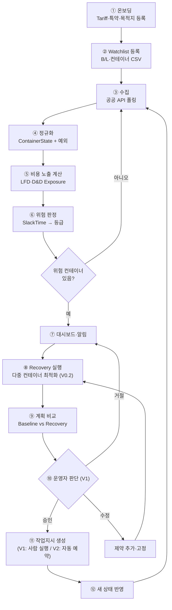
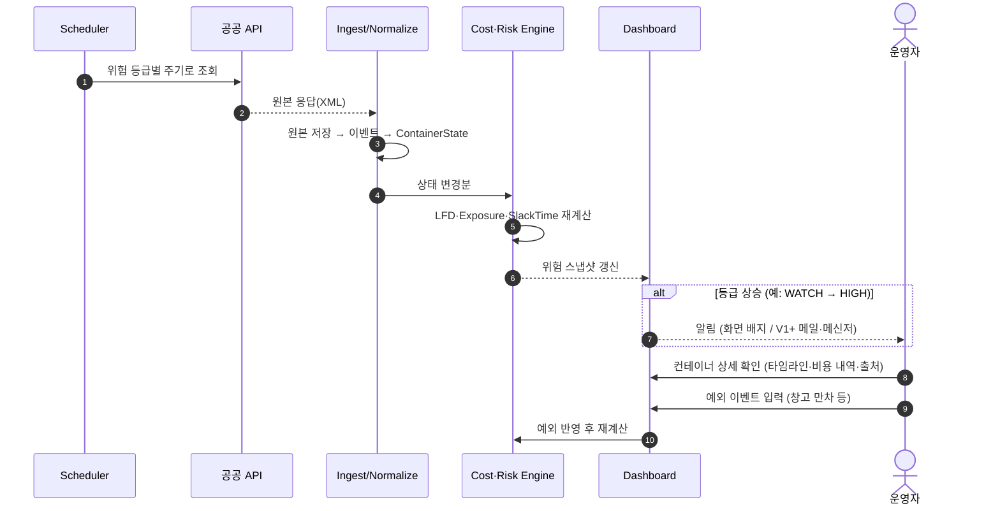

# 04. 서비스 플로우

- 상태: Draft v0.1
- 최종 수정: 2026-09-10
- 관련: `03_data-strategy.md`, `05_domain-model.md`, `07_roadmap.md`

---

## 1. 행위자

| 행위자 | 설명 |
| --- | --- |
| 운영자 (Operator) | 포워더·화주 물류팀 실무자. 위험을 확인하고 복구계획을 승인한다 |
| 관리자 (Admin) | Tariff, 특약, 목적지, 자원 시나리오를 등록한다 (PoC에서는 운영자와 같은 사람일 수 있음) |
| CERA 시스템 | 수집 → 정규화 → 비용 → 위험 → 최적화 → 계획 생성 |
| 공공 API | UNI-PASS, 해수부 외항화물컨테이너정보, 선박 입출항 |
| 외부 실행 시스템 | TMS, VBS, ODCY, EDI (V2부터 연동) |

## 2. 전체 흐름 (한눈에)



| 단계 | V0.1 | V0.2 | V1 | V2 |
| --- | --- | --- | --- | --- |
| ① ~ ⑦ | ✅ | ✅ | ✅ | ✅ |
| ⑧ ~ ⑨ | — | ✅ (가상 자원) | ✅ | ✅ |
| ⑩ ~ ⑪ | — | — | ✅ 작업지시까지 | ✅ 외부 예약·배차 |
| ⑫ 재최적화 | 재수집만 | 수동 재실행 | 이벤트 기반 재실행 | 자동 재최적화 |

## 3. 사용자 여정

### 3.1 온보딩 (최초 1회 + 변경 시)
1. 관리자가 사용하는 선사를 선택하고 Tariff를 등록한다(V0.1은 수기 구조화, 공개 Tariff 템플릿 제공).
2. 화주별 Free Time 특약을 입력한다(Combined/Split 여부 포함).
3. 목적지(창고·공장)를 등록한다: 입고 가능 시간대, 일일 처리량, Reefer 가능 여부, 위험물 가능 여부.
4. (V0.2) 자원 시나리오를 고른다: ODCY 후보, 트럭 대수, VBS 슬롯 가정.

### 3.2 Watchlist 등록
1. 운영자가 B/L·컨테이너 목록을 CSV로 올린다. 필수 열: `mbl_no`, `hbl_no`(선택), `bl_year`, `container_no`, `carrier`, `consignee`, `destination_id`.
2. 시스템이 형식을 검증한다(컨테이너 번호 체크디지트, 중복, 선사·목적지 존재 여부).
3. 초기 조회를 한 번 실행하고 결과를 보여준다: 조회 성공·실패·미발견 건수.
4. 실패 건은 사유와 함께 표시한다(키 불일치, 3년 초과, API 오류 등).

### 3.3 일상 운영 루프


### 3.4 복구계획 (V0.2 이후)
1. 운영자가 Recovery Console에서 대상(기본값: HIGH·CRITICAL 전체)과 계획 기간(기본 72시간 `[ASSUMPTION]`)을 확인한다.
2. `[Recovery 실행]` → 최적화 실행(목표: 60초 이내 `[ASSUMPTION]`).
3. 결과 화면:
   - 요약: 대상 N대, Baseline 비용, Recovery 비용, 예상 절감액, 가상 자원 포함 여부.
   - 배정표: 컨테이너별 `경로(직송 / ODCY A / ODCY B / 대기)`, 슬롯, 트럭, 컨테이너별 비용 변화.
   - 자원 사용률: ODCY 용량, 트럭, 슬롯.
   - 영향을 준 제약: 무엇 때문에 더 줄이지 못했나(예: 목적지 입고 한도).
   - 추천 이유(V0.2+ LLM 요약, 숫자는 엔진 결과만 인용).
4. 운영자가 일부를 고정하거나(`이 컨테이너는 직송 고정`) 제약을 추가해 다시 실행할 수 있다.
5. (V1) 승인하면 작업지시(Command)가 만들어진다: 배차 요청서, VBS 예약 요청 목록, ODCY 반입 요청. 실제 예약은 사람이 외부 시스템에서 한다.
6. (V1) 실행 결과(예약 완료·실패)를 입력하면 상태가 바뀌고 재최적화 대상이 된다.

## 4. 화면 목록

| ID | 화면 | 버전 | 주요 내용 |
| --- | --- | --- | --- |
| SCR-01 | Operations Dashboard | V0.1 | 활성 컨테이너 수, 등급별 분포(LOW/WATCH/HIGH/CRITICAL), 총 D&D Exposure, 위험 목록(정렬: SlackTime 오름차순), 데이터 신선도 |
| SCR-02 | Container Detail | V0.1 | 상태 타임라인(마일스톤), 활성 예외, LFD·비용 항목별 내역, SlackTime 분해, 필드별 출처 배지 |
| SCR-03 | Watchlist 관리 | V0.1 | CSV 업로드, 검증 결과, 조회 상태 |
| SCR-04 | Tariff 관리 | V0.1 | TariffRule 목록·편집, 유효기간, 출처 문서, 검증 태그 |
| SCR-05 | 목적지 관리 | V0.1 | 입고 시간대, 처리량, Reefer/위험물 여부 |
| SCR-06 | Recovery Console | V0.2 | Baseline vs Recovery, 배정표, 자원 사용률, 제약 영향, 재실행 |
| SCR-07 | 시나리오 관리 | V0.2 | 가상 자원 시나리오 선택·편집, seed |
| SCR-08 | 승인·작업지시 | V1 | 승인 대기 계획, 작업지시 목록, 실행 결과 입력, 감사 로그 |

### 4.1 SCR-01 와이어프레임 (초안)

```text
┌─────────────────────────────────────────────────────────────┐
│ CERA  Operations Dashboard            as_of 2026-09-10 14:00│
├──────────┬──────────┬──────────┬──────────┬─────────────────┤
│ ACTIVE   │ LOW      │ WATCH    │ HIGH     │ CRITICAL        │
│ 284      │ 219      │ 31       │ 22       │ 12              │
├──────────┴──────────┴──────────┴──────────┴─────────────────┤
│ TOTAL D&D EXPOSURE  ₩31,840,000   RECOVERABLE ₩(정의 Q-02)   │
├─────────────────────────────────────────────────────────────┤
│ 컨테이너    선사  상태             LFD         Slack  등급  비용│
│ ABCU123…    MSK  CUSTOMS_CLEARED  09-11 23:59  4h    HIGH  …  │
│ …                                                             │
├─────────────────────────────────────────────────────────────┤
│ 데이터 신선도: UNI-PASS 12분 전 · 해수부 47분 전 · 가상자원 포함 │
│                                         [Recovery 실행 (V0.2)] │
└─────────────────────────────────────────────────────────────┘
```
위 숫자는 기획서 예시값이며 실제 데이터가 아니다.

## 5. 알림 정책 (초안)

| 트리거 | V0.1 | V1+ |
| --- | --- | --- |
| 등급 상승 (→ HIGH, → CRITICAL) | 대시보드 배지 | 메일/메신저 |
| LFD가 이미 지남 (D&D 발생 중) | 대시보드 배지 | 메일/메신저 |
| 데이터 stale (마지막 성공 조회 > 폴링 주기 × 3) | 배지 | 메일 |
| 신규 예외 이벤트 | 배지 | 메일/메신저 |

`[ASSUMPTION]` 알림 채널(메일, 카카오 알림톡, 슬랙 등)은 고객 인터뷰 뒤 결정한다.

## 6. 예외 처리 흐름 (예: WAREHOUSE_FULL)

1. 운영자가 "목적지 D1, 9/11~9/12 입고 불가"를 입력한다.
2. D1으로 가는 컨테이너에 `WAREHOUSE_FULL` 예외가 붙는다(메인 상태는 그대로).
3. 비용 엔진이 입고 가능 시점까지 늦어질 때의 Exposure를 다시 계산한다.
4. 위험 등급이 오르면 Recovery 대상에 들어간다.
5. 최적화가 대안을 비교한다: ODCY 임시 반출, 대기, 다른 목적지(등록돼 있으면).
6. 입고가 가능해지면 운영자가 예외를 해제하고 재최적화한다.
