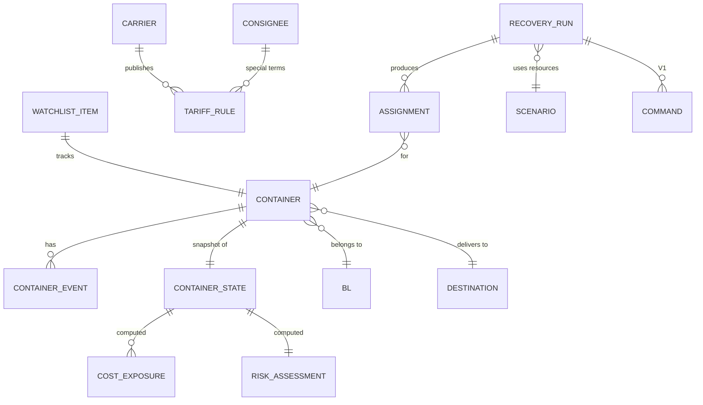
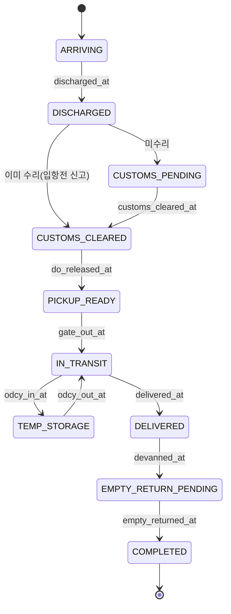

# 05. 도메인 모델 / 계산 모델

- 상태: Draft v0.1
- 최종 수정: 2026-09-10
- 관련 ADR: ADR-005(상태 머신 + 예외 오버레이), ADR-006(금액·시각 규칙), ADR-007(CP-SAT), ADR-009(2단계 최적화)

이 문서의 스키마는 **초안**이다. 확정은 T-007(ContainerState/Event), T-008(TariffRule)에서 실제 API 응답과 Tariff 문서를 보고 한다.

---

## 1. 핵심 엔티티



## 2. 컨테이너 생애주기 상태 머신

### 2.1 메인 상태 (Lifecycle)

| 코드 | 상태 | 진입 조건(마일스톤) | 주 출처 |
| --- | --- | --- | --- |
| S0 | ARRIVING | Watchlist 등록, 선박 ETA 있음, 양하 전 | DS-03, 사용자 |
| S1 | DISCHARGED | 양하·터미널 반입 확인 | DS-02 `[TO VERIFY]` 반입 이벤트 매핑 |
| S2 | CUSTOMS_PENDING | 수입신고 전 또는 심사중 | DS-01 |
| S3 | CUSTOMS_CLEARED | 수입신고수리 | DS-01 |
| S4 | PICKUP_READY | 수리 + D/O 발행 + (필요 시) 운임 결제 | DS-01 + 사용자(UI-05) |
| S5 | IN_TRANSIT | 터미널 반출(Gate out) | DS-02 / DS-01 처리이력 |
| S6 | TEMP_STORAGE | ODCY 반입 (선택) | 사용자 / DS-01 처리이력 `[TO VERIFY]` |
| S7 | DELIVERED | 목적지 도착 | 사용자 (이후 TMS) |
| S8 | EMPTY_RETURN_PENDING | 적출(Devanning) 완료, 공컨테이너 반납 대기 | 사용자 |
| S9 | COMPLETED | 공컨테이너 반납 | DS-02 `[TO VERIFY]` / 사용자 |

**설계 결정 (ADR-005, Proposed): 상태는 마일스톤에서 유도한다.**
- 입항 전 수입신고처럼 통관이 양하보다 먼저 끝날 수 있다. 그래서 상태 전이를 엄격한 선형 순서로 강제하지 않는다.
- 이벤트가 오면 마일스톤 타임스탬프(`discharged_at`, `customs_cleared_at`, `gate_out_at` 등)를 채우고, 메인 상태는 **채워진 마일스톤의 조합**으로 계산한다.
- 이벤트가 늦게 들어오거나 순서가 바뀌어도 같은 결과가 나온다(멱등·순서 무관).



유도 규칙(우선순위 높은 것부터 판정):

```text
empty_returned_at            → S9 COMPLETED
devanned_at                  → S8 EMPTY_RETURN_PENDING
delivered_at                 → S7 DELIVERED
odcy_in_at and not odcy_out_at → S6 TEMP_STORAGE
gate_out_at                  → S5 IN_TRANSIT
customs_cleared_at and do_released_at and discharged_at → S4 PICKUP_READY
customs_cleared_at and discharged_at → S3 CUSTOMS_CLEARED
discharged_at                → S2 CUSTOMS_PENDING
그 외                         → S0 ARRIVING
```

`[TO VERIFY]` S1 DISCHARGED는 양하 직후 통관 정보가 아직 없는 짧은 구간이다. 실제 데이터에서 S1과 S2를 구분할 수 있는지 T-009에서 확인한다.

### 2.2 예외 상태 (Exception Overlay)

예외는 메인 상태와 **동시에** 존재할 수 있으므로 메인 상태가 아닌 **플래그 목록**으로 둔다.

| 코드 | 의미 | 주 출처 | 영향 |
| --- | --- | --- | --- |
| WAREHOUSE_FULL | 목적지 입고 불가 | 사용자 | 직송 불가 구간 생성 |
| CUSTOMS_HOLD | 세관 보류·검사 | DS-01 `[TO VERIFY]` 코드 | PICKUP_READY 진입 차단 |
| TRUCK_SHORTAGE | 트럭 부족 | 사용자 / 시나리오 | 트럭 용량 감소 |
| VBS_UNAVAILABLE | 반출입 예약 슬롯 없음 | 사용자 / 시나리오 | 슬롯 용량 감소 |
| PORT_CONGESTION | 항만 혼잡 | 사용자 / DS-03 | 대기시간 증가 |
| WEATHER_DELAY | 기상 지연 | 사용자 | 대기시간·운송 불가 구간 |
| RECEIVER_REJECT | 수령 거부 | 사용자 | 목적지 변경 필요 |
| REEFER_CAPACITY_SHORTAGE | Reefer 전원·보관 부족 | 사용자 / 시나리오 | Reefer 경로 제한 |

```json
{ "type": "WAREHOUSE_FULL", "active_from": "...", "active_to": "...", "scope": {"destination_id": "D1"},
  "source": "USER_INPUT", "note": "...", "created_by": "..." }
```

## 3. 스키마 초안

### 3.1 ContainerEvent

```json
{
  "event_id": "sha256(container_no|event_type|occurred_at|source)",
  "container_no": "ABCU1234567",
  "bl_no": "MASKED",
  "event_type": "DISCHARGED | CUSTOMS_DECLARED | CUSTOMS_CLEARED | CUSTOMS_HOLD | DO_RELEASED | GATE_OUT | ODCY_IN | ODCY_OUT | DELIVERED | DEVANNED | EMPTY_RETURNED",
  "occurred_at": "2026-09-09T08:10:00+09:00",
  "observed_at": "2026-09-09T09:02:11+09:00",
  "source": "DS-01 | DS-02 | DS-03 | USER_INPUT | SIMULATED",
  "raw_ref": "raw_responses:<id>",
  "attributes": { "location": "장치장명", "terminal": "..." }
}
```

`occurred_at`(실제 발생)과 `observed_at`(시스템이 안 시각)을 분리한다. 둘의 차이가 API 반영 지연(R-1)의 측정값이 된다.

### 3.2 ContainerState

```json
{
  "container_no": "ABCU1234567",
  "bl": { "mbl_no": "MASKED", "hbl_no": null, "bl_year": 2026, "cargo_mgmt_no": "MASKED" },
  "carrier": "MAERSK",
  "consignee_id": "C001",
  "vessel": { "name": "...", "call_sign": "...", "voyage": "..." },
  "port": "KRPUS",
  "terminal": "...",
  "equipment": { "size": "20 | 40 | 45", "type": "DRY | REEFER | OPEN_TOP | FLAT_RACK | TANK", "is_dg": false },
  "destination_id": "D1",
  "lifecycle_state": "S3_CUSTOMS_CLEARED",
  "milestones": {
    "eta": null, "ata": null, "discharged_at": null, "customs_declared_at": null,
    "customs_cleared_at": null, "do_released_at": null, "gate_out_at": null,
    "odcy_in_at": null, "odcy_out_at": null, "delivered_at": null,
    "devanned_at": null, "empty_returned_at": null
  },
  "exceptions": [],
  "planned_pickup_at": null,
  "last_seen_at": { "DS-01": "...", "DS-02": "..." },
  "as_of": "2026-09-10T14:00:00+09:00",
  "provenance": { "<field path>": { "kind": "PUBLIC_API", "source": "DS-01", "as_of": "...", "tag": "VERIFIED" } }
}
```

### 3.3 TariffRule

기획서 스키마에 기산 기준과 출처를 보탰다. LFD를 "하선일 + Free Time" 공식 하나로 고정하지 않는다.

```json
{
  "rule_id": "MAERSK-KRPUS-DRY20-DEM-2026Q3",
  "carrier": "MAERSK",
  "port": "KRPUS",
  "equipment": { "size": "20", "type": "DRY" },
  "consignee_id": null,
  "charge_type": "DEMURRAGE | DETENTION | COMBINED_DND | STORAGE",
  "start_event": "DISCHARGED | GATE_OUT | ...",
  "end_event": "GATE_OUT | EMPTY_RETURNED | ...",
  "free_days": 5,
  "day_count": "CALENDAR | WORKING",
  "start_day_counts": true,
  "excluded_days": ["SUN", "KR_PUBLIC_HOLIDAY"],
  "rate_tiers": [
    { "from_day": 1, "to_day": 5,  "rate": 30, "currency": "USD", "unit": "PER_DAY" },
    { "from_day": 6, "to_day": null, "rate": 60, "currency": "USD", "unit": "PER_DAY" }
  ],
  "effective_from": "2026-07-01",
  "effective_to": null,
  "special_conditions": [],
  "priority": 100,
  "source": { "kind": "TARIFF_DOC", "url": "...", "captured_at": "2026-09-10", "tag": "TO VERIFY" }
}
```

- 위 숫자는 **자리표시 예시**다. 실제 요율이 아니다.
- 규칙 선택: 조건이 가장 구체적인 규칙 우선(화주 특약 > 선사·항만·장비 > 선사 기본). 동률이면 `priority`로 정한다.
- `start_day_counts`, `day_count`, `excluded_days`는 선사마다 다를 수 있다. `[TO VERIFY]` Q-08.

### 3.4 자원 (V0.2, 시나리오)

```yaml
scenario_id: busan-peak-01
seed: 42
horizon: { start: "2026-09-10T14:00:00+09:00", hours: 72, slot_minutes: 120 }  # [ASSUMPTION]
trucks:   { per_slot: [8, 8, 6, ...], cost_per_trip_krw: { TERMINAL->D1: 350000 } }   # SIMULATED
vbs:      { per_slot: [12, 12, 10, ...] }                                              # SIMULATED
odcy:
  - { id: ODCY_A, capacity_teu: 40, storage_krw_per_day: { "20": 15000, "40": 25000 }, handling_krw: 60000 }  # SIMULATED
destinations:
  - { id: D1, windows: [{ from: "08:00", to: "17:00" }], capacity_per_day: 15, reefer: false, dg: false }  # USER_INPUT
```

## 4. 계산 모델

### 4.1 LFD (Last Free Day)

```text
LFD(charge) = start_event_date ⊕ free_days   (day_count, start_day_counts, excluded_days 규칙 적용)
만료 시각    = LFD 23:59:59 Asia/Seoul        [TO VERIFY] 선사별 기준
```

- 컨테이너 상태에 따라 **지금 달리는 시계**가 다르다.
  - 반출 전: Demurrage(또는 Combined) 시계 → 다음 마감 = Demurrage LFD.
  - 반출 후: Detention(또는 Combined) 시계 → 다음 마감 = 공컨테이너 반납 기한.
- 시작 이벤트가 아직 없으면(S0) LFD는 **예상값**이다(ETA 기반). UI에 "예상"으로 표시한다.

### 4.2 비용 항목 (TotalCost)

| 항목 | 계산 | 출처 |
| --- | --- | --- |
| Demurrage | Σ tier_rate × 초과일수 (start → gate out) | TariffRule |
| Detention | Σ tier_rate × 초과일수 (gate out → 공컨 반납) | TariffRule |
| Combined D&D | Σ tier_rate × 초과일수 (양하 → 공컨 반납) | TariffRule |
| Terminal Storage | 터미널 자체 보관료 | `[TO VERIFY]` 터미널 요율 |
| Terminal Handling | 추가 상하차·이적 | `[TO VERIFY]` |
| Terminal→ODCY Transport | 트럭 운임 | SIMULATED |
| ODCY Storage | 일 보관료 × 보관일수 | SIMULATED |
| ODCY Handling | 반입·반출 상하차 | SIMULATED |
| ODCY→Destination Transport | 트럭 운임 | SIMULATED |
| Empty Return Cost | 목적지 → 공컨 반납지 운임 | SIMULATED / USER_INPUT |
| Delay Penalty | 목적지 지연 비용(생산 차질 등) | USER_INPUT `[ASSUMPTION]` |

```text
TotalCost(plan) = Σ_c Σ_item cost_item(c, plan)      (KRW 정수, 외화는 환율·기준일 기록 후 환산)
```

**예: "ODCY로 빼면 D&D가 사라진다"가 틀린 이유**
- Split D&D라면 ODCY 반출 순간 Demurrage는 멈추지만 **Detention이 시작**된다. 여기에 ODCY 운임·보관·핸들링과 두 번째 운송비가 새로 생긴다.
- Combined D&D라면 터미널 반출과 관계없이 **시계가 계속 간다.** ODCY 이동은 터미널 보관료만 줄이고 D&D는 줄이지 못할 수 있다.
- 그래서 경로마다 총비용을 계산해 비교한다.

### 4.3 위험 판정 (Risk Engine)

```text
SlackTime = (다음 마감 − as_of)
          − ExpectedTruckLeadTime
          − ExpectedSlotWait
          − GateBuffer
          − RequiredHandlingBuffer
```

| 입력 | V0.1 출처 |
| --- | --- |
| 다음 마감 | 4.1의 LFD |
| ExpectedTruckLeadTime | 설정값 / 시나리오 `[ASSUMPTION]` |
| ExpectedSlotWait | 설정값 / 시나리오 `[ASSUMPTION]` |
| GateBuffer | 설정값 `[ASSUMPTION]` |
| RequiredHandlingBuffer | 설정값 `[ASSUMPTION]` (기획서 예시에는 값이 없음, Q-06) |

기획서 예시: 남은 34h − 트럭 18h − VBS 8h − Gate 4h = **약 4h** → HIGH.

위험 등급 `[ASSUMPTION]` (기획서에 기준 없음, 인터뷰로 보정):

| 등급 | 조건 |
| --- | --- |
| CRITICAL | SlackTime < 0, 또는 이미 과금 중(LFD 경과), 또는 PICKUP_READY를 막는 예외(CUSTOMS_HOLD 등)가 있는데 마감까지 48h 미만 |
| HIGH | 0 ≤ SlackTime < 8h |
| WATCH | 8h ≤ SlackTime < 24h |
| LOW | SlackTime ≥ 24h |

같은 등급 안에서는 **놓쳤을 때 하루 비용**(Exposure at risk)이 큰 순서로 정렬한다.

### 4.4 Exposure 정의

| 용어 | 정의 (초안) |
| --- | --- |
| D&D Exposure | 현재 계획(Baseline)대로 진행할 때 as_of 이후 새로 생길 것으로 예상되는 D&D + Storage 비용 |
| Total Cost Exposure | Baseline의 TotalCost 전체(운송·보관·지연 포함) |
| Recoverable Exposure | Baseline TotalCost − Recovery Plan TotalCost (≥ 0) |
| Recovery Saving | Recoverable Exposure 가운데 실제로 실행된 부분(V1 이후 측정) |

`[TO VERIFY]` 기획서 대시보드의 RECOVERABLE ₩18,720,000과 콘솔의 현재계획 ₩18,420,000은 정의가 불분명하다(Q-02). 위 정의로 통일하고 사람 확인을 받는다.

### 4.5 Baseline 정의 `[ASSUMPTION]` (Q-07)

절감액은 Baseline에 따라 크게 달라지므로 명확히 정의해야 한다.

1. 사용자가 입력한 현재 반출 계획(`planned_pickup_at`)이 있으면 그 계획을 그대로 수행한다고 본다.
2. 없으면 **LFD 오름차순 FIFO, 직송만, 같은 자원 용량 제약** 휴리스틱으로 만든다.
3. Baseline에도 Recovery와 **같은 자원 제약**을 적용한다. 그래야 절감액이 부풀려지지 않는다.

## 5. 최적화 모델 (V0.2)

### 5.1 규모와 분해 (ADR-009, Proposed)

기획서의 결정변수 `x[c, y, t, s]`(컨테이너 × 목적지 × 트럭 × 슬롯)를 그대로 쓰면
100 × 7 × 20 × 36 ≈ 50만 개 불리언이 된다. 그래서 두 단계로 나눈다.

- **1단계 (배정)**: `x[c, r, s]`. 컨테이너 c를 경로 r로 슬롯 s에 반출한다. 트럭은 슬롯별 **대수 용량**으로만 다룬다.
  규모: 100 × 7 × 36 ≈ 2.5만 개 → CP-SAT로 풀 수 있는 범위로 본다 `[ASSUMPTION]` (T-015에서 벤치마크).
- **2단계 (차량 배정·순서)**: 1단계 결과를 받아 슬롯마다 개별 트럭 배정과 순서를 정한다(scheduling/VRP). V1 이후.

### 5.2 1단계 정식화

```text
집합
  C : 대상 컨테이너 (HIGH·CRITICAL, 설정 가능)
  R_c : 컨테이너 c의 경로 후보 = {DIRECT(d_c)} ∪ {ODCY_o | o ∈ O}
  S : 계획 기간의 시간 슬롯

변수
  x[c,r,s] ∈ {0,1}   c를 경로 r로 슬롯 s에 터미널 반출
  w[c]     ∈ {0,1}   계획 기간 안에 이동하지 않음(대기)

제약
  (1) 배정      Σ_{r,s} x[c,r,s] + w[c] = 1                          ∀c
  (2) 반출 가능  x[c,r,s] = 0  if  슬롯 s에 c가 PICKUP_READY가 아님 (통관·D/O·예외)
  (3) 장비 적합  x[c,r,s] = 0  if  경로 r이 c를 받을 수 없음 (Reefer plug, 위험물, 사이즈)
  (4) 트럭       Σ_{c,r} trips(c,r) · x[c,r,s] ≤ Truck_s                ∀s
  (5) VBS 슬롯   Σ_{c,r} x[c,r,s] ≤ VBS_s                               ∀s
  (6) ODCY 용량  슬롯 s 시점에 ODCY_o에 머무는 컨테이너 TEU 합 ≤ Cap_o      ∀o,s
  (7) 목적지     직송 도착이 목적지 입고 시간대 안이어야 하고, 일일 입고량 ≤ Cap_d,day
  (8) 공컨 반납  반납 기한 관련 비용은 cost[c,r,s]에 반영(하드 제약은 V1에서 검토)

목적
  minimize Σ cost[c,r,s] · x[c,r,s] + Σ cost_wait[c] · w[c]
```

- `cost[c,r,s]`와 `cost_wait[c]`는 **비용 엔진이 미리 계산한 KRW 정수**다. 옵티마이저는 비용 규칙을 모른다. 이렇게 하면 "숫자는 결정론적 엔진에서만" 원칙이 지켜진다.
- ODCY 경로의 두 번째 운송(ODCY→목적지) 시점은 1단계에서 **가장 이른 목적지 입고 가능 시각**으로 고정해 비용에 반영한다 `[ASSUMPTION]`.
- 운영자 고정(`이 컨테이너는 직송`)은 변수 고정 제약으로 넣는다.

### 5.3 출력

```json
{
  "run_id": "...", "as_of": "...", "scenario_id": "...", "seed": 42,
  "input_hash": "sha256(...)", "rule_versions": ["..."], "solver": { "status": "OPTIMAL | FEASIBLE", "time_ms": 0, "gap": 0.0 },
  "baseline_cost_krw": 0, "recovery_cost_krw": 0, "saving_krw": 0,
  "contains_simulated": true,
  "assignments": [ { "container_no": "...", "route": "ODCY_A", "slot": "2026-09-10T16:00+09:00", "cost_krw": 0, "baseline_cost_krw": 0 } ],
  "binding_constraints": [ { "type": "DEST_CAPACITY", "ref": "D1@2026-09-11", "shadow_note": "..." } ]
}
```

## 6. 작업지시 (V1)

```json
{ "command_id": "...", "run_id": "...", "type": "TRUCK_REQUEST | VBS_BOOKING_REQUEST | ODCY_INBOUND_REQUEST",
  "status": "DRAFT | APPROVED | SENT_MANUALLY | CONFIRMED | FAILED", "payload": {}, "approved_by": null, "approved_at": null }
```

V1에서는 `SENT_MANUALLY`까지만 있다. 외부 시스템에 자동으로 보내는 상태는 V2에서 추가한다.
