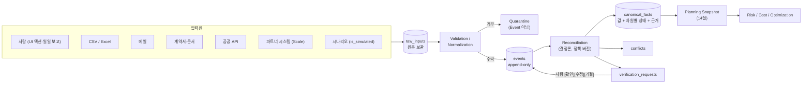

# 05. 이벤트·상태 아키텍처 (Operational Event → Canonical Operational State)

- 상태: **구조 승인됨** — 이 문서가 정의하는 **구조**(Reconciliation, 출처 3축, 상태 차원 분리, 컨테이너 Hybrid)는 2026-09-16 사람 결정으로 확정됐다(ADR-019·020·021 `Accepted (구조 한정)`). **15절의 정책 파라미터 값은 계속 검증한다**(Q-23·Q-24). 기획 v0.2
- 최종 수정: 2026-09-15 (T-060: `RECEIVED_ONLY`는 STALE이 아니라 신선도 `UNKNOWN`. `temporal_quality` → `evidence_time_quality`, `temporal_confidence` 추가. 5.2·5.3·6.2·8.4·9.1·14·15절)
- 이전 수정: 2026-09-11 (T-032)
- **완료 상태**: T-060 수정으로 Event/State 설계는 완료 상태다(사람 검토 T-001은 별도로 남음). 다음 개발 순서는 `12_roadmap.md` 2.5절(Prototype-led Discovery)
- 관련 ADR: ADR-013(저장 방식, Proposed), ADR-014(Freshness, Proposed), ADR-017(사람 확인 게이트, Proposed), **ADR-019(Reconciliation Policy, Accepted 구조 한정)**, **ADR-020(상태 차원 분리·출처 모델, Accepted 구조 한정)**, **ADR-021(컨테이너 상태 모델, Accepted 구조 한정**, `04_domain-model.md` 2절). ADR-012의 전역 우선순위 규칙은 ADR-019로 대체
- **2026-09-18 T-070 — 정본 관계 (이 문서를 구현 명세로 읽기 전에).**
  - **Event·State 의 개념적 행동 규칙**(Reconciliation R1~R12, 출처 3축의 구조, 상태 차원 분리, 신선도, 확인·보류, 사건 부류 OBSERVATION·CORRECTION·VERIFICATION)의 정본은 **이 문서 + 승인된 `21_cera-conceptual-data-model.md`** 다.
  - **논리 DB 의 표·필드·제약**의 정본은 **`22_cera-logical-data-model.md`(rev.2.2)** 다. 이 문서의 `events`·`raw_inputs`·`canonical_facts`·`conflicts`·`verification_requests`·`planning_snapshots`·`plan_decisions` 와 **4.2절 Event 필드표는 저장 명세가 아니다** — 표 이름은 `event`·`raw_input`·`canonical_fact`·`conflict`·`verification_request`(+ `_handling`)·`planning_snapshot`(+ 자식 표)·`plan_decision` 이고, 필드는 `22` 를 따른다.
  - **2026-09-21 T-081 에서 네 곳이 모두 닫혔다.** `docs/22` **rev.2.3** 이 4.2절 필드표와 한 줄씩 대조됐고(대응표는 `22` **23.1절**, **누락 0건**), 이제 이 문서와 `22` 는 같은 것을 말한다.
    - ① 사람 확인·정정 → `event.event_class`·`verification_action`·`verification_method` + 새 표 **`event_verification_target`**(`TARGET`/`OVERRULED`). `22` 11.2a
    - ② 검증기 `confidence` → `event.input_confidence_level`(+ `input_confidence_reasons`). `input_quality`(입력 형태)와 **다른 축**이고, 의미가 정의된 적 없던 `canonical_fact.confidence` 는 제거됐다. `22` 11.2b · 11.4.2
    - ③ 출처 종류 → **3.1절의 7값으로 통일**(2026-09-21 사용자 결정). `22` 의 `source_kind` 6값은 폐기되고 `event.source_type`·`raw_input.source_type` 이 같은 집합을 쓴다. `22` 11.2c. **Q-46 은 그대로 OPEN** — 7값은 현재 ADR-020 기준의 정렬이지 영구 확정이 아니다
    - ④ 나머지 필드 → `event_type`·`schema_version`·`idempotency_key`(UNIQUE)·`correlation_id`·`payload`·`source_id`·`extraction_method` 전부 `22` 에 있다. `22` 11.2d
  - **2026-09-21 Q-44 결정**: 메일의 `source_recorded_at` 선택 규칙을 5.2절 어댑터 매핑 표의 `EMAIL` 행에 반영했다. 근거 시각은 **채널 수신 시각보다 늦을 수 없다** — 미래 `Date` 로 최신처럼 위장하는 것을 막는다(`22` 11.2e).
  - **2026-09-21 Q-45 결정**: 원문(`raw_inputs`)은 **기록 행은 영구히 남고 원문 내용만 보관 정책에 따라 파기될 수 있다.** 1절 원칙의 "원문 보존"은 **원문이 보관된 동안** 재파싱·재추출을 보장한다는 뜻이다. 원문이 파기돼도 Event → Canonical 재계산과 스냅샷 재현은 그대로 된다(`22` 29절).
  - **덧붙여 6.2절의 상태 차원도 `22` 에 복구됐다**(rev.2.3). `canonical_fact` 가 `value_status`·`freshness_status`·`conflict_status`·`hold_status`·`decision_usability` + `verification_basis` 를 따로 갖는다(ADR-020). 한 enum 으로 합쳐져 있던 rev.2.2 는 **R10 보류와 계획 승인 차단을 표현하지 못했다**.
- 이 문서가 답하는 질문: **서로 다른 출처가 서로 다른 현실을 말할 때, CERA는 어떤 근거로 현재 운영 상태를 정하는가?**

## 0. 결정 수준 표기

| 표기 | 뜻 |
| --- | --- |
| `[DECIDED]` | `Accepted` ADR 또는 `01_project-rules.md`에 확정된 내용 |
| `[PROPOSED]` | 이 문서의 설계 결정. 사람 검토(T-001) 전 |
| `[ASSUMPTION]` | PoC 데모용 파라미터 값. 현장 검증 전 임시값 |
| `[TO VERIFY]` | 현업·실측으로 확인해야 하는 사실·값. `15_open-questions.md`에 항목 있음 |
| `[VERIFIED]` | 1차 출처로 확인된 사실 |

이 문서의 구조·규칙은 별도 표시가 없으면 `[PROPOSED]`다.

---

## 1. 원칙

1. 공공 API를 포함해 **어느 출처도 단일 진실원천이 아니다** (ADR-011).
2. **Event가 원본이고, Canonical State는 Event에서 계산한 파생 상태다.** Event는 "어느 출처가 무엇을 언제 주장했다"는 기록일 뿐 현실 그 자체가 아니다.
3. Canonical State는 **(Event 집합, 정책 버전, `as_of`)의 순수 함수**다. 같은 입력이면 같은 결과가 나온다.
4. 출처 우선순위는 **절대 서열이 아니다.** 사실의 종류, 출처의 권한, 확인 여부, 신선도, 발생 시각, 정정 관계를 함께 본다(8절).
5. 출처가 서로 다른 말을 하면 조용히 덮어쓰지 않는다. 자동으로 정할 근거가 있으면 정하고 근거를 남긴다. 근거가 없으면 **Conflict로 드러내고 사람에게 묻는다.**
6. 사람 확인은 정식 입력이다. 사람이 확인하거나 고치면 **새 Event**가 생긴다. 기존 Event는 수정하지 않는다.
7. 모든 Canonical 값은 **"왜 이 값인가"**를 설명할 수 있어야 한다: 이긴 Event, 진 Event, 적용된 규칙, 정책 버전.



## 2. 개념 모델

| 개념 | 정의 | 저장 |
| --- | --- | --- |
| **Event** | 하나의 출처가 하나의 사실에 대해 한 주장. 불변 | `events` (INSERT만) |
| **Fact** | `(entity_type, entity_id, fact_key)`로 식별하는 사실 한 칸. 예: `WAREHOUSE:WAREHOUSE_A / capacity.day(2026-10-05)` | 개념 (키) |
| **Canonical Fact** | 한 Fact에 대한 현재 결론: 값, 차원별 상태, 근거 Event, 적용 규칙 | `canonical_facts` (파생) |
| **Entity View** | 한 엔티티의 Canonical Fact 묶음 + 파생 뷰(컨테이너 단계, 영향) | 조회 시 조립 |
| **Planning Snapshot** | 특정 `as_of`의 Canonical State를 엔진 입력용으로 고정한 불변 묶음 | `planning_snapshots` (14절) |

### 2.1 사실의 종류 (fact_kind)

Reconciliation 규칙은 사실의 종류마다 다르다. 모든 `fact_key`는 아래 종류 중 하나에 속한다(4.3절 카탈로그).

| fact_kind | 뜻 | 값 | 예 | 신선도 적용 |
| --- | --- | --- | --- | --- |
| `MILESTONE` | 한 번 일어나면 되돌아가지 않는 사건과 그 시각 | 시각 | `milestone.gate_out_at` | 값이 있으면 적용 안 함 (N/A) |
| `STATE` | 지금 이 순간의 값. 시간에 따라 바뀐다 | 코드·정수·bool | `customs.status`, `location`, `capacity.day(D)` | 적용 |
| `OFFER` | 특정 미래 시간창에 대한 가용·약속 | 정수 | `available.slot(2026-10-05T15:00)` | 적용 + 시간창이 지나면 `EXPIRED` |
| `TERM` | 계약·요율처럼 적용기간이 있는 조건 | 구조체 | Tariff 조건, `rate.storage_per_day(40DRY)` | 적용기간으로 판단 |
| `IDENTITY` | 식별·연결 정보 | 참조 | `bl.link`, `equipment.size_type`, `vessel_call.link` | 적용 안 함 |
| `PLAN` | **CERA 사용자가 세운** 예정(현실 관측 아님) | 시각·참조 | `plan.pickup_at`, `plan.destination_day` | 적용 안 함. 관측 사실을 절대 이기지 못함 |
| `FORECAST` | 외부 시스템이 알린 **예정·예상값** 또는 CERA의 **예측값**. 아직 일어나지 않은 일에 대한 추정 | 시각·정수 | `forecast.eta` | 적용 (예상도 늙는다). 짝이 되는 실제 MILESTONE이 생기면 판단에서 빠짐(R7-f) |

- **예정(PLAN)·예상(FORECAST)과 관측(MILESTONE·STATE)은 서로 다른 `fact_key`다.** 예정·예상이 관측을 덮어쓰는 일은 구조상 생기지 않는다. 모순되면 교차 규칙(R7)이 영향(impact)으로 표시한다.
- PLAN과 FORECAST를 나눈 이유: PLAN은 CERA 사용자의 의도라서 권한자가 운영자다. ETA 같은 FORECAST는 선사·항만 시스템·예측 모델이 내는 추정이라 권한자가 다르고, 시간이 지나면 늙는다. 선박 스케줄상 도착(scheduled)과 추정 도착(estimated), CERA 예측(predicted)은 **같은 `forecast.eta`**로 두고 `payload.forecast_kind`로만 구분한다(MVP 과설계 방지).
- `OFFER`는 제공자별 엔티티에 붙는다(`TRUCK_POOL:CARRIER_B`). 서로 다른 제공자의 제안은 **합산 관계**이고, 같은 제공자의 새 제안은 **대체 관계**다.

## 3. Source Model (ADR-020)

### 3.1 출처를 세 축으로 나눈다

| 축 | 필드 | 뜻 | 값 |
| --- | --- | --- | --- |
| 채널 | `source_type` | 어떤 경로로 들어왔나 | `HUMAN_UI`, `FILE_IMPORT`, `EMAIL`, `DOCUMENT`, `PUBLIC_API`, `PARTNER_SYSTEM`, `INFERENCE` |
| 역할 | `source_role` | 현실에서 누가 말했나(권한 판단 기준) | `OPERATOR`, `WAREHOUSE`, `TRUCKING`, `ODCY`, `SHIPPING_LINE`, `TERMINAL`, `CUSTOMS_SYSTEM`, `PORT_SYSTEM`, `CERA_ENGINE` |
| 추출 방식 | `extraction.method` | 원문에서 값을 어떻게 뽑았나 | `DIRECT`(구조화 입력), `RULE_PARSED`(결정론 파서), `LLM_EXTRACTED`, `CALCULATED` |

- `source_id`는 구체적인 주체다: 사용자 ID, 파트너 시스템 ID, 공공 API ID(`DS-01`), 메일 발신자 등록 ID. `source_org`는 역할이 속한 조직(예: `CARRIER_B`)으로, **자기 소유 자원에 대해서만 권한**을 인정할 때 쓴다.
- 메일 발신자의 역할·조직은 **상대방 등록부**(counterparty registry)로 결정론적으로 정한다. LLM이 정하지 않는다.
- **시뮬레이션은 출처 유형이 아니다.** 시나리오 이벤트는 흉내 내는 출처의 세 축을 그대로 쓰고 `is_simulated = true`만 다르다(ADR-018). 그래야 데모와 실제가 같은 규칙을 탄다.

**옛 값과의 대응** (v0.2 초안의 `source_type`은 채널과 확인·추출 여부가 섞여 있어 폐기)

| 옛 `source_type` | 새 표현 |
| --- | --- |
| `HUMAN_CONFIRMED` | `HUMAN_UI` (+ 사람 입력은 그 자체로 확인, 6.1) 또는 다른 Event에 대한 `VERIFICATION` |
| `HUMAN_REPORTED` | `FILE_IMPORT` |
| `EMAIL_EXTRACTED` | `EMAIL` + `extraction.method = LLM_EXTRACTED` |
| `DOCUMENT_EXTRACTED` | `DOCUMENT` + `extraction.method = LLM_EXTRACTED` |
| `PUBLIC_API` / `PARTNER_SYSTEM` / `INFERRED` | 같음 (`INFERRED` → `INFERENCE`) |

### 3.2 권한 (Source Authority Matrix)

권한은 **사실 계열 × 역할**로 정한다. 같은 사람·시스템도 사실에 따라 권한이 다르다. 창고 담당자는 창고 수용량의 권한자지만 통관 상태의 권한자는 아니다.

| 등급 | 뜻 |
| --- | --- |
| `A` (Authoritative) | 그 사실을 직접 만들거나 관리하는 주체 |
| `S` (Secondary) | 권한자에게서 들은 것을 전달하거나 간접적으로 아는 주체 |
| `W` (Weak) | 소문·추정 수준. 단독으로는 약한 근거 |
| `–` | 받아들이지 않음(R1에서 제외) |

`[PROPOSED]` 초기 매트릭스. 실제 현장의 권한 구조는 `[TO VERIFY]` Q-23.

| 사실 계열 (fact family) | OPERATOR | WAREHOUSE | TRUCKING | ODCY | SHIPPING_LINE | TERMINAL | CUSTOMS_SYSTEM | PORT_SYSTEM |
| --- | --- | --- | --- | --- | --- | --- | --- | --- |
| `identity` (B/L↔컨테이너, 규격, 입항 건) | S | – | W | – | A | S | S | S |
| `vessel` (ETA·ATA) | S | – | – | – | S | S | – | A |
| `terminal_in` (양하·터미널 반입) | S | – | – | – | S | A | W | S |
| `customs` (신고·수리·보류·통관 상태) | S | – | – | – | W | – | A | – |
| `release` (D/O 발행) | S | – | – | – | A | – | – | – |
| `terminal_out` (반출·터미널 위치) | S | – | S | – | W | A | S | – |
| `odcy_stay` (ODCY 반입·반출·위치) | S | – | S | A(자기 야드) | – | – | S | – |
| `delivery` (창고 입고·수령 거부·적출) | S | A | S | – | – | – | – | – |
| `empty_return` (공컨 반납) | S | – | S | – | A | S | – | – |
| `warehouse_capacity` (수용량·시간대·일일 집계) | S | A(자기 창고) | – | – | – | – | – | – |
| `truck_availability` (슬롯별 가용·운임) | S | – | A(자기 풀) | – | – | – | – | – |
| `yard_capacity` (ODCY 용량·보관 기간) | S | – | – | A(자기 야드) | – | – | – | – |
| `slot_availability` (VBS) | W | – | S | – | – | A | – | – |
| `rate` (자기 서비스 요율·견적) | S | A(자기) | A(자기) | A(자기) | A(자기) | A(자기) | – | – |
| `contract_terms` (D&D Tariff·특약) | S | – | – | – | A | – | – | – |
| `plan` (예정) | A | – | – | – | – | – | – | – |

- `A(자기 …)`: 발화자 조직(`source_org`)이 그 엔티티의 소유자일 때만 A다. 남의 자원에 대한 말은 W로 떨어진다.
- DS-01 처리이력처럼 **B/L 단위** 관측을 컨테이너에 나눠 적용할 때는 한 등급 내린다(A→S, S→W). Q-20이 풀릴 때까지 `[PROPOSED]`.
- OPERATOR(CERA 사용자)는 대부분 S다. 운영자는 권한자에게 들은 것을 옮기는 사람이기 때문이다. 대신 운영자의 **확인(VERIFICATION)**은 사람이 책임지는 판단으로 기록된다(6.1).
- `CERA_ENGINE`(`source_type = INFERENCE`)은 매트릭스 밖이다. 추정값은 권한과 무관하게 R8(관측이 없을 때만 빈칸 채움)으로만 쓰인다.

### 3.3 근거 강도 (evidence strength)

Reconciliation은 출처 순위가 아니라 Event별 **근거 강도**(0~3)를 쓴다. 강도는 채널 × 권한 × 확인 × 추출 신뢰도로 결정론적으로 계산한다.

| source_type | 권한 A | 권한 S | 권한 W | 비고 |
| --- | --- | --- | --- | --- |
| `HUMAN_UI` | 3 | 2 | 1 | 계정을 가진 사람이 직접 입력·확인한 값 |
| `PARTNER_SYSTEM` | 3 | 2 | 1 | 권한자의 운영 시스템(TMS·WMS·TOS) |
| `PUBLIC_API` | 2 | 1 | 1 | 공식 기록이지만 반영 지연 SLA가 확인되지 않아 A도 2로 제한. R-1 실측 뒤 재검토 `[TO VERIFY]` |
| `FILE_IMPORT` | 2 | 2 | 1 | 대량 행은 한 행씩 확인되지 않으므로 최대 2 |
| `EMAIL` (LLM, 신뢰도 MEDIUM) | 1 | 1 | 0 | 자원·제안·견적 사실만. 컨테이너 사실은 0 (ADR-017) |
| `EMAIL`·`DOCUMENT` (신뢰도 LOW) | 0 | 0 | 0 | 후보로만 보관 |
| `DOCUMENT` (계약 조건) | 0 | 0 | 0 | 사람이 확인하기 전까지 DRAFT (G1) |
| `INFERENCE` | I | – | – | 관측이 없을 때만 빈칸을 채움(R8) |

- **확인에 따른 상향**: Event `e`를 사용자 `u`가 `VERIFICATION(CONFIRM)`하면 `strength(e) = max(strength(e), HUMAN_UI[u의 해당 계열 권한])`이 된다. 예: 메일에서 뽑은 트럭 가용(1)을 운영자(S)가 확인하면 2가 된다.
- **강도 0**은 Canonical 후보 자격이 없다(보관·표시만 하고, 확인 요청 대상).
- 강도는 **정책값**이다(`policy.yaml`의 `strength_table`). 바꾸면 `policy_version`이 바뀐다.

**왜 전역 순위(Human > Partner > Public > Email > Inference)를 쓰지 않나**
- 같은 "사람"도 사실에 따라 권한자일 수도 아닐 수도 있다. 운영자가 전화로 들은 트럭 대수는 운송사 TMS보다 약한 근거다.
- 강한 출처의 **오래된** 값이 약한 출처의 **최신** 값보다 항상 옳지 않다. 어제의 사람 입력보다 오늘의 파트너 시스템 값이 현실에 가깝다(CASE 2).
- 전역 순위는 이 두 가지를 표현하지 못한다. 그래서 강도는 **자격과 동률 판정**에만 쓰고, 값의 선택은 발생 시각·신선도와 함께 규칙(8절)으로 정한다.

## 4. Operational Event 스키마

### 4.1 Event 부류 (event_class)

| event_class | 뜻 | fact 주장 | 예 |
| --- | --- | --- | --- |
| `OBSERVATION` | 출처가 사실 하나를 주장 | 예 | 창고 수용량 8, 반출 14:10 |
| `CORRECTION` | 이전 Event가 **틀렸다**며 대체. `supersedes_event_id` 필수 | 예 (값 `null`이면 철회) | "10으로 잘못 입력, 8이 맞음" |
| `VERIFICATION` | 사람이 다른 Event(들)를 확인·거절·취소 | 아니오 | [확인], [거절], [확인 취소] |

"현실이 바뀌었다"(수용량이 20에서 8로 떨어짐)는 `OBSERVATION`이다. "입력이 틀렸다"(10이 아니라 8)는 `CORRECTION`이다. 둘을 구분해야 과거 재현과 감사가 맞는다.

**계획 승인(PLAN_APPROVAL)은 Event Store의 Event가 아니다.** 현실 사실에 대한 주장이 아니라 CERA 안에서 내린 결정이므로 결정 기록(`plan_decisions`)에 따로 남긴다(11.5).

### 4.2 필드

범례 — 생성: `SYS`=CERA가 채움, `SRC`=출처에서 옴, `ADP`=어댑터가 원문에서 계산. 변경: 모든 필드는 **저장 뒤 불변**(append-only). 용도: `C`=Canonical 결정에 쓰임, `A`=감사·추적용.

| 필드 | 필수 | 의미 | 생성 | 용도 |
| --- | --- | --- | --- | --- |
| `event_id` | 필수 | ULID. 전역 고유, 시간순 정렬 가능 | SYS | C(최종 동률 판정), A |
| `schema_version` | 필수 | Event 스키마 버전 | SYS | A |
| `event_class` | 필수 | OBSERVATION / CORRECTION / VERIFICATION | ADP | C |
| `event_type` | 필수 | 업무 의미(4.4 카탈로그) | ADP | C(fact_key 결정), A |
| `entity_type` | 필수 | `CONTAINER`, `BL`, `WAREHOUSE`, `TRUCK_POOL`, `ODCY`, `SLOT_POOL`, `TERMINAL`, `CONTRACT`, `VESSEL_CALL` | ADP | C |
| `entity_id` | 필수 | 엔티티 식별자(컨테이너는 ISO 6346 번호) | ADP | C |
| `fact_key` | OBSERVATION·CORRECTION 필수 | 주장하는 사실의 키(4.3) | ADP | C |
| `value` | OBSERVATION·CORRECTION 필수 | 주장 값. 타입은 fact_key가 정함. CORRECTION의 `null` = 철회 | SRC→ADP | C |
| `payload` | 선택 | 부가 정보(변경 사유 `change_reason`, 원천 코드, 시간창 등) | SRC→ADP | C(`change_reason`만), A |
| `related_entity_ids` | 선택 | 함께 영향받는 엔티티(B/L 단위 관측이 적용될 컨테이너들 등) | ADP | C(분배), A |
| `source_type` | 필수 | 채널(3.1) | ADP | C |
| `source_role` | 필수 | 역할(3.1) | ADP(등록부) | C(권한) |
| `source_org` | 선택 | 발화자 조직. 자기 소유 자원 권한 판정 | ADP(등록부) | C |
| `source_id` | 필수 | 구체 주체(사용자 ID, 시스템 ID, `DS-01`, 발신자 등록 ID) | ADP | C(정정 권한), A |
| `source_event_time` | 선택 | 출처가 그 주장에 붙인 현실 시각. MILESTONE은 사건 발생 시각, STATE·OFFER·FORECAST는 **그 값이 성립한다고 관측·단언한 시각**(5.2). 값이 바뀐 시각을 따로 알면 `payload.changed_at` | SRC | C |
| `source_recorded_at` | 선택 | 출처가 그 주장을 기록·발신한 시각(메일 발신 시각 등) | SRC | C(근거 시각 대체), A |
| `received_at` | 필수 | CERA가 원문을 받은 **운영 시각**(시뮬레이션에서는 SimClock 시각). pull 방식은 fetch 시각 | SYS | C(`as_of` 필터·근거 시각) |
| `recorded_at` | 필수 | 이 행을 DB에 쓴 **벽시계** 시각 | SYS | A |
| `confidence` | 필수 | `{level: HIGH|MEDIUM|LOW, reasons[]}`. 입력 품질. 결정론적 검증기가 정함(4.6) | SYS | C(강도 계산) |
| `extraction` | 조건부 | `method`, 그리고 LLM이면 `{model, prompt_version, schema_version, evidence[{field, quote}], validator_results}` | ADP | C(method), A |
| `supersedes_event_id` | CORRECTION 필수 | 대체 대상 Event | SRC(사람)·ADP | C |
| `target_event_ids` | VERIFICATION 필수 | 확인·거절 대상 Event 목록 | SYS(UI 액션) | C |
| `verification_action` | VERIFICATION 필수 | `CONFIRM`, `REJECT`, `REVOKE`(이전 확인·거절 취소) | SYS | C |
| `verification_method` | VERIFICATION 필수 | `DIRECT_REVIEW`(사실을 직접 보고 확인), `REQUEST_RESOLUTION`(확인 요청 처리). 계획 승인은 확인 방법이 아니다(11.5) | SYS | C(`REQUEST_RESOLUTION`이면 기각 처리), A |
| `overruled_event_ids` | 선택 (VERIFICATION) | 확인 요청을 처리하며 사람이 **고르지 않은** 후보들. 이 처리 이전에 받은 것만 | SYS | C(R1 기각) |
| `correlation_id` | 선택 | 메일 스레드, Recovery Run, 확인 요청, 시나리오 단계 | SYS | A |
| `raw_ref` | 필수 | 원문(`raw_inputs`) 참조. 사람 액션은 액션 기록 | SYS | A |
| `idempotency_key` | 필수 | `hash(raw_ref, entity, fact_key)`. 같은 원문을 두 번 처리해도 Event가 하나 | SYS | A(중복 방지) |
| `is_simulated` | 필수 | 시나리오 여부 | ADP | A(표시), C에는 영향 없음 |

**검토 요청 필드의 처리**

| 요청 필드 | 결정 | 이유 |
| --- | --- | --- |
| `entity_type`, `entity_id` | 채택 | 컨테이너 외에 창고·트럭 풀·ODCY도 사실의 주체다 |
| `container_id` | **제외** | `entity_type = CONTAINER`일 때 `entity_id`와 중복된다. 다른 엔티티의 Event가 컨테이너에 영향을 주면 `related_entity_ids`로 표현한다 |
| `source_id` | 채택 + `source_role`·`source_org` 추가 | 권한은 역할·조직으로 판정해야 한다(3.2) |
| `received_at` / `fetched_at` | `received_at` 하나로 통합 | pull 출처의 fetch 시각이 곧 수신 시각이다. fetch 요청 정보는 `raw_inputs`에 있다 |
| `source_recorded_at` | **추가** | 메일 발신 시각처럼 발생 시각과 수신 시각 사이의 세 번째 시각이다. 발생 시각이 없을 때 근거 시각으로 쓰고(5.2), R-1 지연 측정에도 쓴다 |
| `freshness` | **저장하지 않음** | `as_of`마다 달라지는 값이다. 저장하면 Event 불변 원칙과 재현성이 깨진다(5절) |
| `confidence` | 채택(입력 품질만) | 사실 계열 권한과는 다른 축이다. 강도 계산의 입력 하나일 뿐이다 |
| `verification_status` | **저장하지 않음** | 확인은 나중에 일어난다. 상태는 VERIFICATION Event로부터 계산한다(6.1) |
| `verified_by` | **대상 Event에 두지 않음** | VERIFICATION Event의 `source_id`가 곧 확인자다 |
| `supersedes_event_id` | 채택(CORRECTION 전용) | 10절 |
| `created_at` | `recorded_at`으로 명명 | 시뮬레이션에서는 운영 시각(`received_at`)과 벽시계가 다르므로 둘 다 필요하다 |
| `event_class`, `fact_key`, `value`, `schema_version`, `idempotency_key`, `raw_ref`, `is_simulated`, `target_event_ids`, `verification_action` | **추가** | 구현에 필수 |

### 4.3 fact_key 카탈로그

문법: `<영역>.<이름>[(<파라미터>)]`. 파라미터는 날짜(`D` = `YYYY-MM-DD`), 슬롯 시작 시각(ISO 8601, `+09:00`), 규격(`20DRY`, `40DRY`)이다.

| fact_key | entity_type | fact_kind | 사실 계열 | 값 타입 |
| --- | --- | --- | --- | --- |
| `bl.link` | CONTAINER | IDENTITY | identity | B/L 참조 |
| `equipment.size_type` | CONTAINER | IDENTITY | identity | `20DRY` 등 |
| `vessel_call.link` | CONTAINER | IDENTITY | identity | 입항 건 참조 |
| `forecast.eta` | CONTAINER | FORECAST | vessel | 시각 (`payload.forecast_kind`: `SCHEDULED` / `ESTIMATED` / `PREDICTED`) |
| `milestone.ata` | CONTAINER | MILESTONE | vessel | 시각 |
| `milestone.discharged_at` | CONTAINER | MILESTONE | terminal_in | 시각 |
| `milestone.customs_declared_at` | CONTAINER | MILESTONE | customs | 시각 |
| `milestone.customs_cleared_at` | CONTAINER | MILESTONE | customs | 시각 |
| `milestone.do_released_at` | CONTAINER | MILESTONE | release | 시각 |
| `milestone.gate_out_at` | CONTAINER | MILESTONE | terminal_out | 시각 |
| `milestone.odcy_in_at`, `milestone.odcy_out_at` | CONTAINER | MILESTONE | odcy_stay | 시각 |
| `milestone.delivered_at` | CONTAINER | MILESTONE | delivery | 시각 |
| `milestone.devanned_at` | CONTAINER | MILESTONE | delivery | 시각 |
| `milestone.empty_returned_at` | CONTAINER | MILESTONE | empty_return | 시각 |
| `customs.status` | CONTAINER | STATE (단조) | customs | `NOT_DECLARED` < `DECLARED` < `CLEARED` |
| `location` | CONTAINER | STATE | 주장하는 값에 따라: `TERMINAL`·`IN_TRUCK` → terminal_out, `ODCY` → odcy_stay, `WAREHOUSE` → delivery, `EMPTY_DEPOT` → empty_return | `TERMINAL(t)`, `IN_TRUCK`, `ODCY(o)`, `WAREHOUSE(w)`, `EMPTY_DEPOT` |
| `exception.<CODE>` | CONTAINER | STATE (bool) | `CUSTOMS_HOLD` → customs, `RECEIVER_REJECT` → delivery, `DAMAGE_OR_SEAL` → terminal_out (`04` 2.3) | `true` / `false` |
| `plan.pickup_at`, `plan.destination_day` | CONTAINER | PLAN | plan | 시각 / 날짜 |
| `capacity.day(D)` | WAREHOUSE | STATE | warehouse_capacity | 정수(그날 받을 수 있는 총 대수) |
| `intake.received.day(D)`, `intake.waiting.day(D)`, `capacity.remaining_reported.day(D)` | WAREHOUSE | STATE | warehouse_capacity | 정수 |
| `windows` | WAREHOUSE | TERM | warehouse_capacity | 시간대 목록 |
| `available.slot(S)` | TRUCK_POOL | OFFER | truck_availability | 정수 |
| `rate.route(<from>→<to>)` | TRUCK_POOL | TERM | rate | KRW |
| `capacity.size_type(<T>).day(D)` | ODCY | OFFER | yard_capacity | 정수 |
| `max_days` | ODCY | TERM | yard_capacity | 정수 |
| `rate.storage_per_day(<T>)`, `rate.handling(<T>)` | ODCY | TERM | rate | KRW |
| `available.slot(S)` | SLOT_POOL | OFFER | slot_availability | 정수 |
| `rate.storage_per_day(<T>)` | TERMINAL | TERM | rate | KRW |
| `condition.<CODE>` (`PORT_CONGESTION`, `WEATHER_DELAY`) | TERMINAL | STATE (bool) | terminal_out | `true` / `false` (PoC 예약) |
| `terms.<rule_id>` | CONTRACT | TERM | contract_terms | TariffRule (T-033) |

- ETA는 관측이 아니라 예정·예상이므로 `forecast.eta`(FORECAST)다. 실제 도착인 `milestone.ata`와 fact_key가 다르므로 **같은 의미가 될 수 없다**. `milestone.ata`가 생기면 `forecast.eta`는 판단에서 빠진다(R7-f). 옛 초안의 `milestones.eta` → T-032 초안 `plan.eta` → 이번 패치에서 `forecast.eta`.
- `customs.status`는 **단조 STATE**다. 순서가 앞선 단계의 옛 관측은 새 단계와 모순이 아니다(8.3 R4-c).

### 4.4 event_type 카탈로그

| event_type | event_class | 주장하는 fact_key |
| --- | --- | --- |
| `CONTAINER_REGISTERED`, `BL_LINKED`, `EQUIPMENT_REPORTED`, `VESSEL_CALL_LINKED` | OBSERVATION | identity 계열 |
| `ETA_REPORTED` | OBSERVATION | `forecast.eta` (예상값을 "알렸다"는 관측. 도착했다는 관측이 아님) |
| `ARRIVED`, `DISCHARGED`, `CUSTOMS_DECLARED`, `CUSTOMS_CLEARED`, `DO_RELEASED`, `GATE_OUT`, `ODCY_IN`, `ODCY_OUT`, `WAREHOUSE_IN`, `DEVANNED`, `EMPTY_RETURNED` | OBSERVATION | 해당 `milestone.*` |
| `CUSTOMS_STATUS_REPORTED` | OBSERVATION | `customs.status` |
| `LOCATION_REPORTED` | OBSERVATION | `location` |
| `EXCEPTION_RAISED`, `EXCEPTION_CLEARED` | OBSERVATION | `exception.<CODE>` = true / false |
| `PLAN_SET` | OBSERVATION | `plan.*` |
| `WAREHOUSE_CAPACITY_CHANGED` | OBSERVATION | `capacity.day(D)` (`payload.change_reason` 권장) |
| `WAREHOUSE_DAILY_REPORT` | OBSERVATION | `intake.*.day(D)`, `capacity.remaining_reported.day(D)` (보고 하나 = Event 여러 개, 같은 `raw_ref`) |
| `TRUCK_AVAILABILITY_REPORTED` | OBSERVATION | `available.slot(S)` (TRUCK_POOL) |
| `YARD_CAPACITY_REPORTED` | OBSERVATION | `capacity.size_type(T).day(D)`, `max_days` |
| `SLOT_AVAILABILITY_REPORTED` | OBSERVATION | `available.slot(S)` (SLOT_POOL) |
| `RATE_QUOTE_RECEIVED` | OBSERVATION | `rate.*` |
| `CONTRACT_TERM_EXTRACTED` | OBSERVATION | `terms.*` |
| `CORRECTION` | CORRECTION | 대상과 같은 fact_key |
| `VERIFICATION_RECORDED` | VERIFICATION | — |

한 원문(메일 1통, API 응답 1건, 일일 보고 1회)은 **여러 Event**가 될 수 있다. 모두 같은 `raw_ref`를 가진다.

### 4.5 Validation / Normalization (Event가 되기 전)

| 검사 | 실패 시 |
| --- | --- |
| 스키마·필수 필드, fact_key가 entity_type에 허용되는가, 값 타입·단위("2대" → 2) | 거부 → Quarantine |
| 엔티티 식별: 등록된 엔티티인가. 미등록이면 등록 권한이 있는 출처(identity 계열 A·S)인가 | 거부 → Quarantine (등록 요청 알림) |
| 시각: 타임존 필수. 원천에 타임존이 없으면 어댑터가 `Asia/Seoul`을 붙이고 `payload.tz_assumed = true` | 타임존 없음 → 거부 |
| 미래 시각: MILESTONE·STATE 관측의 `source_event_time > received_at + τ` | 거부 (미래는 PLAN·OFFER·FORECAST로만 표현) |
| 권한: 해당 사실 계열 권한이 `–`인 역할 | 수락하되 R1에서 제외(감사 목적 보관) |
| 중복: 같은 `idempotency_key` | 무시(로그만) |
| CORRECTION: 대상이 존재하고 ACTIVE인가, 정정 권한이 있는가(10절) | 거부 |
| VERIFICATION: 대상 존재, 확인자에게 해당 계열 권한(≥ W)이 있는가 | 거부 |

- **Quarantine은 Event가 아니다.** `raw_inputs.status = QUARANTINED`와 사유만 남기고 상태에는 영향이 없다. 운영자에게 intake 알림을 보낸다.
- 공공 API를 다시 조회해서 같은 값을 받아도 원문이 다르므로 **새 Event**다. PoC 규모(30대)에서는 부담이 없다. 단, 신선도가 갱신되는지는 새 Event의 **근거 시각**이 늦어졌는지로만 정한다. 공공 API가 같은 처리일시를 돌려주면 근거 시각도 같으므로 신선도는 갱신되지 않는다(5.2, 수신 시각은 근거로 쓰지 않음).

### 4.6 추출 검증기 → `confidence` (v0.2 초안 4.3절 유지·이동)

LLM이 스스로 매긴 확신도는 쓰지 않는다. `confidence`는 아래 **결정론적 검증기**로만 정한다.

| 검증 | 실패 시 |
| --- | --- |
| JSON 스키마 적합(구조화 출력) | 추출 실패 → Event를 만들지 않고 확인 요청(수동 입력) |
| 필드별 근거(`extraction.evidence[].quote`)가 원문에 그대로 있음 | 해당 필드 LOW |
| 수량·시각·금액 파싱 가능, 단위 명시 | LOW |
| 스레드 문맥 일치(회신이 문의한 자원·날짜에 대한 것) | LOW |
| 발신자가 상대방 등록부에 있음(역할·조직 결정) | 없으면 권한 W로 처리 |
| 모호 표현(“아마”, “가능할 수도”) 탐지 | LOW + 확인 요청 |
| 모델 거절(`stop_reason: refusal`) 또는 호출 실패 | 추출 실패 → 확인 요청 |

모두 통과하면 MEDIUM이다. 추출 결과는 HIGH가 되지 않는다. 사람이 확인해야 강도가 올라간다(3.3).

사람 입력(`HUMAN_UI`)과 구조화 파일·API 파싱은 스키마·단위 검사를 통과하면 `HIGH`(사람·파트너) 또는 `MEDIUM`(공공 API·파일)로 둔다. `confidence`는 강도 계산에서 추출 Event의 자격(LOW → 0)을 가르는 데만 쓴다.

## 5. 시간과 신선도 (ADR-014 구체화)

### 5.1 네 개의 시각

| 시각 | 뜻 | 예 (창고 설비 고장, STATE 사실) |
| --- | --- | --- |
| `source_event_time` | 출처가 주장에 붙인 현실 시각(MILESTONE은 발생, STATE는 관측) | 11:00 담당자가 "지금 8대"라고 입력 |
| (`payload.changed_at`) | 값이 바뀐 시각(알 때만) | 10:58 설비 고장 |
| `source_recorded_at` | 출처가 기록·발신한 시각 | (메일이었다면 발신 시각) |
| `received_at` | CERA가 받은 운영 시각 | 11:00:03 |
| `recorded_at` | DB에 쓴 벽시계 시각(감사) | 실제 서버 시각 |

현실에서 10:00에 일어난 일이 공공 API로 10:40에 들어올 수 있다. "언제 받았나"(`received_at`)와 "언제 일어났나·관측됐나"(`source_event_time`)는 다른 값이고, 판단은 **근거 시각**으로 한다.

### 5.2 근거 시각 (evidence_time)

근거 시각(`evidence_time`)은 "이 Event가 값을 보증하는 시각"이다. Event 필드로 저장하지 않고 아래 **3단계 폴백**으로 정하며, 어느 단계에서 정했는지를 `evidence_time_quality`로, 그 시각을 얼마나 믿을 수 있는지를 `temporal_confidence`로 함께 남긴다. (T-032 패치: 초안의 `max(source_event_time, source_recorded_at ?? received_at − 지연 허용)` 공식과 공공 API 지연 허용 ∞ 표현은 폐기했다. T-060: 필드 이름을 `temporal_quality`에서 `evidence_time_quality`로 바꾸고 `temporal_confidence`를 더했다.)

```text
if   e.source_event_time 있음 and 유효(4.5: 타임존 있음, 미래 아님):
         evidence_time = e.source_event_time    evidence_time_quality = EVENT_TIME     temporal_confidence = HIGH
elif e.source_recorded_at 있음:
         evidence_time = e.source_recorded_at   evidence_time_quality = RECORDED_TIME  temporal_confidence = MEDIUM  -- 한 단계 낮음
else:
         evidence_time = e.received_at          evidence_time_quality = RECEIVED_ONLY  temporal_confidence = LOW     -- 현실 발생 시각이라는 뜻이 아님
```

- **수신 시각에서 지연을 빼서 현실 시각을 추정하지 않는다.** 공공 API 반영 SLA를 모르므로(R-1) 그런 추정은 근거가 없다.
- `source_event_time`의 뜻은 사실 종류에 따라 다르다. MILESTONE은 **사건 발생 시각**, STATE·OFFER·FORECAST는 **출처가 그 값이 성립한다고 관측·단언한 시각**이다. 값이 바뀐 시각을 따로 알면 `payload.changed_at`에 두고 Canonical의 `effective_time`에만 쓴다(최근 판정에는 쓰지 않음).

**어댑터 매핑 규칙** (시각을 어느 필드에 넣을지는 어댑터가 결정론적으로 정한다)

| source_type | `source_event_time` | `source_recorded_at` | 흔한 evidence_time_quality |
| --- | --- | --- | --- |
| `HUMAN_UI` | 사용자가 적은 발생 시각, 없으면 **액션 시각**(사람은 "지금 이렇다"고 단언) | — | EVENT_TIME |
| `PARTNER_SYSTEM` | 시스템이 붙인 사건·상태 시각 | 전송 시각(있으면) | EVENT_TIME |
| `EMAIL` | 본문에 기준 시각이 명시되면 그 시각 | 메일 발신 시각(`Date` 헤더). **단 `Date` 가 없거나, 파싱되지 않거나, 채널 수신 시각(Gmail `internalDate`)보다 미래이면 채널 수신 시각**을 쓰고 `payload.date_header_rejected` 를 남긴다. `Date` 가 채널 수신 시각보다 **과거인 것은 허용**한다(늦게 도착한 메일은 발신 시각 그대로). 원래 두 시각은 `payload` 에 보존 — **Q-44 사용자 결정 2026-09-21**, `22` 11.2e | RECORDED_TIME |
| `FILE_IMPORT` | 행에 적힌 시각 | 업로드 화면에서 입력한 기준 시각 | EVENT_TIME / RECORDED_TIME / RECEIVED_ONLY |
| `PUBLIC_API` DS-01 | 처리이력의 반출입일시(마일스톤), 상태는 **처리일시**(그 상태가 원천에 기록된 가장 늦은 시각. 필드 의미는 `[TO VERIFY]` Q-19) | — | EVENT_TIME |
| `PUBLIC_API` DS-02 | 컨테이너별 시각 없음 | — | RECEIVED_ONLY (IDENTITY 사실이라 영향 작음. STATE 사실이면 신선도 `UNKNOWN`) |

**fetch(수신) 시각은 절대 `source_event_time`으로 쓰지 않는다.** 그래서 공공 API를 방금 다시 조회했어도 원천 시각이 오래됐으면 오래된 근거다. 초안의 "지연 허용 ∞"와 같은 결과를 공식 없이 얻는다.

**`RECEIVED_ONLY` 처리** (`received_only_policy`, `[PROPOSED]`, T-060 개정)

외부 출처가 `source_event_time`도 `source_recorded_at`도 주지 않고 CERA의 `received_at`만 있으면:

| 차원 | 값 |
| --- | --- |
| `freshness_status` | **`UNKNOWN`** (STALE로 단정하지 않는다) |
| `temporal_confidence` | `LOW` |
| `evidence_time_quality` | `RECEIVED_ONLY` |

- **"언제 발생했는지 모른다"와 "오래됐다"는 다른 주장이다.** STALE은 "근거 시각을 알고, 그 시각이 기준보다 오래됐다"는 뜻이다. RECEIVED_ONLY는 근거 시각 자체를 모르는 상태이므로 오래됐다고도, 신선하다고도 말할 수 없다. 그래서 신선도를 `UNKNOWN`으로 두고, 나이(`age`)는 계산하지 않는다(화면에는 "발생 시각 모름 · 수신 11:00"처럼 수신 시각만 보여준다).
- 값은 그대로 유지한다(STALE과 마찬가지로 값을 UNKNOWN으로 지우지 않는다. 신선도가 모르는 것이지 값이 없는 것이 아니다).
- **판단에 쓸 때는 STALE과 비슷한 게이트가 필요할 수 있다.** 중요 사실(15절 `critical_families`)이 `UNKNOWN`이면 `decision_usability = APPROVAL_BLOCKED`(사유 `FRESHNESS_UNKNOWN`)로 두고 확인 요청(V2)·재조회(Re-fetch)·계획 승인 게이트를 STALE과 같은 방식으로 건다(8.4). 중요하지 않은 사실이면 `USABLE_WITH_WARNING`이다.
- 차단은 사실 단위 행동으로 풀린다: 사람 [지금도 맞음](발생 시각이 붙은 새 `HUMAN_UI` 관측), 출처 재조회로 발생·처리 시각이 붙은 응답, 파트너가 시각을 붙여 다시 보고.
- 옛 규칙(T-032 패치 ③: "공공 API RECEIVED_ONLY → STALE 취급", "그 밖 → received_at으로 계산 + 배지")은 **폐기**했다. 앞의 것은 모르는 것을 오래됐다고 단정했고, 뒤의 것은 수신 시각을 발생 시각처럼 써서 신선하다고 단정했다. `HUMAN_UI`는 항상 액션 시각이 있고 `EMAIL`은 Date 헤더가 있으므로, 실제로 RECEIVED_ONLY가 되는 것은 주로 공공 API(DS-02)·시각 없는 파일·파트너 응답이다.

**결정론 예시 — 왜 STATE의 `source_event_time`은 "관측 시각"이어야 하나** (옛 `max()` 공식이 하던 일을 정의로 대신한다)

| Event | 출처 | 값 | `source_event_time` | `payload.changed_at` |
| --- | --- | --- | --- | --- |
| Ea | HUMAN_UI / 창고 담당자, 11:05 입력 | 수용량 8 | 11:05 (액션 시각) | 10:58 (설비 고장) |
| Eb | PARTNER_SYSTEM / WMS | 수용량 12 | 11:00 | — |

- 규칙대로면 Ea 근거 11:05 > Eb 11:00 → **8 채택**. 담당자는 11:05에 WMS보다 늦게, 더 많이 알고 입력했다.
- 만약 `source_event_time`에 변경 시각(10:58)을 넣었다면 Eb(11:00)가 더 최근이 되어 **12가 잘못 채택**된다. 초안은 이것을 `max()`로 막았다. 이번 패치는 **어댑터가 관측 시각을 넣도록 정의**해서 막는다. 결과는 같고 식은 단순하다.
- 공공 API 예: DS-01이 10:40과 11:30에 `customs.status = DECLARED, 처리일시 10:00`을 돌려줘도 두 Event 모두 근거 시각은 10:00(EVENT_TIME)이다. 수신 시각은 신선도에 영향을 주지 않는다.

### 5.3 신선도 등급

```text
age(e, as_of) = as_of − evidence_time(e)
```

| freshness_status | 조건 | 적용 fact_kind |
| --- | --- | --- |
| `FRESH` | age ≤ `fresh_max(family)` | STATE, OFFER, FORECAST |
| `AGING` | `fresh_max` < age ≤ `stale_after(family)` | STATE, OFFER, FORECAST |
| `STALE` | age > `stale_after(family)` (근거 시각을 알 때만) | STATE, OFFER, FORECAST |
| `UNKNOWN` | 이긴 근거의 `evidence_time_quality = RECEIVED_ONLY` — 근거 시각을 몰라 나이를 계산할 수 없음(5.2, T-060) | STATE, OFFER, FORECAST |
| `EXPIRED` | OFFER의 시간창 끝(또는 `payload.valid_until`) < `as_of`, TERM의 적용기간 밖 | OFFER, TERM |
| `N_A` | 값이 있는 MILESTONE, IDENTITY, PLAN | — |

- 기준값은 **사실 계열별**로 둔다. 현실이 얼마나 빨리 바뀌는지가 사실마다 다르기 때문이다(창고 수용량과 통관 상태는 속도가 다르다). 실제 값은 정하지 않는다 `[TO VERIFY]` Q-24. PoC 데모 값은 15절 `[ASSUMPTION]`.
- **STALE Event도 지우지 않는다.** 더 새로운 근거가 없으면 여전히 이긴 값이 될 수 있다. Canonical 값은 유지하고 `freshness_status = STALE`만 붙인다(값을 UNKNOWN으로 바꾸지 않는다).
- STALE이 Canonical State에 주는 영향: 결정 가능성(R11)이 낮아지고, 판단에 중요한 사실이면 확인 요청(V2)과 계획 승인 차단이 생긴다.
- MILESTONE은 한 번 일어나면 늙지 않는다. 대신 "아직 안 일어났다"(값 없음)는 컨테이너 전체의 최근 근거 시각으로 판단한다(9.2 `last_evidence_at`).

## 6. 확인 상태와 상태 차원 (ADR-020)

### 6.1 Event 수준 (저장하지 않고 `as_of`마다 계산)

| 차원 | 값 | 계산 규칙 |
| --- | --- | --- |
| `verification_status` | `UNVERIFIED`, `PENDING`, `CONFIRMED`, `REJECTED` | `HUMAN_UI`의 OBSERVATION·CORRECTION은 생성 즉시 CONFIRMED(입력자가 책임짐). 그 밖에는 `as_of` 이전에 받은 **가장 늦은** VERIFICATION이 정한다(CONFIRM → CONFIRMED, REJECT → REJECTED, REVOKE → 그 이전 상태). 열린 확인 요청이 있으면 PENDING |
| `supersession_status` | `ACTIVE`, `SUPERSEDED` | `as_of` 이전에 받은 CORRECTION이 이 Event를 `supersedes`하면 SUPERSEDED |
| `reconciliation_role` | `WINNER`, `CORROBORATING`(같은 값), `OUTDATED`(더 새 근거로 대체), `DISSENTING`(강도에서 져 자동 기각, 기록만), `CONTESTING`(열린 충돌의 당사자), `HELD_CANDIDATE`(보류된 변경), `INELIGIBLE`(강도 0), `EXCLUDED`(R1) | Reconciliation 결과 |

### 6.2 Canonical 수준 (한 enum이 아니라 차원별 필드)

| 차원 | 값 | 무엇이 바꾸나 |
| --- | --- | --- |
| `value_status` (값을 누가 보증하나) | `CONFIRMED`(검증 근거 있음, 아래 표), `OBSERVED`(강도 ≥ 2이지만 검증 근거 없음: 공공 API, 파일, 권한 S 출처), `PROVISIONAL`(강도 1), `INFERRED`(추정만), `UNKNOWN`(자격 있는 후보 없음) | 새 Event, 사람 확인 |
| `freshness_status` | `FRESH`, `AGING`, `STALE`, `EXPIRED`, `UNKNOWN`(근거 시각 모름, T-060), `N_A` | 시계(`as_of`), 근거 시각 품질 |
| `conflict_status` | `NONE`, `DISSENT`(진 후보가 기록됨, 판단 차단 없음), `OPEN`(해결 전 판단 차단) | 새 Event, 사람 확인 |
| `hold_status` | `NONE`, `HELD`(불리한 큰 변경이 확인을 기다림, 기존 값 유지) | R10, 사람 확인 |
| `decision_usability` | `USABLE`, `USABLE_WITH_WARNING`, `APPROVAL_BLOCKED`, `UNUSABLE` | 위 네 차원 + 사실의 중요도(R11) |

**CONFIRMED가 되는 근거 (`verification_basis`)** — 이것 말고는 CONFIRMED가 되지 않는다. **계획 승인은 근거가 아니다**(11.5).

| verification_basis | 조건 |
| --- | --- |
| `HUMAN_VERIFICATION` | 이긴 값(또는 같은 값의 후보)이 `HUMAN_UI` 직접 입력(강도 ≥ 2)이거나, 명시적 `VERIFICATION(CONFIRM)`을 받음 |
| `AUTHORITATIVE_SYSTEM` | 이긴 값(또는 같은 값의 후보)이 해당 계열 권한 A인 `PARTNER_SYSTEM`(강도 3)에서 옴 |
| `POLICY_EVIDENCE` | 정책(`verification_evidence_rules`)이 인정한 다른 검증 근거. PoC에서는 비어 있음 `[PROPOSED]` |

**왜 나눴나**
- 옛 7개 값은 서로 다른 질문에 대한 답을 한 칸에 넣었다: "누가 보증하나"(CONFIRMED·OBSERVED·PROVISIONAL·INFERRED), "얼마나 오래됐나"(STALE), "다툼이 있나"(CONFLICTED), "값이 있나"(UNKNOWN).
- 현실에는 조합이 있다. "사람이 확인했지만 어제 값이다"(CONFIRMED + STALE), "공공 API 값인데 사람 입력과 다툰다"(OBSERVED + OPEN). 한 enum으로는 이런 조합을 표현할 수 없고, 어느 쪽을 버리면 판단 근거를 잃는다.
- 각 차원은 바뀌는 계기가 다르다. 확인은 사람 액션, 신선도는 시계, 충돌은 새 Event로 바뀐다. 분리해야 재계산과 설명이 단순하다.
- 엔진은 차원들을 합친 `decision_usability` 하나만 보면 된다.

| 옛 status (v0.2 초안) | 새 표현 |
| --- | --- |
| CONFIRMED | `value_status = CONFIRMED` |
| OBSERVED | `value_status = OBSERVED` |
| PROVISIONAL | `value_status = PROVISIONAL` |
| INFERRED | `value_status = INFERRED` |
| STALE | `freshness_status = STALE` (값 상태는 따로 유지) |
| CONFLICTED | `conflict_status = OPEN` |
| UNKNOWN | `value_status = UNKNOWN` |

**세 가지 비슷한 개념의 구분**

| 개념 | 어디에 | 무엇 | 누가 정하나 |
| --- | --- | --- | --- |
| `confidence` | Event | 입력 품질(추출이 깔끔한가, 모호한가) | 결정론적 검증기, 수신 때 한 번 |
| 근거 강도(strength) | Event × 정책 | 이 사실에 대해 이 출처가 얼마나 강한 근거인가 | 정책(3.3), `as_of`마다 계산 |
| `verification_status` | Event (파생) | 사람이 확인했나 | VERIFICATION Event |

## 7. 충돌 모델

| # | 범주 | 예 | 탐지 규칙 | 결과 |
| --- | --- | --- | --- | --- |
| C1 | 같은 사실의 값 충돌(동시) | 사람 3대 vs 파트너 5대, 둘 다 11:00 | R6: 근거 시각 차이 ≤ τ, 값 다름 | 강도가 다르면 강한 쪽 자동 결정 + `DISSENT`. 가장 강한 후보끼리 동률이면 `OPEN` + 확인 요청(V1), 값은 먼저 알던 값 유지 |
| C2 | 시간 순서 충돌(물리 순서·단계 역행) | 반출 기록 뒤 "터미널 장치 중" 관측, 반출 없이 입고 | R7 | `OPEN` + 확인 요청(V6) |
| C3 | 오래된 사람 입력 vs 최신 파트너 입력 | 어제 사람 5대, 오늘 파트너 3대 | R4 | **충돌 아님.** 새 근거가 이긴다(사람 값 OUTDATED). 단, 옛 값이 더 강하고 아직 FRESH면 C5로 |
| C4 | 메일 추출 vs 확인된 사람 입력 | 메일 "통관 완료", 사람 "통관 미완료" | R2, R4 | 메일의 컨테이너 사실은 강도 0이라 후보 자격 없음(확인 요청만). 자원 사실이면 C5 규칙 |
| C5 | 더 약한 새 근거가 더 강한 최신 근거와 다름 | 11:00 창고 담당자 8대(3), 11:20 메일 추출 12대(1) | R4-b | 강한 값 유지 + `OPEN` + 확인 요청(V1). 약한 값이 조용히 이기지 않는다 |
| C6 | 공공 API vs 파트너 시스템 | TOS "반출", UNI-PASS "장치 중" | R4, R7 | 강도·시각으로 결정. 단계 역행이면 C2 |
| C7 | 이미 정정(superseded)된 Event | E100(10대)를 E105가 정정 | R1 | 충돌 아님. 제외 |
| C8 | 미래 예정 vs 현재 관측 | 15시 반출 예정인데 CUSTOMS_HOLD | R7-d (교차 사실) | 사실 충돌이 아니라 **영향**(`PLAN_INFEASIBLE`)으로 Risk에 전달 |
| C9 | 마일스톤 시각 불일치 | 반출 14:10(사람) vs 15:30(터미널) | R5 | 허용 오차 안이면 권한 높은 출처의 시각. 넘으면 강도로 결정, 동률이면 `OPEN` |
| C10 | 집계 불일치 | 일일 보고 "입고 8", 컨테이너별 입고 기록 5 | R7-e | 개별 사실은 그대로. 확인 요청(V7, 체크리스트) |

**결과 유형**

| 결과 | 뜻 | 쓰이는 곳 |
| --- | --- | --- |
| 자동 결정 | 규칙으로 이긴 값을 정하고 진 후보는 역할(OUTDATED·DISSENTING)로 기록 | C1(강도 차), C3, C6, C9 |
| 후보 유지 | 값에는 반영하지 않고 후보로 보관 | C4(강도 0), 보류(HELD) |
| `conflict_status = OPEN` | 해결 전까지 판단에 경고·차단 | C1(동률), C2, C5 |
| 확인 요청 | Verification Request 생성(11절) | C1, C2, C5, C10, STALE, 추출 |
| 이전 Canonical 유지 | 다툼·보류 동안 먼저 알던 값을 유지 | C1(동률), C5, HELD |
| 승인 전 반영 금지 | 불리한 큰 변경을 약한 출처가 주장하면 확인 전까지 값에 반영하지 않음 | R10 (HELD) |

## 8. Reconciliation Policy (ADR-019)

### 8.1 한 줄 요약

> **자격 있는 근거 중 가장 최근 것을 채택한다.** 단, (1) 아직 신선한 **더 강한** 근거와 다르면 조용히 바꾸지 않고 다툼으로 드러내며, (2) 동시에 나온 **동률** 근거끼리 다르면 사람에게 묻고, (3) 약한 근거가 주장하는 **불리한 큰 변경**은 확인 전까지 보류한다. 모든 결정은 규칙 ID와 근거 Event로 설명된다.

순서는 **사실 종류 → 권한 → 확인 → 신선도 → 발생 시각 → 정정 관계 → 충돌 정책 → 사람 확인 필요성**을 모두 거친다. 출처 이름만으로 이기는 경로는 없다.

### 8.2 처리 순서 (의사코드, 구현 코드 아님)

```text
reconcile_fact(entity, fact_key, all_events, policy, as_of):
    kind   = catalog[fact_key].fact_kind;  family = catalog[fact_key].family
    C = events for (entity, fact_key) with received_at ≤ as_of          # R12 as_of 필터
    apply_corrections(C)                                                  # R9  정정·철회
    C = C − excluded(C)                                                   # R1  거절·대체·권한 없음
    for e in C: e.strength = strength(e, family, policy)                  # R2  채널×권한×확인×신뢰도
    E = { e ∈ C | e.strength ≥ 1 };  INELIGIBLE = C − E
    for e in E: e.evidence_time, e.freshness = time_model(e, kind, as_of) # R3

    if E is empty:        return inferred_or_unknown(entity, fact_key)    # R8
    if kind in {STATE, OFFER, FORECAST}: winner, roles = select_latest_guarded(E)   # R4 (a~d)
    if kind == MILESTONE:      winner, roles = select_milestone(E)         # R5
    if kind in {TERM, IDENTITY, PLAN}: winner, roles = select_latest_guarded(E)  # 같은 규칙, 신선도는 5.3
    conflict = simultaneity_check(E, winner)                              # R6
    hold     = adverse_change_hold(winner, E, family)                     # R10
    fact     = build_canonical_fact(winner, roles, conflict, hold, INELIGIBLE)

reconcile_entity(entity):
    facts = reconcile_fact(...) for every fact_key of entity
    cross_fact_consistency(facts)                                         # R7 (순서·역행·예정·집계)
    for f in facts: f.decision_usability = usability(f, policy.critical)  # R11
    return facts                                                          # 결과는 (events, policy, as_of)의 함수 (R12)
```

### 8.3 결정표 R1~R12

| 규칙 | 조건 | 결과 | Event 역할 / Canonical 차원 |
| --- | --- | --- | --- |
| **R1 제외** | `REJECTED`, `SUPERSEDED`, 해당 계열 권한 `–`, `received_at > as_of`, 확인 요청 처리에서 **기각(overruled)**된 후보 | 후보에서 뺀다. 기각된 후보는 이력으로 남고, 처리 **뒤에** 들어온 Event와는 정상 경쟁한다 | `EXCLUDED` (기각은 `DISSENTING`으로 표시) |
| **R2 자격·강도** | 3.3 강도표로 강도 계산. 확인되면 상향. 메일·문서의 **컨테이너 사실**과 DRAFT 계약 조건, 신뢰도 LOW는 0 | 강도 ≥ 1만 후보. 0은 보관 + 확인 요청(V3) | 0 → `INELIGIBLE` |
| **R3 시간·신선도** | 5.2 근거 시각, 5.3 등급 | Event마다 근거 시각·신선도 부여 | 이긴 값의 신선도 → `freshness_status` |
| **R4-a 최근 우선** (STATE·OFFER·FORECAST·TERM·PLAN) | 근거 시각 내림차순 → 강도 → `received_at` → `event_id` | 첫 번째를 잠정 승자 `r`로 | 나머지 같은 값 `CORROBORATING`, 다른 값 `OUTDATED` |
| **R4-b 강도 가드** | `r`보다 **강도가 높고**, **FRESH**이고, 값이 다른 옛 후보 `o`가 있음 (단 R4-c로 설명되는 경우 제외) | `o`의 값을 유지, 충돌 생성, 확인 요청(V1) | `o` = `WINNER`(현직), `r` = `CONTESTING`, `conflict_status = OPEN` (사유 `CHALLENGED_BY_WEAKER`) |
| **R4-c 단조 진행** | 단조 STATE(`customs.status`)에서 옛 후보가 **앞 단계**, 새 후보가 **뒤 단계** | 모순 아님. 새 값 채택 | 옛 후보 `OUTDATED` |
| **R4-d 제안 만료** | OFFER의 시간창이 지남 | 값은 이력으로 유지, 판단에 쓰지 않음 | `freshness_status = EXPIRED` |
| **R5 마일스톤** | MILESTONE 후보들의 시각이 모두 허용 오차 `δ_m` 안 | 값 = 가장 강한 후보의 시각. 동률이면 해당 계열 권한 A 출처의 시각, 그다음 먼저 받은 것 | 나머지 `CORROBORATING` |
| | 시각 차이가 `δ_m` 초과 | 강도가 다르면 강한 쪽 + `DISSENT`. 가장 강한 후보끼리 동률이면 `OPEN` + V1, 값은 먼저 받은 것 | `DISSENTING` / `CONTESTING` |
| **R6 동시 충돌** | 승자와 근거 시각 차이 ≤ τ이고 값이 다른 후보가 있음. 단 승자의 `payload.change_reason`이 있으면 "변화 선언"으로 보고 제외 | 강도가 다르면 강한 쪽 + `DISSENT`. **가장 강한 후보끼리 동률**이면 `OPEN` + V1, 값은 그 가운데 먼저 받은 것(현직 유지) | `DISSENTING` / `CONTESTING` |
| **R7 교차 사실 일관성** (엔티티 단위) | (a) 마일스톤 순서 위반(양하 ≤ 반출 ≤ ODCY 반입 ≤ ODCY 반출 ≤ 입고 ≤ 적출 ≤ 반납, 오차 `δ_m`) (b) 단계 역행: 확정된 마일스톤 뒤 시각의 앞 단계 관측(`customs.status`, `location`) (c) 반출 없는 입고 (d) 예정 vs 관측 모순 (e) 집계 불일치 (f) 예상 vs 실제: `forecast.eta`의 짝 `milestone.ata`에 값이 있음 | (a)~(c): 관련 사실들에 같은 충돌 ID로 `OPEN` + V6. (d): 사실은 그대로, 영향 `PLAN_INFEASIBLE`. (e): V7. (f): 예상값은 이력으로만 남고 판단에서 빠짐(`UNUSABLE`, 사유 `ACTUAL_EXISTS`). 충돌 아님 | (a)~(c) `CONTESTING` |
| **R8 추정** | 자격 있는 외부 후보가 없음(FORECAST 사실에서 주로 발생) | INFERENCE(CERA 예측) 값이 있으면 채택, 없으면 값 없음. INFERENCE는 FORECAST 사실만 만든다. 관측 사실(MILESTONE·STATE)의 빈칸을 추정으로 채우지 않는다 | `value_status = INFERRED` / `UNKNOWN` |
| **R9 정정** | CORRECTION이 대상 Event를 `supersedes` | 대상은 `SUPERSEDED`. 정정 Event가 대상의 발생 시각으로 후보가 됨. 값 `null`이면 철회(후보 아님) | 대상 `EXCLUDED` |
| **R10 불리한 큰 변경 보류** | 자원 계열(창고·트럭·ODCY·슬롯)의 승자가 강도 < 3이고 사람 확인 전이며, 승자가 없을 때의 값(현직) 대비 감소율 ≥ `θ_adverse` | 현직 값 유지, 변경은 보류, 확인 요청(V4, 높은 우선순위). Risk는 "미확인 경보"와 what-if만 | `hold_status = HELD`, 승자 → `HELD_CANDIDATE` |
| **R11 결정 가능성** | 차원 조합 + 사실 중요도(15절 `critical`) | 아래 8.4 표 | `decision_usability` |
| **R12 결정론** | 입력 = `received_at ≤ as_of`인 Event + 정책 버전 + `as_of` | 모든 정렬의 마지막 기준은 `event_id`. 벽시계를 쓰지 않음. 결과마다 fingerprint | 재현 가능 |

### 8.4 결정 가능성 (R11)

| decision_usability | 조건 | 엔진·UI 동작 |
| --- | --- | --- |
| `UNUSABLE` | `value_status = UNKNOWN`, 또는 `freshness_status = EXPIRED` | 엔진은 보수적 기본값을 쓴다(준비 안 됨, 용량 0) |
| `APPROVAL_BLOCKED` | 중요 사실이면서 `conflict_status = OPEN`, `hold_status = HELD`, `freshness_status = STALE`, `freshness_status = UNKNOWN`(T-060) 중 하나 | 계산은 하되 이 사실에 기대는 계획은 승인할 수 없다. **사실 단위 행동**(확인 요청 처리, 새 근거)으로 차단이 풀려야 한다. 계획 승인으로는 풀리지 않는다(11.5) |
| `USABLE_WITH_WARNING` | `PROVISIONAL`·`INFERRED`, `AGING`, `DISSENT`, 또는 중요하지 않은 사실의 STALE·UNKNOWN(RECEIVED_ONLY)·OPEN·HELD | 재최적화 입력으로 쓰고 계획에 "잠정·주의 입력"으로 표시. 계획 승인 때 **잠정 입력으로 인지했다는 기록**이 필요하다. 승인해도 사실은 PROVISIONAL로 남는다(11.5) |
| `USABLE` | 그 밖 | 그대로 사용 |

### 8.5 옛 R1~R8과의 대응

| 옛 규칙 (v0.2 초안) | 새 규칙 | 바뀐 점 |
| --- | --- | --- |
| R1 거절·대체 제외 | R1, R9 | 권한 `–`와 `as_of` 필터를 더함. 정정은 R9로 분리 |
| R2 메일·문서 자격 | R2 | 전역 출처 대신 강도(채널×권한×확인×신뢰도)로 일반화 |
| R3 전역 우선순위 → 시각 | R4-a·R4-b·R4-c | **폐기한 핵심**: 출처 순위로 먼저 고르지 않는다. 최근 근거를 채택하되 강도 가드를 둔다 |
| R4 충돌(늦은 후보·STALE 승자) | R4-b, R6 | "동시(τ) + 동률"과 "약한 새 근거 vs 강한 신선 근거"로 명확히 나눔 |
| R5 물리 순서 충돌 | R7 | 단계 역행, 예정 vs 관측, 집계 불일치를 더함 |
| R6 추정은 빈칸만 | R8 | 같음 |
| R7 STALE 표시 | R3, R11 | 신선도를 별도 차원으로 분리하고 판단 영향은 R11로 |
| R8 결정론 | R12 | `as_of` 필터와 fingerprint를 명시 |
| — | R5, R10 | 신규: 마일스톤 시각 규칙, 불리한 큰 변경 보류 |

### 8.6 설명 문장 (Explanation)

Reconciliation 결과마다 템플릿으로 설명을 만든다(LLM을 쓰지 않는다).

```text
{fact_label} = {value}
근거: {winner.event_id} · {source_type}/{source_role}{(권한 등급)} · 발생 {source_event_time} · 수신 {received_at} · 강도 {strength}
적용 규칙: {rules}   예) R4-a 최근 우선, R6 동시 충돌 없음
다른 근거: {event_id}={value} ({role}: OUTDATED/DISSENTING/CONTESTING/INELIGIBLE, 사유)
상태: 값 {value_status} · 신선도 {freshness_status}({age}) · 충돌 {conflict_status} · 보류 {hold_status} → {decision_usability}
정책 {policy_version} · 기준시각 {as_of}
```

## 9. Canonical Operational State 스키마

### 9.1 Canonical Fact

```json
{
  "entity_type": "WAREHOUSE", "entity_id": "WAREHOUSE_A",
  "fact_key": "capacity.day(2026-10-05)", "fact_kind": "STATE", "family": "warehouse_capacity",
  "value": 8,
  "effective_time": "2026-10-05T10:58:00+09:00",
  "evidence_time": "2026-10-05T11:00:00+09:00", "evidence_time_quality": "EVENT_TIME", "temporal_confidence": "HIGH",
  "value_status": "CONFIRMED", "verification_basis": "HUMAN_VERIFICATION",
  "freshness_status": "FRESH", "age_minutes": 1,
  "conflict_status": "NONE", "conflict_id": null,
  "hold_status": "NONE", "held_candidate_event_id": null,
  "decision_usability": "USABLE", "usability_reasons": [],
  "winner_event_id": "E103", "winner_strength": 3,
  "evidence": {
    "corroborating": [], "outdated": ["E101", "E102"], "dissenting": [],
    "contesting": [], "ineligible": [], "excluded": []
  },
  "rule_trace": ["R1:0 excluded", "R2:3 eligible", "R4-a:E103", "R6:none", "R10:n/a", "R11:USABLE"],
  "explanation": "창고 A 10/05 수용량 = 8 · 근거 E103 HUMAN_UI/WAREHOUSE(A) …",
  "policy_version": "recon-1.0+<policy.yaml hash>",
  "as_of": "2026-10-05T11:01:00+09:00",
  "fingerprint": "sha256(...)",
  "revision": 3,
  "materialized_at": "<벽시계>"
}
```

| 필드 | 뜻 | 재현성 |
| --- | --- | --- |
| `value` | Canonical 값 | 결정론 |
| `effective_time` | 그 값이 현실에서 참이 된 시각(승자의 `payload.changed_at`, 없으면 근거 시각) | 결정론 |
| `evidence_time`, `evidence_time_quality`, `temporal_confidence` | 승자의 근거 시각, 그 시각을 어느 단계에서 정했는지, 그 시각의 신뢰도(5.2). RECEIVED_ONLY면 `age_minutes = null` | 결정론 |
| `verification_basis` | CONFIRMED의 근거(6.2). CONFIRMED가 아니면 `null` | 결정론 |
| `value_status`, `freshness_status`, `conflict_status`, `hold_status`, `decision_usability` | 6.2 차원 | 결정론 |
| `winner_event_id`, `winner_strength`, `evidence.*` | provenance: 이긴 근거와 진 근거의 역할별 목록 | 결정론 |
| `rule_trace` | 적용된 규칙과 결과 | 결정론 |
| `explanation` | 8.6 템플릿 문장 | 결정론 |
| `policy_version` | 규칙 버전 + `policy.yaml` 해시 | 입력 |
| `as_of` | 기준 시각 | 입력 |
| `fingerprint` | 위 결정론 필드 전체의 해시. **같은 Event 집합 + 같은 정책 + 같은 `as_of`면 같은 값** | 재현성 검증용 |
| `revision` | 이 Fact의 값·상태가 바뀔 때마다 1씩 오르는 운영 카운터(화면 변경 표시용). 재현성 보장 대상 아님 | 운영용 |
| `materialized_at` | 물질화 시각(벽시계) | 감사용 |

### 9.2 Entity View

엔티티 단위 조회는 Canonical Fact 묶음에 파생 정보를 붙인다(저장하지 않고 조립).

| 대상 | 파생 정보 |
| --- | --- |
| 컨테이너 | `phase`(`04_domain-model.md` 2.2 유도 규칙), `exceptions`(값이 true인 `exception.*`), `impacts`(Risk가 계산한 자원 영향, 사실 아님), `ready_at`(14.2), `last_evidence_at`(모든 사실 중 가장 늦은 근거 시각), `worst_usability`(중요 사실 중 가장 나쁜 결정 가능성) |
| 창고 | 날짜별 `capacity`, `received`, `remaining = capacity − received`(보고값과 다르면 V7), 활성 자원 조건(`WAREHOUSE_CAPACITY_REDUCED` 등) |
| 트럭 풀·ODCY·슬롯 | 슬롯·날짜별 가용, 만료 제외 목록 |

### 9.3 "현재 값이 왜 이 값인가"

- API: `GET /state/facts/{entity_type}/{entity_id}/{fact_key}?as_of=` → Canonical Fact 전체(9.1). `GET /events/{event_id}` → 근거 Event 원문과 `raw_ref`.
- UI: 값 옆 출처 배지 → 클릭하면 `explanation`과 근거 Event 목록(역할별)을 보여준다.
- 예: "창고 A 수용량 = 8 · 근거 E103 창고 담당자(권한 A) 사람 입력 · 11:00 설비 고장 · 이전 값 12(E102, 파트너 WMS 10:45)와 20(E101)은 이후 변화로 대체(OUTDATED)".

### 9.4 물질화

- `canonical_facts`는 파생 테이블이다. Event가 들어오면 해당 `(entity, fact_key)`와 그 엔티티의 교차 규칙(R7)만 다시 계산한다. 정책 버전이 바뀌면 전체를 다시 계산한다(ADR-013).
- 시계가 흘러 신선도가 바뀌는 것은 조회 때 `as_of`로 다시 계산한다(주기적 물질화는 알림용, 예: 5분 `[ASSUMPTION]`).
- 과거 시점 조회는 `as_of`를 과거로 주면 된다. `received_at ≤ as_of`인 Event만 쓰므로 "그때 CERA가 알던 상태"가 그대로 나온다.

## 10. 정정(Supersession)과 철회

| 규칙 | 내용 |
| --- | --- |
| 삭제 금지 | Event는 지우지 않는다. 잘못된 값은 CORRECTION으로 대체한다 |
| 정정 권한 | 원래 Event의 `source_id`와 같은 주체, 또는 해당 사실 계열 권한이 S 이상인 사람. LLM·어댑터는 다른 출처의 Event를 정정할 수 없다. 공공 API가 값을 바꿔 보내면 정정이 아니라 새 OBSERVATION이다 |
| 대상 조건 | 대상은 `ACTIVE`여야 한다. 이미 대체된 Event를 다시 정정하면 거부된다(정정의 정정은 최신 정정을 대상으로) |
| 시각 | 정정 Event는 기본적으로 **대상의 `source_event_time`**을 이어받는다("그때의 값이 사실은 이것"). 발생 시각을 따로 주면 그것을 쓴다 |
| 강도 | 정정 Event 자신의 출처로 계산한다 |
| 철회 | CORRECTION의 `value = null` → 대상이 후보에서 빠지고 정정 Event도 후보가 아니다 |
| 확인 취소 | 잘못 누른 확인·거절은 `VERIFICATION(REVOKE)`로 취소한다. 대상의 확인 상태는 그 이전으로 돌아간다 |
| 재현 | `as_of`가 정정 수신 전이면 원래 값, 후면 정정 값. 둘 다 재현된다 |
| 감사 | 정정자 = CORRECTION Event의 `source_id`, 사유 = `payload.correction_reason`(필수) |

예: `E100` 창고 수용량 10 (창고 담당자, 10:05 입력) → `E105` CORRECTION 8, `supersedes = E100`, 사유 "오입력" (같은 담당자, 10:12).
- `as_of = 10:10` → 10 (E100 WINNER)
- `as_of = 10:15` → 8 (E105 WINNER, E100 EXCLUDED/SUPERSEDED). E105의 발생 시각은 E100의 10:05를 이어받는다.

## 11. Human Verification Policy (ADR-017 구체화)

### 11.1 확인 요청을 만드는 조건

| ID | 조건 | 막는 범위 | 우선순위 |
| --- | --- | --- | --- |
| V1 | 가장 강한 근거끼리 동시에 다름(R6), 약한 새 근거가 강한 신선 근거와 다름(R4-b), 마일스톤 시각 동률 불일치(R5) | 그 사실에 기대는 계획 승인 | 영향 비용순 |
| V2 | 중요 사실이 STALE이고, 활성·제안 계획이 쓰거나 해당 컨테이너 위험이 HIGH 이상 | 계획 승인 | 높음 |
| V3 | 강도 0 후보: 메일·문서에서 뽑은 컨테이너 사실, 신뢰도 LOW 추출, DRAFT 계약 조건(G1) | 없음(값에 반영 안 됨) | 보통. 계약은 규칙 사용 전 필수 |
| V4 | 불리한 큰 변경 보류(R10) | 보류된 변경의 반영 자체 | **최우선** |
| V5 | 승인된 계획의 근거 사실이 바뀌어 계획 비용 변화가 `θ_plan` 이상 | 해당 계획의 추가 실행 | 높음 |
| V6 | 시간 순서·단계 역행 충돌(R7 a~c) | 해당 컨테이너 계획 승인 | 높음 |
| V7 | 집계 불일치(R7-e) | 없음 | 보통 |
| V8 | 사실의 값이 한 번에 크게 바뀜(자원 계열 감소율 ≥ `θ_adverse`이고 강도 3이라 보류는 아님) | 없음(알림만) | 높음 |
| V9 | 승인된 계획이 PROVISIONAL 입력을 쓰고 있음(계획 승인은 사실 확인이 아니므로 확인이 따로 남음) | 없음 | 계획 비용 영향순 |

기준값 `θ_adverse`, `θ_plan`은 `[TO VERIFY]` Q-24. PoC 데모 값은 15절.

### 11.2 확인 요청 스키마

```json
{ "request_id": "vr_...", "reason": "V1 | V2 | V3 | V4 | V5 | V6 | V7 | V8",
  "entity_type": "...", "entity_id": "...", "fact_keys": ["..."],
  "candidate_event_ids": ["E102", "E107"], "conflict_id": "cf_...",
  "question": "창고 A의 오늘 수용량은 몇 대입니까? (창고 담당자 8대 / 창고 WMS 12대)",
  "actions": ["CONFIRM:E102", "CONFIRM:E107", "EDIT", "REJECT:E107"],
  "blocking_scope": "PLAN_APPROVAL | VALUE_ADOPTION | NONE",
  "priority_score": 0, "status": "OPEN | RESOLVED | RESOLVED_BY_EVIDENCE | EXPIRED",
  "created_by_rule": "R6", "as_of_created": "..." }
```

- 요청 목록은 Reconciliation 결과에서 **파생**된다. 사용자 처리 이력(열람, 미룸)만 요청 테이블에 따로 저장한다.
- 질문 문구는 템플릿으로 만든다(PoC에서 LLM을 쓰지 않는다).

### 11.3 사람 액션 → 새 Event

| 액션 | 생성되는 Event | 효과 |
| --- | --- | --- |
| [확인] 후보 하나 | `VERIFICATION(CONFIRM, target=[e], method=REQUEST_RESOLUTION, overruled=[요청의 나머지 후보])` | `e` 강도 상향, `verification_status = CONFIRMED`. 고르지 않은 후보는 기각(R1)되므로, 더 강한 옛 후보가 있어도 R4-b·R6이 같은 충돌을 다시 열지 않는다. 충돌이면 `conflict.resolution_event_id` 기록 |
| [수정] 값 입력 | `HUMAN_UI OBSERVATION`(현실 값 보고) 또는 `CORRECTION`(자기·권한 내 Event의 오입력 정정) | 새 근거가 R4로 경쟁. 사람 입력(강도 ≥ 2)이 최신이면 이긴다 |
| [거절] 후보 | `VERIFICATION(REJECT, target=[e])` | `e` 제외(R1) |
| [지금도 맞음] (STALE 사실) | `HUMAN_UI OBSERVATION`(같은 값, 관측 시각 = 지금) | 새 근거 시각으로 신선도가 갱신된다. 옛 Event를 `VERIFICATION`해도 **신선해지지 않는다**(확인은 "그때 사실이었다"는 뜻일 뿐) |
| 잘못 누른 확인·거절 | `VERIFICATION(REVOKE)` | 이전 상태로 |
| 계획 승인 | **Event 없음.** `PLAN_APPROVAL` 결정 기록만(11.5) | 사실 상태 변화 없음. PROVISIONAL은 PROVISIONAL로 남고 V9 확인 요청이 생긴다 |

- 기존 Event의 값을 직접 고치는 경로는 없다.
- 확인자의 권한이 결과 강도를 정한다. 운영자(S)가 창고 수용량을 확인하면 강도 2(CONFIRMED)이고, 창고 담당자(A)가 확인하면 3이다.
- 요청은 더 강한 새 근거가 와서 조건이 사라지면 `RESOLVED_BY_EVIDENCE`, 시간창이 지나면 `EXPIRED`로 닫힌다.

### 11.4 사람 게이트와의 대응 (`06_agent-architecture.md` 7절)

| 게이트 | 이 문서의 규칙 |
| --- | --- |
| G1 계약 확인 | V3 (DRAFT 계약 조건 강도 0) |
| G2 사실 확인 (**Fact Verification Gate**) | V1~V4, V6, V9. 결과는 `VERIFICATION`·`HUMAN_UI` Event |
| G3 계획 승인 (**Plan Approval Gate**) | 11.5. 결과는 `PLAN_APPROVAL` 결정 기록. G2와 별개이며, G2의 차단(`APPROVAL_BLOCKED`)이 남아 있으면 G3를 통과할 수 없다 |
| G4 발송 승인 | Event 모델 밖(`messages`) |
| G5 실행 결과 | 사람 액션 → `HUMAN_UI` OBSERVATION |

### 11.5 Plan Approval과 Fact Verification의 분리 (ADR-017 개정)

| | Fact Verification | Plan Approval |
| --- | --- | --- |
| 묻는 것 | "이 사실이 현실인가?" | "이 Planning Snapshot 기준으로 이 Recovery Plan을 실행해도 되는가?" |
| 대상 | Event / Canonical Fact | Recovery Run + `snapshot_hash` |
| 기록 | `VERIFICATION` Event 또는 `HUMAN_UI` 관측 (`events`) | `PLAN_APPROVAL` 결정 기록 (`plan_decisions`, append-only). 현실 사실이 아니므로 Event Store에 넣지 않는다 |
| 사실 상태에 주는 영향 | CONFIRM → 강도 상향, `verification_basis = HUMAN_VERIFICATION` | **없음.** 계획을 승인했다는 이유로 입력 사실을 CONFIRMED로 올리지 않는다 |
| 권한 | 해당 사실 계열 권한 ≥ W인 사람 | 계획 승인 권한자(운영자) |

**계획 승인 규칙** `[PROPOSED]`
1. **차단 확인**: 계획의 입력 사실 중 `APPROVAL_BLOCKED`(중요 사실의 STALE·충돌 OPEN·보류 HELD)가 있으면 승인할 수 없다. 사실 단위 행동(확인 요청 처리, [지금도 맞음], 새 근거)으로 먼저 풀어야 한다.
2. **입력 불변 확인**: 승인 시점에 입력 사실들을 다시 계산한다. 값이 스냅샷과 하나라도 다르면 승인을 거부하고 재최적화를 요구한다. 값은 같고 상태만 좋아진 경우(PROVISIONAL → CONFIRMED)는 그대로 승인할 수 있다.
3. **잠정 입력 인지**: `USABLE_WITH_WARNING` 입력(PROVISIONAL 등)이 있으면, 승인자는 그 목록을 "확인되지 않은 입력으로 알고 승인함"으로 명시해야 한다(`acknowledged_provisional_inputs`). 정책 `plan_approval.provisional_inputs = ALLOW_WITH_ACK`.
4. **승인 뒤**: 그 입력들은 여전히 PROVISIONAL이다. V9 확인 요청이 생기고, 나중에 값이 바뀌거나 거절되면 V5(승인된 계획의 근거 변경)가 뜬다.

**UI 묶음 동작** — "이 사실들을 확인하고 이 계획도 승인"을 버튼 하나로 제공할 수 있다. 내부적으로는 **두 종류의 기록**을 순서대로 남긴다.
1. 사용자가 체크한 사실마다 `VERIFICATION(CONFIRM, method = DIRECT_REVIEW)` Event
2. 그다음 `PLAN_APPROVAL` 결정 기록(1의 Event ID를 `verified_in_same_action`에, 체크하지 않은 잠정 입력을 `acknowledged_provisional_inputs`에)

```json
{ "decision_id": "pd_...", "decision_type": "PLAN_APPROVAL | PLAN_REJECTION",
  "run_id": "run_...", "snapshot_hash": "sha256(...)",
  "decided_by": "user:op-01", "decided_at": "<운영 시각>", "recorded_at": "<벽시계>",
  "input_check": { "values_unchanged": true, "approval_blockers": [] },
  "acknowledged_provisional_inputs": [{ "entity": "TRUCK_POOL:CARRIER_B", "fact_key": "available.slot(...)", "event_id": "E401" }],
  "verified_in_same_action": ["E450"],
  "reason": null }
```

## 12. 공공 API의 역할 (제한, ADR-011)

| 역할 | 뜻 | 이 문서에서 |
| --- | --- | --- |
| 자동 초기화 | 등록할 때 빈 값을 채운다 | 강도 ≤ 2, `value_status = OBSERVED` |
| 교차 검증 | 다른 출처와 값이 다르면 드러낸다 | R4-b, R6, R7로 충돌·확인 요청 |
| 히스토리 보강 | 사람이 입력하지 않은 과거 Event를 채운다 | 발생 시각이 과거인 OBSERVATION. R5에서 마일스톤 시각의 권한 A 근거 |

- 공공 API 응답을 "현실의 최신 상태"로 쓰는 경로는 없다. 권한이 A여도 강도는 최대 2이고, 신선도는 수신 시각이 아니라 응답 속 발생 시각으로 판단한다(5.2).
- 필드 매핑과 공식 명세는 `data/field-dictionary.md`, 출처별 역할은 `11_data-sources.md`.

## 13. 저장 (ADR-013)

- `raw_inputs`(원문, append-only) → `events`(INSERT만) → 파생 테이블 `canonical_facts`, `conflicts`, `verification_requests`(처리 이력 컬럼 제외), `planning_snapshots`(불변).
- 파생 테이블은 언제든 지우고 Event에서 재생성할 수 있어야 한다(Phase 1 테스트로 확인).
- Full Event Sourcing, CQRS 프레임워크, 메시지 브로커는 쓰지 않는다 `[PROPOSED]` (ADR-013). 테이블 컬럼은 `07_backend-architecture.md` 4절.

## 14. Planning Snapshot — Risk·Cost·Optimization 입력 계약

엔진(`risk`, `cost`, `optimize`)은 Event나 LLM 결과를 직접 읽지 않는다. **Planning Snapshot만** 읽는다. T-036(최적화 명세)과 T-035(위험 명세)는 이 계약을 입력으로 쓴다.

### 14.1 구조

```json
{
  "snapshot_id": "snap_...", "as_of": "...", "policy_version": "...",
  "events_watermark": "<포함된 Event의 최대 received_at>", "snapshot_hash": "sha256(...)",
  "containers": [{
    "container_id": "CAIU1234567", "destination_id": "WAREHOUSE_A", "carrier": "CARRIER_A",
    "equipment": { "size_type": "40DRY" },
    "phase": "CUSTOMS_CLEARED", "location": { "value": "TERMINAL(T1)", "usability": "USABLE" },
    "milestones": { "discharged_at": {"value": "...", "value_status": "OBSERVED", "usability": "USABLE"}, "...": {} },
    "ready_at": "2026-10-05T09:00:00+09:00", "readiness_usability": "USABLE",
    "blocking_exceptions": [], "impacts": ["WAREHOUSE_CAPACITY_REDUCED"],
    "plan": { "pickup_at": "...", "destination_day": "2026-10-05" },
    "forecast": { "eta": null },
    "lfd_inputs": { "clock_start": {"fact": "milestone.discharged_at", "value": "..."}, "tariff_rule_refs": ["..."] },
    "locked_assignment": null,
    "worst_usability": "USABLE"
  }],
  "resources": {
    "warehouses": [{ "id": "WAREHOUSE_A",
      "capacity_by_day": [{ "day": "2026-10-05", "value": 8, "received": 0, "value_status": "CONFIRMED",
                            "usability": "USABLE", "winner_event_id": "E103", "held_candidate": null }],
      "windows": [{ "from": "08:00", "to": "17:00" }] }],
    "truck_pools": [
      { "id": "OWN_FLEET", "owner": "OPERATOR_ORG",
        "availability_by_slot": [{ "slot": "2026-10-05T15:00+09:00", "value": 8, "value_status": "CONFIRMED",
                                   "usability": "USABLE", "winner_event_id": "E020" }], "rates": [] },
      { "id": "CARRIER_B", "owner": "CARRIER_B",
        "availability_by_slot": [{ "slot": "2026-10-05T15:00+09:00", "value": 2, "value_status": "PROVISIONAL",
                                   "usability": "USABLE_WITH_WARNING", "winner_event_id": "E401" }], "rates": [] }],
    "odcys": [{ "id": "ODCY_A", "capacity_by_size_type_day": [], "max_days": null, "rates": [] }],
    "slot_pools": [], "terminals": [{ "id": "T1", "storage_rate": [] }]
  },
  "provisional_inputs": [{ "entity": "...", "fact_key": "...", "event_id": "..." }],
  "approval_blockers": [{ "entity": "...", "fact_key": "...", "reason": "CONFLICT_OPEN | HELD | STALE | FRESHNESS_UNKNOWN" }],
  "held_candidates": [{ "entity": "...", "fact_key": "...", "current_value": 20, "held_value": 8, "event_id": "..." }],
  "contains_simulated": true
}
```

### 14.2 파생 규칙 (엔진이 새로 해석하지 않도록 여기서 고정)

| 항목 | 규칙 |
| --- | --- |
| `ready_at` | `max(discharged_at, customs_cleared_at, do_released_at)`. 셋 중 하나라도 값이 없거나 `exception.CUSTOMS_HOLD = true`이면 `null`(계획 기간 안에 반출 불가) |
| `readiness_usability` | 세 마일스톤과 보류 예외 중 가장 나쁜 결정 가능성 |
| 창고 잔여 | `capacity − received`. 엔진은 잔여만 제약으로 쓴다 |
| 트럭 가용 | 풀별·슬롯별 합. 서로 다른 풀은 더한다. `EXPIRED` 슬롯은 0 |
| ODCY 용량 | 규격·날짜별. 값이 없는 규격은 0 |
| `UNUSABLE` 값 | 보수적 기본값: 준비 안 됨(`ready_at = null`), 용량 0 |
| `HELD` | 현직 값을 쓴다. 보류된 값은 `held_candidates`로만 전달(what-if 실행 여부는 T-036이 정함) |
| `PROVISIONAL` | 정책이 허용하면(`plan_approval.provisional_inputs = ALLOW_WITH_ACK`) 값을 쓰고 `provisional_inputs`에 넣는다. 계획 승인은 이 입력을 **확인하지 않는다**. 승인자가 잠정 입력으로 인지했다는 기록만 남는다(11.5) |
| `APPROVAL_BLOCKED` | 값을 쓰고 `approval_blockers`에 넣는다. 계획은 계산하되, 사실 단위 행동으로 차단이 풀려야 승인할 수 있다 |
| `forecast.eta` | `milestone.ata`가 없는 컨테이너에만 `forecast` 필드로 넘긴다(예상 LFD·위험용). `ready_at` 계산에는 절대 쓰지 않는다 |
| LFD 입력 | 기산 이벤트 사실과 확정 TariffRule 참조만 넘긴다. 계산은 Tariff 엔진(T-043) |

- 스냅샷은 불변이고 `snapshot_hash`를 가진다. Recovery Run은 `snapshot_hash`를 저장하므로 계획도 재현된다(NFR-01).
- 계획 승인 때의 두 검사(차단 확인, 입력 불변 확인, 11.5)는 스냅샷에 들어 있는 입력 사실의 값과 `winner_event_id`를 현재 Canonical State와 비교해서 한다. 스냅샷 구조를 바꿀 필요는 없다.
- 최적화 쪽이 요구하는 추가 필드가 생기면 이 절을 먼저 고친다(엔진이 Event를 직접 읽지 않게).

## 15. 정책 파라미터 (`policy.yaml`)

값은 모두 현장 검증 전이다. 구조는 `[PROPOSED]`, 값은 PoC 데모용 `[ASSUMPTION]`이고 실제 값은 `[TO VERIFY]`(Q-23, Q-24, R-1).

| 키 | 뜻 | PoC 데모 값 `[ASSUMPTION]` | 실제 값 |
| --- | --- | --- | --- |
| `authority_matrix` | 3.2 표 | 3.2 표 | `[TO VERIFY]` Q-23 |
| `strength_table` | 3.3 표 | 3.3 표 | `[TO VERIFY]` Q-23 |
| `received_only_policy` | `RECEIVED_ONLY` 시각의 신선도 처리(5.2) | 모든 출처 → `freshness = UNKNOWN`, `temporal_confidence = LOW`. 중요 사실이면 `APPROVAL_BLOCKED`(`FRESHNESS_UNKNOWN`) (T-060) | `[TO VERIFY]` R-1 |
| `plan_approval.provisional_inputs` | PROVISIONAL 입력을 쓴 계획의 승인 허용 방식(11.5) | `ALLOW_WITH_ACK` | `[PROPOSED]` |
| `verification_evidence_rules` | `POLICY_EVIDENCE`로 CONFIRMED를 인정할 규칙(6.2) | 비어 있음 | `[PROPOSED]` |
| `clock_tolerance_tau` (τ) | 동시로 보는 근거 시각 차이, 미래 시각 허용 오차 | 5분 | `[TO VERIFY]` Q-24 |
| `milestone_tolerance` (δ_m) | 같은 마일스톤으로 보는 시각 차이 | 30분 | `[TO VERIFY]` Q-24 |
| `freshness.warehouse_capacity` | fresh_max / stale_after | 2시간 / 6시간 | `[TO VERIFY]` Q-24, Q-29 |
| `freshness.truck_availability` | fresh_max / stale_after | 1시간 / 4시간 | `[TO VERIFY]` Q-24, Q-26 |
| `freshness.yard_capacity` | fresh_max / stale_after | 4시간 / 12시간 | `[TO VERIFY]` Q-24, Q-25 |
| `freshness.slot_availability` | fresh_max / stale_after | 1시간 / 3시간 | `[TO VERIFY]` Q-24 |
| `freshness.customs` (`customs.status`) | fresh_max / stale_after | 2시간 / 8시간 | `[TO VERIFY]` Q-24, R-1 |
| `freshness.location` | fresh_max / stale_after | 2시간 / 8시간 | `[TO VERIFY]` Q-24 |
| `freshness.vessel` (`forecast.eta`) | fresh_max / stale_after | 6시간 / 24시간 | `[TO VERIFY]` Q-24 |
| `adverse_change_threshold` (θ_adverse) | 보류·알림 대상 감소율 | 30% | `[TO VERIFY]` Q-24 |
| `plan_impact_threshold` (θ_plan) | V5 계획 비용 변화 기준 | 500,000원 | `[TO VERIFY]` Q-24 |
| `critical_families` | 결정 가능성에서 중요 사실로 보는 계열 | customs, release, terminal_in, terminal_out, delivery, warehouse_capacity, truck_availability, yard_capacity, slot_availability, rate | `[PROPOSED]` |
| `rematerialize_interval` | 신선도 알림용 주기 재계산 | 5분 | 구현 선택 |

---

## 부록 A. 검증 사례 (정책을 직접 적용한 결과)

공통: 날짜 D = 2026-10-05. 파라미터는 15절 PoC 데모 값(τ 5분, δ_m 30분, 신선도·θ는 표 값)이다. 결과가 파라미터에 따라 달라지는 경우는 따로 적었다. 강도는 3.3 표, 권한은 3.2 표에 따른다.

### A.1 CASE 1 — 창고 수용량 20 → 12 → 8

Fact: `WAREHOUSE:WAREHOUSE_A / capacity.day(D)` (STATE, warehouse_capacity)

| Event | 출처 | 값 | 근거 시각 | 강도 |
| --- | --- | --- | --- | --- |
| E101 | HUMAN_UI / OPERATOR (S) | 20 | 10:00 | 2 |
| E102 | PARTNER_SYSTEM / WAREHOUSE WMS (A, 자기 창고) | 12 | 10:45 | 3 |
| E103 | HUMAN_UI / WAREHOUSE 담당자 (A), `change_reason = EQUIPMENT_FAILURE` | 8 | 11:00 | 3 |

`as_of = 11:01` 적용: R1 제외 없음 → R2 모두 자격 → R3 모두 FRESH → **R4-a** 최근 = E103 → R4-b 더 강한 옛 후보 없음(최대 3) → R6 τ(5분) 안에 다른 값 없음(E102는 15분 전), 게다가 E103은 변화 선언 → R10 강도 3이라 보류 대상 아님 → V8 알림(12 → 8, 33% 감소) → R11 `USABLE`.

- **최종 값 8.** `value_status = CONFIRMED`(담당자 입력), `FRESH`, 충돌 `NONE`, 보류 `NONE`, `USABLE`
- **이유**: 가장 최근 근거이고, 더 강한 신선한 반대 근거가 없으며, 변화 사유(설비 고장)를 선언했다.
- **provenance**: winner E103 / outdated E102, E101 / rule_trace `R4-a, R6:none(change_reason), R10:n/a, V8`
- E101(사람)이 E102(파트너)보다 먼저 들어왔다는 이유로 이기는 일은 없다. E101이 창고 담당자(강도 3)였어도 결과는 같다.

### A.2 CASE 2 — 어제 사람 트럭 5대 vs 오늘 파트너 3대

Fact: `TRUCK_POOL:CARRIER_B / available.slot(D 15:00)` (OFFER, truck_availability)

| Event | 출처 | 값 | 근거 시각 | 강도 | 신선도 (as_of D 11:00) |
| --- | --- | --- | --- | --- | --- |
| E201 | HUMAN_UI / OPERATOR (S, 전화로 들은 값) | 5 | D-1 17:00 | 2 | STALE (18시간 > 4시간) |
| E202 | PARTNER_SYSTEM / TRUCKING TMS (A, 자기 풀) | 3 | D 10:55 | 3 | FRESH |

**R4-a** 최근 = E202 → R4-b: E201이 더 강하지 않고(2 < 3) STALE이라 가드 없음 → R6 없음 → R10 강도 3이라 보류 아님, V8 알림(5 → 3, 40%) → **3, CONFIRMED(`verification_basis = AUTHORITATIVE_SYSTEM`, 권한 A 파트너), FRESH, USABLE**. E201은 `OUTDATED`. (패치 전 표기 OBSERVED → CONFIRMED 근거 정의 변경으로 바뀜. 값과 선택 이유는 같음)

- **사람이라는 이유만으로 5가 유지되지 않는다.** 근거가 18시간 전이고 STALE이다(신선도). 오늘 근거가 더 늦다(발생 시각). 트럭 가용은 운송사가 권한자(A)이고 운영자는 전달자(S)다(사실 계열 권한).
- 변형 a — E201이 운송사 배차 담당자의 UI 입력(A, 강도 3)이었어도 더 오래됐으므로 E202가 이긴다(R4-a, 동률이면 최근).
- 변형 b — 오늘 값이 **메일 추출**(강도 1)이었다면: 최근 = 메일 3대 → R4-b: E201이 더 강하지만 STALE이라 가드 없음 → **R10**: 사람 확인 전의 강도 1이 40% 감소를 주장 → `HELD`. 값은 5(STALE)로 유지, 확인 요청 V4 최우선, `APPROVAL_BLOCKED`.
- 변형 c — 사람 입력이 오늘 10:50(강도 2, FRESH)이었다면: 최근 = E202(10:55) → R4-b 가드 없음(2 < 3) → R6: 5분 이내, 값 다름, 강도 3 vs 2 → **E202 채택 + `DISSENT`**(사람 값 `DISSENTING`, 기록만).

### A.3 CASE 3 — 공공 API 미통관 · 메일 추출 통관 · 사람 확인 통관

컨테이너 X의 두 Fact: `customs.status`(STATE, 단조), `milestone.customs_cleared_at`(MILESTONE)

| Event | 출처 | 주장 | 발생 시각 | 강도 |
| --- | --- | --- | --- | --- |
| E301 | PUBLIC_API DS-01 / CUSTOMS_SYSTEM (A) | `customs.status = DECLARED`(심사중) | 10:00 (10:40 수신) | 2 (공공 API 상한) |
| E302a, E302b | EMAIL / LLM 추출, 신뢰도 MEDIUM | `customs_cleared_at = 10:20`, `status = CLEARED` | 10:20 | **0** (메일의 컨테이너 사실) |
| E303a, E303b | HUMAN_UI / OPERATOR (S) [통관 완료] | `customs_cleared_at = 10:25`, `status = CLEARED` | 10:25 | 2 |

`as_of = 10:30`:
- `customs.status`: R2로 E302b 자격 없음 → **R4-a** 최근 = E303b → R4-b 가드 없음(2 = 2) → **R4-c** E301은 앞 단계(DECLARED < CLEARED)라 모순 아님 → **CLEARED, CONFIRMED, FRESH, USABLE**
- `milestone.customs_cleared_at`: 자격 있는 후보 E303a뿐 → **R5** → **10:25, CONFIRMED, N_A**
- R7: `status = DECLARED@10:00`은 수리 시각(10:25)보다 앞이라 역행 아님.

| Event | verification_status | supersession | reconciliation_role |
| --- | --- | --- | --- |
| E301 | UNVERIFIED | ACTIVE | OUTDATED |
| E302a·b | PENDING → 요청은 `RESOLVED_BY_EVIDENCE`로 닫힘(사람이 같은 사실을 따로 확인). Event 자체는 UNVERIFIED로 남는다(CERA가 확인을 지어내지 않음) | ACTIVE | INELIGIBLE (같은 값, 참고) |
| E303a·b | CONFIRMED (사람 입력) | ACTIVE | WINNER |

- **요청과의 차이**: 요청에서는 메일 Event를 "PROVISIONAL"이라고 했다. 이 설계에서 PROVISIONAL은 **자원·제안·견적 사실의 Canonical 상태**에만 쓴다. 메일에서 뽑은 **컨테이너 사실**은 확인 전까지 Canonical 후보조차 되지 않는다(ADR-017 규칙 1, R2). 대신 확인 요청(V3)이 생긴다.
- 이후 공공 API가 11:00에 다시 조회돼 여전히 DECLARED(처리일시 10:00)를 돌려줘도, 어댑터는 처리일시를 `source_event_time`으로 넣고 fetch 시각은 쓰지 않으므로 근거 시각은 10:00(EVENT_TIME)이다. 그래서 OUTDATED로 남는다. 느린 공공 API 때문에 거짓 충돌이 생기지 않는다(5.2).
- 근거 시각 품질: E301·E303 `EVENT_TIME`. E302(메일)는 본문에 "10:20 수리"가 적혀 있으면 `EVENT_TIME`, 없으면 발신 시각 기준 `RECORDED_TIME`이지만 어차피 강도 0이라 결과에 영향이 없다.
- 히스토리 보강: 나중에 DS-01 처리이력으로 수리 시각 10:18(E304, CUSTOMS_SYSTEM A, 강도 2)이 들어오면, R5에서 10:25와 δ_m 안이고 강도 동률이므로 **권한 A 출처의 시각 10:18**이 값이 된다(E303a는 CORROBORATING).

### A.4 CASE 4 — 운송사 메일 "15시 2대, 17시 1대 가능"

Response Agent가 Event 2개를 만든다: `TRUCK_POOL:CARRIER_B / available.slot(D 15:00) = 2`, `available.slot(D 17:00) = 1`. 출처 EMAIL / TRUCKING(A, 등록부로 CARRIER_B 확인) / LLM 추출, 검증기 모두 통과 → 신뢰도 MEDIUM → **강도 1**. 발신 11:38, 수신 11:40.

- 흐름: `EMAIL` + LLM 추출 → **PROVISIONAL 자원 사실** → 정책이 허용하면(`ALLOW_WITH_ACK`) 재최적화 입력으로 사용 → 계획 승인은 이 사실을 **CONFIRMED로 만들지 않는다.**
- 곧바로 CONFIRMED가 되지 **않는다.** 자원 사실이므로 자격이 있고(R2), 기존 값이 없으므로 R4-a 승자, 증가라서 R10 대상 아님 → **`value_status = PROVISIONAL`, FRESH(근거 11:38 발신 시각, `RECORDED_TIME`), `USABLE_WITH_WARNING`**. Planning Snapshot의 `provisional_inputs`에 들어간다.
- 운영자가 Plan v2를 승인하면: `PLAN_APPROVAL` 결정 기록에 E401·E402가 `acknowledged_provisional_inputs`로 남는다. **두 사실은 여전히 PROVISIONAL**이고, V9 확인 요청("CARRIER_B 15시 2대·17시 1대 확정 여부")이 생긴다.
- CONFIRMED가 되는 근거는 이것뿐이다: (1) 사람의 명시적 `VERIFICATION(CONFIRM)`(예: 운영자가 운송사와 통화 뒤 [확인] → 강도 2, `HUMAN_VERIFICATION`) (2) 운송사 TMS(권한 A 파트너, 강도 3)가 같은 값을 보고 → `AUTHORITATIVE_SYSTEM` (3) 정책이 인정한 다른 검증 근거(PoC에서는 없음). UI에서 "이 사실들을 확인하고 계획도 승인"을 한 번에 누르면, 체크한 사실의 `VERIFICATION` Event와 `PLAN_APPROVAL` 기록이 **따로** 남는다(11.5)
- 반영되지 **않는** 조건: 검증기 일부 실패(모호 표현 "아마", 스레드 불일치, 단위 없음) → 신뢰도 LOW → 강도 0 → INELIGIBLE + V3 / 발신자가 등록부에 없거나 다른 회사 풀에 대한 말 → 권한 W → 강도 0 / 기존 가용을 30% 이상 **줄이는** 내용 → R10 `HELD`
- 15:00 슬롯이 지나면 `EXPIRED` → `UNUSABLE`(스냅샷에서 0).

### A.5 CASE 5 — 최신 사람 확인과 최신 파트너 값이 다름

| Event | 출처 | 값 | 근거 시각 | 강도 |
| --- | --- | --- | --- | --- |
| E501 | HUMAN_UI / WAREHOUSE 담당자 (A) | 8 | 11:00 | 3 |
| E502 | PARTNER_SYSTEM / WAREHOUSE WMS (A) | 12 | 11:02 | 3 |

R4-a 최근 = E502 → R4-b 가드 없음(동률) → **R6**: 2분 ≤ τ, 값 다름, 가장 강한 후보끼리 동률 → **자동 선택하지 않는다.** `conflict_status = OPEN`, 값 = 둘 중 먼저 받은 **8(현직 유지)**, 둘 다 `CONTESTING`, 확인 요청 V1("창고 A 오늘 수용량: 담당자 8 / WMS 12"), 창고 수용량은 중요 사실이므로 `APPROVAL_BLOCKED`.

- **두 게이트는 분리된다.** 충돌은 Fact Verification Gate(G2)의 V1 확인 요청으로만 풀린다. 이 창고 수용량에 기대는 계획은 Plan Approval Gate(G3)에서 `APPROVAL_BLOCKED` 때문에 승인할 수 없고, **계획 승인으로 충돌을 대신 풀 수도 없다.**
  - 순서: 담당자가 V1에서 8을 [확인](`VERIFICATION`, `REQUEST_RESOLUTION`, 12는 기각) → 값 8은 스냅샷과 같으므로 기존 계획을 승인할 수 있다(`PLAN_APPROVAL`, 입력 불변 확인 통과).
  - 12를 골랐다면 값이 바뀌므로 기존 계획 승인은 거부되고 재최적화 → 새 계획을 따로 승인한다.
- 권한이 다르면 자동으로 정한다: 사람이 운영자(S, 강도 2)였다면 WMS(3) 채택 + `DISSENT`.
- 한쪽이 변화 사유를 선언했으면(E502 `change_reason = REPAIRED`) R6 예외 → E502 채택.
- 두 근거가 τ보다 멀리 떨어져 있으면(예: 20분) "그 사이 현실이 바뀌었다"로 보고 최근 값을 채택한다. 그래서 **τ가 핵심 검증 대상 파라미터다**(Q-24).

### A.6 CASE 6 — 오래된 공공 API Event만 있음

컨테이너 Y: E601 PUBLIC_API DS-01 `customs.status = DECLARED`, 발생 시각 D-2 09:00. `as_of = D 11:00`.

R4-a 승자 E601 → R3 나이 50시간 > 8시간 → **STALE** → R11 통관은 중요 사실 → `APPROVAL_BLOCKED`.

- **값은 UNKNOWN으로 바꾸지 않는다.** `value = DECLARED`, `value_status = OBSERVED`, `freshness_status = STALE`로 유지한다. 오래된 사실도 "마지막으로 알던 값"으로 유효한 정보이고, UNKNOWN으로 지우면 판단 근거를 잃는다.
- 필요한 게이트: 컨테이너 Y가 활성·제안 계획에 들어 있거나 위험 HIGH 이상이면 V2 확인 요청. Orchestrator는 공공 API 재조회를 요청한다. Y에 기대는 계획은 계산되지만 **승인은 확인이나 새 근거가 올 때까지 막힌다**. 화면에는 "마지막 근거 50시간 전"을 표시한다.
- Planning Snapshot: `customs_cleared_at`이 없으므로 `ready_at = null`(반출 불가로 가정, 보수적)이고 `approval_blockers`에 들어간다.
- **계획 승인 차단과 사실 확인 요청의 관계**: STALE이 원인이고(사실 차원), 계획 승인 차단은 그 결과다(계획 차원). 차단은 **사실 단위 행동으로만** 풀린다.
  - 운영자가 V2에서 [지금도 맞음] → 같은 값의 새 `HUMAN_UI` 관측(근거 시각 = 지금) → FRESH → 차단 해제 → 값이 같으므로 기존 계획 승인 가능
  - [수정](예: 이미 통관 완료) → 새 관측 → 값이 바뀌므로 재최적화 → 새 계획 승인
  - 공공 API 재조회로 **처리일시가 더 늦은** 응답이 오면 자동 해제. 같은 처리일시면 해제되지 않는다
  - 옛 E601을 `VERIFICATION(CONFIRM)`만 해서는 신선해지지 않는다(그때 사실이었다는 뜻일 뿐). 계획 승인 버튼으로 차단을 건너뛰는 경로는 없다

### A.7 추가 경계 사례

| # | 상황 | 적용 규칙 | 결과 |
| --- | --- | --- | --- |
| A.7.1 | E100 수용량 10(담당자 10:05) → E105 CORRECTION 8, `supersedes = E100`, 사유 "오입력"(같은 담당자 10:12) | R9, R1, R12 | `as_of 10:10` → 10 / `as_of 10:15` → 8 (E100 SUPERSEDED). 두 시점 모두 재현 |
| A.7.2 | 운영자 [반출 완료] `gate_out_at = 14:10`(강도 2), 이후 터미널 TOS(A, 강도 3)가 `location = TERMINAL(T1)` 근거 시각 15:00 | R7-b | 반출 뒤 시각의 터미널 관측 = 단계 역행 → 두 사실에 같은 충돌 ID로 `OPEN`, V6 "X는 터미널에 있습니까, 반출됐습니까?" |
| A.7.3 | 운송사 메일이 "X 통관 완료"라고 씀 | R1(운송사의 customs 권한 `–`), R2 | EXCLUDED. 감사용으로만 보관 |
| A.7.4 | 외부 ETA가 없고 CERA가 선박 스케줄로 계산한 `forecast.eta`(INFERENCE, `forecast_kind = PREDICTED`)만 있음. 이후 선사가 ETA 10/06 14:00(ESTIMATED)를 알림, 그다음 DS-03이 실제 입항 10/06 15:10을 알림 | R8, R4-a, R7-f | ① INFERRED, `USABLE_WITH_WARNING` ② 선사 ETA가 이김(외부 후보가 있으면 추정은 빠짐) ③ `milestone.ata = 15:10`(MILESTONE)이 생기고 `forecast.eta`는 `UNUSABLE`(사유 `ACTUAL_EXISTS`), 이력으로만 남음. ETA가 도착 시각으로 쓰이는 경로는 없다 |
| A.7.5 | 트럭 제안 슬롯 15:00, `as_of = 15:30` | R4-d | `EXPIRED` → `UNUSABLE` → 스냅샷 가용 0 |
| A.7.6 | `gate_out_at` 14:10(운영자, 2) vs 15:30(TOS, A, 3) | R5 | 차이 80분 > δ_m, 강도 3 > 2 → 15:30 채택 + `DISSENT` |
| A.7.7 | 일일 보고 "입고 완료 8", 컨테이너별 `delivered_at`은 5건 | R7-e | 개별 사실은 그대로. V7 체크리스트 "입고된 컨테이너 3대를 더 선택하세요" |
| A.7.8 | MVP 변형 B: 10:00 담당자 20(강도 3, FRESH), 11:02 창고 메일 "설비 고장, 오늘 8대까지"(LLM, 강도 1) | R4-b | 강한 신선 값 20 유지, 메일 8은 `CONTESTING`, `OPEN`, V1 → 운영자가 8을 [확인](`REQUEST_RESOLUTION`, 20은 기각) → 8이 CONFIRMED(강도 2)로 채택, 같은 충돌이 다시 열리지 않음 |
| A.7.9 | 같은 변형 B인데 기존 20이 이미 AGING(4시간 전) | R10 | R4-b 가드 없음 → 메일 8이 승자 후보 → 60% 감소, 강도 1 → `HELD`, 값 20 유지, V4 최우선 |
| A.7.10 | 같은 API 응답을 두 번 처리 | 4.5 멱등 | 같은 `idempotency_key` → Event 1개 |

### A.8 규칙 사용 확인

| 규칙 | 사용한 사례 |
| --- | --- |
| R1 | A.7.1(정정 대상), A.7.3(권한 없음), A.7.8(기각) |
| R2 | A.3(메일 컨테이너 사실 0), A.4(자원 사실 1), A.7.3 |
| R3 | A.2(STALE), A.6(STALE) |
| R4-a | A.1, A.2, A.3, A.4, A.5 |
| R4-b | A.7.8 (A.2 변형 b·c에서는 발동 안 함을 확인) |
| R4-c | A.3 |
| R4-d | A.4, A.7.5 |
| R5 | A.3(보강 시각), A.7.6 |
| R6 | A.1(변화 선언 예외), A.2 변형 c(DISSENT), A.5(동률 OPEN) |
| R7 | A.3(역행 아님 확인), A.7.2, A.7.7 |
| R8 | A.7.4 |
| (R7-f) | A.7.4 (예상 vs 실제) |
| R9 | A.7.1 |
| R10 | A.2 변형 b, A.7.9 |
| R11 | A.1, A.5, A.6 |
| R12 | A.7.1(`as_of` 재현), 모든 사례(정렬 마지막 기준 `event_id`) |

### A.9 MVP 시나리오 11:00 사건의 표현

| 순서 | 표현 |
| --- | --- |
| 1 | 창고 담당자 [수용량 변경] → `raw_inputs`(액션) → Event `E103`: `WAREHOUSE_CAPACITY_CHANGED`, `WAREHOUSE:WAREHOUSE_A`, `capacity.day(D0) = 8`, HUMAN_UI / WAREHOUSE(A), `change_reason = EQUIPMENT_FAILURE`, `is_simulated = true` |
| 2 | Reconciliation: A.1과 같음 → 8, CONFIRMED, USABLE, V8 알림 |
| 3 | 창고 Entity View: `remaining = 8 − received`, 활성 자원 조건 `WAREHOUSE_CAPACITY_REDUCED` |
| 4 | Planning Snapshot 생성 → Risk가 오늘 입고 예정 20대 중 12대에 영향 `WAREHOUSE_CAPACITY_REDUCED` 표시(T-035) |
| 5 | 최적화는 스냅샷의 `capacity_by_day`와 `ready_at`만 읽는다(T-036). 이후 운송사·ODCY 회신은 A.4처럼 PROVISIONAL로 들어와 재최적화 → 계획 승인(`PLAN_APPROVAL`, 잠정 입력 인지 기록) → 잠정 입력은 V9로 따로 확인 |

