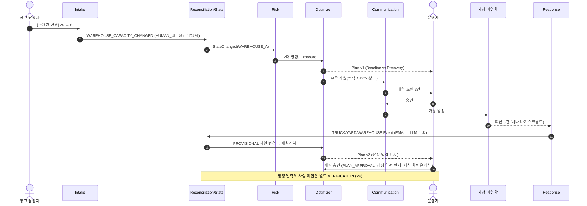

# 06. 에이전트 아키텍처

- 상태: Draft (기획 v0.2)
- 최종 수정: 2026-09-11
- 관련 ADR: ADR-008(LLM 경계, Accepted), ADR-015(에이전트·오케스트레이터), ADR-017(사람 확인 게이트)

---

## 1. "멀티에이전트"의 뜻

- LLM을 여러 개 띄워 서로 대화시키는 구조가 **아니다**.
- 각 에이전트는 **명확한 책임, 입력·출력 계약, 트리거**를 가진 모듈이다. 모두 하나의 Event Store, Canonical State, Rule Engine, Solver를 공유한다.
- 대부분의 에이전트는 **결정론적 코드**다. LLM은 비정형 텍스트를 읽거나 쓰는 **말단 함수**로만 쓴다.
- 흐름은 LLM이 계획하지 않는다. 결정론적 **오케스트레이터**가 Event에 반응해 다음 단계를 부른다(ADR-015).

## 2. 역할

| # | 에이전트 | 책임 | 트리거 | 입력 → 출력 | LLM | 사람 게이트 |
| --- | --- | --- | --- | --- | --- | --- |
| 1 | **Intake** | 입력원 수집·정규화. 공공 API, CSV/Excel, 사용자 액션, 메일함, 문서 업로드, (이후) 파트너 API | 스케줄, 업로드, 액션, 새 메일 | 원문 → 후보 Event (UNVERIFIED) + 원문 보관 | 메일 분류·추출 단계에서만 | — |
| 2 | **Document / Contract** | 계약서·Tariff·견적 구조화 | 계약서 업로드, 계약성 메일 | PDF·메일 → TariffRule DRAFT / RateQuote + 필드별 근거 | 예 | 계약 조건 최초 1회 확인 |
| 3 | **State Reconciliation** | 같은 사실에 대한 출처 간 비교, 이긴 값 결정, Conflict 탐지 | 새 Event | Event 집합 → 이긴 값 + Conflict (`05_event-and-state.md` 8절 R1~R12) | 아니오 | — |
| 4 | **Verification** | Conflict·STALE·확인 대기 추출에서 확인 요청 생성, 우선순위, 처리 결과 기록 | Conflict·STALE 발생, 추출 대기 | → VerificationRequest / 사람 액션 → `VERIFICATION_RECORDED` Event | 아니오 (문구는 템플릿) | 확인 요청 자체가 게이트 |
| 5 | **State** | Canonical State 물질화, 변경분(diff) 발행 | Reconciliation 완료 | → canonical_facts, StateChanged | 아니오 | — |
| 6 | **Risk** | LFD·Exposure·SlackTime, 자원 부족·영향 컨테이너 탐지 | StateChanged, 시계 틱 | Canonical State + 확정 규칙 → RiskAssessment, 예외 감지 | 아니오 | — |
| 7 | **Recovery Optimizer** | 다중 컨테이너 × 트럭 × 장치장 × 창고 × 슬롯의 비용 최소 계획 | 위험 임계 초과, 운영자 요청 | 입력 스냅샷 → RecoveryRun (Baseline vs Recovery) | 계산에는 아니오. 결과 **설명**에만 선택적으로 | 계획 승인 |
| 8 | **Communication** | 운송사·창고·ODCY 문의 메일, 작업지시 초안 | 계획 생성, 부족 자원 | 계획 + 부족 자원 → Message DRAFT (구조화 값은 계획에서) | 예 (문장만) | **발송 승인 (항상)** |
| 9 | **Response** | 회신에서 가능/불가·수량·시각·비용·조건 추출 | 스레드에 회신 도착 | 회신 → 자원·견적 Event (EMAIL + LLM 추출, 강도 ≤ 1) + 요약 | 예 | 불확실 추출은 확인 요청 |
| 10 | **Re-optimization** | 재계획 조건 판단과 재실행 | 활성 계획에 쓰인 자원·상태 사실이 바뀜, 계획 거절 | → 새 RecoveryRun (승인·실행된 배정 잠금, 변경 최소화) | 아니오 | 새 계획 승인 |

### 2.1 PoC 구현 묶음

역할 10개를 파일 10개로 나눌 필요는 없다. PoC에서는 아래처럼 묶는다.

| 구현 모듈 | 포함 역할 | 성격 |
| --- | --- | --- |
| `intake` | Intake(어댑터) | 결정론 + 추출 호출 |
| `extraction` | Intake의 메일 추출, Document/Contract, Response | LLM (구조화 출력) |
| `state` | Reconciliation, Verification, State | 결정론 |
| `risk` | Risk | 결정론 |
| `optimize` | Recovery Optimizer, Re-optimization의 계산 부분 | 결정론 (솔버는 T-036에서 결정, 후보 CP-SAT) |
| `comms` | Communication(초안·승인·가상 발송·스레드) | LLM(문장) + 결정론(값·승인) |
| `orchestrator` | Re-optimization 트리거, 전체 흐름 연결, Activity Log | 결정론 |

## 3. 오케스트레이션 (ADR-015)

- **in-process 작업 큐 + 이벤트 핸들러**로 만든다. 메시지 브로커(Kafka 등)나 LLM 기반 플래너는 쓰지 않는다.
- 규칙은 표로 명시한다.

| 이벤트 | 다음 단계 |
| --- | --- |
| Event 저장됨 | Reconciliation(해당 subject) → State diff |
| State diff 있음 | Risk 재평가(영향 subject) |
| 위험 임계 초과 또는 WAREHOUSE_SHORTFALL 등 자원 부족 탐지 | Recovery 실행 제안 (PoC 데모 모드: 자동 실행) |
| RecoveryRun 생성 | Communication 초안 생성(부족 자원이 있으면) → 승인 대기 |
| 초안 승인 | 가상 발송 → 스레드 대기 |
| 회신 도착 | Response 추출 → Event 저장 → (루프) |
| 활성 계획의 입력 사실 변경 | Re-optimization → 새 계획 승인 대기 |
| 확인 요청 처리 | Event 저장 → (루프) |

- 루프 폭주 방지: 같은 원인으로 재최적화가 반복되지 않도록 디바운스(예: 5초)와 "입력 해시가 같으면 재실행 안 함" 규칙을 둔다 `[ASSUMPTION]`.
- 모든 단계는 **Agent Activity**를 남긴다: `{ at, agent, action, subject_refs, run_id, message }`. 이것이 시뮬레이터 오른쪽 타임라인이 된다(`10_simulation-spec.md`).

## 4. Closed Loop 시퀀스

## 5. AI vs 결정론 책임 경계

| 영역 | 담당 | LLM 허용 여부 |
| --- | --- | --- |
| Tariff 규칙 적용, LFD, 비용 계산·합산 | Rule Engine (`tariff`, `cost`) | ✕ |
| 상태 전이, Reconciliation, Canonical State | State Engine (`state`) | ✕ |
| 제약조건, 최적화, 배정 결정 | Solver (`optimize`) | ✕ |
| 위험 판정 | Risk Engine (`risk`) | ✕ |
| 재최적화 트리거, 흐름 | Orchestrator | ✕ |
| 메일 읽기·분류, 회신 구조화 | `extraction` | ○ 후보 Event까지만 |
| 계약서 읽기 → TariffRule 후보 | `extraction` | ○ DRAFT까지만 |
| 비정형 현장 보고 구조화 | `extraction` | ○ 후보 Event까지만 |
| 운영자 자연어 명령 해석 | `extraction` | ○ 제약·액션 후보까지만 (Should) |
| 복구 결과 설명, 회신 요약 | `comms` / `explain` | ○ 숫자는 입력값만 |
| 연락 메일 초안 | `comms` | ○ 문장만, 발송은 사람 승인 |

LLM이 하지 않는 것: D&D 금액 계산, 비용 합산, State 임의 확정, 최적 배치 결정, 확정되지 않은 현실 이벤트 생성(`01_project-rules.md` 3절).

## 6. LLM 통합 설계

| 항목 | 결정 (Proposed) |
| --- | --- |
| 모델 | 기본 `claude-opus-5`. 모델 ID는 설정값(`CERA_LLM_MODEL`)으로 둔다. 더 싼 모델로 바꿀지는 추출 정확도를 측정한 뒤 사람이 정한다 |
| 출력 형식 | **구조화 출력**(Messages API `output_config.format`에 JSON 스키마). 스키마는 Pydantic 후보 모델에서 생성한다. 응답을 받은 뒤 `05_event-and-state.md` 4.6절의 결정론 검증기를 다시 돌린다 |
| 근거 | 필드마다 원문 인용(`evidence.quote`)을 스키마에 넣는다. API의 citations 기능은 구조화 출력과 함께 쓸 수 없으므로 쓰지 않는다 |
| 문서 입력 | 계약서 PDF는 document 블록으로 넣는다(요청당 32MB·600쪽 한도). 긴 문서는 조항 단위로 나눈다 |
| 실패 처리 | 모델 거절(`stop_reason: refusal`), 스키마 실패, 타임아웃이면 추출 실패로 처리 → 확인 요청(수동 입력). 재시도는 1회 |
| 프롬프트 인젝션 | 메일·문서 본문은 데이터로만 넣고, 추출 호출에는 도구를 주지 않는다. 출력은 스키마 값뿐이라 부작용이 없다 |
| 테스트 | LLM 응답을 녹화한 fixture로 재생한다(네트워크 없음). 추출 정확도는 합성 메일·계약서 평가 세트로 따로 잰다(T-034) |
| 기록 | 추출 Event의 `extraction`에 모델, 프롬프트 버전, 스키마 버전, 검증 결과를 남긴다 |
| 숫자 검사 | 초안·설명에 나온 숫자는 모두 입력 구조화 데이터에 있어야 한다. 테스트로 강제한다 |
| 데모 | 라이브 LLM 호출 모드와 녹화 재생 모드를 둔다. 공모전·인터뷰 데모는 녹화 재생으로 결과를 고정할 수 있다 |

## 7. 사람 게이트 요약 (ADR-017)

| 게이트 | 언제 | 무엇이 확정되나 |
| --- | --- | --- |
| G1 계약 확인 | 계약 조건 최초 추출 | TariffRule DRAFT → CONFIRMED |
| G2 사실 확인 | LLM이 추출한 컨테이너 사실, Conflict, STALE | Event → CONFIRMED / REJECTED |
| G3 계획 승인 | Recovery Plan 표시 | 계획 실행 허가만(`PLAN_APPROVAL` 결정 기록). 입력 사실은 확정되지 않는다. G2 차단이 남아 있으면 통과 불가(`05_event-and-state.md` 11.5) |
| G4 발송 승인 | 메일 초안 | 발송 (PoC: 가상) |
| G5 실행 결과 | 실제 반출·입고 결과 (Pilot) | 마일스톤 Event |
