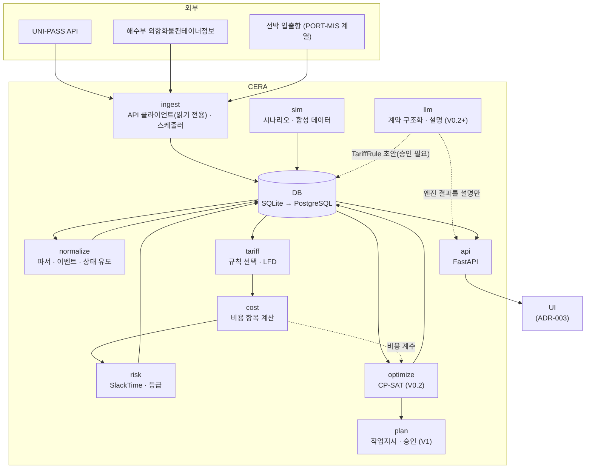

# 06. 아키텍처 / 기술 스택

- 상태: Draft v0.1
- 최종 수정: 2026-09-10
- 관련 ADR: ADR-002(기술 스택), ADR-003(UI), ADR-004(저장소)

---

## 1. 구성도



**의존 방향 규칙**
- `tariff`, `cost`, `risk`, `optimize`는 순수 계산 모듈이다. DB·네트워크·LLM을 import하지 않는다.
- `llm`은 엔진 결과를 읽기만 한다. 엔진이 `llm`에 의존하는 방향은 금지한다.
- `ingest`는 읽기 전용 HTTP 메서드만 쓴다(V1 이전).

## 2. 기술 스택 (ADR-002, Proposed)

| 영역 | 선택 | 이유 |
| --- | --- | --- |
| 언어 | Python 3.12 | OR-Tools, 데이터 처리, LLM SDK 생태계 |
| 패키지 관리 | uv | 빠르고 lockfile 재현성이 좋음 |
| 도메인 모델 | Pydantic v2 | 검증 + JSON Schema 자동 생성 |
| HTTP 클라이언트 | httpx | 타임아웃·재시도 제어, 테스트 mocking(respx) |
| XML 파싱 | lxml (또는 xmltodict) | 공공 API가 XML |
| 최적화 | OR-Tools CP-SAT | 기획서 1차 후보. 정수 비용·논리 제약에 강함 |
| API 서버 | FastAPI | Pydantic과 궁합, OpenAPI 자동 생성 |
| DB | SQLite(PoC) → PostgreSQL | PoC는 파일 하나로, 운영은 Postgres (ADR-004) |
| ORM/쿼리 | SQLAlchemy 2.x + Alembic | 마이그레이션 관리 |
| 스케줄러 | APScheduler (PoC) | 단일 프로세스로 충분 |
| UI | Streamlit (PoC 데모) — ADR-003 Proposed | 1인 개발 속도. 상용화 때 React/Next.js로 교체 검토 |
| 테스트 | pytest, hypothesis(비용 계산 속성 테스트) | |
| 린트·포맷 | ruff | |
| LLM (V0.2+) | Claude API (`claude-sonnet-5` 기본, 어려운 계약서는 `claude-opus-5`) | 계약 PDF 구조화, 설명. 계산 경로에는 쓰지 않음 |
| 휴일 캘린더 | `holidays` 패키지(KR) + 수동 보정 파일 | 영업일 기준 Free Time 계산 |

## 3. 저장소 레이아웃 (T-003에서 생성)

```text
container_exception/
├─ AGENTS.md                 # 에이전트 진입점
├─ CLAUDE.md                 # AGENTS.md 가져오기
├─ README.md                 # 사람용 소개 (T-003)
├─ pyproject.toml
├─ .env.example              # 키 이름만 (UNIPASS_API_KEY, DATA_GO_KR_SERVICE_KEY, ANTHROPIC_API_KEY)
├─ docs/                     # 정본 문서
│  ├─ data/                  # field-dictionary.md, code-tables.md (T-004)
│  └─ tasks/                 # QUEUE.md, LOG.md
├─ src/cera/
│  ├─ config/                # settings.py(환경변수) + assumptions.yaml(가정값, 값마다 태그)
│  ├─ domain/                # Pydantic 모델: ContainerState, ContainerEvent, TariffRule, Scenario ...
│  ├─ ingest/                # unipass.py, mof_container.py, vessel.py, scheduler.py
│  ├─ normalize/             # parsers/, state_deriver.py
│  ├─ tariff/                # rule_selector.py, lfd.py, calendar.py
│  ├─ cost/                  # items.py, total.py
│  ├─ risk/                  # slack.py, grading.py
│  ├─ sim/                   # scenario_loader.py, synthetic_containers.py
│  ├─ optimize/              # model_stage1.py, baseline.py (V0.2)
│  ├─ plan/                  # commands.py, approval.py (V1)
│  ├─ llm/                   # contract_extract.py, explain.py (V0.2+)
│  ├─ storage/               # db.py, repositories.py, migrations/
│  └─ api/                   # FastAPI 앱
├─ ui/                       # Streamlit 앱 (ADR-003)
├─ data/
│  ├─ raw/                   # 실제 원본 응답 — .gitignore
│  ├─ fixtures/              # 마스킹된 원본 응답 (테스트용)
│  ├─ tariffs/               # TariffRule YAML/JSON (출처·태그 포함)
│  └─ sim/                   # 시나리오 YAML
├─ schemas/                  # Pydantic → JSON Schema 산출물
├─ scripts/                  # 일회성 스크립트 (API 탐색, 데이터 생성)
└─ tests/
   ├─ unit/
   ├─ golden/                # 손 검산 비용 예제, 최적화 기준 결과
   └─ fixtures -> ../data/fixtures
```

원본 기획서(PDF/DOCX)는 T-003에서 `docs/reference/`로 옮길지 사람 확인 뒤 결정한다.

## 4. 저장 스키마 (논리)

| 테이블 | 핵심 컬럼 | 비고 |
| --- | --- | --- |
| `watchlist_items` | id, mbl_no, hbl_no, bl_year, container_no, carrier, consignee_id, destination_id, active | 사용자 업로드 |
| `raw_responses` | id, source, request_hash, fetched_at, http_status, body(blob) | 불변, append-only |
| `container_events` | event_id(PK, 멱등 해시), container_no, event_type, occurred_at, observed_at, source, raw_ref, attributes(json) | 불변 |
| `container_states` | container_no, as_of, state(json), state_hash | 스냅샷 이력 |
| `exceptions` | id, type, scope(json), active_from, active_to, source, created_by | |
| `tariff_rules` | rule_id, version, body(json), effective_from/to, source(json), approved_by | 버전 관리 |
| `destinations` | id, windows(json), capacity_per_day, reefer, dg | |
| `scenarios` | scenario_id, seed, body(json) | SIMULATED |
| `risk_snapshots` | id, as_of, container_no, next_deadline, slack_minutes, grade, exposure_krw, breakdown(json) | |
| `recovery_runs` | run_id, as_of, scenario_id, seed, input_hash, rule_versions, solver_status, baseline_krw, recovery_krw | |
| `assignments` | run_id, container_no, route, slot, cost_krw, baseline_cost_krw | |
| `commands` | command_id, run_id, type, status, payload, approved_by, approved_at | V1 |
| `audit_log` | id, at, actor, action, target, detail | V1 |

## 5. 내부 API 초안 (FastAPI)

| 메서드 | 경로 | 버전 | 설명 |
| --- | --- | --- | --- |
| POST | `/watchlist/upload` | V0.1 | CSV 업로드·검증 |
| GET | `/containers` | V0.1 | 목록(필터: 등급, 상태, 선사) |
| GET | `/containers/{container_no}` | V0.1 | 상세(상태, 타임라인, 비용 내역, 출처) |
| POST | `/containers/{container_no}/exceptions` | V0.1 | 예외 입력 |
| GET/PUT | `/tariffs`, `/tariffs/{rule_id}` | V0.1 | Tariff 관리 |
| POST | `/ingest/run` | V0.1 | 수동 수집 실행 |
| GET | `/risk/snapshot?as_of=` | V0.1 | 대시보드 집계 |
| POST | `/recovery/runs` | V0.2 | 최적화 실행 (as_of, 대상, 시나리오, 고정 조건) |
| GET | `/recovery/runs/{run_id}` | V0.2 | 결과 |
| POST | `/recovery/runs/{run_id}/approve` | V1 | 승인 → 작업지시 생성 |

PoC에서 Streamlit이 엔진을 직접 호출할지, FastAPI를 거칠지는 ADR-003에서 함께 결정한다.
권장: V0.1은 Streamlit → 서비스 계층 직접 호출, V0.2부터 FastAPI 분리.

## 6. 설정·비밀

| 키 | 용도 |
| --- | --- |
| `UNIPASS_API_KEY` | UNI-PASS 인증키(crkyCn) |
| `DATA_GO_KR_SERVICE_KEY` | 공공데이터포털 serviceKey |
| `ANTHROPIC_API_KEY` | V0.2+ LLM 기능 |
| `CERA_DB_URL` | 기본 `sqlite:///data/cera.db` |
| `CERA_TZ` | `Asia/Seoul` 고정 |

가정값(버퍼 시간, 등급 기준, 폴링 주기)은 `src/cera/config/assumptions.yaml`에 두고, 값마다 `tag`와 `rationale`을 적는다.
