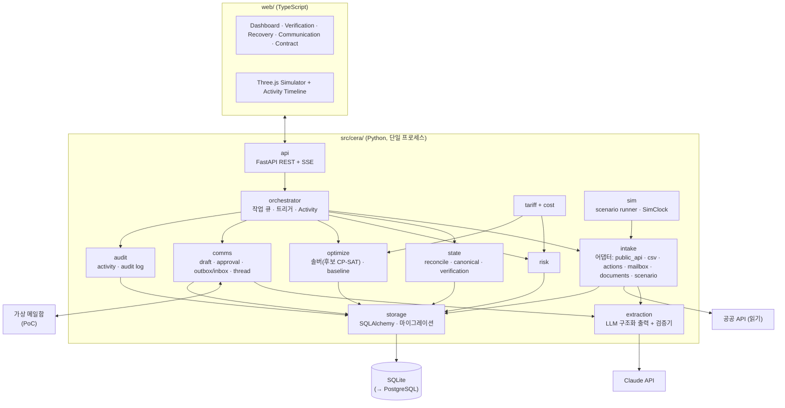

# 07. 백엔드 아키텍처

- 상태: Draft (기획 v0.2)
- 최종 수정: 2026-09-11 (T-032: 저장 스키마의 events·canonical_facts·conflicts·verification_requests·planning_snapshots 컬럼 갱신)
- 관련 ADR: ADR-002(스택), ADR-004(DB), ADR-013(저장 방식), ADR-015(오케스트레이터), ADR-016(프론트엔드), ADR-018(시나리오 재생)

---

## 1. 원칙

1. **모듈형 모놀리스**: 백엔드는 Python 프로세스 하나, DB는 SQLite 파일 하나로 시작한다. 마이크로서비스, 메시지 브로커, 쿠버네티스, 멀티테넌트 인증은 PoC에서 만들지 않는다.
2. **순수 엔진 + 얇은 I/O**: 계산 모듈(`state`, `tariff`, `cost`, `risk`, `optimize`)은 DB·네트워크·LLM을 import하지 않는 순수 함수다. I/O는 `intake`, `extraction`, `comms`, `storage`, `api`에만 있다.
3. **시뮬레이션과 실제가 같은 경로**: 시나리오 재생 이벤트는 실제 입력과 같은 Intake → Event Store → Reconciliation 경로를 탄다(ADR-018).
4. **프론트는 표시만**: 모든 숫자·상태·계획은 백엔드가 만든다.

## 2. 구성



### 2.1 요구 컴포넌트 → 모듈 대응

| 컴포넌트 | 모듈 | PoC 구현 | 이후 |
| --- | --- | --- | --- |
| API Gateway / Backend | `api` | FastAPI, REST + SSE(서버 푸시) | 인증·권한 (Pilot) |
| Event Ingestion Layer | `intake` | 어댑터별 함수, 원문 보관 | 실제 메일함·파트너 API |
| Event Store | `storage` + `events` 테이블 | append-only 테이블 (ADR-013) | PostgreSQL |
| State Reconciliation Engine | `state.reconcile` | 순수 함수, subject 단위 재계산 | — |
| Canonical State Store | `canonical_facts` 등 파생 테이블 | Reconciliation이 갱신 | — |
| Contract / Tariff Rule Engine | `tariff`, `cost` | 순수 함수, 휴일 캘린더 | — |
| Risk Engine | `risk` | 순수 함수 | — |
| Optimization Service | `optimize` | in-process 솔버 (후보 CP-SAT, T-036에서 결정) | 별도 워커(규모가 커지면) |
| Agent Orchestrator | `orchestrator` | in-process 큐 + 핸들러 표 | — |
| Communication Service | `comms` | 초안·승인·가상 발송·스레드 | 실제 메일 발송 (Pilot, ADR 필요) |
| Response Parser | `extraction` | 구조화 출력 + 검증기 | — |
| Notification Service | `api` SSE + `notifications` 테이블 | 앱 안 알림 | 메일·메신저 |
| Audit Log | `audit` | activity + audit 테이블 (append-only) | — |
| Simulation Service | `sim` | 시나리오 로더, SimClock, 스크립트 회신 | — |

## 3. 기술 스택 (ADR-002, ADR-016 Proposed)

| 영역 | 선택 | 이유 |
| --- | --- | --- |
| 언어·런타임 | Python 3.12, uv | OR-Tools·데이터 처리·LLM SDK 생태계, lockfile 재현성 |
| 도메인 모델 | Pydantic v2 | 검증 + JSON Schema 생성(LLM 구조화 출력 스키마로도 사용) |
| API | FastAPI + SSE | Pydantic과 궁합, 단방향 실시간 푸시로 충분 |
| DB | SQLite → PostgreSQL, SQLAlchemy 2.x + Alembic | 파일 하나로 시작, JSON 컬럼은 두 DB에서 모두 동작하는 방식만 |
| 최적화 | **미정** — 현재 후보 OR-Tools CP-SAT (ADR-007 Reopened, T-036에서 MILP·min-cost flow 등과 비교해 결정) | 정수 비용·논리 제약 |
| HTTP·XML | httpx, lxml | 공공 API가 XML |
| LLM | Anthropic Python SDK, 기본 `claude-opus-5` | 구조화 출력, PDF 입력 (`06_agent-architecture.md` 6절) |
| 스케줄 | APScheduler (공공 API 동기화), SimClock (시나리오) | 단일 프로세스 |
| 휴일 | `holidays`(KR) + 수동 보정 파일 | 영업일 Free Time |
| 테스트·린트 | pytest, hypothesis, ruff | 속성 테스트(순서 무관성, 비용 단조성) |
| 프론트엔드 | TypeScript, React, Vite, Three.js(@react-three/fiber) | 3D/2.5D 시뮬레이터와 대시보드를 한 앱에서 (ADR-016) |

## 4. 저장 스키마 (논리)

| 테이블 | 핵심 컬럼 | 성격 |
| --- | --- | --- |
| `events` | event_id, schema_version, event_class, event_type, entity_type, entity_id, fact_key, value(json), payload(json), related_entity_ids(json), source_type, source_role, source_org, source_id, source_event_time, source_recorded_at, received_at, recorded_at, confidence(json), extraction(json), supersedes_event_id, target_event_ids(json), verification_action, verification_method, overruled_event_ids(json), correlation_id, raw_ref, idempotency_key(unique), is_simulated (`05_event-and-state.md` 4.2) | **append-only** |
| `raw_inputs` | id, kind(PUBLIC_API/EMAIL/FILE/ACTION/SCENARIO), received_at, request_hash, http_status, body(blob), meta(json) | append-only |
| `canonical_facts` | entity_type, entity_id, fact_key, fact_kind, family, value(json), effective_time, evidence_time, temporal_quality, value_status, verification_basis, freshness_status, conflict_status, conflict_id, hold_status, held_candidate_event_id, decision_usability, usability_reasons(json), winner_event_id, winner_strength, evidence(json), rule_trace(json), explanation, policy_version, as_of, fingerprint, revision, materialized_at (`05` 9.1) | 파생 (재생성 가능) |
| `conflicts` | conflict_id, entity_type, entity_id, fact_keys(json), candidate_event_ids(json), rule, status(OPEN/RESOLVED), resolution_event_id | 파생 |
| `verification_requests` | request_id, reason(V1~V8), entity_type, entity_id, fact_keys(json), candidate_event_ids(json), conflict_id, question, actions(json), blocking_scope, priority_score, status, created_by_rule | 파생 + 처리 이력 컬럼 |
| `planning_snapshots` | snapshot_id, as_of, policy_version, events_watermark, snapshot_hash, body(json) (`05` 14절) | 불변 |
| `plan_decisions` | decision_id, decision_type(PLAN_APPROVAL/PLAN_REJECTION), run_id, snapshot_hash, decided_by, decided_at, recorded_at, input_check(json), acknowledged_provisional_inputs(json), verified_in_same_action(json), reason (`05` 11.5) | **append-only**. Event Store와 분리(사실이 아니라 결정) |
| `containers` | container_no, bl refs, carrier, destination_id, is_simulated | 식별 레지스트리 |
| `resources` | resource_id, type(WAREHOUSE/TRUCK_POOL/ODCY/SLOT/TERMINAL), attrs(json) | 등록 정보 |
| `contracts` | contract_id, party, file_ref, status | |
| `tariff_rules` | rule_id, version, status(DRAFT/CONFIRMED/RETIRED), body(json), evidence(json), confirmed_by/at | 버전 관리 |
| `rate_quotes` | quote_id, provider, item, equipment, amount_krw, valid_until, source_event_id, status | |
| `risk_snapshots` | run_id, as_of, subject, type, grade, slack_minutes, exposure_krw, breakdown(json) | 산출물 |
| `recovery_runs` | run_id, as_of, trigger, input_hash, policy/rule versions, seed, solver_status, baseline_krw, recovery_krw, provisional_inputs(json), status(PROPOSED/APPROVED/SUPERSEDED/REJECTED) | 산출물 |
| `assignments` | run_id, container_no, route, slot, delivery_day, cost_krw, baseline_cost_krw, locked | 산출물 |
| `messages` | message_id, thread_id, direction(OUT/IN), counterparty, subject, body, structured(json), status(DRAFT/APPROVED/SENT/RECEIVED), approved_by/at, run_id | |
| `agent_activity` | id, at, agent, action, refs(json), text | append-only, 타임라인 |
| `audit_log` | id, at, actor, action, target, detail(json) | append-only |
| `scenarios` | scenario_id, seed, body(json) | SIMULATED |

## 5. 내부 API 초안

| 메서드 | 경로 | 설명 |
| --- | --- | --- |
| POST | `/intake/csv` | Watchlist·초기 상태 업로드 |
| POST | `/actions` | 짧은 액션(확인·수정·도착·입고·거절·수용량 변경 …) |
| POST | `/intake/daily-report` | 일일 집계 보고 |
| GET | `/state/containers`, `/state/containers/{no}` | Canonical State (사실별 상태·근거) |
| GET | `/state/resources` | 자원 Canonical State |
| GET | `/events?entity=`, `/events/{event_id}` | 근거 Event·원문 조회 |
| GET | `/state/facts/{entity_type}/{entity_id}/{fact_key}?as_of=` | "왜 이 값인가": Canonical Fact 전체(근거·규칙·설명) |
| GET | `/state/snapshot?as_of=` | Planning Snapshot 생성·조회 (`05` 14절) |
| GET/POST | `/verifications`, `/verifications/{id}/resolve` | 확인 큐 |
| GET/POST | `/contracts`, `/tariff-rules/{id}/confirm` | 계약 추출 후보·확인 |
| GET | `/risk/snapshot?as_of=` | 위험 집계 |
| POST | `/recovery/runs` | 최적화 실행(대상, 고정 조건) |
| GET/POST | `/recovery/runs/{id}`, `/recovery/runs/{id}/approve` | 결과·계획 승인. 본문: `acknowledged_provisional_inputs`, 선택 `verify_event_ids`(묶음 동작이면 먼저 `VERIFICATION` Event를 만들고 그다음 `PLAN_APPROVAL` 기록). 차단·입력 변경이면 409 (`05` 11.5) |
| GET/POST | `/messages`, `/messages/{id}/approve` | 초안·승인·스레드 |
| POST | `/sim/scenarios/{id}/start`, `/sim/clock` | 시나리오 재생·시계 제어 |
| GET | `/stream` | SSE: state diff, activity, 알림, 계획 갱신 |

## 6. 저장소 레이아웃 (T-003에서 생성)

```text
container_exception/
├─ AGENTS.md · CLAUDE.md · README.md(T-003)
├─ pyproject.toml · .env.example
├─ docs/
├─ src/cera/
│  ├─ config/        settings.py · policy.yaml(우선순위·신선도·가정값, 값마다 태그)
│  ├─ domain/        Pydantic: Event, CanonicalFact, TariffRule, RateQuote, Resource, Plan, Message …
│  ├─ intake/        adapters/{public_api, csv, actions, mailbox, documents, scenario}.py
│  ├─ extraction/    schemas/ · prompts/ · validators.py · client.py
│  ├─ state/         reconcile.py · canonical.py · verification.py · policy.py
│  ├─ tariff/        rule_selector.py · lfd.py · calendar.py
│  ├─ cost/          items.py · total.py
│  ├─ risk/          slack.py · shortfall.py · grading.py
│  ├─ optimize/      model.py · baseline.py · explain_data.py
│  ├─ comms/         drafts.py · approval.py · mailbox.py · threads.py
│  ├─ orchestrator/  handlers.py · queue.py · activity.py
│  ├─ sim/           scenario_loader.py · clock.py · scripted_replies.py
│  ├─ storage/       db.py · repositories.py · migrations/
│  └─ api/           app.py · routes/ · sse.py
├─ web/              Vite + React + Three.js
├─ data/
│  ├─ raw/           실제 원본 — .gitignore
│  ├─ fixtures/      마스킹·합성 fixture (공공 API, LLM 녹화 응답)
│  ├─ scenarios/     시나리오 YAML (busan-wh-capacity-01 …)
│  └─ contracts/     합성 계약서
├─ schemas/          JSON Schema 산출물
└─ tests/            unit/ · golden/(손 검산 비용, 기준 계획) · replay/(시나리오 재생 해시)
```

## 7. 설정·비밀

| 키 | 용도 |
| --- | --- |
| `UNIPASS_API_KEY` | UNI-PASS 인증키(`crkyCn`) |
| `DATA_GO_KR_SERVICE_KEY` | 공공데이터포털 `serviceKey` |
| `ANTHROPIC_API_KEY` | LLM (녹화 재생 모드에서는 불필요) |
| `CERA_LLM_MODEL` | 기본 `claude-opus-5` |
| `CERA_LLM_MODE` | `live` / `replay` |
| `CERA_DB_URL` | 기본 `sqlite:///data/cera.db` |
| `CERA_TZ` | `Asia/Seoul` 고정 |

정책값(권한 매트릭스, 근거 강도표, τ·δ_m, 신선도 기준, 보류 기준, 버퍼, 등급 기준 — `05_event-and-state.md` 15절)은 `src/cera/config/policy.yaml`에 두고 값마다 `tag`와 `rationale`을 적는다. 정책 파일의 해시가 `policy_version`이 된다.

## 8. 만들지 않는 것 (PoC)

- 풀 Event Sourcing 프레임워크, CQRS 분리 배포 (ADR-013)
- 메시지 브로커, 분산 작업 큐
- 실제 메일 발송, 외부 시스템 Write (`01_project-rules.md` 6절)
- 사용자 인증·권한·멀티테넌시 (로컬 단일 사용자 가정)
- 모바일 앱 (짧은 액션은 웹 반응형으로)
