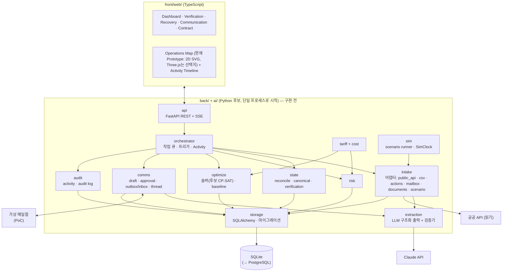

# 07. 백엔드 아키텍처

- 상태: Draft (기획 v0.2)
- 최종 수정: 2026-09-16 (**T-072: 3절 기술 표를 A~D 4분류로 읽도록 정리**(특정 LLM 공급자·모델은 요구사항이 아니라 "구현 시점 선택"), 4절 `messages` 대체 표기를 ADR-028 **Accepted**로 정정, 2.1절 실제 발송을 **Tech Validation**으로 정정). 같은 날 T-068: 6.1절 신설 — 결정론 엔진을 `ai/`에서 분리(ADR-029 Accepted), 6절 배치표 갱신, 4절 `messages` → `comm_*` 대체(ADR-028 Accepted). 이전: 2026-09-15 (6절 Monorepo 레이아웃 재정렬 ADR-024: `web/` → `front/web/`, `back/`·`ai/`·`packages/`·`infra/` 영역. 같은 날: 프론트엔드 스택 Next.js·화면용 조회 API, `canonical_facts`의 `evidence_time_quality`·`temporal_confidence`). 이전: 2026-09-11 T-032 저장 스키마 갱신
- 관련 ADR: ADR-002(스택), ADR-004(DB), ADR-013(저장 방식), ADR-015(오케스트레이터), ADR-016(프론트엔드), ADR-018(시나리오 재생)

---

## 1. 원칙

1. **모듈형 모놀리스**: 백엔드는 Python 프로세스 하나, DB는 SQLite 파일 하나로 시작한다. 마이크로서비스, 메시지 브로커, 쿠버네티스, 멀티테넌트 인증은 PoC에서 만들지 않는다.
2. **순수 엔진 + 얇은 I/O**: 계산 모듈(`state`, `tariff`, `cost`, `risk`, `optimize`)은 DB·네트워크·LLM을 import하지 않는 순수 함수다. I/O는 `intake`, `extraction`, `comms`, `storage`, `api`에만 있다.
3. **시뮬레이션과 실제가 같은 경로**: 시나리오 재생 이벤트는 실제 입력과 같은 Intake → Event Store → Reconciliation 경로를 탄다(ADR-018).
4. **프론트는 표시만**: 모든 숫자·상태·계획은 백엔드가 만든다.

## 2. 구성



### 2.1 요구 컴포넌트 → 모듈 대응

| 컴포넌트 | 모듈 | PoC 구현 | 이후 |
| --- | --- | --- | --- |
| API Gateway / Backend | `api` | FastAPI, REST + SSE(서버 푸시) | 인증·권한 (Pilot) |
| Event Ingestion Layer | `intake` | 어댑터별 함수, 원문 보관 | 실제 메일함·파트너 API |
| Event Store | `storage` + `events` 테이블 | append-only 테이블 (ADR-013) | PostgreSQL |
| State Reconciliation Engine | `state.reconcile` | 순수 함수, subject 단위 재계산 | — |
| Canonical State Store | `canonical_facts` 등 파생 테이블 | Reconciliation이 갱신 | — |
| Contract / Tariff Rule Engine | `tariff`, `cost` | 순수 함수, 휴일 캘린더 | — |
| Risk Engine | `risk` | 순수 함수 | — |
| Optimization Service | `optimize` | in-process 솔버 (후보 CP-SAT, T-036에서 결정) | 별도 워커(규모가 커지면) |
| Agent Orchestrator | `orchestrator` | in-process 큐 + 핸들러 표 | — |
| Communication Service | `comms` | 초안·승인·가상 발송·스레드 | **Tech Validation 단계부터 조건부 실제 발송** (ADR-027 Accepted. 조건은 `01_project-rules.md` 6.1절이 정본이며 여기에 복사하지 않는다) |
| Response Parser | `extraction` | 구조화 출력 + 검증기 | — |
| Notification Service | `api` SSE + `notifications` 테이블 | 앱 안 알림 | 메일·메신저 |
| Audit Log | `audit` | activity + audit 테이블 (append-only) | — |
| Simulation Service | `sim` | 시나리오 로더, SimClock, 스크립트 회신 | — |

## 3. 기술 스택 (ADR-002, ADR-016 Proposed)

> **읽는 법 (2026-09-16 갱신)**: 아래 표의 각 줄을 네 가지로 구분해 읽는다. **특정 제품·모델 이름이 적혀 있다고 해서 요구사항이 아니다.**
>
> | 구분 | 뜻 | 해당 |
> | --- | --- | --- |
> | **A. 현재 구현된 기술** | 실제로 코드가 있다 | **프론트엔드 줄뿐** (Next.js + 2D SVG) |
> | **B. Accepted 결정** | 뒤집으려면 새 ADR이 필요하다 | 이 표에는 없다 |
> | **C. 판정 전 후보** | ADR이 Proposed다 | 언어·API·DB·HTTP·스케줄·휴일·테스트 줄 |
> | **D. 구현 시점으로 미룬 선택** | **지금 고르지 않기로 한 것** | **LLM 공급자·모델·SDK**, 최적화 방식·솔버, DB 제품, ORM·마이그레이션 도구, 큐·워커, 클라우드 |
>
> **D는 특히 주의한다.** 사용자 방향은 *"구체적인 기술은 실제 구현 시점에 품질·비용·보안·유지보수성·최신 상황을 비교해 고른다"*이다. 아래 표에 적힌 특정 LLM 공급자·모델명은 **2026-09-11 시점의 예시**이지 CERA의 요구사항이 아니다.
>
> **요구사항인 것**은 따로 있다: 구조화된 출력을 받는다 · 값마다 원문 인용을 함께 받는다 · 결정론 검증기를 다시 돌린다 · 녹화 응답으로 네트워크 없이 재생할 수 있다 · 사용한 구현과 설정을 기록한다. 이것들은 `01` 3절·`19` 11절이 정본이다.

| 영역 | 선택 | 이유 |
| --- | --- | --- |
| 언어·런타임 | Python 3.12, uv | OR-Tools·데이터 처리·LLM SDK 생태계, lockfile 재현성 |
| 도메인 모델 | Pydantic v2 | 검증 + JSON Schema 생성(LLM 구조화 출력 스키마로도 사용) |
| API | FastAPI + SSE | Pydantic과 궁합, 단방향 실시간 푸시로 충분 |
| DB | SQLite → PostgreSQL, SQLAlchemy 2.x + Alembic | 파일 하나로 시작, JSON 컬럼은 두 DB에서 모두 동작하는 방식만 |
| 최적화 | **미정** — 현재 후보 OR-Tools CP-SAT (ADR-007 Reopened, T-036에서 MILP·min-cost flow 등과 비교해 결정) | 정수 비용·논리 제약 |
| HTTP·XML | httpx, lxml | 공공 API가 XML |
| LLM | **[D] 미정 — 구현 시점에 선택한다.** 아래는 2026-09-11 시점의 예시일 뿐 요구사항이 아니다: Anthropic Python SDK, `claude-opus-5`. **요구사항은 "무엇을 하는가"이지 "어느 제품인가"가 아니다** | 구조화 출력, 문서 입력, 원문 인용, 녹화 재생 (`01` 3절, `19` 11절) |
| 스케줄 | APScheduler (공공 API 동기화), SimClock (시나리오) | 단일 프로세스 |
| 휴일 | `holidays`(KR) + 수동 보정 파일 | 영업일 Free Time |
| 테스트·린트 | pytest, hypothesis, ruff | 속성 테스트(순서 무관성, 비용 단조성) |
| 프론트엔드 | TypeScript, React, **Next.js**(App Router), 운영 지도는 2D SVG. Three.js는 필요할 때만 | Control Tower Prototype으로 먼저 구현(ADR-022 Proposed, ADR-016 부분 개정). 화면은 Frontend Data Contract에만 의존(`16_frontend-prototype.md` 5절) |

## 4. 저장 스키마 (논리)

| 테이블 | 핵심 컬럼 | 성격 |
| --- | --- | --- |
| `events` | event_id, schema_version, event_class, event_type, entity_type, entity_id, fact_key, value(json), payload(json), related_entity_ids(json), source_type, source_role, source_org, source_id, source_event_time, source_recorded_at, received_at, recorded_at, confidence(json), extraction(json), supersedes_event_id, target_event_ids(json), verification_action, verification_method, overruled_event_ids(json), correlation_id, raw_ref, idempotency_key(unique), is_simulated (`05_event-and-state.md` 4.2) | **append-only** |
| `raw_inputs` | id, kind(PUBLIC_API/EMAIL/FILE/ACTION/SCENARIO), received_at, request_hash, http_status, body(blob), meta(json) | append-only |
| `canonical_facts` | entity_type, entity_id, fact_key, fact_kind, family, value(json), effective_time, evidence_time, evidence_time_quality, temporal_confidence, value_status, verification_basis, freshness_status, conflict_status, conflict_id, hold_status, held_candidate_event_id, decision_usability, usability_reasons(json), winner_event_id, winner_strength, evidence(json), rule_trace(json), explanation, policy_version, as_of, fingerprint, revision, materialized_at (`05` 9.1) | 파생 (재생성 가능) |
| `conflicts` | conflict_id, entity_type, entity_id, fact_keys(json), candidate_event_ids(json), rule, status(OPEN/RESOLVED), resolution_event_id | 파생 |
| `verification_requests` | request_id, reason(V1~V8), entity_type, entity_id, fact_keys(json), candidate_event_ids(json), conflict_id, question, actions(json), blocking_scope, priority_score, status, created_by_rule | 파생 + 처리 이력 컬럼 |
| `planning_snapshots` | snapshot_id, as_of, policy_version, events_watermark, snapshot_hash, body(json) (`05` 14절) | 불변 |
| `plan_decisions` | decision_id, decision_type(PLAN_APPROVAL/PLAN_REJECTION), run_id, snapshot_hash, decided_by, decided_at, recorded_at, input_check(json), acknowledged_provisional_inputs(json), verified_in_same_action(json), reason (`05` 11.5) | **append-only**. Event Store와 분리(사실이 아니라 결정) |
| `containers` | container_no, bl refs, carrier, destination_id, is_simulated | 식별 레지스트리 |
| `resources` | resource_id, type(WAREHOUSE/TRUCK_POOL/ODCY/SLOT/TERMINAL), attrs(json) | 등록 정보 |
| `contracts` | contract_id, party, file_ref, status | |
| `tariff_rules` | rule_id, version, status(DRAFT/CONFIRMED/RETIRED), body(json), evidence(json), confirmed_by/at | 버전 관리 |
| `rate_quotes` | quote_id, provider, item, equipment, amount_krw, valid_until, source_event_id, status | |
| `risk_snapshots` | run_id, as_of, subject, type, grade, slack_minutes, exposure_krw, breakdown(json) | 산출물 |
| `recovery_runs` | run_id, as_of, trigger, input_hash, policy/rule versions, seed, solver_status, baseline_krw, recovery_krw, provisional_inputs(json), status(PROPOSED/APPROVED/SUPERSEDED/REJECTED) | 산출물 |
| `assignments` | run_id, container_no, route, slot, delivery_day, cost_krw, baseline_cost_krw, locked | 산출물 |
| ~~`messages`~~ | **ADR-028(Accepted)로 대체됐다**: 통신 도메인을 스레드 / 메시지 / 상태 전이 이력으로 나누고, 상대방 등록부를 **거래처 → 담당 연락처 → 채널 주소**(발송 자격 3상태) 3단계로 둔다. 검증 기록·추출 기록이 더해진다. 옛 단일 테이블에는 채널·외부 ID·재시도·멱등키·승인 내용 해시가 없어 실제 발송을 감당하지 못한다. **구조는 확정이고 테이블·컬럼 이름은 후보다**(ADR-028 본문: "구체 컬럼·DDL은 확정이 아니다"). 후보 컬럼은 `18` D.1 | **구조 확정 · DDL 미정** |
| `agent_activity` | id, at, agent, action, refs(json), text | append-only, 타임라인 |
| `audit_log` | id, at, actor, action, target, detail(json) | append-only |
| `scenarios` | scenario_id, seed, body(json) | SIMULATED |

## 5. 내부 API 초안

| 메서드 | 경로 | 설명 |
| --- | --- | --- |
| POST | `/intake/csv` | Watchlist·초기 상태 업로드 |
| POST | `/actions` | 짧은 액션(확인·수정·도착·입고·거절·수용량 변경 …) |
| POST | `/intake/daily-report` | 일일 집계 보고 |
| GET | `/state/containers`, `/state/containers/{no}` | Canonical State (사실별 상태·근거) |
| GET | `/state/resources` | 자원 Canonical State |
| GET | `/events?entity=`, `/events/{event_id}` | 근거 Event·원문 조회 |
| GET | `/state/facts/{entity_type}/{entity_id}/{fact_key}?as_of=` | "왜 이 값인가": Canonical Fact 전체(근거·규칙·설명) |
| GET | `/state/snapshot?as_of=` | Planning Snapshot 생성·조회 (`05` 14절) |
| GET/POST | `/verifications`, `/verifications/{id}/resolve` | 확인 큐 |
| GET/POST | `/contracts`, `/tariff-rules/{id}/confirm` | 계약 추출 후보·확인 |
| GET | `/risk/snapshot?as_of=` | 위험 집계 |
| POST | `/recovery/runs` | 최적화 실행(대상, 고정 조건) |
| GET/POST | `/recovery/runs/{id}`, `/recovery/runs/{id}/approve` | 결과·계획 승인. 본문: `acknowledged_provisional_inputs`, 선택 `verify_event_ids`(묶음 동작이면 먼저 `VERIFICATION` Event를 만들고 그다음 `PLAN_APPROVAL` 기록). 차단·입력 변경이면 409 (`05` 11.5) |
| GET/POST | `/messages`, `/messages/{id}/approve` | 초안·승인·스레드 |
| POST | `/sim/scenarios/{id}/start`, `/sim/clock` | 시나리오 재생·시계 제어 |
| GET | `/stream` | SSE: state diff, activity, 알림, 계획 갱신 |

**화면용 조회 API (Frontend Data Contract v0.1, 2026-09-15)**: Control Tower는 아래 읽기 전용 엔드포인트의 View Model만 쓴다. 지금은 `front/web/`의 MockProvider가 같은 모양을 시나리오 데이터 팩에서 돌려주고, 백엔드가 생기면 ApiProvider로 바꾼다. 응답은 `{ data, meta }`이고 `meta.result_kind`(SCENARIO_RESULT / ENGINE_RESULT)·`is_simulated`·`as_of`를 싣는다. 타입 정본은 `front/web/src/contracts/cera.ts`, 설명은 `16_frontend-prototype.md` 5절.

| 메서드 | 경로 | View Model |
| --- | --- | --- |
| GET | `/operations/today?as_of=` | 서술·KPI·활성 예외 |
| GET | `/containers?as_of=` | 컨테이너별 위험·현재 경로·사실별 신뢰 |
| GET | `/risks?as_of=` | 등급 분포·노출 |
| GET | `/resources?as_of=` | 창고·ODCY 게이지, 트럭 시간대별 부하, 자원 사실 |
| GET | `/recovery-plans/current?as_of=` | 현재 계획·Baseline·이력 |
| GET | `/communications?as_of=` | 연락 스레드·회신 추출값 |
| GET | `/activity?as_of=` | Activity Timeline (`kind`로 사실·결과·사람 결정 구분) |
| GET | `/data-trust?as_of=` | 신뢰 범주·신선도 개수·확인 대기 |

## 6. 저장소 레이아웃 — Private Monorepo (ADR-024, 2026-09-15 재정렬)

CERA는 **하나의 Private Monorepo**로 관리하며, Front / Back / AI는 코드 책임 영역으로 분리한다. 배포 시에는 서비스별 Docker Image로 분리할 수 있으며, Git Repository를 분리할 필요는 없다.

**현재 실제로 있는 것** (2026-09-15):

```text
container_exception/            ← 저장소 루트 = CERA 루트
├─ AGENTS.md · CLAUDE.md · README.md · .gitignore · .gitattributes
├─ front/
│  └─ web/        Next.js + React + TypeScript Control Tower Prototype
│                 (src/contracts · src/data/(provider, mock/) · src/components · scripts/)
├─ back/          README.md만 (구현 전)
├─ ai/            README.md만 (구현 전)
├─ packages/      README.md만 (비어 있음)
├─ infra/         README.md만 (구현 전)
├─ data/
│  └─ scenarios/busan-wh-capacity-01/   시나리오 데이터 팩 (front가 사용, 향후 back·ai·테스트 공통)
└─ docs/
```

**앞으로의 배치 계획** `[PROPOSED]` — 폴더는 필요할 때 만든다(T-003). 옛 계획의 `src/cera/<모듈>`을 두 영역으로 나눈 것이다.

| 영역 | 들어갈 모듈 (옛 `src/cera/` 이름) | 비고 |
| --- | --- | --- |
| `back/` | **I/O 계층**: `api`(REST + push), `storage`(DB·마이그레이션), `intake`(어댑터: public_api·csv·actions·mailbox·documents·scenario), `channels`(Gmail 등 통신 채널 어댑터·OAuth), `comms`(초안·승인·Outbox·스레드·상대방 등록부), `orchestrator`, `sim`(시나리오 재생·SimClock), `config`(policy.yaml)<br>**결정론 엔진**(ADR-029): `state`(reconcile·canonical·verification), `tariff`, `cost`, `risk`, `optimize` | Event 저장·Canonical State·연동·승인·감사·**모든 결정론 계산**이 여기. 엔진 패키지는 순수 함수이고 `storage`·네트워크·LLM 클라이언트를 import하지 않는다(`07` 1.2, `01` 3절) |
| `ai/` | **LLM·비정형 처리만** (ADR-029 Accepted): LLM Provider, Email Extraction, Contract Extraction, Draft 자연어 문장, Explanation | 검증기·매핑은 Backend 쪽이다(`18` D.3). `ai/`는 DB 커넥션·ORM·외부 API 클라이언트를 갖지 않는다 |
| back·ai 공통 | `domain`(Event, CanonicalFact, TariffRule, Plan … 모델) | 둘이 함께 쓰는 Python 패키지 위치는 T-003에서 정한다 |
| `packages/` | 화면·백엔드 공유 계약 | Backend의 **OpenAPI를 정본**으로 두고 TypeScript 타입을 자동 생성하는 방향. 지금은 `front/web/src/contracts/cera.ts`(손 작성) |
| `data/` | `scenarios/`(현재 JSON), `fixtures/`(마스킹·합성, 녹화 응답), `contracts/`(합성 계약서), `raw/`(실제 원본, `.gitignore`) | 현재는 `scenarios/`만 있음 |
| `infra/` | Dockerfile, compose, 클라우드 배포 | 서비스별 이미지(front / back / ai) |
| 테스트 | 각 영역 안에 둔다(`back/tests`, `ai/tests`, `front/web`의 검사 스크립트) | 옛 계획의 루트 `tests/`·`schemas/`는 영역별로 나눈다 |

**향후 방향 (확정 아님)**: Frontend는 Web 우선. Backend는 중앙 API·DB·Integration. Desktop 앱은 현업 필요성이 검증되면 기존 React 화면을 Tauri로 재사용하는 방안을 **검토**한다(Tauri는 확정 기술이 아니다).

### 6.1 결정론 엔진은 `ai/`에 두지 않는다 (ADR-029, Accepted 2026-09-16)

**위험·비용·Tariff·Reconciliation·최적화·Solver는 AI가 아니다.** CERA의 핵심 주장은 "숫자는 결정론 엔진에서만 나온다"(`01` 3절)이고 금지 주장에는 "AI가 D&D 비용을 계산한다"(`01` 4절)가 들어 있다. 그 코드가 `ai/`라는 폴더에 있으면 저장소를 여는 사람마다 그 주장을 의심하게 된다. 게다가 옛 배치는 순수 엔진 중 **`state`만 `back/`에 두고 나머지를 `ai/`에 둬서** 이미 일관되지 않았다.

| 영역 | 맡는 것 |
| --- | --- |
| `ai/` | LLM Provider, Email Extraction, Contract Extraction, Draft 자연어 문장, Explanation |
| `back/` 결정론 엔진 | Reconciliation·Canonical State, Freshness, Tariff·LFD, Cost·D&D, Risk·Slack Time, Constraint Validation, Optimization·Solver |

- **새 최상위 `engine/` 영역은 만들지 않는다.** 1인 개발·MVP 규모에서 세 번째 패키지·테스트 트리·의존 그래프는 과설계다. 별도 배포 이미지나 두 번째 소비자가 생기면 그때 다시 판단한다.
- 엔진 패키지는 순수 함수이고 `storage`·네트워크·LLM 클라이언트를 import하지 않는다. 패키지 경계로 강제한다.
- **적용 시점은 T-003(Backend scaffold)이다.** 지금은 `back/`·`ai/`에 코드가 없어 이동 비용이 0이다. T-068에서는 폴더를 옮기지 않았다.
- `ai/README.md`·`back/README.md`·루트 `README.md`의 영역 문구는 T-070에서 맞춘다.

책임 경계 전체는 `18_external-communication.md` O절 표를 본다.

## 7. 설정·비밀

| 키 | 용도 |
| --- | --- |
| `UNIPASS_API_KEY` | UNI-PASS 인증키(`crkyCn`) |
| `DATA_GO_KR_SERVICE_KEY` | 공공데이터포털 `serviceKey` |
| `ANTHROPIC_API_KEY` | LLM (녹화 재생 모드에서는 불필요) |
| `CERA_LLM_MODEL` | 쓸 모델 식별자. **기본값을 문서에 고정하지 않는다** — 구현 시점에 고른다(3절 D) |
| `CERA_LLM_MODE` | `live` / `replay` |
| `CERA_DB_URL` | 기본 `sqlite:///data/cera.db` |
| `CERA_TZ` | `Asia/Seoul` 고정 |

정책값(권한 매트릭스, 근거 강도표, τ·δ_m, 신선도 기준, 보류 기준, 버퍼, 등급 기준 — `05_event-and-state.md` 15절)은 `back/`의 config 모듈 아래 `policy.yaml`(옛 계획 `src/cera/config/policy.yaml`, 정확한 경로는 T-003)에 두고 값마다 `tag`와 `rationale`을 적는다. 정책 파일의 해시가 `policy_version`이 된다.

## 8. 만들지 않는 것 (PoC)

- 풀 Event Sourcing 프레임워크, CQRS 분리 배포 (ADR-013)
- 메시지 브로커, 분산 작업 큐
- 실제 메일 발송, 외부 시스템 Write (`01_project-rules.md` 6절)
- 사용자 인증·권한·멀티테넌시 (로컬 단일 사용자 가정)
- 모바일 앱 (짧은 액션은 웹 반응형으로)
