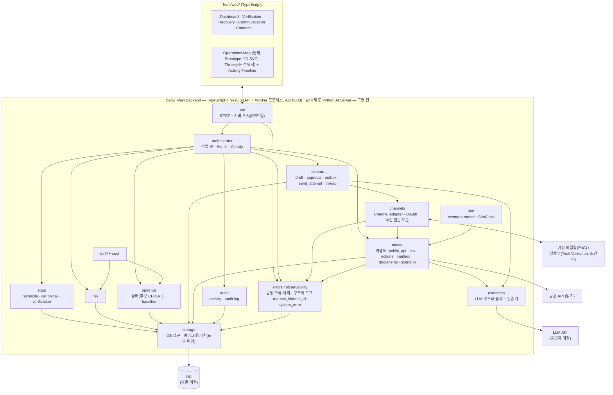

# 07. 백엔드 아키텍처

- 상태: Draft (기획 v0.2)
- 최종 수정: 2026-09-22 (**Q-68 결정 반영 — ADR-034**: DB = **PostgreSQL**(SQLite 미사용) · 접근 = **Drizzle ORM**(SQL-aware Hybrid) · migration = **drizzle-kit 생성 SQL 을 사람이 검토·커밋 뒤 명시 적용**. 3절 DB 줄 갱신). 이전: 2026-09-21 (**Q-64 결정 반영 — ADR-033**: Main Backend = **TypeScript + NestJS** 모듈형 모놀리스(API + Worker), **AI Server = 별도 Python 런타임**. 1·2·3·6절 갱신, 3절의 Python Backend 줄은 폐기 표시). 이전: 2026-09-18 (**T-070 문서 동기화**: 1·2절 Python·FastAPI·SQLite 를 확정처럼 읽히던 표현을 "미결 — `docs/23`"으로, 2·2.1절에 오류 처리·관측성과 외부 통신 흐름(Outbox·발송 시도·채널 어댑터·검증) 반영, 3절 Backend 줄을 초안 기록으로 표시, **4절 저장 스키마를 `docs/22` 논리 설계 대응표로 교체**(X-10), 6·7·8절 정리. **구현은 아직 없다** — 이 문서는 설계다). 같은 날 앞서: 런타임·오류 처리·관측성은 `23_runtime-platform-and-observability.md` 가 정본이 됐다. 이전: 2026-09-16 (**T-072: 3절 기술 표를 A~D 4분류로 읽도록 정리**(특정 LLM 공급자·모델은 요구사항이 아니라 "구현 시점 선택"), 4절 `messages` 대체 표기를 ADR-028 **Accepted**로 정정, 2.1절 실제 발송을 **Tech Validation**으로 정정). 같은 날 T-068: 6.1절 신설 — 결정론 엔진을 `ai/`에서 분리(ADR-029 Accepted), 6절 배치표 갱신, 4절 `messages` → `comm_*` 대체(ADR-028 Accepted). 이전: 2026-09-15 (6절 Monorepo 레이아웃 재정렬 ADR-024: `web/` → `front/web/`, `back/`·`ai/`·`packages/`·`infra/` 영역. 같은 날: 프론트엔드 스택 Next.js·화면용 조회 API, `canonical_facts`의 `evidence_time_quality`·`temporal_confidence`). 이전: 2026-09-11 T-032 저장 스키마 갱신
- 관련 ADR: ADR-002(스택 초안, Proposed), ADR-004(DB 초안, **Superseded by ADR-034**), ADR-034(PostgreSQL + Drizzle, Accepted), ADR-013(저장 방식), ADR-015(오케스트레이터), ADR-016(프론트엔드), ADR-018(시나리오 재생), ADR-026~029(외부 통신·책임 경계, Accepted), ADR-030·031(오류·관측성·런타임 방향, Proposed)
- **구현 상태**: 지금 코드가 있는 것은 `front/web/` Prototype(시나리오 재생, MockProvider)뿐이다. 아래의 Backend·DB·Event Store·엔진·채널 연동·오류 기록은 **설계**이며 아직 구현되지 않았다

---

## 1. 원칙

1. **모듈형 모놀리스**: Main Backend 는 **TypeScript + NestJS**(ADR-033 Accepted) 코드베이스 하나이고, 같은 코드베이스에서 **API 프로세스와 Worker 프로세스**를 따로 실행할 수 있다. DB 는 하나로 시작한다(**PostgreSQL — ADR-034**. DB 권한은 Main Backend 만). **AI Server 는 별도 Python 런타임**이며 권한이 없다(HTTP/JSON). 마이크로서비스, 메시지 브로커, 쿠버네티스, 멀티테넌트 인증은 PoC에서 만들지 않는다.
2. **순수 엔진 + 얇은 I/O**: 결정론 계산 모듈(`state`, `tariff`, `cost`, `risk`, `optimize`)은 DB·네트워크·LLM을 import하지 않는 순수 함수이며 **`back/` 영역**에 있다(ADR-029). I/O는 `intake`, `extraction`, `comms`, `channels`, `storage`, `api`에만 있다.
5. **오류는 세 경계에서 같은 방식으로 잡는다**: API 요청 · 외부 연동 · 백그라운드 작업이 공통 오류 처리와 구조화 로그를 쓰고, `request_id`·`trace_id` 를 남기며, 중요한 기술 오류만 `system_error` 로 기록한다. 현실 사실(`event`)·감사(`audit_log`)와 섞지 않는다. 상세는 `23` 4~6절.
3. **시뮬레이션과 실제가 같은 경로**: 시나리오 재생 이벤트는 실제 입력과 같은 Intake → Event Store → Reconciliation 경로를 탄다(ADR-018).
4. **프론트는 표시만**: 모든 숫자·상태·계획은 백엔드가 만든다.

## 2. 구성



### 2.1 요구 컴포넌트 → 모듈 대응

| 컴포넌트 | 모듈 | PoC 구현 | 이후 |
| --- | --- | --- | --- |
| API Gateway / Backend | `api` | REST + 서버 푸시(SSE 등). 프레임워크 미결(`23` 3절) | 인증·권한 (Pilot) |
| Event Ingestion Layer | `intake` | 어댑터별 함수, 원문 보관 | 실제 메일함·파트너 API |
| Event Store | `storage` + `raw_input` · `event` · `event_entity_link` (`22` 11절) | 덧붙이기만 (ADR-013) | — |
| State Reconciliation Engine | `state.reconcile` | 순수 함수, subject 단위 재계산 | — |
| Canonical State Store | `canonical_fact` · `conflict` · `verification_request` 파생 (`22` 11.4~11.6) | Reconciliation 이 다시 만든다. 사람 처리 기록은 `verification_request_handling` 에 따로 남는다 | — |
| Contract / Tariff Rule Engine | `tariff`, `cost` | 순수 함수, 휴일 캘린더 | — |
| Risk Engine | `risk` | 순수 함수 | — |
| Optimization Service | `optimize` (`back/` 결정론 영역, ADR-029) | in-process 솔버 (후보 CP-SAT, T-036에서 결정. Backend 언어에 따른 실행 위치는 Q-65) | 별도 워커(규모가 커지면) |
| Agent Orchestrator | `orchestrator` | in-process 큐 + 핸들러 표 | — |
| Communication Service | `comms` + `channels` | 초안·구조화 값·발송 승인(`message_approval`)·Outbox·발송 시도(`send_attempt`)·Channel Adapter·수신 원문 보존·발신자 등록부 매핑. 흐름은 2.2절 | **Tech Validation 단계부터 조건부 실제 발송** (ADR-027 Accepted. 조건은 `01_project-rules.md` 6.1절이 정본이며 여기에 복사하지 않는다) |
| Response Parser | `ai/` 추출 → `back/` 검증기 | LLM 은 값 후보 + 원문 인용만(`extraction`). 역할·권한·사실 키·확정은 Backend | — |
| Notification Service | `api` SSE + `notifications` 테이블 | 앱 안 알림 | 메일·메신저 |
| Audit Log | `audit` | activity + audit 테이블 (append-only) | — |
| Simulation Service | `sim` | 시나리오 로더, SimClock, 스크립트 회신 | — |
| Error Handling / Observability | `errors`(공통 오류 처리) · 구조화 로거 | 세 경계 공통 처리, `request_id`·`trace_id`, 중요한 오류만 `system_error`(`22` 16.2a) | 로그 저장소·관측 제품(Q-67) |

### 2.2 외부 통신 흐름 (정본: `18` · `19` · `22` 15절)

```text
발송:  초안(숫자는 계획에서 주입, 문장은 AI) → 사람 발송 승인(업무 메시지) → Outbox
       → 발송 시도(send_attempt, 외부 호출 전에 기록) → Channel Adapter → 결과 한 번 기록
수신:  원문 보존(raw_input) → 발신자 등록부 매핑(역할·권한, Backend) → AI 추출 후보(extraction)
       → Backend 검증(인용·스키마·단위) → Event → Reconciliation → 현재 사실(대개 PROVISIONAL)
실패:  발송 시도 결과 + 필요하면 system_error. 현실 Event 로 기록하지 않는다
```

- **AI 는 신원·권한·사실 키·현재 상태·숫자·발송을 정하지 않는다**(`18` O절, ADR-026·029).

## 3. 기술 스택 (ADR-033 Accepted · ADR-016 Proposed)

> **2026-09-21 — ADR-033(Accepted): Main Backend = TypeScript + NestJS, AI Server = 별도 Python 런타임.** 아래 표에서 **"(폐기)"** 로 표시한 줄은 옛 ADR-002(Python Backend, 이제 Superseded) 초안이다 — Main Backend 기술로 쓰지 않는다. 그 자리의 NestJS 쪽 구체 라이브러리(스키마·HTTP·스케줄·테스트·로깅)는 **U0(T-085)** 에서, DB·ORM·마이그레이션은 **ADR-034(Accepted, 2026-09-22 — Q-68 CLOSED)** 로 정했다: PostgreSQL + Drizzle ORM + drizzle-kit 검토 SQL migration. 오류 처리·관측성은 `23_runtime-platform-and-observability.md` 가 정본이다.

> **읽는 법 (2026-09-16 갱신)**: 아래 표의 각 줄을 네 가지로 구분해 읽는다. **특정 제품·모델 이름이 적혀 있다고 해서 요구사항이 아니다.**
>
> | 구분 | 뜻 | 해당 |
> | --- | --- | --- |
> | **A. 현재 구현된 기술** | 실제로 코드가 있다 | **프론트엔드 줄뿐** (Next.js + 2D SVG) |
> | **B. Accepted 결정** | 뒤집으려면 새 ADR이 필요하다 | 언어·API 줄(ADR-033, 2026-09-21) · **DB 줄(ADR-034, 2026-09-22)** |
> | **C. 판정 전 후보** | ADR이 Proposed다 | HTTP·스케줄·휴일·테스트 줄 (언어·API·DB 는 2026-09-21~22 에 B 로 옮겨졌다) |
> | **D. 구현 시점으로 미룬 선택** | **지금 고르지 않기로 한 것** | **LLM 공급자·모델·SDK**, 최적화 방식·솔버, ~~DB 제품, ORM·마이그레이션 도구~~(ADR-034 로 결정), 큐·워커, 클라우드 |
>
> **D는 특히 주의한다.** 사용자 방향은 *"구체적인 기술은 실제 구현 시점에 품질·비용·보안·유지보수성·최신 상황을 비교해 고른다"*이다. 아래 표에 적힌 특정 LLM 공급자·모델명은 **2026-09-11 시점의 예시**이지 CERA의 요구사항이 아니다.
>
> **요구사항인 것**은 따로 있다: 구조화된 출력을 받는다 · 값마다 원문 인용을 함께 받는다 · 결정론 검증기를 다시 돌린다 · 녹화 응답으로 네트워크 없이 재생할 수 있다 · 사용한 구현과 설정을 기록한다. 이것들은 `01` 3절·`19` 11절이 정본이다.

| 영역 | 선택 | 이유 |
| --- | --- | --- |
| 언어·런타임 | **Main Backend: TypeScript + NestJS**(ADR-033 Accepted, 버전은 U0) · **AI Server: Python**(FastAPI 또는 동등 — 구체 패키지는 구현 시점) | Frontend 와 같은 언어 · 모듈·DI·예외 필터가 `23` 의 오류 경계와 대응 · AI 는 Python 생태계 |
| 도메인 모델·스키마 | **스키마 단일 원천**(ADR-033 결정 7) — 라이브러리는 U0. ~~Pydantic v2~~ **(폐기 — ADR-002)** | 검증 · OpenAPI · 생성 타입이 한 정본에서 나온다 |
| API | **NestJS**(REST + 서버 푸시 — 방식은 구현). ~~FastAPI + SSE~~ **(폐기 — ADR-002)** | OpenAPI 를 계약 정본으로(ADR-028) |
| DB | **PostgreSQL**(ADR-034 Accepted — 로컬·시험·운영 모두. 버전·호스팅·로컬 실행 방식은 T-080/U0) · **Drizzle ORM**, SQL-aware Hybrid(핵심 경로는 PostgreSQL 의미를 드러내 쓴다) · **migration = drizzle-kit 생성 SQL → 사람 검토 → 저장소 기록 → 명시 적용**(운영 자동 동기화·`push` 금지). DB 권한은 Main Backend 만. ~~SQLite → PostgreSQL, SQLAlchemy 2.x + Alembic~~ **(폐기 — ADR-004 Superseded)** | FK · 복합 UNIQUE · 부분/조건부 유일(partial unique index 등으로 구현, 세부는 T-080) · 명시 트랜잭션 · 행 잠금(Outbox) · JSON · BIGINT · 타임존 시각 · append-only 를 DB 에서 강제. 개발·운영 DB 를 나누면 잠금·제약·시각 의미가 달라 시험이 왜곡된다 |
| 최적화 | **미정** — 현재 후보 OR-Tools CP-SAT (ADR-007 Reopened, T-036에서 MILP·min-cost flow 등과 비교해 결정) | 정수 비용·논리 제약 |
| HTTP·XML | **(초안)** httpx, lxml | 공공 API가 XML |
| LLM | **[D] 미정 — 구현 시점에 선택한다.** 아래는 2026-09-11 시점의 예시일 뿐 요구사항이 아니다: Anthropic Python SDK, `claude-opus-5`. **요구사항은 "무엇을 하는가"이지 "어느 제품인가"가 아니다** | 구조화 출력, 문서 입력, 원문 인용, 녹화 재생 (`01` 3절, `19` 11절) |
| 스케줄·워커 | **Worker 프로세스 + DB Outbox 단일 워커 폴링**(ADR-033 결정 5). 스케줄러 패키지는 U0. ~~APScheduler~~ **(폐기)** · SimClock(시나리오)는 유지 | 큐 제품 없음 |
| 휴일 | **(미정 — 구현 시점)** 휴일 데이터 + 수동 보정 파일. ~~`holidays`(KR, Python)~~ **(폐기)** | 영업일 Free Time |
| 테스트·린트 | **(미정 — U0)** TypeScript 쪽 단위·통합 시험과 속성 시험, 린트(생성 타입만 import 규칙 포함). ~~pytest, hypothesis, ruff~~ **(Main Backend 에서는 폐기 — AI Server 는 Python 도구)** | 속성 테스트(순서 무관성, 비용 단조성) |
| 프론트엔드 | TypeScript, React, **Next.js**(App Router), 운영 지도는 2D SVG. Three.js는 필요할 때만 | Control Tower Prototype으로 먼저 구현(ADR-022 Proposed, ADR-016 부분 개정). 화면은 Frontend Data Contract에만 의존(`16_frontend-prototype.md` 5절) |

## 4. 저장 스키마 (논리)

**정본은 `22_cera-logical-data-model.md`(rev.2.2, T-079 DONE)다.** 2026-09-18 T-070 에서 이 절의 옛 테이블 목록(개념 모델 이전 초안)을 지우고 대응표로 바꿨다(X-10). 컬럼·제약·변경 방식은 여기에 복사하지 않는다.

| 옛 초안 이름 | 논리 설계의 표 (`22`) | 비고 |
| --- | --- | --- |
| `events` · `raw_inputs` | `event` · `event_entity_link` · `raw_input` | 사건마다 주체 1건, 근거 강도는 사건에 저장하지 않는다(11.2~11.3) |
| `canonical_facts` · `conflicts` · `verification_requests` | `canonical_fact` · `conflict` · `verification_request` + `verification_request_handling` | 파생 표는 다시 만들 수 있고, 사람 처리 기록은 논리 연결 키로 남는다(11.4~11.7) |
| `planning_snapshots` | `planning_snapshot` + `_fact` · `_constraint` · `_input` | 계산에 쓴 입력을 값으로 얼린다(13.1~13.2b) |
| `plan_decisions` | `plan_decision` · `operator_planning_constraint` | 계획 결정과 계획 조건은 다른 기록이다(13.5~13.6) |
| `containers` | `container` · `bl` · `container_bl` · `external_identifier` | B/L 은 독립, 연결 표(8절) |
| `resources` | `facility` + `facility_warehouse` · `_terminal` · `_odcy` · `truck_pool` | 마스터는 평시 기준선만, 그날 값은 사실(9절) |
| `contracts` · `tariff_rules` | `contract` · `tariff_rule` | 요율 규칙은 판 교체(12.1~12.2) |
| `rate_quotes` | `commercial_offer` · `commercial_offer_item` + `TERM` 사건 | 제안은 근거, 현재 요율의 정본은 현재 사실(12.3~12.4) |
| `risk_snapshots` · `recovery_runs` · `assignments` | `risk_assessment` · `recovery_run` · `assignment` · `cost_result` · `cost_line_item` · `cost_line_link` | 계산 산출 기록, 사실이 아니다(13·14절) |
| `messages` | `comm_thread` · `question_item` · `comm_message` · `comm_message_structured_field` · `comm_message_question` · `message_approval` · `message_approval_structured_field` · `send_attempt` · `message_status_transition` · `extraction` · 등록부(`counterparty` → `counterparty_contact` → `contact_channel_address` · `contact_verification`) · `channel_connection` | ADR-028(15·10절) |
| `agent_activity` | 저장하지 않음 — Activity Timeline 은 조회로 만든다 | `22` 21절 |
| `audit_log` · `scenarios` | `audit_log` · `actor` · `scenario` | 16절 |
| (없었음) | `system_error` | 기술 운영 기록. 업무 사실이 아니다(16.2a, `23` 4절) |

- 논리 표 전체(MVP 51)는 **첫 마이그레이션이 아니다.** 물리 설계(T-080)는 T-069 가 정한 첫 슬라이스에 필요한 표부터 한다(`22` 26절).

## 5. 내부 API 초안

> **경로는 초안이다.** 외부 통신 슬라이스부터 Backend OpenAPI 가 계약 정본이 되며(ADR-028) 실제 endpoint 는 T-069 구현 계획에서 정한다. 오류 응답 모양(코드 · 사람이 읽을 문장 · `request_id`)도 계약에 들어간다(`23` 12절).

| 메서드 | 경로 | 설명 |
| --- | --- | --- |
| POST | `/intake/csv` | Watchlist·초기 상태 업로드 |
| POST | `/actions` | 짧은 액션(확인·수정·도착·입고·거절·수용량 변경 …) |
| POST | `/intake/daily-report` | 일일 집계 보고 |
| GET | `/state/containers`, `/state/containers/{no}` | Canonical State (사실별 상태·근거) |
| GET | `/state/resources` | 자원 Canonical State |
| GET | `/events?entity=`, `/events/{event_id}` | 근거 Event·원문 조회 |
| GET | `/state/facts/{entity_type}/{entity_id}/{fact_key}?as_of=` | "왜 이 값인가": Canonical Fact 전체(근거·규칙·설명) |
| GET | `/state/snapshot?as_of=` | Planning Snapshot 생성·조회 (`05` 14절) |
| GET/POST | `/verifications`, `/verifications/{id}/resolve` | 확인 큐 |
| GET/POST | `/contracts`, `/tariff-rules/{id}/confirm` | 계약 추출 후보·확인 |
| GET | `/risk/snapshot?as_of=` | 위험 집계 |
| POST | `/recovery/runs` | 최적화 실행(대상, 고정 조건) |
| GET/POST | `/recovery/runs/{id}`, `/recovery/runs/{id}/approve` | 결과·계획 승인. 본문: `acknowledged_provisional_inputs`, 선택 `verify_event_ids`(묶음 동작이면 먼저 `VERIFICATION` Event를 만들고 그다음 `PLAN_APPROVAL` 기록). 차단·입력 변경이면 409 (`05` 11.5) |
| GET/POST | `/messages`, `/messages/{id}/approve` | 초안·승인·스레드 |
| POST | `/sim/scenarios/{id}/start`, `/sim/clock` | 시나리오 재생·시계 제어 |
| GET | `/stream` | SSE: state diff, activity, 알림, 계획 갱신 |

**화면용 조회 API (Frontend Data Contract v0.1, 2026-09-15)**: Control Tower는 아래 읽기 전용 엔드포인트의 View Model만 쓴다. 지금은 `front/web/`의 MockProvider가 같은 모양을 시나리오 데이터 팩에서 돌려주고, 백엔드가 생기면 ApiProvider로 바꾼다. 응답은 `{ data, meta }`이고 `meta.result_kind`(SCENARIO_RESULT / ENGINE_RESULT)·`is_simulated`·`as_of`를 싣는다. 타입 정본은 `front/web/src/contracts/cera.ts`, 설명은 `16_frontend-prototype.md` 5절.

| 메서드 | 경로 | View Model |
| --- | --- | --- |
| GET | `/operations/today?as_of=` | 서술·KPI·활성 예외 |
| GET | `/containers?as_of=` | 컨테이너별 위험·현재 경로·사실별 신뢰 |
| GET | `/risks?as_of=` | 등급 분포·노출 |
| GET | `/resources?as_of=` | 창고·ODCY 게이지, 트럭 시간대별 부하, 자원 사실 |
| GET | `/recovery-plans/current?as_of=` | 현재 계획·Baseline·이력 |
| GET | `/communications?as_of=` | 연락 스레드·회신 추출값 |
| GET | `/activity?as_of=` | Activity Timeline (`kind`로 사실·결과·사람 결정 구분) |
| GET | `/data-trust?as_of=` | 신뢰 범주·신선도 개수·확인 대기 |

## 6. 저장소 레이아웃 — Private Monorepo (ADR-024, 2026-09-15 재정렬)

CERA는 **하나의 Private Monorepo**로 관리하며, Front / Back / AI는 코드 책임 영역으로 분리한다. 배포 시에는 서비스별 Docker Image로 분리할 수 있으며, Git Repository를 분리할 필요는 없다.

**현재 실제로 있는 것** (2026-09-15):

```text
container_exception/            ← 저장소 루트 = CERA 루트
├─ AGENTS.md · CLAUDE.md · README.md · .gitignore · .gitattributes
├─ front/
│  └─ web/        Next.js + React + TypeScript Control Tower Prototype
│                 (src/contracts · src/data/(provider, mock/) · src/components · scripts/)
├─ back/          README.md만 (구현 전)
├─ ai/            README.md만 (구현 전)
├─ packages/      README.md만 (비어 있음)
├─ infra/         README.md만 (구현 전)
├─ data/
│  └─ scenarios/busan-wh-capacity-01/   시나리오 데이터 팩 (front가 사용, 향후 back·ai·테스트 공통)
└─ docs/
```

**앞으로의 배치 계획** `[PROPOSED]` — 폴더는 필요할 때 만든다(T-003). 옛 계획의 `src/cera/<모듈>`을 두 영역으로 나눈 것이다.

| 영역 | 들어갈 모듈 (옛 `src/cera/` 이름) | 비고 |
| --- | --- | --- |
| `back/` | **I/O 계층**: `api`(REST + push), `errors`(공통 오류 처리·구조화 로그·`system_error` 기록, `23` 4~6절), `storage`(DB·마이그레이션), `intake`(어댑터: public_api·csv·actions·mailbox·documents·scenario), `channels`(Gmail 등 통신 채널 어댑터·OAuth), `comms`(초안·승인·Outbox·스레드·상대방 등록부), `orchestrator`, `sim`(시나리오 재생·SimClock), `config`(policy.yaml)<br>**결정론 엔진**(ADR-029): `state`(reconcile·canonical·verification), `tariff`, `cost`, `risk`, `optimize` | Event 저장·Canonical State·연동·승인·감사·**모든 결정론 계산**이 여기. 엔진 패키지는 순수 함수이고 `storage`·네트워크·LLM 클라이언트를 import하지 않는다(`07` 1.2, `01` 3절) |
| `ai/` | **별도 Python AI Server 런타임**(ADR-033) — **LLM·비정형 처리만**(ADR-029 Accepted): LLM Provider, Email Extraction, Contract Extraction, Draft 자연어 문장, Explanation | 검증기·매핑은 Main Backend 쪽이다(`18` D.3). `ai/` 는 **DB 커넥션·ORM·채널·업무 외부 API 클라이언트를 갖지 않는다** — 가진 외부 클라이언트는 LLM 공급자 호출뿐. Main Backend 와 **HTTP/JSON 계약으로만** 만난다 |
| back·ai 공통 | **없다**(ADR-033 결정 10) — 두 런타임은 언어가 다르고 **HTTP 계약으로만** 만난다. 공유되는 것은 AI Server 요청·응답 **스키마(계약)** 뿐이다 | 옛 계획의 공통 `domain` 패키지는 만들지 않는다 |
| `packages/` | 화면·백엔드 공유 계약 | Backend의 **OpenAPI를 정본**으로 두고 TypeScript 타입을 자동 생성하는 방향. 지금은 `front/web/src/contracts/cera.ts`(손 작성) |
| `data/` | `scenarios/`(현재 JSON), `fixtures/`(마스킹·합성, 녹화 응답), `contracts/`(합성 계약서), `raw/`(실제 원본, `.gitignore`) | 현재는 `scenarios/`만 있음 |
| `infra/` | Dockerfile, compose, 클라우드 배포 | 서비스별 이미지(front / back / ai) |
| 테스트 | 각 영역 안에 둔다(`back/tests`, `ai/tests`, `front/web`의 검사 스크립트) | 옛 계획의 루트 `tests/`·`schemas/`는 영역별로 나눈다 |

**향후 방향 (확정 아님)**: Frontend는 Web 우선. Backend는 중앙 API·DB·Integration. Desktop 앱은 현업 필요성이 검증되면 기존 React 화면을 재사용하는 **중앙 Backend 의 Client**로 검토한다 — **2026-09-18 갱신: 첫 후보 Electron, Tauri 는 나중 재평가**(ADR-031 Proposed, `23_runtime-platform-and-observability.md` 8~10절).

### 6.1 결정론 엔진은 `ai/`에 두지 않는다 (ADR-029, Accepted 2026-09-16)

**위험·비용·Tariff·Reconciliation·최적화·Solver는 AI가 아니다.** CERA의 핵심 주장은 "숫자는 결정론 엔진에서만 나온다"(`01` 3절)이고 금지 주장에는 "AI가 D&D 비용을 계산한다"(`01` 4절)가 들어 있다. 그 코드가 `ai/`라는 폴더에 있으면 저장소를 여는 사람마다 그 주장을 의심하게 된다. 게다가 옛 배치는 순수 엔진 중 **`state`만 `back/`에 두고 나머지를 `ai/`에 둬서** 이미 일관되지 않았다.

| 영역 | 맡는 것 |
| --- | --- |
| `ai/` | LLM Provider, Email Extraction, Contract Extraction, Draft 자연어 문장, Explanation |
| `back/` 결정론 엔진 | Reconciliation·Canonical State, Freshness, Tariff·LFD, Cost·D&D, Risk·Slack Time, Constraint Validation, Optimization·Solver |

- **새 최상위 `engine/` 영역은 만들지 않는다.** 1인 개발·MVP 규모에서 세 번째 패키지·테스트 트리·의존 그래프는 과설계다. 별도 배포 이미지나 두 번째 소비자가 생기면 그때 다시 판단한다.
- 엔진 패키지는 순수 함수이고 `storage`·네트워크·LLM 클라이언트를 import하지 않는다. 패키지 경계로 강제한다.
- **적용 시점은 T-085(U0 Backend 뼈대)이다**(옛 T-003 흡수, 2026-09-21). 지금은 `back/`·`ai/`에 코드가 없어 이동 비용이 0이다. T-068에서는 폴더를 옮기지 않았다.
- `ai/README.md`·`back/README.md`·루트 `README.md`의 영역 문구는 T-070에서 맞춘다.

책임 경계 전체는 `18_external-communication.md` O절 표를 본다.

## 7. 설정·비밀

| 키 | 용도 |
| --- | --- |
| `UNIPASS_API_KEY` | UNI-PASS 인증키(`crkyCn`) |
| `DATA_GO_KR_SERVICE_KEY` | 공공데이터포털 `serviceKey` |
| LLM 공급자 키 (예: `ANTHROPIC_API_KEY`) | LLM (녹화 재생 모드에서는 불필요). **공급자는 미정**이라 키 이름은 구현 때 정한다 |
| `CERA_LLM_MODEL` | 쓸 모델 식별자. **기본값을 문서에 고정하지 않는다** — 구현 시점에 고른다(3절 D) |
| `CERA_LLM_MODE` | `live` / `replay` |
| `CERA_DB_URL` | DB 연결. 기본값은 DB 제품 결정(T-069 뒤) 다음에 정한다 |
| `CERA_TZ` | `Asia/Seoul` 고정 |

정책값(권한 매트릭스, 근거 강도표, τ·δ_m, 신선도 기준, 보류 기준, 버퍼, 등급 기준 — `05_event-and-state.md` 15절)은 `back/`의 config 모듈 아래 `policy.yaml`(옛 계획 `src/cera/config/policy.yaml`, 정확한 경로는 T-003)에 두고 값마다 `tag`와 `rationale`을 적는다. 정책 파일의 해시가 `policy_version`이 된다.

## 8. 만들지 않는 것 (PoC)

- 풀 Event Sourcing 프레임워크, CQRS 분리 배포 (ADR-013)
- 메시지 브로커, 분산 작업 큐
- PoC 단계의 실제 메일 발송(**Tech Validation 단계부터 조건부 허용** — `01_project-rules.md` 6.1절), 외부 시스템 Write (`01` 6절)
- 사용자 인증·권한·멀티테넌시 (로컬 단일 사용자 가정)
- 모바일 앱 (짧은 액션은 웹 반응형으로)
