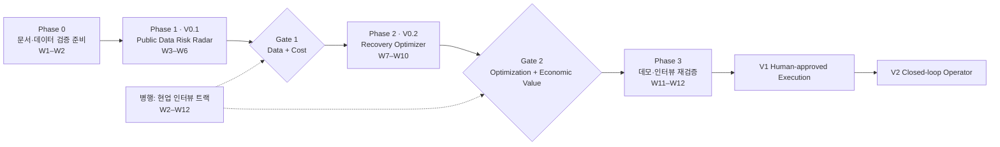

# 07. 로드맵 / 작업 계획

- 상태: Draft v0.1
- 최종 수정: 2026-09-10
- 이 문서는 `tasks/QUEUE.md`에 넣을 태스크의 **원천**이다. 큐가 비어 가면 여기서 다음 태스크를 꺼낸다.

---

## 1. 단계 요약

일정(W1 = 2026-09-14 주) `[ASSUMPTION]`: 1인 개발 + AI 에이전트 기준 12주 PoC. 기획서 부록 A의 "3개월 PoC"에 맞췄다.

## 2. Phase 0 — 문서·데이터 검증 준비 (W1–W2)

목표: 코드를 쓰기 전에 **데이터가 실제로 나오는지**와 **작업 체계**를 확정한다.

| 태스크 | 내용 | 산출물 |
| --- | --- | --- |
| T-000 | 문서 초안 세트 작성 | AGENTS.md, docs/* |
| T-001 | 초안 검토·ADR 승인 (사람) | ADR 상태 갱신 |
| T-002 | API 키 발급 (사람) | `.env` (로컬) |
| T-003 | 저장소 초기화 | pyproject, 디렉토리, CI 없이 로컬 테스트 |
| T-004 | 공식 명세·연계가이드 확보, 필드 사전 초안 | `docs/data/field-dictionary.md`, `code-tables.md` |
| T-005 | UNI-PASS 실제 호출, 원본 fixture | `ingest/unipass.py`, fixtures |
| T-006 | 해수부 외항화물컨테이너정보 실제 호출, 반영 지연 측정 | `ingest/mof_container.py`, 지연 측정 리포트 |
| T-029 | 공개 D&D Tariff 원문 조사 (선사 2~3곳) | `docs/data/tariff-research.md` |
| T-017 | 인터뷰 가이드 작성 | `docs/research/interview-guide.md` |

**Phase 0 종료 조건**: 실제 B/L 최소 5건의 원본 응답 확보, 필드 사전 초안 완성, R-1(실시간성) 1차 측정값 확보.

## 3. Phase 1 — V0.1 Public Data Risk Radar (W3–W6)

| 태스크 | 내용 | 의존 |
| --- | --- | --- |
| T-007 | ContainerState/Event 스키마 확정 (Pydantic + JSON Schema) | T-004 |
| T-008 | TariffRule 스키마 + 선사 1곳 실제 Tariff 구조화 | T-003, T-029 |
| T-009 | State Normalizer (파서 → 이벤트 → 상태 유도) | T-005, T-006, T-007 |
| T-010 | 시뮬레이션 데이터 생성기 (컨테이너 30~50대 + 자원 시나리오) | T-007 |
| T-011 | Baseline Cost Engine (LFD, 비용 항목, 손 검산 골든 테스트) | T-008, T-010 |
| T-012 | Risk Engine (SlackTime, 등급, 가정값 설정 파일) | T-011 |
| T-018 | 저장 계층 (SQLite + 마이그레이션) | T-007 |
| T-019 | 수집 스케줄러 (적응형 폴링, 재시도, stale 표시) | T-009, T-018 |
| T-013 | Risk Radar 대시보드 (SCR-01~05) | T-012, T-018, ADR-003 |
| T-014 | Gate 1 검증 리포트 | T-013 |

### Gate 1 기준 (`[ASSUMPTION]` 수치는 T-001에서 사람 확인)

| Gate | 판정 질문 | 통과 기준 초안 |
| --- | --- | --- |
| Data | 실제 공공데이터로 Container State를 안정적으로 만드는가? | 실제 B/L 샘플 20건 이상 중 90% 이상 상태 생성, 필드 출처 100% 추적 |
| Cost | Tariff를 결합해 D&D Exposure를 재현 가능하게 계산하는가? | 손 검산 골든 케이스 10건 오차 0원, 같은 입력·as_of에서 결과 해시 동일 |

## 4. Phase 2 — V0.2 Recovery Optimizer (W7–W10)

| 태스크 | 내용 | 의존 |
| --- | --- | --- |
| T-015 | 1단계 CP-SAT 모델 + Baseline 휴리스틱 + 벤치마크(30/50/100대) | T-011, T-010 |
| T-016 | Recovery Console (SCR-06, 07) | T-015, T-013 |
| T-020 | 비용 계수 사전계산 (cost[c,r,s]) 성능 최적화 | T-015 |
| T-021 | 대안 모델 비교 메모 (MILP / min-cost flow) | T-015 |
| T-022 | LLM: 계약 PDF → TariffRule 초안 (사람 승인 흐름 포함) | T-008 |
| T-023 | LLM: 추천 이유 요약 (숫자 검사 테스트 포함) | T-015 |
| T-024 | Gate 2 검증 리포트 | T-016 |

### Gate 2 기준 초안

| Gate | 판정 질문 | 통과 기준 초안 |
| --- | --- | --- |
| Optimization | 다수 컨테이너에서 Solver가 의미 있는 자원배치를 만드는가? | 50대·72h에서 60초 안에 FEASIBLE 이상, 모든 하드 제약 위반 0, 단순 휴리스틱보다 비용 낮음 |
| Economic Value | Baseline 대비 비용감소를 설명 가능한 금액으로 보이는가? | 시나리오 3종에서 절감액과 절감 이유(제약·경로)를 컨테이너 단위로 설명 가능 |

## 5. Phase 3 — 데모·인터뷰 재검증 (W11–W12)

| 태스크 | 내용 |
| --- | --- |
| T-025 | 데모 시나리오 스크립트 (기획서 37대 예시 재현 + 실제 데이터 혼합) |
| T-026 | 인터뷰 결과 종합 → 고객·문제·BM 가설 갱신 (`02_product-brief.md`) |
| T-027 | V1 범위 확정 문서 (작업지시 종류, 승인 흐름, 감사 로그) |

## 6. V1 / V2 (PoC 이후, 개요만)

- **V1 Human-approved Execution**: Observe → Detect → Optimize → Approve. 작업지시 생성, 승인, 실행 결과 수기 입력, 이벤트 기반 재최적화, 알림 채널, 2단계(개별 트럭) 스케줄링.
- **V2 Closed-loop Operator**: Observe → Detect → Optimize → Approve → Reserve → Dispatch → Monitor → Re-optimize. TMS/VBS/ODCY/EDI 연동은 **권한을 확보한 뒤에만** 진행한다.

## 7. 병행 트랙 — 현업 인터뷰 (W2–W12)

| 순서 | 내용 | 검증 대상 |
| --- | --- | --- |
| 1 | 인터뷰 가이드 작성 (T-017) | — |
| 2 | 중소·중견 포워더 10~20명 인터뷰 | R-2 D&D/LFD 수작업 정도, 첫 고객 |
| 3 | ODCY·운송사 비용구조 인터뷰 | R-3 ODCY가 실제로 절감인가 |
| 4 | BPA·터미널·운송사 확인 | R-4 VBS/TMS 외부 연동 범위 |
| 5 | 경쟁제품 데모 비교 | R-5 한국형 Recovery 공백 |

에이전트가 할 수 있는 부분(가이드·질문지·결과 정리)만 태스크로 만들고, 실제 인터뷰는 `NEEDS_HUMAN`으로 둔다.

## 8. 기획서 개발 착수 순서(15장)와의 대응

| 기획서 순서 | 태스크 |
| --- | --- |
| 1. 공공데이터 API 명세 실제 호출, 필드 사전 | T-004, T-005, T-006 |
| 2. ContainerState JSON Schema 확정 | T-007 |
| 3. 선사 1곳 Tariff 실제 예제 구조화 | T-008 |
| 4. 컨테이너 30~50대 시뮬레이션 데이터 | T-010 |
| 5. Baseline Cost Engine | T-011 |
| 6. OR-Tools Recovery Optimizer | T-015 |
| 7. Risk Radar + Recovery Console 데모 | T-013, T-016 |
| 8. 현업 인터뷰 재검증 | 7절 트랙, T-026 |
