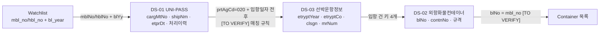

# 11. 데이터 출처와 검증

- 상태: Draft (기획 v0.2)
- 최종 수정: 2026-09-16 (T-068 Audit: 5절 메일 분류를 결정론 등록부 조회로 확정, "모호하면 LLM 분류" 폐기. 구조화 채널의 LLM 우회 규칙 추가). 이전: 2026-09-15 (T-060: RECEIVED_ONLY → 신선도 UNKNOWN)
- 관련: `05_event-and-state.md`(Event·신뢰도·신선도), `18_external-communication.md`(외부 통신 루프·채널·상대방 등록부), `data/field-dictionary.md`(공공 API 필드 정본, 출처 ID `S-nn`), `data/code-tables.md`

---

## 1. 원칙

- 모든 출처는 Event를 만든다. 출처마다 **만드는 Event 유형, 기본 신뢰도, 신선도 기준 시각, PoC 구현 방식**을 정한다.
- 어느 출처도 단일 진실원천이 아니다(`01_project-rules.md` 1절).
- 원문은 가공하지 않고 `raw_inputs`에 보관한다. 실제 원문은 `data/raw/`에만 두고 커밋하지 않는다.

## 2. 출처 카탈로그

| 채널 | 출처 | 만드는 Event (예) | source_type | 기본 신뢰도 `[ASSUMPTION]` | 신선도 기준 시각 | PoC 구현 |
| --- | --- | --- | --- | --- | --- | --- |
| 사람 | 짧은 액션(확인·수정·도착·입고·거절·수용량 변경 …) | 마일스톤, 위치, 예외, 자원 | `HUMAN_UI` (역할: 로그인 사용자의 역할) | HIGH | 입력 시각(또는 사용자가 적은 발생 시각) | 실제 UI |
| 사람 | 일일 집계 보고 | `WAREHOUSE_DAILY_REPORT` | `HUMAN_UI` / WAREHOUSE | HIGH | 보고 시각 | 실제 UI |
| 사람 | CSV/Excel 업로드 | `CONTAINER_REGISTERED`, 초기 마일스톤 | `FILE_IMPORT` (강도 최대 2) | MEDIUM | 파일에 적힌 기준 시각 → 없으면 업로드 시각 | 실제 UI |
| 메일 | 운송사 회신 | `TRUCK_AVAILABILITY_REPORTED`, `RATE_QUOTE_RECEIVED` | `EMAIL` / TRUCKING + LLM 추출 | 검증기 결과(`05` 4.6) | 발신 시각 | 가상 메일함 + 스크립트 회신 |
| 메일 | ODCY 회신 | `YARD_CAPACITY_REPORTED`, `RATE_QUOTE_RECEIVED` | `EMAIL` / ODCY + LLM 추출 | 검증기 결과 | 발신 시각 | 가상 메일함 |
| 메일 | 창고 메일 | `WAREHOUSE_CAPACITY_CHANGED`, `EXCEPTION_RAISED`(수령 거부) | `EMAIL` / WAREHOUSE + LLM 추출 | 검증기 결과 | 발신 시각 | 가상 메일함 |
| 문서 | 선사·운송사·ODCY 계약서 | `CONTRACT_TERM_EXTRACTED` → TariffRule DRAFT | `DOCUMENT` + LLM 추출 (확인 전 강도 0) | 검증기 결과 | 계약 적용기간 | 합성 계약서 |
| 공공 API | DS-01 UNI-PASS 화물통관진행정보 | 통관 상태, 처리이력(반출입 일시), 입항일자 | PUBLIC_API | MEDIUM | 응답 속 처리·반출입 일시 | 녹화 fixture (+ 키가 있으면 실호출) |
| 공공 API | DS-03 해수부 선박운항정보 | `ARRIVAL_DECLARED`(입항 **신고** 일시 — 실제 입항 확정 아님) · `LOCATION_REPORTED`(계선 시설) | PUBLIC_API | MEDIUM | 입항 일시 | **T-102 구현** — Backend 어댑터 · replay(합성 fixture) · live(키) |
| 공공 API | DS-02 해수부 외항화물컨테이너정보 | `VESSEL_CALL_LINKED`, `BL_LINKED`, `EQUIPMENT_REPORTED` (적하목록 스냅샷 — **T-102 구현**) | PUBLIC_API | MEDIUM | **수신 시각**(컨테이너별 일시 없음) | 녹화 fixture |
| 공공 API | DS-04 부산항 체인포털 | — | — | — | — | 공개 API 미확인, 사용 안 함 |
| 파트너 | TMS, 터미널, 파트너 API | 마일스톤, 자원 | PARTNER_SYSTEM | HIGH | 시스템 시각 | Scale 단계 |
| 시나리오 | 시나리오 스크립트 | 흉내 내는 출처의 Event | 흉내 내는 출처 + `is_simulated` | 시나리오 지정 | 시나리오 시각 | 실제 |

## 3. 공공 API

### 3.1 역할 (제한)

1. **자동 초기화**: B/L 기반 컨테이너 목록, 통관 상태, 입항 정보, 규격을 채운다(OBSERVED).
2. **교차 검증**: 사용자 입력과 다르면 Conflict·알림을 만든다.
3. **히스토리 보강**: 사람이 입력하지 않은 과거 Event(처리이력의 반출입 일시 등)를 사후에 채운다.

공공 API 응답을 현실의 최신 상태로 쓰지 않는다. 판단에 쓰일 때는 신선도(`05_event-and-state.md` 5절)를 반드시 계산한다. 공공 API는 권한이 A여도 근거 강도가 최대 2이다. 신선도는 응답 속 발생·처리 시각으로만 판단하고, fetch(수신) 시각은 근거로 쓰지 않는다. 응답에 시각이 없으면 `RECEIVED_ONLY`로 표시하고 신선도를 `UNKNOWN`(STALE이 아님, `temporal_confidence = LOW`)으로 둔다. 중요 사실이면 STALE처럼 확인·재조회·승인 게이트가 걸린다(`05_event-and-state.md` 5.2, T-060).

### 3.2 확인된 사실 요약 (T-004, 2026-09-11 · 2026-10-22 재확인)

> **2026-10-22 재확인(T-101 · T-102)**: DS-01 · DS-02 · DS-03 모두 정상 · 무료. DS-02/03 포털 수정 2026-10-06 · 가이드 새 PDF(field-dictionary S-09 · S-10, 필드 구성 같음 · 일부 크기 정정). DS-01 은 변동 없음(가이드 해시 같음), 호출 한도 공개 수치 없음(Q-05). 해수부 15057599(외항컨테이너반출입정보)는 입항 건 **집계**라 컨테이너별 근거가 아니다. UNI-PASS API048(보세구역 반출신고)이 컨테이너별 반출 시각 후보 — 단위 `[TO VERIFY]`(T-106). **구현**: 공공 API 는 Backend `back/src/public-data/` 만 부른다(ADR-036 결정 3). Agent · AI Server · 브라우저는 직접 부르지 않는다.

필드 단위 정본은 `data/field-dictionary.md`다. 여기에는 결정에 필요한 요약만 둔다.

| ID | 데이터 | 조회 키 | CERA 용도 (v0.2) | 태그 |
| --- | --- | --- | --- | --- |
| DS-01 | 관세청 화물통관진행정보 (UNI-PASS API001, data.go.kr 15126268). `https://unipass.customs.go.kr:38010/ext/rest/cargCsclPrgsInfoQry/retrieveCargCsclPrgsInfo` (GET, XML, `crkyCn`) | 화물관리번호, 또는 MBL/HBL + B/L 연도 | 통관 상태, 처리이력(처리구분·반출입일시·장치장)으로 **초기화·교차 검증·히스토리 보강** | `[VERIFIED S-01, S-02, S-08]` |
| DS-02 | 해수부 외항화물컨테이너정보 (data.go.kr 15131742). `https://apis.data.go.kr/1192000/CargFrghtContnOut/ContnInfo` (GET, XML, `serviceKey`) | **선박 입항 건**: 항만청코드 + 입항연도 + 입항횟수 + 호출부호 | B/L ↔ 컨테이너 목록, 규격·사이즈 (**적하목록 스냅샷**, 이벤트 출처 아님) | `[VERIFIED S-03, S-04, S-08]` |
| DS-03 | 해수부 선박운항정보 (data.go.kr 15006353). `https://apis.data.go.kr/1192000/VsslEtrynd5/Info5` | 항만청코드(부산 `020`) + 검색 기간 (+ 호출부호) | DS-02 조회 키(입항횟수) 확보, ATA, 선석 | `[VERIFIED S-05, S-06]` 조인 필드. 전체 필드 사전은 T-030 |
| DS-04 | 부산항 체인포털 | — | 사용 안 함 | `[TO VERIFY]` 공개 API를 1차 출처에서 찾지 못함 (Q-21) |

추가로 확인된 사실:

| 사실 | 태그 |
| --- | --- |
| UNI-PASS는 오류여도 HTTP 200 + `tCnt=-1` + 한글 `ntceInfo`로 응답한다. 여러 건이면 `[N00]` 목록 응답을 준다 | `[VERIFIED S-02, S-08]` |
| UNI-PASS 조회 가능 기간: 2023-06-17부터 3년 이내. IP로는 호출할 수 없다(도메인명만) | `[VERIFIED S-01, S-02]` |
| UNI-PASS 연계 가이드에 "관세청 사전 승인 없이 복사·전재·배포·사용 금지" 문구가 있다 → 원문을 저장소에 두지 않는다 | `[VERIFIED S-02]`, Q-17 |
| DS-02 공식 명세에 **컨테이너별 반출입 일시 필드가 없다**. 시각 필드는 선박 `etryndDt`뿐이다 | `[VERIFIED S-03, S-04]` |
| DS-02 `numOfRows` 최대 50, 개발계정 1,000, 30 tps, 갱신주기 표기 "실시간" | `[VERIFIED S-03, S-04]` (실제 지연은 `[TO VERIFY]` R-1) |
| DS-03 개발계정 10,000, 운영 자동승인, 30 tps | `[VERIFIED S-05, S-06]` |
| 공공데이터포털 게이트웨이 오류는 `OpenAPI_ServiceResponse/cmmMsgHeader` 봉투 + HTTP 401. 가이드와 포털의 에러코드 번호 체계가 다르다 | `[VERIFIED S-03, S-04, S-08]` |
| 15011649는 오픈API가 아니라 파일데이터(XLSX, 100행, 1회성) `해양수산부_컨테이너반출입정보_20230112`다. 옛 URL `/dataset/15011649`만 404였다. 현재 오픈API 후보는 15131742 | `[VERIFIED S-07]` (Q-03 CLOSED) |

아직 확인하지 못한 것: DS-01 호출 한도·갱신주기, 처리이력 값 목록(Q-12), 14자리 일시 타임존(Q-19), 여러 컨테이너 B/L의 표현(Q-20), 화물관리번호 ↔ 적하목록관리번호 관계(Q-04), DS-02 트래픽 단위(Q-05)·`tkinTkoutSe` 의미(Q-18), 양하 시각의 공식 출처(Q-22).

### 3.3 조인 경로

DS-02는 B/L로 조회할 수 없으므로(`[VERIFIED S-04]`) 조인은 **B/L → DS-01 → DS-03(입항 건) → DS-02** 순서다(`data/field-dictionary.md` 5절).

- DS-01의 항구 코드(`dsprCd`, 5자리)와 DS-02·03의 `prtAgCd`(3자리 항만청코드)는 체계가 다르다.
- 컨테이너 번호는 ISO 6346 체크디지트로 입력 단계에서 검증한다.

### 3.4 동기화 주기 `[ASSUMPTION]`

공공 API는 보조 출처이므로 폴링이 수집의 중심이 아니다. 동기화가 필요할 때는 아래를 초기값으로 쓴다.

| 대상 | 주기 |
| --- | --- |
| DS-01 (위험 CRITICAL 컨테이너의 B/L) | 30분 |
| DS-01 (HIGH / WATCH / LOW) | 1시간 / 3시간 / 6시간 |
| DS-01 (도착 전) | 12시간 |
| DS-03 | 입항 예정일 전후 하루 1~2회 |
| DS-02 | 입항 건마다 1~2회 스냅샷(`ceil(totalCount/50)`회 호출) |

- DS-01의 한도는 공식 수치가 없다(Q-05). 예: B/L 50건을 모두 1시간 주기로 조회하면 하루 1,200건이다.
- PoC 데모 경로는 녹화 fixture를 쓰므로 한도의 영향을 받지 않는다.

### 3.5 공공 관측의 쓰임 (T-136 · ADR-042)

- 공공 응답은 **근거(Evidence)** 다. 권한은 사실 영역별: 입항 신고 일시(Port-MIS)만 A → Truth OBSERVED. 위치 · 식별 정보는 관측 기록일 뿐
- 업체 주장과 결정론 교차 확인(허용 오차 60분 [ASSUMPTION]) — 충돌이면 사람 검토. 공공 근거가 없다고 업체 말이 틀린 것은 아니다
- 창고 수용량 · 트럭 가용 · 요율은 공공데이터가 다루지 않는다(NOT_COMPARABLE) — 묻지 않는다
- 업체 회신 메일 속 입항 일시도 교차 확인 대상이다(T-137) — 실제 메일은 실제 관측과, Mock 메일은 녹화 재생 관측과만 비교한다
- Agent 는 공공으로 확인할 수 있는 공백만 먼저 조회하고, 조회 실패는 실행을 멈추지 않는다

## 4. 공공 API가 주지 않는 데이터

`data/field-dictionary.md` 6절이 정본이다. 요약하면 다음 값은 공공 API가 주지 않는다: Free Time, LFD, D&D Tariff, 화주 특약, ODCY 용량·요율, 트럭 가용성, VBS 슬롯·예약(Write), D/O 발행, 목적지 수용량, 도착·적출·공컨 반납 시각, 컨테이너별 반출 시각(DS-01 이력은 B/L 단위), 양하 시각(공식 필드 미확인). 이 값들은 사람 입력, 메일, 계약서, 시나리오에서 온다.

## 5. 이메일 입력

| 항목 | PoC | Pilot |
| --- | --- | --- |
| 메일함 | 가상 메일함(DB 테이블 + 시나리오 스크립트 회신) | Gmail·회사 메일 연동 방식 `[TO VERIFY]` Q-33. 기술검증 1차 제안: **Gmail API + 전용 계정 + 전용 라벨 + CERA가 만든 Thread만 수집** `[PROPOSED]` (`18` G절) |
| 추출 여부 | **입력이 비정형일 때만 LLM을 부른다.** 구조화 채널(응답 폼·포털·TMS·CSV)은 스키마 검증만 하고 LLM을 거치지 않는다 (2026-09-16, ADR-026) | 같음 |
| 분류 | **발신자 주소 → 상대방 등록부 조회 + 스레드 상관. 전부 결정론이다.** 등록부에 없거나 스레드가 매칭되지 않으면 **Quarantine**(사람이 처리)이며, LLM에게 "누구인지" 묻지 않는다 (2026-09-16 개정, `18` A.1·D.5) | 같음 |
| 추출 | 구조화 출력 + 검증기(`05_event-and-state.md` 4.6) | 같음 |
| 원문 보관 | `raw_inputs` (합성 메일만 커밋) | 실제 메일은 커밋 금지, 보관 기간 정책 필요 |
| 발송 | 가상 발송 | 사람 승인 후 실제 발송 (ADR 필요) |

- `[TO VERIFY]` Q-28: 실제 운송사·ODCY·창고가 메일로 어떻게 소통하는가(형식, 회신 속도, 전화 비중).

## 6. 참고 출처

1차 출처(`data/field-dictionary.md` 0.2절 S-01~S-08, 확인일 2026-09-11):

- 관세청_화물통관진행정보: https://www.data.go.kr/data/15126268/openapi.do (참고문서 `화물통관진행정보_OpenAPI 연계가이드.docx`)
- 해양수산부_외항화물컨테이너정보: https://www.data.go.kr/data/15131742/openapi.do (참고문서 `DAT211_오픈API활용가이드_외항화물컨테이너정보.docx`)
- 해양수산부_선박운항정보: https://www.data.go.kr/data/15006353/openapi.do (참고문서 `DAT211_오픈API활용가이드_선박운항정보.docx`)
- 해양수산부_컨테이너반출입정보_20230112(파일데이터): https://www.data.go.kr/data/15011649/fileData.do
- 해양수산부_내항컨테이너반출입정보(범위 밖): https://www.data.go.kr/data/15058585/openapi.do
- 부산항 체인포털: https://www.chainportal.co.kr/main/ko
- Maersk D&D Terms (Tariff 조사 후보, T-029): https://terms.maersk.com/dnd

2차 출처(참고만, VERIFIED 근거 아님):

- UNI-PASS API 사용 예(블로그): https://www.autooffice.io/knowhow/unipass-bl-status-update. T-000에서 참고했고, T-004에서 공식 가이드로 대체했다
