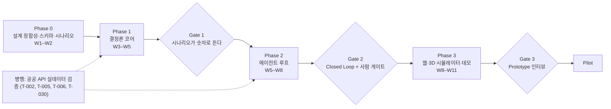
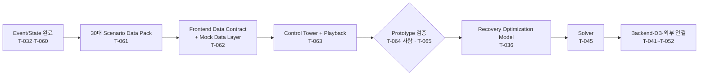

# 12. 로드맵

- 상태: Draft (기획 v0.2)
- 최종 수정: 2026-09-18 (7절에 Web First · Desktop 위치 한 줄. 런타임 방향 정본은 `23_runtime-platform-and-observability.md`). 이전: 2026-09-15 (2.5절 Prototype-led Discovery 추가, T-036 DEFERRED)
- 이 문서는 `tasks/QUEUE.md`에 넣을 태스크의 **원천**이다. 큐가 비어 가면 여기서 다음 태스크를 꺼낸다.
- 옛 v0.1 로드맵의 백로그 ID(T-009~T-016, T-018~T-028)는 폐기했다. 다시 쓰지 않는다(`CHANGELOG.md` 6절).

---

## 1. 단계 요약

일정(W1 = 2026-09-14 주) `[ASSUMPTION]`: 1인 + AI 에이전트 기준 약 11~12주. Phase 경계는 겹칠 수 있다.

**원칙**: 작동하는 Prototype을 가장 빨리 만든다. 공공 API 실데이터 검증은 병행하되 PoC 데모의 선행 조건이 아니다(데모 경로는 fixture).

## 2. Phase 0 — 설계 정합성·스키마·시나리오 (W1–W2)

| 태스크 | 내용 | 산출물 |
| --- | --- | --- |
| T-031 | 기획 v0.2 재정렬 (완료) | 정본 문서 세트 |
| T-001 | 사람 검토: 기획 v0.2, ADR-011~018, T-004 결과 | ADR 판정 |
| T-032 | Event·Source·Canonical State 스키마 + Reconciliation 규칙표 | `05` 확정안(스키마 표·R1~R12·검증 사례), `04` 2절 상태 모델. JSON Schema는 T-041에서 Pydantic 모델로 생성 |
| T-033 | Contract·Tariff·RateQuote 스키마 | JSON Schema 초안, `04` 4절 확정 |
| T-034 | 메일 Event 스키마 + LLM 추출 계약 + 평가 세트 설계 | 추출 스키마, 합성 메일 목록 |
| T-035 | Risk 모델 명세 (자원 부족·영향 탐지 포함) | `04` 6절 확정 |
| T-036 | Recovery 최적화 모델 명세 (MVP 규모, Baseline, 재최적화) — **DEFERRED** (2.5절, ADR-023) | `08` 확정 |
| T-037 | MVP 시나리오 데이터 팩 | `data/scenarios/busan-wh-capacity-01.yaml` |
| T-029 | 공개 D&D Tariff 원문 조사 | `docs/data/tariff-research.md` |
| T-003 | 저장소 초기화 (`back/`·`ai/` 뼈대. `front/web`은 2026-09-15 선행 완료, Monorepo 영역은 ADR-024) | pyproject, 디렉토리, 빈 테스트 |

**Phase 0 종료 조건**: ADR-011~018 판정, T-032·T-036·T-037 완료, 저장소 초기화. (2026-09-15: T-036은 2.5절 Prototype 검증 뒤로 옮겼다)

## 2.5 Phase 0.5 — Prototype-led Discovery (2026-09-14 사람 지시, ADR-023)

**변경 이유**: 실제 운영 데이터와 제약이 충분히 검증되지 않은 상황에서 수학모델을 먼저 고정하면 가정을 과도하게 설계할 위험이 있다. 작동하는 화면과 30대 시나리오를 먼저 만들고 현업 검증 결과를 Solver 설계에 반영한다. 기획 후퇴가 아니라 Prototype-led Discovery(`02` 9절)를 실제 개발 순서에 적용한 것이다. Optimization 설계(`08`)는 삭제하지 않는다.

| 태스크 | 내용 | 산출물 | 상태 |
| --- | --- | --- | --- |
| T-060 | Event/State 마무리: RECEIVED_ONLY → 신선도 UNKNOWN (STALE 아님) | `05` 5.2·5.3·8.4 | 완료 |
| T-061 | 30대 Scenario Data Pack (Prototype 판, 의도 설계) | `data/scenarios/busan-wh-capacity-01/` | 완료 |
| T-062 | Frontend Data Contract + Mock Data Provider | `front/web/src/contracts/`, `front/web/src/data/` | 완료 |
| T-063 | CERA Operations Control Tower + Scenario Playback | `front/web/`, `docs/16_frontend-prototype.md` | 완료 |
| T-064 | Prototype 사람 검토 + 현업 검증 질문 (NEEDS_HUMAN) | 검토 결과 | 대기 |
| T-065 | Prototype 발견 요구사항(`16` 11절 G-1~G-13)을 `04`·`05`·`08`에 반영 | 정본 갱신 | T-064 뒤 |

- 이 단계가 끝나면 T-036을 다시 연다(DEFERRED → TODO). T-036의 입력에 `16` 11절이 추가된다.
- Phase 3의 T-054(대시보드)·T-056(시뮬레이터)·T-040(Wireflow)·T-038(시뮬레이터 명세)은 Prototype이 일부를 먼저 만들었다. 범위는 T-065에서 다시 정한다.

## 3. Phase 1 — 결정론 코어 (W3–W5)

LLM 없이, 시나리오를 CLI로 재생해 숫자가 나오게 한다. 회신은 이미 구조화된 Event로 스크립트한다.

| 태스크 | 내용 | 의존 |
| --- | --- | --- |
| T-041 | Event Store + 저장 계층 (DB 제품 미결 — T-069 뒤 결정, 마이그레이션, append-only 보장) | T-003, T-032 |
| T-042 | Reconciliation + Canonical State + Verification 큐 (순수 함수, 속성 테스트) | T-041 |
| T-043 | Tariff·Cost 엔진 (LFD, 비용 항목, 손 검산 골든 테스트) | T-033 |
| T-044 | Risk 엔진 (SlackTime, 자원 부족, 영향 컨테이너) | T-042, T-043, T-035 |
| T-045 | Optimizer (T-036에서 고른 솔버) + Baseline + 재최적화 + 재현성 | T-043, T-036 |
| T-046 | 시나리오 러너 + SimClock + CLI 재생 (end-to-end, LLM 없음) | T-037, T-042, T-044, T-045 |
| T-047 | Gate 1 리포트 | T-046 |

### Gate 1 기준 `[ASSUMPTION]` (T-001에서 사람 확인)

| 판정 질문 | 통과 기준 |
| --- | --- |
| 시나리오가 결정론적으로 도는가? | 3회 재생 결과 해시 동일 |
| 비용이 맞는가? | 손 검산 골든 케이스 10건 오차 0원 |
| 상태 정합성이 동작하는가? | 충돌 장면에서 Conflict 생성 → 확인 → 해소가 Event로 재현됨 |
| 최적화가 의미 있는가? | 12대 영향 장면에서 Baseline보다 비용이 낮고, 하드 제약 위반 0, 5초 이내 |

## 4. Phase 2 — 에이전트 루프 (W5–W8)

| 태스크 | 내용 | 의존 |
| --- | --- | --- |
| T-048 | Intake 어댑터 (CSV, 짧은 액션, 일일 보고, 가상 메일함, 공공 API fixture 래퍼) | T-041 |
| T-049 | 추출(메일·회신): 구조화 출력 + 검증기 + 녹화 fixture + 평가 | T-034, T-048 |
| T-050 | Contract Agent (PDF → TariffRule DRAFT + 근거) + 확인 흐름 | T-033, T-049 |
| T-051 | Communication (초안, 승인, 가상 발송, 스레드) + 결과 설명(숫자 검사) | T-045, T-049, T-039 |
| T-052 | Orchestrator + Agent Activity + API/SSE | T-046, T-048 |
| T-053 | Gate 2 리포트 | T-049~T-052 |

### Gate 2 기준 `[ASSUMPTION]`

| 판정 질문 | 통과 기준 |
| --- | --- |
| Closed Loop가 도는가? | 예외 → 계획 → 초안 → 승인 → 가상 발송 → 회신 3건 추출 → 재최적화가 사람 게이트를 지키며 완주 |
| 추출을 믿을 만한가? | 합성 회신 평가 세트에서 필드 정확도 목표치 이상(T-034에서 정함), 틀린 추출이 확인 없이 확정된 경우 0 |
| 안전한가? | 승인 없는 발송 경로 없음, LLM 출력의 숫자 검사 통과 |

## 5. Phase 3 — 웹·3D 시뮬레이터·데모 (W8–W11)

| 태스크 | 내용 | 의존 |
| --- | --- | --- |
| T-054 | Operations Dashboard + Container Detail + Verification UI를 실제 API에 연결 (웹 뼈대·Prototype 화면은 `front/web`에 선행 완료) | T-052, T-040 |
| T-055 | Recovery Console + Communication UI + Contract UI | T-054 |
| T-056 | Operations Simulator + Agent Activity Timeline (Prototype 2D를 확장. Three.js는 필요할 때만, ADR-022) | T-038, T-052 |
| T-057 | 데모 모드, 30초 영상 스크립트, 시나리오 다듬기 | T-055, T-056 |
| T-058 | Prototype 인터뷰 수행 (NEEDS_HUMAN) + 결과 종합 | T-057, T-017 |
| T-059 | Gate 3 리포트 → Pilot 범위 결정 | T-058 |

### Gate 3 기준

| 판정 질문 | 통과 기준 초안 |
| --- | --- |
| 현장이 "무엇이 틀렸는지"를 말해 주는가? | 인터뷰 5~10건에서 구체적 오류·누락 피드백 수집 |
| 문제·고객 가설이 살아남는가? | R-2, R-3, R-7, Q-28, Q-29 각각에 1차 결론 |
| Pilot 후보가 있는가? | 실제 데이터 제공 의향이 있는 곳 1곳 이상 |

## 6. 병행 트랙

| 트랙 | 태스크 | 비고 |
| --- | --- | --- |
| 공공 API 실데이터 | T-002(키, 사람), T-005(UNI-PASS), T-006(선박운항·외항화물 + 지연 측정), T-030(추가 명세) | 초기화·교차 검증 품질과 R-1 측정. 데모 선행 조건 아님 |
| Discovery | T-017(Prototype 인터뷰 가이드) → T-058 | 인터뷰는 데모가 생긴 뒤에 한다 |
| 설계 명세 | T-038(시뮬레이터 상세), T-039(Communication·Response 명세), T-040(UI Wireflow) | Phase 2·3 착수 전 |

## 7. Pilot 이후 (개요)

- **Pilot**: 실제 고객 1~2곳의 데이터, 실제 메일함 연동(읽기 + 승인 후 발송), 실행 결과 입력, 실측 KPI.
- **Desktop (선택지, 일정 없음)**: **Web First.** Web 에서 폐쇄 루프(예외 → 상태 → 위험·비용 → 복구 계획 → 문의 → 승인 → 발송 → 회신 → 재계산)가 동작하고 현업 필요성이 확인된 뒤에만 검토한다. Desktop 은 중앙 Backend 의 Client 이고 첫 후보는 Electron 이다(ADR-031 Proposed, `23` 7~10절).
- **Scale**: 파트너 시스템(TMS·터미널) 연동, 권한을 확보한 범위의 예약·배차 Write, 2단계 차량 스케줄링.
