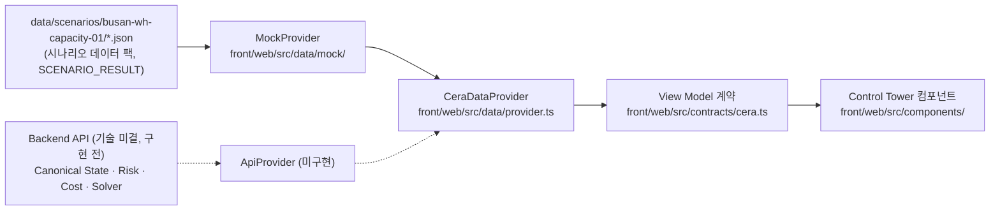

# 16. Frontend Prototype — CERA Operations Control Tower

- 상태: Draft — **Prototype 구현 완료, 사람 검토 대기** (T-061~T-063, 2026-09-15)
- 관련 ADR: **ADR-035(Vite + React SPA, CSR 만 — Accepted 2026-10-06)**, ADR-022(2D SVG + Mock Provider, Proposed — Next.js 부분은 ADR-035 가 대체), ADR-023(Prototype 우선 개발 순서, Proposed), ADR-016(웹 프론트엔드), ADR-018(시나리오 재생)
- 코드: `front/web/` · 시나리오 데이터 팩: `data/scenarios/busan-wh-capacity-01/`
- 관련 문서: `09_mvp-scenario.md`(시나리오 정본), `10_simulation-spec.md`(시뮬레이터 요구사항), `05_event-and-state.md`(출처·신선도), `08_optimization-model.md`(계획 출력)

---

## 1. 왜 지금 Prototype인가

실제 운영 데이터와 제약이 충분히 검증되지 않은 상태에서 수학모델(T-036)을 먼저 고정하면 가정을 과도하게 설계할 위험이 있다. 그래서 작동하는 화면과 30대 시나리오를 먼저 만들고, 현업 검증 결과를 Solver 설계에 반영한다.

이것은 기획 후퇴가 아니라 **Prototype-led Discovery(`02_product-definition.md` 9절)를 실제 개발 순서에 적용한 것**이다. Optimization 설계(`08`)는 삭제하지 않았고 T-036은 `DEFERRED`로 보류했다(ADR-023, `12_roadmap.md` 2.5절).

화면이 10~30초 안에 답해야 하는 것: **문제가 생겼고, 누가 위험하고, 무엇을 바꿨으며, 얼마를 줄였는가.**

## 2. 범위

| 한다 | 하지 않는다 |
| --- | --- |
| 30대 합성 시나리오 데이터 팩(의도 설계, Faker 없음) | Solver·Risk·Cost 엔진, T-036 상세 모델, CP-SAT·MILP·OR-Tools |
| Frontend Data Contract + Mock Data Provider | Backend 본 구현(Main Backend = TypeScript + NestJS — ADR-033, 2026-09-21. 구현 전), DB, 마이그레이션, 캐시 |
| Control Tower 한 화면 + 시나리오 재생(Reset·이전·다음·Play) | 실제 메일·공공 API·VBS/TMS 연동, LLM 연결 |
| 결과값은 fixture에 명시하고 `SCENARIO_RESULT`로 표시 | 인증, Microservice, Kafka, Event Sourcing 프레임워크 |
| 추상 2D 운영 지도(SVG) | 부산항 지형 재현, 게임형 3D, Digital Twin |

## 3. 실행

```text
cd front/web
npm install
npm run validate:scenario   # 데이터 팩 정합성 (합계·용량·트럭·KPI·금지 표현)
npm run typecheck           # tsc --noEmit
npm test                    # vitest — API 경계 · 상태 매핑 단위 시험(브라우저 · Backend 불필요)
npm run lint                # eslint
npm run build && npm run start   # 타입 검사 + vite build → dist/ 정적 파일, vite preview http://localhost:3000
npm run smoke               # 서버가 떠 있을 때: Edge/Chrome 헤드리스로 9단계 재생·화면 값 확인, 스크린샷 front/web/.smoke/
npm run dev                 # Vite 개발 서버 http://localhost:3000 (CSR 만 — 서버 렌더링 없음)
                            # /dev/api = Backend 응답 확인 화면. /backend/* 는 Main Backend(CERA_API_URL, 기본 127.0.0.1:3100)로 프록시
```

키보드: `→` 다음 이벤트, `←` 이전, `Esc` 상세 닫기.

## 4. 구조 — 나중에 구현체만 바뀐다



- 컴포넌트는 raw fixture를 import하지 않는다. `fixture.ts`는 MockProvider만 쓴다.
- 교체 순서: Mock Data → Backend API → Canonical State(DB) → Risk/Cost Engine → Solver. 각 단계에서 계약(`cera.ts`)은 그대로 두고 응답의 `meta.result_kind`만 `SCENARIO_RESULT` → `ENGINE_RESULT`로 바뀐다.
- 과도한 추상화는 하지 않았다: provider 인터페이스 하나, 구현 하나, 선택 함수 하나(`createProvider`, `VITE_CERA_PROVIDER`).

### 4.1 Backend 연결 경계 (2026-10-06 — 실제 Backend 연결 준비)

| 층 | 파일 | 하는 일 |
| --- | --- | --- |
| API base | `src/api/config.ts` | `VITE_CERA_API_BASE`(기본 `/backend` = 개발 Vite 프록시, 운영 `/api` 또는 배포 URL). **호스트 하드코딩 금지** — 잘못된 값이면 빌드된 앱이 바로 실패 |
| HTTP 클라이언트 | `src/api/client.ts` · `errors.ts` | JSON 요청 하나. 공통 오류 바디 `{code, message, request_id}` → `ApiError`(`HTTP` · `NETWORK` · `TIMEOUT` · `ABORTED` · `INVALID_RESPONSE`, `retryable`). 기본 15초 제한. 세션 고정 · 인스턴스 메모리 의존 없음(LB 뒤 어느 API 인스턴스든 응답 가능) |
| 엔드포인트 함수 | `src/api/health.ts` | 지금은 `/health` 뿐. **T-087 부터는 생성된 OpenAPI 타입**(`packages/contracts/openapi.json`)으로 쓴다 — Backend 소스 import 금지 |
| 요청 상태 | `src/state/async.ts` | `AsyncState` = `IDLE` · `LOADING` · `SUCCESS` · `FAILED`, `useAsyncAction`(새 요청이 옛 요청 취소 · 언마운트 취소 · 화면 전체를 막지 않음). 긴 AI 작업이 202 + 조회로 바뀌면 상태 하나를 더한다 |
| 공통 표시 | `src/components/workflow/` | `AsyncStatus`(실패 사유 · 다시 시도는 `retryable` 일 때만 · `request_id`) · `GateBlockers`(Backend Contact Gate 가 준 차단 사유를 제품 규칙 / 개발 안전장치로 나눠 표시 — 판정은 서버, FR-ELG-02·04·05) · `MessageLifecycle`(docs/19 15.1 의 보이는 상태 · 승인 무효화 → 재승인 필요) · `CandidateBadge`(AI 제안 · 잠정 · 사람 확인 필요 · 확인 완료 — **AI 표시는 `LLM_EXTRACTED` 일 때만**) |
| 데이터 출처 표시 | `src/components/BackendStatus.tsx` | 헤더에 "데이터: Mock (시나리오)"와 Backend 연결 상태를 **따로** 보여준다(Backend 가 살아 있어도 운영 데이터는 아직 Mock) |

- **Mock ↔ Real 교체**: 화면은 계속 `CeraDataProvider` 만 본다. T-087 부터 엔드포인트가 생기는 화면부터 `ApiProvider` 메서드가 `src/api/*` 를 부른다. 없는 Backend API 를 프론트에서 미리 지어내지 않는다.
- **연결 후보 위치**: 거래처 · 연락처 · Contact Gate → `Communications` 스레드 머리 + `GateBlockers` · 초안 · 승인 → `MessageLifecycle`(지금 `MessageView.lifecycle` 을 MockProvider 가 시나리오 상태에서 매핑) · 활동 → `ActivityTimeline`.
- 브라우저는 Main Backend 만 부른다. AI Server · LLM 공급자 · DB 직접 호출, 비밀값 보관 금지(`docs/23` 7.1).

## 5. Frontend Data Contract (v0.1)

모든 메서드는 `as_of`를 주입받는다(`01_project-rules.md` 5절). 응답은 `Envelope<T> = { data, meta }`이고 `meta`에 `contract_version`, `scenario_id`, `as_of`, `step_id`, `is_simulated`, `result_kind`, `provider`가 있다.

| 개념상 엔드포인트 | Provider 메서드 | View Model | Mock의 원천 |
| --- | --- | --- | --- |
| `GET /operations/today?as_of=` | `getOperationsToday` | `OperationsToday` (서술, KPI `OperationsSummary`, `ActiveException[]`, 고지문) | `scenario.json` steps[].kpi, `risk.json` exceptions |
| `GET /containers?as_of=` | `getContainers` | `ContainerView[]` (위험, 현재 경로, 사실별 `TrustView`) | `containers.json`, `risk.json`, `plans.json` |
| `GET /risks?as_of=` | `getRisks` | `RiskSummary` | `risk.json` states |
| `GET /resources?as_of=` | `getResources` | `ResourceStatus` (창고·ODCY 게이지, 트럭 시간대별 부하, 자원 사실) | `resources.json` facts_timeline, `plans.json` capacity_usage·truck_schedule |
| `GET /recovery-plans/current?as_of=` | `getCurrentRecoveryPlan` | `RecoveryPlanCurrent` (계획, Baseline, 이력) | `plans.json` |
| `GET /communications?as_of=` | `getCommunications` | `CommunicationThread[]` | `communications.json` |
| `GET /activity?as_of=` | `getActivity` | `ActivityItem[]` (`kind`: FACT·STATE·RESULT·HUMAN·COMMS) | `activity.json` |
| `GET /data-trust?as_of=` | `getDataTrust` | `DataTrustSummary` (범주별 개수, 신선도 개수, 확인 대기) | 사실 전체, `verifications.json` |
| `GET /sim/scenarios/{id}` | `getScenario` | `ScenarioInfo` (재생 단계) | `scenario.json` |

**계산 위치 규칙**
- 위험 등급·금액·계획·KPI는 fixture 값을 그대로 쓴다. 합계가 맞는지는 `validate:scenario`가 검사한다.
- MockProvider(백엔드 대역)는 **표시용 집계만** 한다: 트럭 시간대별 사용 대수, 신뢰 범주 개수, 게이지 초과분(`over_by`). 나중에 백엔드가 같은 자리에서 한다.
- 컴포넌트는 서식만 바꾼다(금액 표기, 시각 문자열 자르기). 막대 길이 같은 시각적 비율만 계산한다.
- 시각은 문자열 그대로 자른다(`Date` 파싱 없음). 화면은 벽시계를 읽지 않고 시나리오 시계(`as_of`)만 쓴다.

## 6. Mock·Simulated 원칙

| 무엇 | 표시 |
| --- | --- |
| 전체 데이터 | 상단 `SIMULATED SCENARIO` 배지, 하단 고지문, 모든 파일 `is_simulated = true` |
| 위험·비용·계획 | `result_kind = SCENARIO_RESULT`, "Simulated Recovery Plan", "시나리오 결과 (Solver 아님)", 절감액에 "시뮬레이션 기준" |
| 메일 | "가상 메일함 · 실제 발송 없음", 추출값은 "SIMULATED — 시나리오 작성값 (LLM 미실행)"·잠정. **LLM은 한 번도 실행하지 않았다**(2026-09-15 표기 정정: 옛 "LLM (녹화 재생)"은 실제 LLM 결과처럼 읽혀 바꿨다) |
| 지도 | "시뮬레이션 · 실제 항만 배치 아님" |
| 금지 표현 | "AI가 최적화했다", "Solver가 계산했다", 금지 주장(`01` 4절) — `validate:scenario`가 데이터와 `front/web/src`를 검사 |

## 7. 화면 구성 (SCR-01 + SCR-04 + SCR-07 요약판)

| 영역 | 내용 | 브리프 |
| --- | --- | --- |
| 상단 바 | 제목, SIMULATED 배지, 시나리오 시계, Reset · 이전 · 다음 이벤트 · Play Scenario, 단계 점 1~9 | 10절 |
| 서술 줄 | 이번 단계에서 무슨 일이 일어났는지 한두 문장 | 13-1 |
| A. KPI | Active Containers, Critical, High Risk, Current Exposure, Recoverable Exposure, 창고 A Capacity(8/20 게이지) | 9-A |
| B. Operations Map | 터미널(컨테이너 28칸, 경로 색), 선박(입항 전 2대), ODCY A·B 게이지, 창고 A·B. 정상 경로 / 막힌 경로(빨간 점선 + ✕) / Recovery 경로(ODCY A 청록, ODCY B 보라) / 제안·다음 날 구간(점선) / 잠정 입력 의존(반투명) / 영향 컨테이너(빨간 테두리) / 이번 계획에서 경로 변경(검은 점선 테두리). 아래에 트럭 시간대별 사용(자사 + K운송 잠정) | 9-B |
| C. Exception Panel | 창고 A Equipment Failure, 20 → 8, Affected 12, Detected 11:00:00, Source Human Confirmed + Simulated, 영향 컨테이너 칩 | 9-C |
| D. Recovery Console | Baseline Cost / Simulated Recovery Plan Cost / Potential Saving, 막대 비교, "20대 배치 = 20" · "영향 12대 Actions = 12" 등식, 12행 조치 표(경로·출발·트럭·입고일·비용·절감·근거·변경 표시), 직송 유지 8대 줄, 바뀐 것·잠정 입력·막는 제약·부족 자원·사람 승인(G3) | 9-D |
| E. Activity Timeline | 최신이 위, 이번 단계 항목 강조, 종류 배지(현실 입력·상태·시뮬레이션 결과·사람 결정·연락) | 9-E |
| F. Data Trust | 사람 확인·파트너·공공 API·메일 추출·시뮬레이션·예상 개수, 신선도(신선·노화·STALE·UNKNOWN), 확인 대기 목록 | 9-F |
| Communications | 스레드 3개(K운송·ODCY A·창고 A): 초안 → 발송(가상) → 회신·추출값(잠정) | 8 |
| Containers | 30행 표(필터: 전체·영향·Critical·High·이번 계획에서 변경), 행 클릭 → 상세 서랍(위험 사유, 조치 근거, Baseline vs Plan 비용 내역, 사실별 출처·상태·신선도·근거 시각) | 13-3·5·7 |

## 8. 재생 단계별 화면 변화 (S0~S8)

| 단계 | 시각 | 사건 | KPI (Critical / High / Exposure / Recoverable) | 지도·콘솔 변화 |
| --- | --- | --- | --- | --- |
| S0 | 10:30:00 | 정상 운영 | 0 / 2 / 0원 / — | 직송 20대, 창고 B 3대. 예외 없음 |
| S1 | 11:00:00 | 창고 A 설비 장애 20 → 8 (사람 입력) | 11 / 3 / 2,490,000원 / — | 12칸 빨강(막힌 경로 ✕), 창고 게이지 8/20 + 12 빗금. Baseline 4,650,000원만 표시 |
| S2 | 11:00:02 | Plan v1 생성 + 문의 초안 3건 | 11 / 3 / 2,490,000원 / 815,000원 | ODCY A 5·B 4·대기 3 점선(승인 전). 부족 자원: 트럭 2대 |
| S3 | 11:02:00 | 운영자 v1 승인(잠정 2건 인지), 가상 발송 | 2 / 3 / 2,490,000원 / 815,000원 | 경로 실선(ODCY A는 잠정이라 반투명). 확인 대기 4 |
| S4 | 11:15:00 | K운송 회신 15시 2·17시 1 | 동일 | 트럭 차트에 K운송 잠정 칸 |
| S5 | 11:18:00 | ODCY A 회신 4대·2일·35,000원 | 동일 | ODCY A 게이지 "배정 5 > 가용 4 · 1대 초과", 콘솔 "계획 입력 변경 — 재계획 필요", 예외 상태 재계획 필요 |
| S6 | 11:20:00 | 창고 A 회신: 추가 불가 | 동일 | 값 변화 없음(새 Event 없음) |
| S7 | 11:20:05 | Plan v2 생성 | 2 / 3 / 2,490,000원 / 795,000원 | ODCY A 4·B 6·대기 2. C007(A→B)·C008(대기→B) 점선 테두리, "v1 → v2에서 바뀐 것" |
| S8 | 11:22:00 | 운영자 v2 승인(잠정 4건 인지) | 1 / 3 / 2,490,000원 / 795,000원 | 경로 실선, 위험 재등급, 확인 대기 5(V9 3건) |

Current Exposure는 "조치하지 않을 때"의 값이라 계획이 바뀌어도 변하지 않는다. 계획 반영 뒤 남는 추가비용은 Recovery Console의 잔여 노출과 컨테이너 상세에 있다.

## 9. 신뢰 범주 매핑 (TRUST_CATEGORY_RULES) `[PROPOSED]`

화면 배지는 `05_event-and-state.md`의 차원을 여섯 범주로 줄인 것이다. 범주는 백엔드가 `TrustView.category`로 내려준다(화면에서 계산하지 않음).

| 범주 | 조건 | 예 |
| --- | --- | --- |
| 사람 확인 `HUMAN_VERIFIED` | `value_status = CONFIRMED`이고 `verification_basis = HUMAN_VERIFICATION` (사람 입력, 사람 확인, 확인된 계약) | 창고 수용량 8, D/O, 입고 계획 |
| 파트너 `PARTNER` | `source_type = PARTNER_SYSTEM`, 또는 파트너가 준 파일(`FILE_IMPORT`, role TERMINAL 등) | ODCY B 포털 6대, 터미널 장치 현황 파일 |
| 공공 API `PUBLIC` | `source_type = PUBLIC_API` (`OBSERVED`) | 양하·통관 마일스톤 |
| 메일 추출 `EXTRACTED` | `EMAIL`·`DOCUMENT` + LLM 추출, `PROVISIONAL` | ODCY A 가용 4대, K운송 트럭 |
| 시뮬레이션 `SIMULATED` | 엔진이 아직 없어 시나리오가 준 값(`SCENARIO_VALUE`)과 모든 결과 | LFD, 위험 등급, 계획 비용 |
| 예상 `PREDICTED` | `fact_kind = FORECAST` 또는 `INFERENCE` | ETA |

신선도 배지는 범주와 따로 붙는다: 신선 · 노화 · 오래됨(STALE) · **시각 모름(UNKNOWN, T-060)**. 예: C003 위치는 "파트너 · 관측 · 시각 모름"(RECEIVED_ONLY)이고, C026 통관은 "공공 API · 관측 · 오래됨 · 승인 차단"이다.

## 10. 검증 결과 (2026-09-15)

| 검사 | 결과 |
| --- | --- |
| `npm run validate:scenario` | 통과 — 2,133개 검사(비용 항목 합, 계획 합계, 절감 = Baseline − Plan, 20대·12대 합계, ODCY 용량·규격·최대 보관일, 창고 일자별 용량, 트럭 근무 시간·중복 배차·창고 당일 마감, K운송 트럭은 회신 뒤·제안 시각에만, KPI = 위험 상태, 확인 대기 수, ISO 6346 체크디지트, +09:00, KRW 정수, 금지 표현) |
| `npm run typecheck` | 통과 |
| `npm run lint` | 통과 (경고 0) |
| `npm run build` | 통과 (정적 페이지) |
| `npm run smoke` (Edge 헤드리스) | 통과 — 9단계 모두에서 시계·KPI 6개·예외·계획 비용·절감·조치 12행·"= 12대"·지도 경로별 칸 수를 fixture와 대조, S5 재계획 경고, S7 변경 표시, C007·C003 상세, Reset·Play, 브라우저 콘솔 오류 0 |

## 11. Prototype에서 발견한 Backend·Data 요구사항

화면을 실제로 만들면서 기존 설계(`05`, `08`, `04`)에 없거나 모호한 것을 찾았다. 반영은 T-065(사람 검토 T-064 뒤)에서 한다.

| # | 발견 | 영향 문서 | 질문 |
| --- | --- | --- | --- |
| G-1 | 응답·숫자마다 `result_kind`(시나리오 결과 vs 엔진 결과)와 `is_simulated`가 필요하다. 없으면 화면이 "Solver가 계산했다"처럼 보인다 | `07` 5절, `08` 7절 | — |
| G-2 | Recovery 출력에 **범위 분리**가 필요하다: 원래 창고 대상 20대 배치(`route_summary_20`), 영향 12대 조치(`recovery_action_summary_12`), 계획에서 빠진 직송 유지분(`unchanged_direct`), 비교 범위 설명(`cost_scope`). `08` 7절의 `summary_by_route` 하나로는 "Affected 12 = Actions 12"를 보장할 수 없다 | `08` 7절 | — |
| G-3 | Exposure 정의가 둘로 갈린다. 화면에는 "조치 없을 때 추가비용"(Baseline − 정상 직송 운임)과 "절감 가능액"(Baseline − Plan)이 필요했다 | `04` 6.4 | Q-02 |
| G-4 | 승인된 계획이 쓴 잠정 입력이 바뀌어 일부가 실행 불가가 되는 상태(`INPUT_CHANGED` / 예외 `REPLAN_NEEDED`)가 필요하다. 지금 설계에는 "승인됨"과 "대체됨" 사이가 없다 | `05` 11.5, `08` 6절 | Q-37 |
| G-5 | 트럭 제약: 슬롯별 대수만으로는 부족했다. 경로별 왕복 시간(ODCY B는 2시간 점유), 트럭별 근무 시간, 창고 당일 도착 마감이 배정 가능성을 바꾼다 | `08` 3절 (T-036) | Q-39 |
| G-6 | 창고의 **다음 날 수용량 전망**(부분 복구 11대)과 기존 다음 날 계획(5대)의 우선순위가 이월 12대의 입고일을 정한다. 이 값의 사실 종류(STATE vs FORECAST)와 슬롯 배분 규칙이 없다 | `05` 4.3, `04` 3절 | Q-38 |
| G-7 | "추가 수용 불가"처럼 **값을 바꾸지 않는 회신**을 어떻게 남길지(현재 값의 신선도 갱신인지, Event 없음인지) | `05` 4.4·11절 | Q-40 |
| G-8 | 동률 후보 가운데 누구를 옮길지(ODCY A 5 → 4에서 C005·C007·C014) 타이브레이크 규칙이 결과를 바꾼다 | `08` 8절 (T-036) | Q-41 |
| G-9 | RateQuote에 **구조화된 조건**(최대 보관일 2일)이 필요하다. `conditions` 자유 문자열로는 제약에 못 쓴다 | `04` 4.3 | — |
| G-10 | 위치 값에 "입항 전(선박)"이 없다. 입항 전 컨테이너를 터미널에 그리면 틀린 화면이 된다 | `04` 2.3 | Q-42 |
| G-11 | Canonical State API가 컨테이너별 `worst_usability`, 신뢰 범주, 신선도 개수를 내려줘야 화면이 계산하지 않는다 | `07` 5절 | — |
| G-12 | Activity에 `kind`(현실 입력 / 상태 / 엔진 결과 / 사람 결정 / 연락)가 필요하다. 사실과 산출물을 섞지 않기 위해서다(`04` 1절 원칙) | `07` 4절 `agent_activity` | — |
| G-13 | 문의 초안의 구조화 값이 어느 계획의 어느 `resource_gaps`에서 왔는지 포인터가 필요하다(숫자 검사, `01` 3절) | `06` | — |

## 12. 한계와 다음 단계

- 숫자는 모두 합성 시나리오의 명시값이다. 요율은 `[ASSUMPTION]` 자리표시이고, 등급 규칙은 `04` 6.3을 단순화했다.
- 사람 승인·확인 버튼은 재생 단계로만 보여준다(클릭으로 상태를 바꾸지 않는다). 짧은 액션 UI(SCR-03)는 범위 밖이다.
- 3D(Three.js)는 쓰지 않았다. 2D SVG가 상태 변화를 더 분명히 보여줬다(ADR-022). 필요하면 T-056에서 다시 판단한다.
- 다음 단계: 사람 검토(T-064) → 화면·데이터 요구사항 수정(T-065) → Recovery Optimization 설계 재개(T-036) → Backend/Solver 연결.
