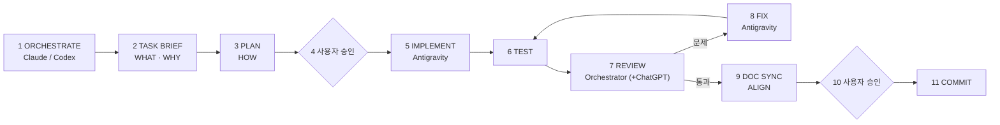

# 17. AI 협업 개발 Workflow — Orchestrator · Plan · Implement · Review

- 상태: **Accepted** (2026-09-15, 사람 결정, ADR-025)
- 관련: `AGENTS.md` 2절(읽는 순서), 3절(작업 프로토콜, 3.7 Orchestrator Handoff Rule), 4절 규칙 10(commit 승인), `docs/tasks/CURRENT.md`(현재 작업 인계), `docs/tasks/TASK_BRIEF_TEMPLATE.md`, `docs/tasks/QUEUE.md`, `docs/tasks/LOG.md`, ADR-001(문서 체계)

---

## 1. 왜 이 Workflow를 쓰나

CERA는 1인 개발이지만 여러 AI 도구를 역할별로 쓴다. 작업 장소에 따라 Claude(Claude Code)와 Codex가 번갈아 같은 저장소를 이어서 관리한다. 도구가 바뀔 때마다 설계 판단이 대화 기억으로만 전해지면 방향이 흔들린다(이미 정한 결정을 다시 뒤집거나, 범위가 조용히 넓어지거나, 구현이 계획과 달라진다).

그래서 **인수인계는 대화가 아니라 Git 안의 문서로 한다.** 누가 이어받든 같은 파일을 읽고 같은 결론에서 시작한다.

## 2. Source of Truth (정본)

AI와의 대화는 정본이 아니다. CERA의 정본은 아래 순서다.

1. 실제 Git repository (커밋된 상태 + 현재 작업 트리)
2. Accepted ADR (`docs/14_decisions.md`)
3. `docs/` 정본 문서 (규칙은 `docs/01_project-rules.md`가 가장 우선)
4. 현재 작업 문서 `docs/tasks/CURRENT.md`
5. API · Schema · Test
6. 실제 code

대화에서 나온 판단(ChatGPT의 계획, Claude의 설계 논의 등)은 **이 문서들에 옮겨 적어야** 다음 사람·도구가 쓸 수 있다. 옮겨 적지 않은 결론은 없는 것으로 본다.

## 3. 역할

| 역할 | 누구 | 하는 일 | 하지 않는 일 |
| --- | --- | --- | --- |
| **최종 결정권자** | 사용자 | Architecture Decision 승인, Implementation Plan 승인, commit 승인, 다음 Task 선택 | — |
| **Orchestrator** | Claude **또는** Codex (작업 단위마다 하나) | Task 정의(Task Brief), 계획 요청·검토, 구현 지시 조율, 결과 리뷰, 문서 동기화, `CURRENT.md` 관리 | 한 Task에 두 Orchestrator가 동시에 지시하지 않음. 사용자 승인 없이 commit·push 하지 않음 |
| **Implementation Planner / Independent Reviewer** | ChatGPT (필요할 때) | 승인된 WHAT/WHY를 받아 HOW를 구체화(변경 파일, API, DB, 상태 모델, 예외, 테스트, 완료 조건, 순서). 구현 뒤 독립 리뷰(누락, 과설계, scope creep, 보안, contract drift, 문서·코드 불일치) | 결정권 없음. ChatGPT 대화 자체는 정본이 아니며, 결과는 계획 문서로 옮겨야 효력이 있다 |
| **Coding Agent / Implementer** | Antigravity (외부 Coding Agent) | 승인된 Implementation Plan대로 코드 작성, 지정된 테스트 실행 | Architecture Decision·Task Scope 변경. 계획과 다른 설계가 필요하면 **구현하지 말고 멈추고 보고** |

Orchestrator의 강점 분담 (강제 규칙이 아니라 운영상 기본값):
- Claude — 제품·도메인 설계, RFC, Architecture, ADR, 요구사항 정리, 문서 정합성, 작업 범위 정의
- Codex — 실제 저장소 상태 분석, 코드 변경 영향 분석, 구현 조율, refactor, test/debug, diff review

Planning 단계는 ChatGPT가 맡을 수도 있고, Orchestrator(Claude/Codex)가 **별도의 planning 단계**로 직접 쓸 수도 있다.

## 4. 기본 흐름

| 단계 | 한 줄 | 산출물 (정본 위치) |
| --- | --- | --- |
| Task Brief | **WHAT / WHY**: 목표, 이유, 범위, 범위 밖, 따라야 할 결정, 완료 기준 | `CURRENT.md` 상단 (큰 작업은 `docs/tasks/briefs/T-NNN-<slug>.md`에 두고 링크) |
| Implementation Plan | **HOW**: 변경 파일·API·DB·상태 모델·예외·테스트·순서 | `docs/tasks/plans/T-NNN-<slug>.md` (필요할 때 만든다). `CURRENT.md`에 상태 NOT_STARTED / DRAFTED / APPROVED |
| Implement | **IMPLEMENT**: 승인된 계획대로 코드 | 작업 트리 (커밋 전) |
| Review | **VERIFY**: 계획 대비 차이, 테스트, 리뷰 발견 | `CURRENT.md` Validation · Review Findings |
| Docs Sync | **ALIGN**: docs·ADR·QUEUE·LOG를 코드 상태에 맞춤 | 관련 문서, `CURRENT.md` Documentation Sync |
| Commit | **USER APPROVAL**: 사용자가 승인해야 commit | `CURRENT.md` Commit Gate |

`briefs/`·`plans/` 폴더는 첫 사용 때 만든다. 빈 폴더를 미리 만들지 않는다.

### 4.1 언제 전체 흐름을 쓰나

전체 11단계는 **Architecture 변경, 여러 영역(front·back·ai·data)을 건드리는 기능, 중요한 Vertical Slice**에 쓰는 기본 흐름이다.

작은 수정(오타, 문구, 단순 UI 조정, 한 파일 안의 명백한 버그)은 줄여서 한다:
사용자 지시 → 수정 → 검증 명령 실행 → 결과 보고 → 사용자 승인 → commit. `CURRENT.md`·Task Brief·Plan은 생략할 수 있고, LOG에 한 줄만 남긴다. **commit 승인만은 생략하지 않는다.**

## 5. Claude ↔ Codex 인수인계 (Orchestrator Handoff)

규칙 본문은 `AGENTS.md` 3.7절 "Orchestrator Handoff Rule". 실제 절차는 이렇다.

**세션을 시작하는 Orchestrator**
1. `AGENTS.md`
2. `docs/tasks/CURRENT.md` — Status, Scope / Out of Scope, Accepted Decisions, Handoff Notes
3. `CURRENT.md`가 가리키는 ADR·계획 문서
4. `git status`와 최근 커밋 — `CURRENT.md`의 Baseline과 실제 저장소가 맞는지 확인. 다르면 작업 전에 차이를 사용자에게 보고
5. `CURRENT.md`의 Current Orchestrator를 자기 이름으로 바꾸고 시작

**세션을 끝내는 Orchestrator** (특히 다음 Orchestrator가 다른 도구일 수 있을 때)
- 중요한 상태 변경을 `CURRENT.md`에 반영한다: 결정된 것, 진행 상태, blocker, 다음 한 걸음.
- 대화 내용을 통째로 옮기지 않는다.
- 커밋되지 않은 변경이 있으면 Commit Gate에 그 사실을 적는다.

**이어받은 쪽이 하지 않는 것**
- 이전 Orchestrator가 정한 Scope / Out of Scope를 임의로 넓히지 않는다.
- Accepted ADR을 임의로 바꾸지 않는다. 바꿔야 하면 새 ADR(Proposed)이나 변경 제안으로 올리고 사용자 승인을 받는다.
- 구현 결과가 승인된 계획과 다르면, 고치기 전에 먼저 차이를 보고한다.

## 6. QUEUE · CURRENT · LOG

| 문서 | 무엇 | 언제 바뀌나 |
| --- | --- | --- |
| `docs/tasks/QUEUE.md` | 후보·예정 작업 목록 (앞으로) | 작업을 고르거나 추가·완료할 때 |
| `docs/tasks/CURRENT.md` | **지금 진행 중인 작업 하나**의 인수인계 문서 (현재) | 작업 중 수시로. 도구가 바뀌어도 여기서 이어받는다 |
| `docs/tasks/LOG.md` | 끝난 작업 기록 (과거, append-only) | 작업이 끝나거나 막혔을 때 |

Task가 끝나면: `CURRENT.md` 내용을 요약해 LOG 맨 위에 옮기고, QUEUE에서 DONE 처리한 뒤, `CURRENT.md`를 다음 Task로 채우거나 `IDLE`로 되돌린다.

## 7. ChatGPT에 계획·리뷰를 맡길 때

**넘길 것**: `CURRENT.md`의 Task Brief 부분(Goal, Why, Scope, Out of Scope, Accepted Decisions, Completion Criteria), 관련 문서 경로, 필요한 경우 코드 발췌.

**받을 것 (Plan)**: 변경 파일, API, DB, 상태 모델, 예외 처리, 테스트, 완료 조건, 작업 순서. 받은 계획은 Orchestrator가 검토한 뒤 `docs/tasks/plans/`에 저장하고, 사용자 승인을 받아야 `APPROVED`가 된다.

**받을 것 (Review)**: 누락, 과설계, scope creep, 보안, contract drift, 문서·코드 불일치. 채택한 지적만 `CURRENT.md` Review Findings에 옮긴다.

## 8. Antigravity에 구현을 맡길 때

Antigravity는 저장소 도구가 아니라 외부 Coding Agent로 쓴다. 전용 설정 파일은 두지 않는다. 구현 지시에는 **최소한** 아래를 넣는다.

| 항목 | 내용 |
| --- | --- |
| Goal | 이번 구현으로 달성할 것 한두 문장 |
| Scope | 이번에 구현하는 것 |
| Out of Scope | 하지 않는 것 (다음 Task 몫 포함) |
| Approved Implementation Plan | 승인된 계획 문서 경로 (`docs/tasks/plans/...`) |
| 변경 가능 영역 | 수정해도 되는 폴더·파일 |
| 변경 금지 영역 | 건드리면 안 되는 폴더·파일 (예: `data/scenarios/`, 다른 영역, Accepted ADR) |
| Completion Criteria | 끝났다고 볼 조건 |
| Test commands | 실행해야 할 검증 명령 (예: `cd front/web && npm run typecheck && npm run lint && npm run validate:scenario && npm run build`) |

그리고 이 한 줄을 붙인다: "Architecture Decision과 Scope를 바꾸지 말 것. 계획과 다른 설계가 필요하면 구현하지 말고 멈추고 보고할 것. commit·push 하지 말 것."

## 9. Commit Gate

- 사용자 승인 없이 commit / push / remote 생성을 하지 않는다. 어떤 도구도 예외가 아니다(Orchestrator, Antigravity 포함).
- 승인 전 확인: `git status`, `git diff --stat`, 커밋 제외 대상(`node_modules/`, `.next/`, `.smoke/`, 빌드·캐시 산출물), 비밀정보(`.env`, 키, 토큰) 없음.
- 승인 여부와 커밋 해시는 `CURRENT.md` Commit Gate에 남긴다.
