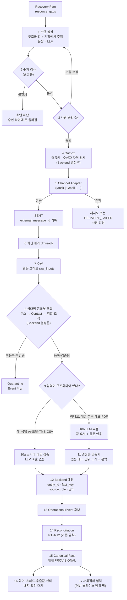
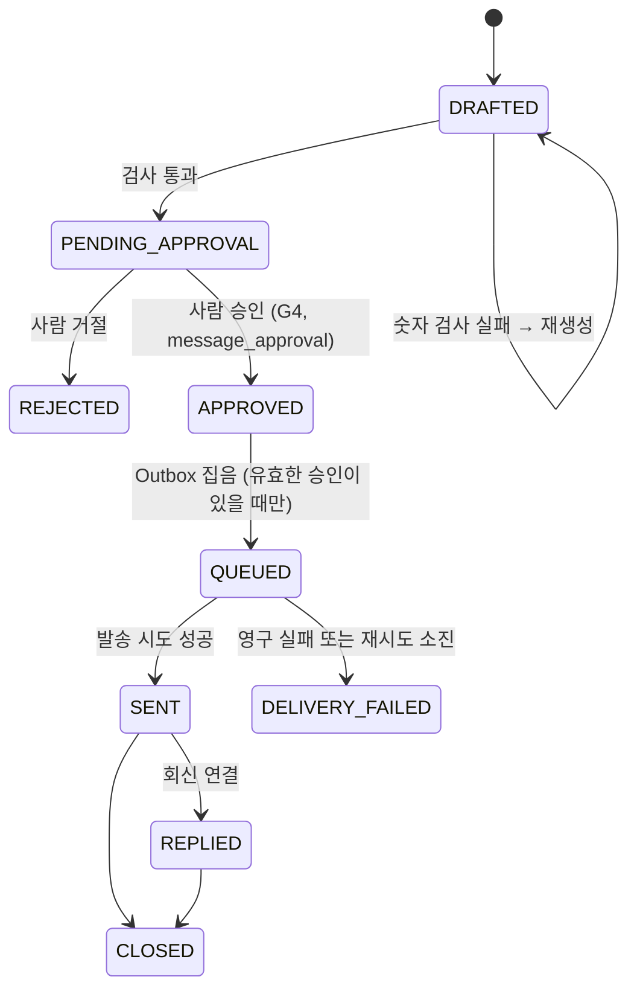

# 18. 외부 통신 루프 (External Communication Loop) — RFC v0.1

- 상태: **Draft / RFC — 사람 검토 대기** (T-068, 2026-09-16, 같은 날 책임 경계 Audit으로 2차 개정). 이 문서의 설계 결정은 별도 표시가 없으면 `[PROPOSED]`다
- 관련 ADR: ADR-008(LLM 경계, Accepted), ADR-017(사람 확인 게이트), ADR-018(시나리오 재생), ADR-019·020(Reconciliation·출처), ADR-024(Monorepo, Accepted), **ADR-026·027·028·029(이 문서에서 제안)**
- **2차 개정 요지 (2026-09-16)**: ① 수신 흐름에 **구조화 채널 분기** 추가 — LLM은 "값이 자주 바뀌어서"가 아니라 "입력이 비정형이라서" 부른다(J.6) ② LLM 출력에서 `entity_id`·`fact_key`를 걷어내고 Backend 매핑으로 옮김(D.3) ③ `send_allowlist`를 **제품 Contact Gate + 개발 안전장치** 두 겹으로 분리(D.5·D.6·G.5) ④ 회신 결과를 세 가지로 구분하고 `OBSERVATION_REFRESH`는 미결로 둠(F.4) ⑤ **O절 CERA 전체 책임 경계표** 신설
- 관련 문서: `01_project-rules.md` 3·6절, `03_requirements.md` 2.1·2.7·5절, `05_event-and-state.md` 3·4·8·11·14절, `06_agent-architecture.md` 2·4·7절, `07_backend-architecture.md` 4·5·6절, `11_data-sources.md` 5절, `16_frontend-prototype.md` 5·11절
- **2026-09-18 T-070 동기화 — 저장 구조의 정본은 `22_cera-logical-data-model.md`(rev.2.2)다.** D.1 · E.1 · E.4 · H.2~H.4 · K.1 · N.2 를 논리 설계 기준으로 고쳤다. 역할 구분: **`comm_message`** = 업무 메시지·승인할 내용(만든 뒤 내용 불변) · **`message_status_transition`** = 메시지 생애주기 상태 변경 · **`send_attempt`** = 실제 외부 채널 전송 시도 한 번(재시도는 같은 메시지 아래 새 시도) · **`message_approval`** = 발송 승인(덧붙이기, 취소·무효화도 새 행) · **`audit_log`** = 사람·시스템의 감사 대상 행위 · **`system_error`** = 기술 오류(`23` 4절). 이 RFC 의 설계 근거와 흐름은 그대로 유효하다
- 이 문서가 답하는 질문: **CERA가 밖으로 연락해서 받은 답을, 어떤 경로로 "믿을 수 있는 사실 후보"로 되돌리는가. 그리고 채널이 메일이 아니어도 그 구조가 버티는가.**

> **범위 경고.** 이 문서는 설계(RFC)다. 코드는 없다. 여기 적힌 것을 구현하려면 M절의 사용자 결정 7건이 먼저 필요하고, 특히 `01_project-rules.md` 6절(“PoC의 메일 발송은 가상 메일함으로만”)을 고치지 않으면 실제 발송을 만들 수 없다.

---

## 0. 한 문단 요약

CERA는 계획에서 나온 **부족 자원(resource gaps)** 을 근거로 문의 초안을 만들고, 사람이 승인해야만 외부로 보낸다. 보낸 메시지는 CERA가 만든 **Thread**에 묶이고, 회신은 그 Thread로만 들어온다. 회신 원문은 가공 없이 보관되고, LLM은 원문에서 값을 **후보로만** 뽑는다. 후보는 기존 Reconciliation 규칙(`05` 8절 R1~R12)을 그대로 타서 대부분 `PROVISIONAL` 자원 사실이 되고, 화면에는 "잠정"으로 표시된다. **회신이 사실을 확정하지 않는다.** Gmail은 이 루프를 처음 실제로 돌려 보는 채널일 뿐이고, 채널 교체가 가능하도록 Channel Adapter 뒤에 둔다.

---

## A. 사람이 이해할 수 있는 기능 흐름

### A.1 한 장 흐름



**9번 분기가 이 설계에서 가장 중요한 규칙이다.** LLM은 "값이 자주 바뀌어서" 부르는 것이 아니라 **"입력이 비정형이라서"** 부른다. 같은 트럭 가용 대수라도 메일 본문으로 오면 추출이 필요하고, 응답 폼·TMS로 오면 필요 없다(J.6절). 그리고 8번(신원·역할)과 12번(fact_key·강도)은 **언제나 Backend 결정론**이다. LLM은 10b 한 칸에만 있다.

### A.2 말로 푼 흐름 (시나리오 S2~S6에 대응)

1. 창고 A 수용량이 20 → 8로 떨어져 계획이 다시 짜인다. 계획은 "15~17시 사이 T1 → ODCY B 트럭 2대가 모자람"을 `resource_gaps`로 남긴다.
2. CERA가 K운송에게 보낼 문의 초안을 만든다. **대수(2)·시간창(15:00–17:00)·구간은 계획에서 그대로 가져오고, 인사말과 문장만 LLM이 쓴다.**
3. 본문에 적힌 숫자가 전부 구조화 값에 있는지 결정론 검사가 확인한다. 하나라도 어긋나면 초안은 승인 화면에 올라가지 못한다.
4. 운영자가 읽고 [승인]을 누른다. **이 승인은 "보내도 된다"는 뜻일 뿐, 계획 승인도 사실 확인도 아니다.**
5. CERA가 승인된 그 내용 그대로 보낸다. 같은 승인으로 두 번 보내지 않는다.
6. K운송이 "15시 2대, 17시 1대 가능합니다"라고 답한다. 원문이 그대로 보관된다.
7. 발신 주소로 상대방 등록부를 찾아 역할(TRUCKING)·조직(K운송)을 **결정론적으로** 정한다. LLM은 여기에 관여하지 않는다.
8. LLM이 원문에서 `available.slot(15:00)=2`, `available.slot(17:00)=1`을 뽑고, 각 값마다 원문 인용을 붙인다.
9. 검증기가 인용이 원문에 실제로 있는지, 단위가 있는지, 스레드 문맥과 맞는지 확인한다. 통과하면 신뢰도 MEDIUM, 근거 강도 1.
10. Reconciliation이 돌아 `PROVISIONAL` 자원 사실이 된다. 화면에 "메일 추출 · 잠정"으로 뜨고, V9 확인 요청이 생긴다.
11. 운영자가 나중에 전화로 확인하고 [확인]을 누르면 그때 CONFIRMED가 된다. **회신만으로는 되지 않는다.**

### A.3 이 흐름에서 절대 일어나지 않는 일

| 일어나지 않는 일 | 막는 장치 |
| --- | --- |
| 사람 승인 없이 메일이 나간다 | Outbox는 `APPROVED` + 승인 내용 해시 일치 상태만 집는다. NFR-03 "승인 없는 발송 경로가 코드에 없음"을 테스트로 고정 |
| 같은 문의가 두 번 나간다 | 멱등키 + 발송 전 외부 조회(H절) |
| 계획이 바뀌었는데 옛 문의가 나간다 | 계획(run)이 SUPERSEDED되면 미발송 승인 초안은 자동 취소 |
| 회신 한 통으로 사실이 확정된다 | R2(메일 추출 강도 ≤ 1), ADR-017. 컨테이너 사실은 강도 0 |
| LLM이 상대방의 권한을 정한다 | 상대방 등록부가 결정론적으로 정한다(`05` 3.1) |
| LLM이 초안의 숫자를 만든다 | 구조화 값 주입 + 숫자 검사(`01` 3절) |
| 검증·승인되지 않은 주소로 메일이 간다 | Contact Gate (VERIFIED + APPROVED + ACTIVE, D.5) |
| 개발 중에 실수로 진짜 거래처에 메일이 나간다 | 개발 안전장치 `CERA_TEST_RECIPIENT_ALLOWLIST` (G.5, Contact Gate와 별개의 두 번째 겹) |
| 구조화된 값이 굳이 LLM을 거친다 | 수신 9번 분기에서 구조화 채널은 추출을 건너뛴다(J.6) |
| 회신 본문의 지시를 CERA가 따른다 | 추출 호출에 도구를 주지 않고, 본문은 데이터로만 넣는다 |

---

## B. Task Brief

정본은 `docs/tasks/CURRENT.md`에 있다. 요지만 옮긴다.

| 항목 | 내용 |
| --- | --- |
| Goal | 문의 초안 → 승인 → 외부 발송 → 실제 회신 → 구조화 → Event 후보 → 화면 반영 루프를 구현 가능한 수준으로 설계한다 |
| Why | CERA에서 **한 번도 기술 검증되지 않은 유일한 핵심 루프**다. 이게 안 되면 System of Decision이 아니라 대시보드다 |
| Scope | 이번 세션은 설계 문서(RFC + ADR + 큐)만 |
| Out of Scope | Solver, Recovery Optimization, Tauri·Rust·Desktop, Public API 연동, Contract Parser 전체, Multi-tenancy, Production infra |
| 성공 판정 | "Gmail이 붙는가"가 아니라 **"채널이 전화·카카오톡·TMS로 바뀌어도 이 설계가 버티는가"** |

---

## C. Front / Back / AI 책임 경계

ADR-024의 영역 분리를 이 루프에 적용한 것이다. **2026-09-21 (ADR-033 Accepted)**: `back/` = Main Backend(TypeScript + NestJS), `ai/` = **처음부터 별도인 Python AI Server 런타임**. 둘은 HTTP/JSON 으로만 만나고, AI Server 출력은 언제나 후보다.

| 영역 | 맡는 것 | 맡지 않는 것 |
| --- | --- | --- |
| `front/web` | 스레드·메시지·원문 표시, 초안 검토·수정·승인 UI, 추출 결과와 신뢰 배지 표시, 발송 실패·재시도 상태 표시, 확인 요청 목록 | 비즈니스 로직 없음. 숫자를 만들지 않는다. 메일 서버에 직접 접속하지 않는다. 토큰을 만지지 않는다. HTML 본문을 그대로 렌더링하지 않는다 |
| `back/` | `comms`(스레드·메시지·승인·Outbox·Dispatcher), `channels`(Gmail 등 어댑터), `intake/mailbox`(수신·원문 보관·Quarantine), 상대방 등록부, OAuth 토큰 저장·갱신, `state`(Event 저장·Reconciliation), `audit`, 스케줄러, 화면 push | 값 추출을 하지 않는다(LLM 호출은 `ai/`에 위임). 최적화·비용 계산을 하지 않는다 |
| `ai/` (AI Server) | `extraction`: 회신 원문 → 구조화 후보 + 필드별 근거, 초안 **문장** 생성. 자기 출력의 **형식 수준 스키마 검사**는 할 수 있다 | **결정론 검증기와 최종 판정을 하지 않는다**(인용 대조·단위·모호성 → `confidence`, 근거 강도, 권한, 발신자 신원, 최종 매핑, Event 수용, 현재 상태 — 모두 `back/`). 네트워크로 메일을 읽거나 보내지 않는다. Event를 저장하지 않는다. 사실을 확정하지 않는다. 숫자를 만들어 내지 않는다 |

**경계 규칙**

1. **Gmail 클라이언트는 `back/`에만 있다.** `ai/`는 메일 주소도, 토큰도, 스레드 ID도 모른다. `ai/extraction`의 입력은 "텍스트 + 스레드 문맥 요약"이고 출력은 "후보 값 + 근거 인용"뿐이다.
2. **결정론 엔진(tariff·cost·risk·optimize)은 `back/` 에 있고(ADR-029) 이 루프에 등장하지 않는다.** 등장하더라도 LLM 클라이언트를 import하지 않는다(`01` 3절).
3. **초안 문장 생성과 회신 추출은 서로 다른 프롬프트·스키마·호출**이다. 한 LLM 세션이 "쓰고 읽는" 구조를 만들지 않는다(회신 내용이 다음 초안 문장에 새어 들어가는 경로를 막는다).
4. **LLM 호출 조건은 "비정형 입력"이다.** 값이 자주 바뀐다는 것은 LLM을 부르는 이유가 아니다. 구조화된 입력(응답 폼·포털·TMS·CSV·Human UI)은 Backend 검증만 거친다(J.6).
5. **`ai/`(AI Server)는 값을 저장하지 않는다.** 입력을 받아 후보를 돌려주는 순수 호출이다. **허용되는 외부 호출은 LLM 공급자 API 뿐이다**(ADR-033). DB 커넥션·ORM·DB 권한, Gmail·채널 API 클라이언트, 외부 운영 시스템 호출, Event·CanonicalFact 직접 변경은 갖지 않는다.
6. **회신 처리 순서**: 수신(Main Backend) → AI Server 추출 **후보** → Main Backend **결정론 검증** → Event → CanonicalFact(Reconciliation). 검증 권한은 Main Backend 에만 있다.

### C.1 AI가 이 루프에서 **하지 않는** 일 (금지 목록)

| 금지 | 대신 누가 | 근거 |
| --- | --- | --- |
| 발신자가 누구인지·어느 회사인지 판정 | Backend 상대방 등록부 조회 | `05` 3.1 "메일 발신자의 역할·조직은 상대방 등록부로 결정론적으로 정한다. LLM이 정하지 않는다" |
| `source_role`·`source_org`·권한 등급 결정 | Backend 권한 매트릭스(`05` 3.2) | 같음 |
| 근거 강도(0~3) 결정 | Backend 강도표(`05` 3.3, 정책값) | ADR-019 |
| `confidence` 결정 | Backend 결정론 검증기(`05` 4.6) | "LLM이 스스로 매긴 확신도는 쓰지 않는다" |
| `entity_id`·`fact_key` 확정 | Backend가 스레드 문맥에서 해석(D.3) | 엔티티 신원은 DB의 것 |
| CONFIRMED 여부·Canonical 값 결정 | Backend Reconciliation(R1~R12) | ADR-017 |
| 신선도·`evidence_time` 계산 | Backend(`05` 5.2) | 결정론 |
| 수신자 발송 자격 판정 | Backend Contact Gate(G.5) | 권한은 DB가 안다 |
| 승인·발송·재시도·멱등 판단 | Backend Outbox(H절) | 결정론 |
| DB·Canonical State 직접 쓰기, 채널·외부 운영 시스템 직접 호출 | Backend만 | `ai/`(AI Server)에는 LLM 공급자 클라이언트만 있다(ADR-033) |
| 초안의 수량·시각·금액 생성 | 계획에서 주입(D.2) | `01` 3절 |

> **주의**: ADR-024(Accepted)는 `ai/` 영역에 LLM 해석과 **결정론 엔진(Tariff·Cost·Risk·Optimization·Solver)** 을 함께 둔다. 이 루프에는 그 엔진들이 등장하지 않지만, `ai/`라는 이름이 "위험·비용을 AI가 계산한다"로 읽히는 문제가 있다(`01` 4절 금지 주장과 충돌). 영역 재배치는 이 RFC의 범위가 아니며 **ADR-029(Proposed)** 로 따로 올렸다.

---

## D. 주요 데이터 모델

`07_backend-architecture.md` 4절의 옛 `messages` 한 테이블로는 실제 발송을 감당할 수 없어 나눴다. **표·컬럼·제약의 정본은 `22` 10·15절이다**(2026-09-18 T-070 — 이 절의 RFC 당시 후보 표를 논리 설계 대응으로 바꿨다).

### D.1 테이블

| 논리 설계의 표 (`22`) | 무엇을 담나 | RFC 당시 후보 이름 |
| --- | --- | --- |
| `counterparty` → `counterparty_contact` → `contact_channel_address` | 거래처(**역할 판정의 정본**) → 담당자 → 주소. 주소의 세 상태(주소 확인 · 업무 관계 승인 · 통신 활성) AND 가 **발송 자격의 정본**(D.5) | `counterparties` · `counterparty_contacts` · `contact_channel_addresses` |
| `contact_verification` | 이메일 소유 확인. 1회용 토큰(해시만), 사용 결과는 한 번만 기록 | `contact_verifications` |
| `comm_thread` | CERA 가 만든 대화만 존재 | `comm_threads` |
| `question_item` | 한 문의가 묻는 것 하나. 대상 개체·사실 키·적용 범위를 질문 생성 때 확정 | (없었음) |
| `comm_message` (+ `comm_message_structured_field` · `comm_message_question`) | 업무 메시지 / 주소 확인 메일 한 통 — **승인할 내용**(제목·본문·받는 사람·구조화 값). 만든 뒤 내용 불변, 바꾸면 새 메시지 | `comm_messages` |
| `message_approval` (+ `message_approval_structured_field`) | 발송 승인 결정(덧붙이기). 승인 시점 내용 지문·사본·만료. 취소·무효화도 새 행 | `comm_messages` 의 승인 필드 |
| `message_status_transition` | 메시지 생애주기 상태 변경 이력. 상태의 정본 | `comm_message_events` |
| `send_attempt` | **실제 외부 채널 전송 시도 한 번.** 멱등 키 · 보낸 내용 지문 · 결과 · 채널 응답 id. 재시도는 새 행 | `comm_messages` 의 `attempt_count` · `last_error` |
| `raw_input` | 수신 원문(RFC822 그대로). append-only | `raw_inputs` |
| `extraction` | LLM 추출 후보(값 후보 + 원문 인용). 추출 결과 불변, 검토 결과만 한 번 기록 | `extractions` |
| `channel_connection` | 채널 연결 상태·권한 범위·만료. **토큰 값은 넣지 않는다** — 값은 `.env`/OS 보안 저장소, 여기는 참조만 | `channel_credentials` |
| ~~`send_allowlist`~~ | **폐기.** 제품 게이트는 주소의 세 상태가 대신한다(D.5). 개발 환경 안전장치는 DB가 아니라 환경변수 `CERA_TEST_RECIPIENT_ALLOWLIST`로 분리한다(G.5) | — |
| `audit_log` | 사람·시스템의 감사 대상 행위. append-only | 같음 |
| `system_error` | 기술 오류(외부 호출 실패 등). 업무 사실도 감사 기록도 아니다 | (없었음) |

기존 `messages` 테이블(`07` 4절)은 위 표들로 **대체**됐다.

### D.2 초안의 구조화 값 — G-13 해결

`16` 11절 G-13이 요구한 "초안의 숫자가 어느 계획의 어느 gap에서 왔는가" 포인터를 필드로 고정한다. 시나리오의 문자열 `"RP-001.resource_gaps[0]"`을 구조로 바꾼다.

```json
"structured": {
  "fields": [
    { "key": "trucks_needed", "value": 2, "unit": "대",
      "origin": { "run_id": "RP-001", "gap_id": "gap-001", "path": "resource_gaps[0].needed" } },
    { "key": "window_from", "value": "2026-10-13T15:00:00+09:00",
      "origin": { "run_id": "RP-001", "gap_id": "gap-001", "path": "resource_gaps[0].window.from" } }
  ],
  "render_context": { "leg": "TERMINAL_T1→ODCY_B" }
}
```

**숫자 검사 규칙**: 본문에서 추출한 모든 수량·시각·금액 토큰은 `structured.fields`의 값 집합에 있어야 한다. 하나라도 없으면 초안은 `BLOCKED_NUMBER_CHECK`가 되고 승인 화면에 올라가지 않는다. 이것이 `01` 3절 "LLM이 쓴 문장의 숫자는 입력 구조화 데이터에 있어야 한다"를 강제하는 지점이다.

### D.3 추출 결과 계약 (`ai/` → `back/`)

**LLM은 엔티티 신원도 `fact_key`도 정하지 않는다.** Backend가 스레드에서 "무엇을 물었는지"(`ask_id`)를 이미 알고 있으므로, LLM은 **그 물음에 대한 답만** 돌려준다. 매핑은 Backend가 한다.

Backend가 LLM에 주는 것:

```json
{ "thread_context": {
    "asks": [
      { "ask_id": "ask-1", "question": "15:00~17:00 사이 40FT Dry 셔틀 트럭 가용 대수",
        "answer_shape": "QUANTITY_BY_TIME_SLOT", "unit": "대",
        "slots": ["2026-10-13T15:00:00+09:00", "2026-10-13T17:00:00+09:00"] }
    ] },
  "message_text": "<회신 본문 평문>" }
```

LLM이 돌려주는 것:

```json
{
  "outcome": "VALUES | NO_CHANGE | REFUSAL | UNPARSEABLE",
  "answers": [
    { "ask_id": "ask-1", "slot": "2026-10-13T15:00:00+09:00", "value": 2, "unit": "대",
      "evidence": { "quote": "15시 2대" } },
    { "ask_id": "ask-1", "slot": "2026-10-13T17:00:00+09:00", "value": 1, "unit": "대",
      "evidence": { "quote": "17시에 한 대 더" } }
  ],
  "unmapped_statements": ["다음 주는 어렵습니다"],
  "ambiguity_flags": ["HEDGED_LANGUAGE"]
}
```

Backend가 그다음에 하는 것(전부 결정론):

| 단계 | 하는 일 |
| --- | --- |
| 1 | `evidence.quote`가 원문에 그대로 있는지 대조. 없으면 그 답은 버리거나 `confidence = LOW` |
| 2 | 단위·타입·범위 검사. `answer_shape`와 맞지 않으면 버림 |
| 3 | `ask_id` + `slot` → **`entity_type`·`entity_id`·`fact_key`** 해석 (스레드의 `gap_ref`와 등록부에서) |
| 4 | 발신 주소 → Contact → Counterparty → `source_role`·`source_org` |
| 5 | 권한 매트릭스 + 강도표 → 근거 강도. 남의 자원에 대한 답이면 W로 떨어뜨림 |
| 6 | Event 생성 → Reconciliation |

- 스레드가 묻지 않은 자원에 대한 주장은 `unmapped_statements`로만 남는다. Backend는 이것으로 Event를 만들지 않고, 필요하면 확인 요청(V3)을 만든다.
- 값의 단위·타입은 `fact_key` 카탈로그(`05` 4.3)가 정한다. LLM은 카탈로그를 보지 않는다.
- `outcome = NO_CHANGE`는 "추가 수용 불가"처럼 값을 바꾸지 않는 회신이다(F.4절).

**왜 이렇게 바꿨나**: 초안(2026-09-16 오전)에서는 LLM이 `entity_id`와 `fact_key`를 직접 내도록 했다. 허용 목록으로 걸러도, **엔티티 신원과 사실 키는 DB가 아는 것**이지 본문에서 읽어 낼 것이 아니다. 지금 형태는 LLM의 출력에서 신원·권한·키를 완전히 걷어냈다.

### D.4 이번 슬라이스가 다루는 fact_key (최소 집합)

시나리오 3건 회신이 요구하는 것만이다. 전체 카탈로그는 T-034.

| fact_key | entity | fact_kind | 사실 계열 | 나오는 회신 |
| --- | --- | --- | --- | --- |
| `available.slot(S)` | TRUCK_POOL | OFFER | truck_availability | K운송 |
| `capacity.size_type(T).day(D)` | ODCY | OFFER | yard_capacity | ODCY A |
| `max_days` | ODCY | TERM | yard_capacity | ODCY A |
| `rate.storage_per_day(T)` | ODCY | TERM | rate | ODCY A |
| `capacity.day(D)` | WAREHOUSE | STATE | warehouse_capacity | 창고 A (NO_CHANGE 사례) |

**컨테이너 사실(`milestone.*`, `customs.status`, `location`)은 이번 슬라이스의 추출 대상이 아니다.** 강도 0이라 Canonical 후보가 못 되고(R2), 확인 요청만 늘린다. 회신에 섞여 있으면 `unmapped_statements`에 남기고 V3 확인 요청을 만든다.

### D.5 Counterparty · Contact · 발송 자격 (제품 도메인 모델)

초안에서는 `send_allowlist`라는 평평한 주소 목록 하나로 발송 자격을 다뤘다. 그것은 **개발 환경의 안전장치**이지 제품 모델이 아니다. 제품에서는 "이 주소로 업무 메시지를 보내도 되는가"가 세 가지 서로 다른 질문의 **AND**다.

```text
Counterparty (K운송, TRUCKING)
  └─ Contact (김OO / 배차팀)
       └─ Channel Address (dispatcher@k-transport.com, GMAIL)
            ├─ email_verification_status : UNVERIFIED | PENDING | VERIFIED | FAILED | EXPIRED
            ├─ relationship_status       : PENDING | APPROVED | REJECTED
            └─ communication_status      : ACTIVE | PAUSED | INACTIVE
```

| 상태 | 정확한 의미 | 누가 바꾸나 |
| --- | --- | --- |
| `email_verification_status = VERIFIED` | **이 주소를 실제로 통제하는 사람이 CERA의 확인 요청에 응답했다.** 그 이상은 아니다 | 상대방이 확인 링크를 누름 → Backend |
| `relationship_status = APPROVED` | **CERA 사용자가 이 주소를 그 거래처의 업무 연락처로 인정했다** | CERA 사용자 |
| `communication_status = ACTIVE` | **지금 이 주소로 업무 메시지를 보낼 수 있다** (일시 중지·퇴사·주소 변경으로 꺼질 수 있다) | CERA 사용자 또는 정책 |

> **과대 해석 금지.** 이메일 확인은 법인 대표권이나 계약 체결 권한을 증명하지 않는다. CERA가 필요한 것은 딱 이만큼이다: *"거래처의 업무 연락처로 등록됐고, 주소가 검증됐고, 사용자가 사용을 승인했는가."* 문서·UI에 그 이상으로 쓰지 않는다.

**수신자 자격 판정 (Backend 결정론, LLM 관여 없음)**

```text
can_send(address) :=
      address.active
  AND email_verification_status = VERIFIED
  AND relationship_status       = APPROVED
  AND communication_status      = ACTIVE
  AND counterparty.active
  AND (개발 환경이면) address ∈ CERA_TEST_RECIPIENT_ALLOWLIST
```

- 승인 시점과 **발송 직전**에 각각 검사한다. 3분 전에 유효했다고 지금 유효한 것이 아니다.
- 실패 사유는 코드로 구분해 화면에 보여준다: `NOT_VERIFIED`, `NOT_APPROVED`, `NOT_ACTIVE`, `COUNTERPARTY_INACTIVE`, **`CONTACT_INACTIVE`**(2026-10-06 T-087 D1 — FR-ELG-01 ② · FR-ELG-04 "연락처 비활성"), `NOT_IN_TEST_ALLOWLIST`. 막힌 사유는 첫 하나가 아니라 **전부** 돌려준다. 구현: `back/src/registry/contact-gate.ts` · `GET /registry/addresses/{addressId}/eligibility`.
- **AI는 이 판정에 어떤 형태로도 참여하지 않는다.** "이 주소가 K운송 담당자인 것 같다"는 추론은 존재하지 않는다.

### D.6 Contact Verification Flow

```text
CERA 사용자 → Counterparty 생성
           → Contact + 이메일 주소 등록          (relationship_status = PENDING)
           → [확인 메일 보내기]
Backend    → 1회용 토큰 발급(해시로 저장) + 확인 메일 발송   (email_verification_status = PENDING)
상대방     → 확인 링크 클릭
Backend    → 토큰 검증(만료·1회용·주소 일치)              (→ VERIFIED, verified_at 기록)
CERA 사용자 → 관계 승인                                  (→ APPROVED)
Backend    →                                            (communication_status = ACTIVE)
이후       → 업무 메시지 발송 가능
```

| 항목 | 결정 | 과설계하지 않는 선 |
| --- | --- | --- |
| 토큰 | 1회용, 해시로 저장, 유효기간 **72시간** `[ASSUMPTION]` | 재사용·추측 불가면 충분. 서명 토큰(JWT)까지 가지 않는다 |
| 확인 메일 | **업무 메시지가 아니다.** 자격 검사를 건너뛰는 유일한 발송이며, 별도 메시지 종류(`VERIFICATION`)로 승인 게이트(G4) 밖에 둔다. 대신 사용자가 Contact를 등록·발송 요청한 행위 자체가 승인이고, 감사 로그에 남는다 | 이중 승인 UI를 만들지 않는다 |
| 만료·실패 | `EXPIRED`·`FAILED`로 두고 재발송 가능. 재발송은 이전 토큰을 무효화 | 자동 재시도 없음 |
| 주소 변경 | 새 `contact_channel_addresses` 행으로 등록하고 옛 행은 `INACTIVE`. **주소가 바뀌면 검증 상태를 물려받지 않는다** | 주소 수정 in-place 금지 |
| 담당자 퇴사·중지 | `communication_status = INACTIVE`. 이미 열린 스레드의 회신은 계속 받되 새 발송은 막는다 | 스레드 강제 종료 없음 |
| 재검증 | 정책으로 주기 재검증을 걸 수 있는 자리만 남긴다. **MVP에서는 켜지 않는다** | 주기 재검증 미구현 |

**상대방 CERA 계정은 필요 없다.** 두 모델을 구분한다.

| 모델 | 내용 | 위치 |
| --- | --- | --- |
| **Model A — Contact Verification** | 사용자가 거래처 담당 이메일을 등록 → 이메일 확인 → 업무 연락 | **이번 MVP** |
| Model B — Partner Account / Portal | 운송사가 CERA에 가입 → 회사·Contact 관리 → 포털에서 직접 구조화 회신 | Pilot / Expansion. **이번 슬라이스로 끌어오지 않는다** |

Model B가 생기면 회신이 **구조화 채널**로 들어오므로 LLM 추출이 아예 필요 없어진다(J.6). 즉 Model B는 이 루프를 대체하는 것이 아니라 **더 좋은 입력 경로를 추가**하는 것이다.

---

## E. 주요 상태 전이

### E.1 Outbound Message

**2026-09-18 T-070 동기화.** 발송 중·재시도 대기는 **메시지 상태가 아니라 발송 시도(`send_attempt`)** 로 표현한다. 메시지 상태 값 목록의 정본은 `22` 15.8 이다.



**발송 시도 (메시지마다 0개 이상)**: 시도 행을 외부 호출 **전에** 만든다(`result` 비어 있음) → 호출 → 결과를 **한 번** 기록(`SUCCESS` · `RETRYABLE_FAILURE` · `PERMANENT_FAILURE` · `UNKNOWN`). 재시도는 같은 메시지 아래 **새 시도**다(`22` 15.7.3). `UNKNOWN` 은 확정이 아니다 — 화해만 `SUCCESS` · `RETRYABLE_FAILURE` 로 한 번 더 바꾸고, 그 전에는 새 시도를 만들지 않는다(`22` rev.2.5).

불변식:

- `QUEUED` 로 가려면 **유효한 승인**이 있어야 한다 — 같은 메시지 · `APPROVED` · 만료 전 · 무효화되지 않음 · 승인 지문 = 지금 보낼 내용 지문 · 승인 수신자 = 실제 수신자(`22` 15.5.1). **승인한 그 내용만 나간다.**
- 승인 뒤 본문·받는 사람·주입 값이 바뀌면 **새 메시지 + 새 승인**이고 옛 승인에는 무효화 행(`CONTENT_CHANGED`)이 남는다. 계획 교체·사용자 취소도 무효화 행이다(H.4).
- 결과가 비어 있는 시도(호출 중 중단)는 재기동 때 **재전송 대신 외부 조회부터** 한다(H.2).
- `is_simulated = true`인 메시지는 실채널로 갈 수 없고, 실채널의 수신 메시지는 `is_simulated = true`가 될 수 없다(J.3).
- 반송 수신·숫자 검사 실패·취소가 화면에 어떤 이름으로 보이는지는 `19` 15.1 이 정한다.

### E.2 Thread

`OPEN_DRAFT` → `AWAITING_REPLY` → `REPLIED` → (`CLOSED` | `AWAITING_REPLY` 재진입) · `FAILED`(발송 실패) · `EXPIRED`(회신 기한 경과)

- `EXPIRED`는 사실이 아니라 운영 상태다. Event를 만들지 않는다. 대신 "K운송 회신 없음 45분"을 Activity·알림으로 올려 운영자가 전화하도록 한다. **회신이 없다는 것을 "가용 0"으로 해석하지 않는다.**

### E.3 Inbound Message

`RECEIVED_RAW` → (`QUARANTINED` | `MATCHED`) → `EXTRACTING` → (`EXTRACTED` | `EXTRACTION_FAILED`) → `EVENTS_CREATED` | `NO_EVENT`

- `QUARANTINED`: 스레드 매칭 실패, 미등록 발신자, 크기·형식 초과. **Event가 아니다**(`05` 4.5). 원문은 보관하고 운영자에게 알린다.
- `EXTRACTION_FAILED`(스키마 실패·모델 거절·타임아웃): 재시도 1회 뒤 수동 입력 확인 요청(`06` 6절).
- `NO_EVENT`: `outcome = NO_CHANGE` 또는 모든 후보가 검증기에서 탈락. 메시지와 추출 기록은 남는다.

### E.4 게이트 4개는 서로를 대신하지 않는다

| 게이트 | 묻는 것 | 남는 기록 | 사실 상태에 주는 영향 |
| --- | --- | --- | --- |
| G2 Fact Verification | "이 사실이 현실인가?" | `VERIFICATION` Event | CONFIRMED로 올림 |
| G3 Plan Approval | "이 계획을 실행해도 되는가?" | `plan_decision` | **없음** (ADR-017 개정) |
| **G4 Send Approval** | "이 문장을 이 상대에게 보내도 되는가?" | `message_approval`(덧붙이기) + `audit_log` | **없음** |
| G1 계약 확인 | "이 계약 조건이 맞는가?" | `VERIFICATION` Event | DRAFT → CONFIRMED |

**G4는 Event Store에 들어가지 않는다.** 현실 사실에 대한 주장이 아니라 CERA 안에서 내린 결정이기 때문이다(`05` 4.1의 PLAN_APPROVAL과 같은 논리). UI에서 "확인하고 승인" 묶음을 제공하더라도 세 종류 기록은 따로 남는다.

---

## F. Event / State 연결

### F.1 원칙 — 새 규칙을 만들지 않는다

회신에서 나온 Event는 `05` 8절의 R1~R12를 **그대로** 탄다. 이 문서는 새 Reconciliation 규칙을 추가하지 않는다. 이미 CASE 4(`05` A.4)가 "운송사 메일 15시 2대, 17시 1대"를 끝까지 풀어 놓았다.

### F.2 회신 → Event 매핑

> **2026-09-21 정리 — 이 표의 필드 이름·재료는 `docs/22` rev.2.3~2.4 가 정본이다.** 옛 판의 `extraction.method` · `confidence` · `raw_ref` · `hash(raw_ref, entity, fact_key)` 표현을 논리 모델에 맞췄다. 새 설계는 넣지 않았다.

| Event 필드 (`docs/22` 11.2) | 값 | 정하는 주체 |
| --- | --- | --- |
| `event_class` | `OBSERVATION` (회신이 사실을 주장) | 어댑터 |
| `event_type` | `docs/05` 4.4 카탈로그의 업무 사건 유형(예: `TRUCK_AVAILABILITY_REPORTED`) | 어댑터 |
| `source_type` | `EMAIL` | 채널 어댑터 |
| `source_role_at_ingestion` · `asserted_by_counterparty_id` | 상대방 등록부 조회 결과(역할 · 거래처) | **결정론(등록부). LLM 아님** |
| `source_id` | 발신 주소의 등록 id(`contact_channel_address`) | 어댑터 |
| `extraction_method` | 비정형 본문이면 `LLM_EXTRACTED`, 구조화 회신이면 `DIRECT` · `RULE_PARSED` | 어댑터 |
| `input_quality` · `input_confidence_level` (+ `input_confidence_reasons`) | 입력 형태 · **결정론 검증기** 판정(`05` 4.6) | 결정론 |
| `source_event_time` | 본문에 기준 시각이 명시될 때만 그 시각 | 추출 + 검증기 |
| `source_recorded_at` | **Q-44 규칙**(아래 · `docs/22` 11.2e) | 어댑터 |
| `received_at` | CERA가 받은 운영 시각 | SYS |
| `correlation_id` | `thread_id` (업무 상관 id — 기술 추적 `trace_id` 와 다르다) | SYS |
| `raw_input_id` | 원문 기록 행(원문 내용은 보관 관리 내용 — `docs/22` 29절) | SYS |
| `extraction_id` | LLM 추출이면 그 추출 기록 | SYS |
| `idempotency_key` | 원천 입력 · SUBJECT · `fact_key` · **적용 범위** · `event_class` · **주장 위치**에서 결정적으로 (`docs/22` 11.2d) | SYS |
| `payload` | Q-44 의 원래 두 시각과 선택 결과 (`date_header_raw` · `channel_received_at` · `recorded_at_basis` · `date_header_rejected` …) | 어댑터 |
| `is_simulated` | 채널이 Mock이면 true | SYS |

**근거 시각**: 대부분 `RECORDED_TIME`(발신 시각)이 된다. `05` 5.2의 3단계 폴백 그대로다. 시나리오 데이터도 이미 그렇게 되어 있다(`evidence_time_quality: "RECORDED_TIME"`).

**Q-44 — 2026-09-21 사용자 결정(CLOSED).** `Date` 헤더는 발신자가 조작할 수 있다. 그래서 **방향에 따라 다르게** 본다.

- `Date` 가 있고, 정상 파싱되고, **채널 수신 시각(`internalDate`)보다 미래가 아니면** → `Date` 를 쓴다. 늦게 도착한 메일(과거 `Date`)도 **발신 시각 그대로** 둔다 — 채널 수신 시각을 쓰면 오래된 주장이 최신 관측보다 새것처럼 보인다.
- `Date` 가 없거나, 파싱되지 않거나, **채널 수신 시각보다 미래**이면 → 채널 수신 시각을 쓰고 `date_header_rejected` 와 거부 사유를 남긴다. 근거 시각은 **채널이 받은 시각보다 늦을 수 없다.**
- 원래 두 시각은 사건 `payload` 에 남는다. 허용 오차는 두지 않는다(필요하면 정책 파라미터, `[TO VERIFY]`).
- `[TO VERIFY]` `internalDate` 의 정확한 의미(Google 이 받은 시각인가)는 Tech Validation 에서 확인한다.

초안의 "τ 안이면 `Date`, 아니면 `internalDate`"(대칭) 제안은 **늦게 도착한 메일을 최신처럼 만드는 문제**가 있어 채택하지 않았다(`docs/22` 11.2e · ADR-032).

### F.3 Canonical 반영 조건 (기존 규칙의 결과)

| 회신 내용 | 강도 | Canonical 결과 |
| --- | --- | --- |
| 자원·제안·견적 사실, 검증기 전부 통과 | 1 | `PROVISIONAL`, `USABLE_WITH_WARNING`, V9 확인 요청 |
| 자원 사실인데 모호 표현·단위 없음·근거 인용 불일치 | 0 | `INELIGIBLE`, 값 반영 없음, V3 확인 요청 |
| 발신자가 등록부에 없음 | 0 (권한 W) | Quarantine 또는 INELIGIBLE |
| 남의 자원에 대한 주장 (K운송이 ODCY 용량을 말함) | 0 (권한 W) | 반영 없음 |
| 컨테이너 사실 (통관·반출) | 0 | 반영 없음 + V3 |
| 기존 가용을 `θ_adverse`(30%) 이상 줄이는 내용 | 1 | **R10 `HELD`** — 현직 값 유지, V4 최우선, `APPROVAL_BLOCKED` |
| 시간창이 이미 지난 제안 | — | R4-d `EXPIRED` → 스냅샷에서 0 |

**이 표가 이 슬라이스의 안전성 근거다.** 회신 한 통으로 계획이 조용히 뒤집히는 경로가 없다.

### F.4 회신의 세 가지 결과 (Q-40 / G-7) — **이번에 확정하지 않는다**

초안은 이것을 "값을 바꾸지 않는 회신"이라는 한 덩어리로 다뤘다. 실제로는 **서로 다른 세 가지**이고, 섞으면 신선도 정책이 무너진다.

| 분류 | 뜻 | 예 | 값 | 신선도 |
| --- | --- | --- | --- | --- |
| **`VALUE_CHANGE`** | 새 값을 주장 | "15시 2대 가능합니다" (기존 0 → 2) | 바뀜 | 갱신 |
| **`OBSERVATION_REFRESH`** | **같은 값을 지금 시점으로 다시 관측** | "지금도 3대 가능합니다" | 그대로 | **쟁점** |
| **`NO_OPERATIONAL_CHANGE`** | 운영상 바뀐 것이 없다는 응답. 특정 사실에 대한 관측이라고 보기 어려움 | "오늘은 추가 수용이 어렵습니다", "확인 후 다시 연락드리겠습니다" | 그대로 | 갱신 안 함 |

**`VALUE_CHANGE`와 `NO_OPERATIONAL_CHANGE`는 명확하다.** 앞은 R1~R12대로 새 Event, 뒤는 Event 없이 메시지·추출 기록만 남는다(Prototype이 이미 이렇게 한다).

**`OBSERVATION_REFRESH`가 미결이다.** "지금도 3대 가능합니다"는 값은 같지만 **새로운 관측**이다. 이것이 신선도를 자동으로 갱신해도 되는가?

| 입장 | 근거 | 위험 |
| --- | --- | --- |
| 갱신해야 한다 | 권한자(A)가 방금 현재 시점으로 재확인했다. 갱신하지 않으면 멀쩡한 사실이 STALE로 늙어 승인이 막힌다 | — |
| 갱신하면 안 된다 | 메일 추출은 강도 1이다. **강도 1이 신선도를 갱신하면 약한 근거로 STALE 승인 차단(R11·V2)을 우회**하게 된다. `05` 11.3은 "옛 Event를 VERIFICATION해도 신선해지지 않는다"고 이미 못박았다 | — |

**이 RFC의 입장**: 확정하지 않는다. 다만 판단 기준은 **출처 권한과 검증 정책**이어야 하고, 결정은 `policy.yaml`의 값이어야 한다. 예를 들어 `observation_refresh.min_strength = 2`처럼 두면, 메일 추출(1)은 갱신하지 못하고 사람 확인·파트너 시스템(2·3)은 갱신하는 정책을 **코드 수정 없이** 고를 수 있다.

**확정적인 것 하나**: 이 분류를 **AI가 결정하지 않는다.** LLM은 `outcome`(`VALUES`/`NO_CHANGE`/…)과 값 후보만 돌려주고, "이것이 신선도를 갱신하는 관측인가"는 Backend가 값 비교 + 출처 강도 + 정책으로 판정한다.

**MVP 임시 동작**: `OBSERVATION_REFRESH`로 보이는 회신에는 Event를 만들지 않고, 화면에 원클릭 **[지금도 맞음]**을 띄운다. 운영자가 누르면 `05` 11.3대로 **사람이 낸 같은 값의 새 관측**(강도 2·3)이 생겨 신선도가 갱신된다. 정책이 정해지기 전까지 안전한 쪽으로 동작하면서 상대의 재확인도 버리지 않는다.

→ 사용자 결정 항목(M-6). 결정되면 `05` 4.4·11절, `15` 15절 정책표, `08` 6절에 반영한다(T-070).

### F.5 이번 슬라이스가 필요로 하는 State 범위

전체 Canonical State는 필요 없다. 아래만 있으면 루프가 닫힌다.

- 대상 사실 계열: `truck_availability`, `yard_capacity`, `warehouse_capacity`, `rate` (D.4의 5개 fact_key)
- 필요한 규칙: **R1, R2, R3, R4-a, R4-b, R4-d, R6, R10, R11**
- 필요 없는 규칙(이번 범위): R5(마일스톤), R7(교차 사실), R8(추정), R9(정정 — 있으면 좋지만 후순위)
- 필요한 산출: `canonical_fact` 행 + `verification_request`(V3·V4·V9)

이것이 T-041·T-042의 **부분집합**이다. 전체를 먼저 할지 이 부분집합으로 갈지는 사용자 결정(M-4).

---

## G. 보안 · OAuth · 최소 권한

### G.1 Gmail을 첫 채널로 쓸 수 있는가 — 결론

**쓸 수 있다. 단, "CERA 전용 계정"이라는 전제 위에서만이다.**

| 판단 항목 | 결론 |
| --- | --- |
| 프로그램 발송·수신 | Gmail API로 가능. 스레드 헤더(`In-Reply-To`/`References`)와 `threadId`를 모두 쓸 수 있다 |
| 최소 권한 | scope만으로는 충분히 좁혀지지 않는다(아래 G.3). **전용 메일함으로 좁힌다** |
| 인증 | OAuth 2.0 Installed App(로컬 루프백 리다이렉트). 로컬 단일 사용자 PoC에 맞는다 |
| 회신 상관 | RFC822 헤더로 결정론적 매칭 가능 |
| 원문 보존 | `format=raw`로 RFC822 원문 확보 가능 |
| 한계 | 개인정보·사내 정책(R-8), 상대가 메일을 안 쓸 가능성(Q-26·Q-28), 회신 형식이 제각각 |

**Gmail을 고른 이유는 "현업이 Gmail을 쓴다"가 아니라 "혼자서, 계약 없이, 실제 외부 왕복을 오늘 검증할 수 있는 유일한 채널"이기 때문이다.** 이 위치를 문서·UI·코드 주석 어디에도 흐리지 않는다.

### G.2 대안 비교

| 방식 | 장점 | 단점 | 판정 |
| --- | --- | --- | --- |
| **Gmail API + OAuth (전용 계정)** | 스레드·원문·헤더 전부 접근, 권한 취소 가능, 감사 가능 | OAuth 설정 필요, Google 정책 의존 | **채택 제안** |
| IMAP/SMTP + 앱 비밀번호 | 구현 단순, 표준 | 비밀번호가 계정 전체 권한, 취소 관리 어려움, Google이 축소하는 방향 | 기각 |
| 전달 주소(forwarding) + 발송은 SMTP | 고객 메일함 접근 불필요(R-8 우회) | 스레드 상관이 약해지고 원문 헤더가 변형됨 | **Pilot 후보로 보류** |
| 서비스 계정 + 도메인 전체 위임 | 고객 Workspace에 적합 | 관리자 동의 필요, PoC에 과함 | Pilot |
| Pub/Sub push 알림 | 실시간 | 공개 엔드포인트 필요 | 이번 범위 밖 (폴링) |

### G.3 최소 권한 — scope가 아니라 메일함으로 좁힌다

| scope | 할 수 있는 것 | 판단 |
| --- | --- | --- |
| `gmail.send` | 발송만. 읽기 불가 | **필요** |
| `gmail.readonly` | 메일함 전체 읽기 | 넓다. 그러나 대안이 없다 |
| `gmail.metadata` | 헤더만, 본문 없음 | 추출이 불가능해 쓸 수 없다 |
| `gmail.modify` | 읽기 + 라벨·삭제 | `readonly`보다 넓다. 라벨링이 꼭 필요할 때만 재검토 |

Gmail에는 "이 라벨만 읽기" 같은 scope가 없다. 그래서 **권한 축소를 세 겹으로 만든다.**

1. **전용 계정**: CERA 기술검증 전용 Gmail 계정을 새로 만든다. 그 계정에는 CERA 스레드 말고 아무것도 없다. `readonly`가 실질적으로 "CERA 스레드 읽기"가 된다. **개인·회사 메일함에 붙이지 않는다.**
2. **CERA가 만든 Thread 중심 접근**: 어댑터는 `q=label:CERA`로만 조회하고, 그 위에 **CERA가 아는 `external_thread_id` 또는 CERA 토큰이 헤더에 있는 메시지만** 수집한다. 둘 다 아니면 읽지 않고 저장하지 않는다.
3. **저장 최소화**: 수집 대상이 아닌 메시지는 ID조차 저장하지 않는다. 이 불변식을 테스트로 고정한다("CERA 스레드가 아닌 메시지가 `raw_inputs`에 들어오지 않는다").

`[PROPOSED]` 2번의 CERA 토큰: 발송할 때 커스텀 헤더 `X-CERA-Thread: <thread_id>` / `X-CERA-Message: <message_id>`를 붙인다. 회신에는 보통 커스텀 헤더가 살아오지 않으므로, **1차 상관은 `In-Reply-To`/`References`**로 하고 커스텀 헤더는 발송분 재조회(중복 방지)에 쓴다.

### G.4 토큰 관리

| 항목 | 결정 |
| --- | --- |
| 저장 위치 | refresh token은 `.env`(로컬 단일 사용자) 또는 OS 보안 저장소. **DB·저장소·로그에 넣지 않는다.** `.gitignore`에 `.env`가 이미 있다 |
| DB에 두는 것 | `channel_credentials`에 계정 참조·부여된 scope·부여 시각·상태만. 토큰 값은 없다 |
| 갱신 | access token은 메모리에만. 만료 시 refresh. 갱신 실패는 `DELIVERY_FAILED`가 아니라 **연동 상태 = DISCONNECTED**로 올려 사람이 다시 동의하게 한다 |
| 회수 | `/integrations/gmail/disconnect`로 로컬 토큰 파기 + Google 쪽 취소 안내. 회수 뒤 발송 시도는 전부 거부 |
| 로그 | 토큰·메일 주소 전체·본문을 로그에 남기지 않는다. 주소는 마스킹(`k***@example.com`) |
| 커밋 | 실제 메일 본문·주소·토큰은 커밋하지 않는다(`01` 6절). 테스트 fixture는 합성본만 |

### G.5 수신자 자격 — 제품 게이트와 개발 안전장치는 다른 것이다

초안은 이 둘을 `send_allowlist` 하나로 뭉쳤다. 분리한다.

| | **Product Contact Gate** | **Development Safety Allowlist** |
| --- | --- | --- |
| 무엇 | "이 주소로 업무 메시지를 보내도 되는가" | "지금 이 환경에서 실제 메일이 밖으로 나가도 되는가" |
| 어디 | DB: `contact_channel_addresses`의 3개 상태(D.5) | 환경변수 `CERA_TEST_RECIPIENT_ALLOWLIST` |
| 판정 | `VERIFIED` AND `APPROVED` AND `ACTIVE` AND 거래처 active | 주소가 목록에 있는가 |
| 수명 | **영구.** 제품이 살아 있는 한 항상 적용된다. Pilot·Scale에서도 그대로 | **임시.** 기술검증·개발 환경에서만 켠다 |
| 바뀌는 방법 | 사용자가 Contact를 등록·검증·승인 | 개발자가 환경 설정 변경 |
| 실패 코드 | `NOT_VERIFIED` / `NOT_APPROVED` / `NOT_ACTIVE` / `COUNTERPARTY_INACTIVE` / `CONTACT_INACTIVE` | `NOT_IN_TEST_ALLOWLIST` (실채널 × 비운영에만 — MOCK · production 은 검사 안 함, 목록 비면 전부 차단. 2026-10-06 T-087 D2) |

**둘을 섞지 않는 이유**: 허용목록을 제품 모델로 두면 "검증되지 않은 주소라도 목록에 넣으면 보낼 수 있다"는 뒷문이 생긴다. 반대로 Contact Gate만 두면 개발 중 실수로 진짜 거래처를 등록·승인해 버렸을 때 막을 것이 없다. **두 겹은 서로를 대신하지 못한다.**

- 두 검사 모두 **승인 시점과 발송 직전**에 각각 한다.
- 두 검사 모두 **Backend 결정론**이다. AI는 관여하지 않는다.
- 확인 메일(D.6)은 Contact Gate 밖에 있다(아직 검증 전이므로). 그러나 **개발 안전장치는 확인 메일에도 적용된다.**

### G.6 프롬프트 인젝션 · 신뢰할 수 없는 입력

회신 본문은 **외부인이 쓴 신뢰할 수 없는 데이터**다(`01` 3절).

| 위협 | 방어 |
| --- | --- |
| 본문에 "이전 지시를 무시하고 …" | 추출 호출에 **도구를 주지 않는다.** 출력은 스키마 값뿐이라 부작용이 없다. 본문은 데이터 블록으로 분리해 넣는다 |
| 본문이 허용되지 않은 fact를 주장 | 스레드 문맥의 허용 fact_key 목록 밖은 검증기가 버린다 |
| 본문이 근거를 지어냄 | `evidence.quote`가 원문에 그대로 있는지 대조. 없으면 LOW → 강도 0 |
| HTML·원격 이미지·추적 픽셀 | text/plain 우선. HTML은 파싱해 텍스트만 쓰고, UI에서 raw HTML을 렌더링하지 않는다. 원격 리소스를 불러오지 않는다 |
| 첨부파일 | 이번 슬라이스에서는 **보관만** 한다. 열거나 파싱하지 않는다(Contract Parser는 범위 밖). 크기·개수 상한 |
| 대용량·폭탄 메일 | 크기 상한 초과는 Quarantine |
| 회신 내용이 다음 초안에 새어 들어감 | 초안 생성과 추출은 별도 호출·별도 프롬프트(C절 규칙 3) |

### G.7 개인정보

- 실제 메일 본문·주소는 `data/raw/`(gitignore) 와 로컬 DB에만. `data/fixtures/`에는 마스킹·합성본만.
- 회신에 담당자 이름·연락처가 들어올 수 있다. 화면 표시는 하되 **보관 기간 정책이 필요하다**(`11` 5절이 이미 "실제 메일은 커밋 금지, 보관 기간 정책 필요"라고 적어 놓았다). → Q-45.
- **Q-45 — 2026-09-21 사용자 결정(구조 CLOSED · 기간 OPEN).** **기록과 내용을 나눈다 — 행 삭제 ≠ 내용 파기.** 원문(RFC822, 첨부·HTML 포함)·메시지 제목·본문·승인 문장·추출 인용·제안 조건 원문은 **보관 관리 내용**이고 기록은 참조 + 지문만 갖는다. 사건·외부 메시지 id·지문·시각·구조화 값·승인·발송 시도·감사는 **기록**이라 파기하지 않는다. 원본 HTML 은 따로 저장하지 않는다. 파기는 감사된다(본문 복사 금지). **실제 보관 기간 숫자는 Pilot 정책**(`docs/22` 29절 · ADR-032).
- **Tech Validation** 은 전용 테스트 계정만 쓰고 개인·회사 실메일을 쓰지 않으며, 단계가 끝나면 원문·내용을 정리한다.

### G.8 구현 (T-118, 2026-10-27) — Gmail 어댑터 · 기술검증 준비

**구조(Mock 과 같은 포트)**: `back/src/channel/gmail-channel-adapter.ts` · `gmail/gmail-client.ts`(fetch 만, Google SDK 없음) · `gmail/gmail-mime.ts`. `CERA_GMAIL_ENABLED=true` 일 때만 GMAIL 어댑터가 생기고, MOCK 은 늘 함께 있다. 어느 채널로 나가는지는 받는 주소의 `channel_type` 이 정한다. 발송은 기존 승인 → Outbox → Worker 경로 그대로다(새 발송 흐름 없음, Agent 는 Gmail 을 부르지 않는다).

| 항목 | 구현 |
| --- | --- |
| 인증 | Installed App + 루프백 + PKCE(`npm run gmail:auth`). refresh token 은 `back/.env` 에만, access token 은 메모리에만. scope = `gmail.send` + `gmail.readonly` |
| 발송 | 승인 사본 → text/plain UTF-8 + `X-CERA-Message` · `X-CERA-Thread`. 헤더 줄바꿈 주입 차단. 같은 대화의 다음 편지는 threadId + In-Reply-To/References |
| 외부 id | `send_attempt.provider_message_id` = 보낸 편지의 **RFC822 Message-ID**(회신 In-Reply-To 와 대조), `comm_thread.external_thread_id` = Gmail threadId |
| 중복 방지 | T-090 그대로: 시도 선커밋 → 외부 호출 → 결과. 응답 유실(시간 초과 · 연결 끊김) = UNKNOWN → 다시 보내기 전에 보낸 편지함에서 `X-CERA-Message` 로 조회(`lookupSent`, 범위 `CERA_GMAIL_LOOKUP_DAYS`, 다 훑지 못하면 "확인 불가"로 두고 재전송하지 않음) |
| 오류 분류 | 401 → 토큰 한 번 갱신 후 다시, 그래도 401 · `invalid_grant` · 그 밖 403 = AUTH(재시도 금지 → `DELIVERY_FAILED`) · 403 rate limit · 429 · 5xx = TRANSIENT(백오프) · 그 밖 4xx = PERMANENT · 발송 중 시간 초과 = UNKNOWN |
| 수신 | **폴링**(Worker 주기). 메일함 전체를 읽지 않고 **CERA 가 보낸 스레드**(`WAITING_REPLY` · `ANSWERED`, 마지막 활동 `CERA_GMAIL_INBOUND_THREAD_DAYS` 안)만 `threads.get` → CERA 가 보낸 편지(SENT · `X-CERA-Message` · 자기 주소) 제외 → 이미 보존한 것 제외 → `format=raw` RFC822 바이트를 그대로 ContentStore 에. 발신자 판정 · 스레드 연결 · 보류는 기존 InboundProcessor(등록부, AI 없음) |
| 라벨 | `label:CERA` 는 쓰지 않는다 — 라벨을 붙이려면 `gmail.modify`(더 넓은 권한)가 필요하다. 대신 "CERA 가 아는 스레드 id" 화이트리스트가 더 좁은 수집 조건이다 |
| 본문 | text/plain 우선, HTML 만 있으면 태그를 걷은 텍스트만(렌더링 없음 → 원격 이미지 · 스크립트 실행 경로 없음). 회신의 인용(이전 편지)은 추출 · 미리보기 입력에서 뺀다 — 원문에는 남는다 |
| 크기 | `CERA_GMAIL_MAX_MESSAGE_BYTES`(기본 10 MB [ASSUMPTION]) 초과는 받지 않고 저장도 하지 않는다 |
| Mock / Real | 어댑터가 `declaresSimulated=false` 고정 · 가상 메시지는 거부. 시나리오(시뮬레이션) 실행의 값은 GMAIL 로 나갈 수 없다(초안 단계 `SIMULATION_MISMATCH`). Agent 의 `find_counterparty` 는 실행의 Mock/Real 과 맞는 주소만 eligible 로 돌려준다 |

**기술검증 준비(사람이 한 번)** — 실제 값은 커밋하지 않는다:

1. CERA 전용 Gmail 계정 하나 + 외부 역할 테스트 Gmail 계정 하나(둘 다 새로, 개인 · 회사 계정 금지)
2. Google Cloud Console: 프로젝트 → Gmail API 사용 설정 → OAuth 동의 화면(External · Testing, 테스트 사용자에 CERA 전용 계정 추가) → 사용자 인증 정보 → OAuth client ID **데스크톱 앱** → client ID · secret 을 `back/.env` 의 `GMAIL_CLIENT_ID` · `GMAIL_CLIENT_SECRET` 에
3. `back` 에서 `npm run gmail:auth` → 브라우저에서 **CERA 전용 계정**으로 동의 → `.env` 에 `GMAIL_REFRESH_TOKEN` · `GMAIL_ACCOUNT_EMAIL` 기록(화면에 값 표시 없음)
4. `back/.env`: `CERA_GMAIL_ENABLED=true` · `CERA_TEST_RECIPIENT_ALLOWLIST=<외부 테스트 계정>`
5. `npm run gmail:tech-validation -- --recipient <외부 테스트 계정>` → 그 주소를 ODCY 연락처의 GMAIL 주소(확인 · 승인 · 활성)로 등록하고 **시뮬레이션이 아닌** 오늘 날짜 계획 실행을 만든다(합성 시나리오 실행의 값은 실채널로 못 나가므로 실제 왕복은 이 실행에서 한다)
6. API · Worker 재기동 → 그 실행으로 Agent Run → 초안 승인 · 발송 요청(사람) → 외부 계정에서 회신 → Worker 수신 · 추출 → Agent 깨어남

검증 구분: 가짜 Gmail 서버로 하는 시험(`back/test/unit/gmail-channel.test.ts` · `back/test/db/gmail-channel.test.ts`)은 credential 없이 돈다. 실제 Google 왕복은 위 준비 뒤에만 확인할 수 있다.

---

## H. 실패 · 중복 · 재시도 정책

### H.1 왜 어려운가

발송은 **되돌릴 수 없고, 한 번만 일어나야 한다.** 그런데 네트워크는 "보냈는지 모르겠다"는 상태를 만든다. 순진하게 재시도하면 같은 문의가 두 번 나가고, 재시도를 안 하면 계획이 막힌다.

### H.2 중복 방지 — Outbox + 외부 조회 화해

```text
1. 승인: message_approval(APPROVED) 에 승인 내용 지문 고정
2. Outbox가 집음: 메시지 상태 QUEUED (message_status_transition)
3. 전송 직전: send_attempt 행 생성·커밋 — attempt_no, idempotency_key(메시지 + 시도 번호 — 시도마다 다르다, `22` rev.2.5),
   sent_content_hash(= 유효한 승인의 지문), started_at, result = 비어 있음
4. 어댑터 호출 (헤더에 X-CERA-Message: <message_id> 포함)
5. 성공: 그 시도에 result = SUCCESS · provider_message_id 를 한 번 기록, 메시지 상태 SENT
6. 실패·무응답: 그 시도의 result 가 비어 있거나(중단) RETRYABLE_FAILURE / UNKNOWN
7. 재기동/재시도: 결과가 비었거나 UNKNOWN 인 시도를 보면 **재전송하지 않고 먼저 조회**한다
   → 채널에서 X-CERA-Message=<message_id>인 발신 메시지를 검색
   → 있으면 그 시도를 SUCCESS 로 화해. 없으면 그 시도를 RETRYABLE_FAILURE(보내지 않았음 확인)로 화해하고, 그때만 **새 시도**(attempt_no + 1)로 재전송
   → UNKNOWN 은 확정 결과가 아니다 — 화해만 한 번 더 바꾼다. 한 메시지에 성공 시도 최대 1 · 미확정 시도 최대 1(`22` 15.7.3 규칙 2·6, rev.2.5)
```

(2026-09-18 T-070 — 옛 판은 메시지 상태 `SENDING` 과 `hash(message_id, approved_content_hash)` 로 설명했다. 논리 설계는 이것을 발송 시도 행으로 옮겼다, `22` 15.7.)

이 "조회 후 재전송"이 중복 방지의 핵심이다. 멱등키만으로는 안 된다. Gmail API에 멱등 키 개념이 없기 때문이다.

### H.3 실패 분류와 재시도

| 분류 | 예 | 정책 |
| --- | --- | --- |
| 일시 (transient) | 네트워크, 5xx, 429 rate limit | 지수 백오프 재시도. 최대 5회, 상한 약 10분 `[ASSUMPTION]`. 429는 `Retry-After` 존중 |
| 인증 (auth) | 토큰 만료·취소, scope 부족 | **재시도 금지.** 연동 상태 DISCONNECTED, 사람이 재동의 |
| 영구 (permanent) | 잘못된 수신자 형식, 정책 거부 | 재시도 금지. `DELIVERY_FAILED` + 사람 알림 |
| 정책 (policy) | Contact Gate 불통과, 개발 안전장치 밖, 승인 해시 불일치, 계획 교체됨 | 재시도 금지. 상태를 명시적으로 남기고 사람에게 이유를 보여준다 |
| 반송 (bounce) | 발송 후 수신 거부 알림 | 반송 수신을 기록하고 스레드를 실패로 표시한다(`19` FR-SND-10). **자동 재발송하지 않는다** |

- 재시도 사이에도 **Contact Gate·개발 안전장치·승인 해시·계획 유효성을 매번 다시 검사**한다. 3분 전에 유효했다고 지금 유효한 것이 아니다.
- 모든 시도는 **발송 시도 기록(`send_attempt`, `22` 15.7)** 에 남고, 메시지 상태 변화는 `message_status_transition` 에 남는다(2026-09-18 T-070 정정 — 옛 표기 `comm_message_events`). 기술 원인은 필요하면 `system_error`(`23` 4절). "몇 번 시도했고 왜 실패했나"를 화면에서 볼 수 있어야 한다.

### H.4 승인의 유효기간 — 계획이 바뀌면 옛 문의를 보내지 않는다

이것이 이 루프에서 가장 놓치기 쉬운 실패다. Plan v1 기준으로 승인된 "트럭 2대" 문의가, Plan v2에서 필요 대수가 1대로 바뀐 뒤에 나가면 **CERA가 틀린 요청을 실제 사람에게 보낸 것**이 된다.

| 규칙 | 내용 |
| --- | --- |
| 연결 | 모든 초안은 `run_id` + `gap_id`를 가진다(D.2) |
| 자동 취소 | `run_id`가 SUPERSEDED/REJECTED가 되면 미발송 메시지의 승인에 **무효화 행**(`INVALIDATED`, 사유 `PLAN_SUPERSEDED`)이 남고 발송되지 않는다(`22` 15.5.1) |
| 이미 보낸 것 | 취소할 수 없다. 스레드에 "이 문의는 옛 계획 기준입니다" 표시 + 필요하면 정정 메일을 **새 초안으로 다시 승인** |
| 시간 만료 | 승인의 `expires_at`(승인할 때 정하고 고치지 않는다. 기본 30분 `[ASSUMPTION]`). 지나면 재승인 필요 |

### H.5 수신 쪽 실패

| 상황 | 처리 |
| --- | --- |
| 스레드 매칭 실패 | Quarantine. 운영자가 수동으로 스레드에 붙일 수 있게 한다 |
| 미등록 발신자 | Quarantine + "상대방 등록" 알림. **자동 등록하지 않는다** |
| 같은 메시지 두 번 수집 | `external_message_id` unique로 무시(로그만) |
| 폴링 누락·중복 | `history_id` 워터마크 + 메시지 ID 기준 dedup. 워터마크가 만료되면 최근 N일 전체 재조회 후 dedup |
| 추출 실패 | 재시도 1회 → 실패면 수동 입력 확인 요청(`06` 6절) |
| 부분 추출 | 통과한 후보만 Event로, 나머지는 확인 요청 |

---

## I. API 후보

`07` 5절에 더한다. **이 슬라이스의 엔드포인트가 OpenAPI 정본 전환의 첫 대상 후보다**(M-7).

### I.1 화면이 쓰는 것

| 메서드 | 경로 | 설명 |
| --- | --- | --- |
| GET | `/communications?as_of=` | 기존. 스레드 목록 View Model (`CommunicationThread[]`) |
| GET | `/comms/threads/{thread_id}?as_of=` | 스레드 상세: 메시지, 상태 이력, 추출 결과, 실패 사유 |
| GET | `/comms/messages/{message_id}/raw` | 원문(텍스트화된 것). 권한·감사 대상 |
| POST | `/comms/messages/{message_id}/approve` | **G4 발송 승인.** 본문에 `content_hash` 필수(다른 화면에서 본 내용과 다르면 409) |
| POST | `/comms/messages/{message_id}/reject` | 거절 + 사유 |
| PATCH | `/comms/messages/{message_id}` | 초안 본문 수정 → `DRAFT`로 되돌림 + 숫자 재검사 |
| POST | `/comms/messages/{message_id}/cancel` | 승인 후 미발송 취소 |
| POST | `/comms/inbound/{message_id}/reextract` | 추출 재실행(감사 기록됨) |
| GET | `/verifications?as_of=` | 기존. V3·V4·V9 확인 요청 |
| POST | `/verifications/{id}/resolve` | 기존 |
| GET | `/integrations/gmail/status` | 연동 상태, 부여된 scope, 계정 표시명, 마지막 폴링 시각 |
| GET | `/stream` | 기존 SSE. 발송 결과·회신 도착·추출 완료 push |

### I.2 운영·내부

| 메서드 | 경로 | 설명 |
| --- | --- | --- |
| POST | `/comms/drafts` | 계획의 `resource_gaps`에서 초안 생성(오케스트레이터) |
| POST | `/comms/outbox/tick` | Dispatcher 1회 실행(스케줄러. 수동 호출은 개발용) |
| POST | `/comms/inbound/poll` | 수신 폴링 1회(스케줄러) |
| GET/POST | `/counterparties` | 거래처 등록·조회 |
| GET/POST | `/counterparties/{id}/contacts` | 담당자·주소 등록 |
| POST | `/contacts/addresses/{address_id}/verify-request` | 확인 메일 발송(1회용 토큰) |
| GET | `/verify/{token}` | 상대방이 누르는 확인 링크(공개, 1회용) |
| POST | `/contacts/addresses/{address_id}/approve` | 관계 승인 → `APPROVED` |
| POST | `/contacts/addresses/{address_id}/deactivate` | `communication_status` 변경 |
| GET | `/integrations/gmail/auth-url` | OAuth 동의 URL 발급 |
| GET | `/integrations/gmail/callback` | 루프백 콜백 → 토큰 저장 |
| POST | `/integrations/gmail/disconnect` | 연동 해제 |

### I.3 계약 규칙

- 모든 조회는 `as_of`를 받고 응답은 `{ data, meta }`. `meta.result_kind`·`is_simulated`·`provider`는 기존 그대로(`16` 5절).
- **쓰기 엔드포인트가 처음 생긴다.** 실패 코드를 계약에 명시한다: `409 CONTENT_CHANGED`(승인 해시 불일치), `409 PLAN_SUPERSEDED`, `403 RECIPIENT_NOT_ELIGIBLE`(+ `NOT_VERIFIED`/`NOT_APPROVED`/`NOT_ACTIVE` 세부 코드), `403 NOT_IN_TEST_ALLOWLIST`, `409 ALREADY_SENT`, `503 CHANNEL_DISCONNECTED`.
- 승인 API는 **멱등**이다. 같은 `message_id` + 같은 `content_hash`로 두 번 호출해도 승인은 하나다.

---

## J. Mock → Real 전환 방식

### J.1 채널 추상화

```text
ChannelAdapter (port)
  ├─ capabilities() -> { threading, attachments, structured_reply, delivery_receipt, inbound_push }
  ├─ send(OutboundMessage) -> { external_message_id, external_thread_id }
  ├─ fetch_inbound(watermark) -> [InboundRawMessage]
  └─ lookup_sent(cera_message_id) -> external_message_id | None      # H.2 화해용
```

| 어댑터 | 상태 | 특징 |
| --- | --- | --- |
| `MockChannel` | 현재 Prototype이 쓰는 것 | 가상 메일함. 시나리오 스크립트 회신. `is_simulated = true` 고정 |
| `GmailChannel` | 이번 슬라이스의 목표 | 실제 왕복. `is_simulated = false` 고정 |
| `SmtpImapChannel` | 후보 | 회사 메일 대응 |
| `ForwardingChannel` | 후보 (R-8 우회) | 고객 메일함 접근 없이 전달 주소만 |
| `PhoneLogChannel` | 후보 | 사람이 통화 후 입력. **회신이 기계가 읽을 수 있는 형태가 아니다** → 추출 없음, `HUMAN_UI` 관측으로 직행 |
| `ResponseLinkChannel` | 후보 | 상대가 링크로 구조화 입력. **추출 불필요**, `extraction.method = DIRECT` |
| `KakaoWork/BizMessage` | 후보 | 스레드 개념이 약할 수 있다 |
| `TmsChannel` | Scale | 시스템 대 시스템. `PARTNER_SYSTEM` 출처가 되어 강도가 달라진다 |

### J.2 채널이 바뀌면 무엇이 바뀌고 무엇이 안 바뀌나

**안 바뀌는 것 (이 설계의 가치)**: 초안 생성, 숫자 검사, G4 승인, Outbox·멱등·재시도, 상대방 등록부, 원문 보존, 검증기, R1~R12, PROVISIONAL 규칙, 화면.

**바뀌는 것**: 전송·수신 방법, 스레드 상관 방법, 그리고 **`source_type`과 그로 인한 강도**.

| 채널 | 입력 형태 | **LLM 필요?** | `source_type`(채널) | `source_role`(역할) | `extraction.method` | 강도 |
| --- | --- | --- | --- | --- | --- | --- |
| Gmail / SMTP / 전달 | 비정형 본문 | **예** | `EMAIL` | 등록부 조회 (TRUCKING …) | `LLM_EXTRACTED` | 1 |
| 전화 후 운영자 입력 | 사람이 구조화 | 아니오 | `HUMAN_UI` | OPERATOR | `DIRECT` | 2 (운영자 S) |
| 모바일 응답 링크 / 상대방 포털 | **상대방이 구조화** | **아니오** | **미정** (아래) | 등록부 조회 | `DIRECT` | **미정** |
| TMS 연동 | 시스템 구조화 | 아니오 | `PARTNER_SYSTEM` | 등록부 조회 | `DIRECT` | 3 |
| CSV 업로드 | 구조화 파일 | 아니오 | `FILE_IMPORT` | 업로더가 지정 | `DIRECT` | ≤ 2 |

**표에서 읽어야 할 것**: LLM이 필요한 칸은 **한 줄뿐**이다. 나머지는 전부 Backend 검증만 거친다.

**모바일 응답 링크의 `source_type` 문제 (Q-46)** — 이번에 확정하지 않는다. 두 축을 섞지 말아야 한다.

- `source_type`(채널: 어떤 경로로 들어왔나)과 `source_role`(역할: 현실에서 누가 말했나)은 **다른 축**이다(`05` 3.1). 응답 링크로 들어온 값의 `source_role`은 이미 문제가 없다 — 등록부가 `TRUCKING`/`K운송`으로 결정론적으로 정한다.
- 문제는 `source_type`뿐이다. 후보: `COUNTERPARTY_PORTAL` · `PARTNER_HUMAN` · `EXTERNAL_FORM`.
- **`HUMAN_UI`로 넣으면 안 된다.** `HUMAN_UI`는 "CERA 계정을 가진 사람이 직접 입력·확인한 값"이고 강도표에서 권한 A일 때 3이다(`05` 3.3). 상대방이 폼에 적은 값이 CERA 운영자의 확인과 같은 무게를 갖게 되면 권한 모델이 무너진다.
- **`PARTNER_SYSTEM`으로 넣어도 안 된다.** 그것은 "권한자의 운영 시스템(TMS·WMS·TOS)"이고 강도 3이다. 사람이 폼에 손으로 적은 값은 시스템 기록이 아니다.
- 남는 질문: 새 채널 값의 강도를 얼마로 둘 것인가. 직관적으로는 **메일 추출(1)보다 높고 파트너 시스템(3)보다 낮은 2**가 후보다 — 추출 오류가 없고(구조화 입력) 상대가 직접 냈지만(권한 A), 시스템 기록은 아니고 사람의 착오가 가능하다. 확정은 권한 모델과 함께 별도로 한다.
- 이 결정은 Model B(Partner Portal, D.5)를 실제로 만들 때 필요하다. 이번 슬라이스에는 그 채널이 없다.

### J.3 Mock과 Real을 섞지 않는 불변식

| 규칙 | 강제 방법 |
| --- | --- |
| `is_simulated = true` 메시지는 실채널로 나갈 수 없다 | Dispatcher가 채널 종류와 플래그를 대조. 불일치는 `BLOCKED_SIMULATION_MISMATCH` |
| 실채널 수신은 `is_simulated = true`가 될 수 없다 | 어댑터가 플래그를 고정. 호출자가 못 바꾼다 |
| 한 스레드 안에서 채널이 섞이지 않는다 | `comm_threads.channel` 고정 |
| 화면은 둘을 반드시 구분해 보여준다 | 실제 스레드에 "실제 발송" 배지, Mock에 "가상 메일함 · 실제 발송 없음" |
| 추출 표기 | Mock: "SIMULATED — 시나리오 작성값 (LLM 미실행)". Real: "LLM 추출 · 잠정 · 모델/프롬프트 버전". **`validate:scenario`의 금지 표현 검사도 함께 고쳐야 한다** |

### J.4 전환 순서 (화면을 다시 짜지 않는다)

```text
0 현재    : MockProvider → 시나리오 JSON                    result_kind = SCENARIO_RESULT
1 읽기    : ApiProvider  → Backend(스레드·메시지는 DB, 계획은 여전히 시나리오)
2 쓰기    : 승인 버튼이 실제 POST. MockChannel로 발송(가상)  — 루프는 진짜, 채널만 가짜
3 실채널  : GmailChannel + Contact Gate + 개발 안전장치. 등록·검증한 테스트 계정 간 왕복
4 추출    : ai/extraction 실제 LLM 연결. 녹화 재생 모드 병행
5 확장    : 다른 채널 어댑터 추가 (구조화 채널은 4단계를 건너뛴다)
```

**2단계가 중요하다.** 채널을 실제로 바꾸기 전에 승인·Outbox·멱등·상태 전이를 전부 Mock 채널로 검증할 수 있다. 실제 발송은 마지막에 켠다.

### J.6 구조화 채널은 LLM을 거치지 않는다 (하드 규칙)

이 루프에서 가장 오해하기 쉬운 지점이다. **"값이 자주 바뀐다"는 LLM을 부르는 이유가 아니다.**

트럭 가용 대수는 시간에 따라 매우 자주 바뀐다. 그렇다고 트럭 가용이 "AI 영역"이 되지 않는다. 판단 기준은 **오직 입력의 형태**다.

| 기준 | LLM 필요 | LLM 불필요 |
| --- | --- | --- |
| 입력 형태 | 비정형 (메일 본문, 통화 메모, PDF, 자유 텍스트) | 구조화 (폼, 포털, TMS/API, CSV, Human UI) |
| 모호성 | 사람이 자유롭게 쓴 문장, 해석이 필요 | 필드·타입·단위가 이미 정해짐 |

```text
# 같은 사실, 다른 경로
메일  "15시 2대 가능하고, 17시에 한 대 더 가능합니다"
       → LLM 추출 → 검증기 → Backend 매핑 → Event (강도 1, PROVISIONAL)

응답 폼  { available_trucks: 2, available_at: "15:00" }
       → Backend 스키마 검증 → Backend 매핑 → Event (LLM 호출 0회)
```

**금지 패턴**: `Form → LLM → Structured Value`. 이미 구조화된 값을 LLM에 통과시켜 다시 구조화하는 경로를 만들지 않는다. 비용·지연·오류가 늘 뿐 얻는 것이 없다.

**강제 방법**: `ChannelAdapter.capabilities().structured_reply`가 `true`이면 Intake가 추출 단계를 **호출하지 않는다.** 이 분기는 어댑터의 선언에서 나오고, 메시지 내용으로 판단하지 않는다. 테스트로 고정한다("구조화 채널 수신에서 LLM 클라이언트가 호출되지 않는다").

### J.5 `CeraDataProvider`를 어떻게 확장하나

현재 `CeraDataProvider`는 **읽기 전용**이고 그게 맞다(View 계약). 쓰기 동작을 여기 섞으면 계약이 흐려진다.

```text
CeraDataProvider   (읽기, 기존 9개 메서드 유지)
CeraCommandClient  (쓰기, 신규)
  ├─ approveMessage(messageId, contentHash)
  ├─ rejectMessage(messageId, reason)
  ├─ updateDraft(messageId, body)
  ├─ cancelMessage(messageId)
  └─ resolveVerification(requestId, action)
```

- 두 인터페이스 모두 `mock` / `api` 구현을 가진다. `VITE_CERA_PROVIDER`로 고른다(2026-10-06 ADR-035 — 옛 이름 `NEXT_PUBLIC_CERA_PROVIDER`).
- Mock 구현은 시나리오 재생을 깨뜨리지 않게 **메모리 상태만 바꾼다**(Prototype의 "버튼은 재생 단계로만"을 대체).
- `cera.ts`의 View Model은 그대로 두고 `CommunicationThread`/`MessageView`에 필드를 **더한다**: `channel`, `is_real`, `failure`, `attempt_count`, `approval`(누가·언제·해시), `extraction.model_ref`.

---

## K. 이번 MVP 범위 (구현 단계에서 만들 것)

승인되면 만들 것. 이번 세션에서는 만들지 않는다.

### K.1 들어가는 것

| # | 항목 | 영역 |
| --- | --- | --- |
| 1 | 통신·등록부 스키마 — `comm_thread` · `question_item` · `comm_message`(+ 구조화 값·질문 연결) · `message_approval`(+ 구조화 값 사본) · `message_status_transition` · `send_attempt` · `counterparty` · `counterparty_contact` · `contact_channel_address` · `contact_verification` · `extraction` · `channel_connection` (`22` 10·15절) | back |
| 1b | **Contact Verification Flow**: 토큰 발급·확인 링크·상태 전이(VERIFIED → APPROVED → ACTIVE) (D.6) | back |
| 1c | **수신자 자격 판정**(Contact Gate) + 개발 안전장치 2겹 (D.5, G.5) | back |
| 2 | 계획 `resource_gaps` → 초안 생성 + 구조화 값 주입 + `origin` 포인터 | back |
| 3 | 초안 문장 생성 (LLM, 문장만) | ai |
| 4 | **숫자 검사 결정론 검증기** | back |
| 5 | G4 승인 API + 승인 해시 + 감사 | back |
| 6 | Outbox Dispatcher (멱등, 재시도, 화해, Contact Gate 재검사, 계획 교체 취소) | back |
| 7 | `ChannelAdapter` 인터페이스 + `MockChannel` + `GmailChannel` | back |
| 8 | Gmail OAuth(설치형 앱, 루프백) + 토큰 저장·갱신·해제 | back |
| 9 | 수신 폴링(`label:CERA` + 스레드 화이트리스트) + RFC822 원문 보관 + Quarantine | back |
| 10 | 상대방 등록부 조회 → `source_role`/`source_org` 결정 | back |
| 10b | **구조화 채널 분기**: `structured_reply = true`면 추출을 호출하지 않음 (J.6) | back |
| 11 | 회신 구조화 추출 — **LLM은 `ask_id` + 값 + 원문 인용만 반환**(D.3) | ai |
| 11b | 결정론 검증기 + `ask_id` → `entity_id`·`fact_key`·강도 매핑 | back |
| 12 | Event 생성 + Reconciliation 부분집합(F.5) + `canonical_fact` | back |
| 13 | V3·V4·V9 확인 요청 생성 | back |
| 14 | `CeraCommandClient` + Communications 화면 실동작(승인·수정·거절·실패 표시) | front |
| 15 | Activity `kind = COMMS` 실제 기록, SSE push | back/front |
| 16 | 감사 로그: 초안·수정·승인·발송 시도·결과·수신·추출·Event 생성·Contact 검증/승인/비활성·토큰 이벤트 | back |
| 17 | 테스트: **승인 없는 발송 경로 없음**(NFR-03), 중복 발송 없음, Mock/Real 분리, 스레드 밖 메일 미수집, 프롬프트 인젝션 회신 fixture, **자격 없는 수신자 발송 불가**, **구조화 채널에서 LLM 미호출** | back/ai |

### K.2 성공 판정 (구현 단계의 DoD 후보)

- [ ] 실제 Gmail 계정 2개 사이에서 **초안 → 승인 → 발송 → 회신 → 추출 → PROVISIONAL Canonical Fact → 화면 표시**가 한 번 끝까지 돈다
- [ ] 같은 승인으로 두 번 보내지지 않는다(프로세스 강제 종료 후 재기동 시나리오 포함)
- [ ] 승인 없이 보내는 코드 경로가 없음을 테스트가 증명한다
- [ ] `VERIFIED` + `APPROVED` + `ACTIVE`가 아닌 주소로는 보내지지 않는다 (네 가지 실패 사유가 각각 테스트됨)
- [ ] 개발 환경에서 `CERA_TEST_RECIPIENT_ALLOWLIST` 밖 주소로는 보내지지 않는다 (Contact Gate를 통과해도)
- [ ] 구조화 채널 수신에서 LLM 클라이언트가 한 번도 호출되지 않는다
- [ ] LLM 출력에 `entity_id`·`fact_key`·`source_role`·강도가 존재하지 않는다 (스키마로 강제)
- [ ] CERA 스레드가 아닌 메일이 `raw_inputs`에 들어오지 않는다
- [ ] 회신이 사실을 CONFIRMED로 만들지 않는다(PROVISIONAL + V9)
- [ ] 계획이 교체되면 미발송 승인 초안이 자동 취소된다
- [ ] 원문에 없는 근거를 단 추출 값이 Canonical에 반영되지 않는다
- [ ] 기존 30대 시나리오 재생(Mock 채널)이 여전히 통과한다

---

## L. 의도적으로 미루는 것

| 미루는 것 | 왜 | 언제 |
| --- | --- | --- |
| Solver, Recovery Optimization | T-036 DEFERRED. 이번 루프는 계획을 **소비만** 한다 | T-064·T-065 뒤 |
| 회신 반영 후 자동 재최적화 | 솔버가 없다. 이번에는 "입력이 바뀌었다"까지만 표시 | T-045 |
| Tauri · Desktop | 이 루프에 데스크톱이 필요한 이유가 없다. OAuth 루프백은 로컬 웹으로 충분하다 | 현업 검증 뒤 |
| Public API 연동 | 별개 트랙(T-005·T-006) | 병행 |
| Contract Parser(첨부 PDF) | 첨부는 보관만. 파싱은 T-050 | T-033 뒤 |
| Multi-tenancy · 인증 | 로컬 단일 사용자 가정(`07` 8절) | Pilot |
| Production infra | 배포·스케일·HA | Scale |
| Pub/Sub push 수신 | 공개 엔드포인트 필요. 폴링으로 충분 | 필요해지면 |
| 첨부 발송 | 받는 것만. 보내는 첨부는 승인 UX가 더 복잡하다 | 이후 |
| 컨테이너 사실 추출 | 강도 0이라 이득이 없고 확인 요청만 늘린다 | T-034 |
| 다국어·영문 메일 | 한국어 회신 먼저 | 이후 |
| 회신 자동 분류 LLM | 발신자·스레드 결정론 분류로 충분(`11` 5절) | 필요해지면 |
| 보관 기간 자동 삭제 | **구조는 결정됨**(Q-45, `docs/22` 29절). 기간 숫자와 자동 삭제 실행은 Pilot 정책 뒤 | Pilot |

---

## M. 아직 사용자 결정이 필요한 것

> **2026-09-16 사용자 결정 완료.** M-6을 제외한 전부가 승인됐다. 아래 표의 "결과" 열이 확정 상태다.

| # | 주제 | 최종 상태 |
| --- | --- | --- |
| M-1 | 실제 Gmail 기술 검증 | **승인.** `Tech Validation` 단계 신설(ADR-027 Accepted, `01` 6·6.1절) |
| M-2 | 발송 자격 | **승인.** 제품은 검증된 거래처 연락처 게이트, 개발용 Allowlist는 **별개**(ADR-028 Accepted) |
| M-3 | 구현 착수 | **승인.** External Communication Vertical Slice 구현 착수 가능 |
| M-4 | Event/Reconciliation 범위 | **승인.** 이번 기능에 필요한 최소 subset만 |
| M-5 | Extraction 스키마 | **승인.** 실제 회신에 필요한 최소 fact key부터 |
| M-6 | 값이 같은 새 회신 | **미확정.** `OBSERVATION_REFRESH` 정책은 추가 검토(아래 F.4·M.3) |
| M-7 | OpenAPI 정본화 | **승인.** External Communication API부터 시작(ADR-028 Accepted) |
| ADR-029 | `ai/` 역할 축소 | **승인.** 결정론 엔진은 Backend 영역. 새 `engine/`은 만들지 않음. 적용은 T-003 |

아래는 각 결정의 배경과 근거다(기록용).

> **2026-09-16 2차 개정**: 책임 경계 Audit 결과로 M-1·M-2·M-3·M-6이 바뀌었다. 초안은 "실제 현업 담당자인가"를 안전의 기준으로 삼았는데, 옳은 기준은 **"등록·검증·승인된 Contact인가"**다. 앞의 기준은 검증할 수 없고 시간이 지나면 무너지지만, 뒤의 기준은 DB가 판정할 수 있고 Pilot에서도 그대로 쓰인다.

| # | 결정 | 배경 | 권고 (2차) |
| --- | --- | --- | --- |
| **M-1** | **`01_project-rules.md` 6절 개정 — 실제 발송을 언제 허용하나** | 현재 규칙은 "PoC = 가상 메일함만 / Pilot = 실제 발송, 별도 ADR 필요". `11` 5절, `03` FR-ING-07(Could/Pilot)도 같다. 이 Task는 그 규칙과 정면으로 부딪힌다 | **`Tech Validation` 단계 신설** → ADR-027. 실제 Gmail API를 쓴다. 단 허용 조건의 축을 바꾼다: ① 수신자가 **등록·검증(VERIFIED)·승인(APPROVED)·활성(ACTIVE)된 Contact**여야 한다 ② 건마다 사람 승인 ③ 개발 환경에서는 `CERA_TEST_RECIPIENT_ALLOWLIST`가 추가로 막는다. **"실제 고객인지 아닌지"는 판정 기준이 아니다** |
| **M-2** | 발송 자격을 무엇으로 강제하나 | 초안의 `send_allowlist`는 제품 모델과 개발 안전장치를 뭉쳤다 | **두 겹으로 분리한다**(G.5). 제품 = Counterparty → Contact → Verification → Approval → ACTIVE (D.5, 영구). 개발 = `CERA_TEST_RECIPIENT_ALLOWLIST` 환경변수(임시). `send_allowlist` 테이블은 **폐기**. 판정은 전부 Backend 결정론이며 AI는 관여하지 않는다 |
| **M-3** | 구현 착수 시점과 테스트 상대 | QUEUE 사람 지시가 Backend·Gmail 구현을 막고 있고, T-064·T-001이 P0 NEEDS_HUMAN | **Vertical Slice 구현 가능**(사용자가 QUEUE 지시를 풀면). 테스트 상대는 본인 계정·가족 계정·테스트 계정·가상의 운송사 역할 계정을 **같은 Contact Verification Flow로 등록·인증**해서 쓴다. 중요한 것은 **실제 거래처로 넘어갈 때 흐름이 바뀌지 않는다는 점**이다 — 테스트용 우회 경로를 따로 만들지 않는다 |
| **M-4** | Event Store 선행 범위 | 이 루프가 Event를 남기려면 T-041·T-042가 필요하다 | **F.5의 부분집합**(자원 사실 5개 fact_key, 규칙 9개). 전체를 먼저 하면 검증하려던 가설(외부 루프)이 뒤로 밀린다. 부분집합은 확장되는 구조라 버려지지 않는다 |
| **M-5** | T-034(추출 스키마)와의 순서 | 추출 계약의 정본은 T-034다 | **실제 회신에 필요한 최소 fact_key(D.4의 5개)부터.** T-034는 이 슬라이스의 실제 회신을 입력으로 받아 뒤에 완성한다 |
| **M-6** | 회신의 세 가지 결과 (Q-40 / G-7) | 초안은 "값을 바꾸지 않는 회신" 한 덩어리로 봤다 | **확정하지 않는다.** `VALUE_CHANGE` / `OBSERVATION_REFRESH` / `NO_OPERATIONAL_CHANGE`로 나누고(F.4), 앞뒤 둘은 명확하므로 구현한다. **`OBSERVATION_REFRESH`가 신선도를 갱신하는지는 출처 권한·검증 정책과 함께 따로 판단**하고 `policy.yaml` 값(`observation_refresh.min_strength`)으로 둔다. MVP는 안전한 쪽(Event 없음 + 원클릭 [지금도 맞음]). **AI가 이 분류를 결정하지 않는다** |
| **M-7** | 계약 정본을 OpenAPI로 옮기는 시점 | ADR-024가 "방향(미확정)"으로 남긴 것. 이번에 처음 쓰기 API가 생긴다 | **이 슬라이스 엔드포인트부터 OpenAPI 정본으로 시작**, 생성 타입은 `packages/`. 기존 View Model은 백엔드가 그 화면을 서빙할 때까지 손 작성으로 남기고 혼재 상태를 명시한다. → **ADR-028** |

### M.1 함께 올리는 ADR (Proposed)

| ADR | 제목 | 요지 |
| --- | --- | --- |
| ADR-026 | 외부 통신 = Channel Adapter 추상화, Gmail은 첫 기술검증 채널 | 채널을 포트 뒤에 고정. **구조화 채널은 LLM을 거치지 않는다** |
| ADR-027 | 제품 단계에 `Tech Validation` 신설 | `01` 6절 개정. **검증·승인된 Contact + 건별 승인 + 개발 안전장치** 아래서만 실제 발송 |
| ADR-028 | 통신 도메인 저장 분리 + OpenAPI 정본 전환 시작 | `comm_*` 분리, **Counterparty→Contact→Address 3상태 모델**, `CeraCommandClient` |
| ADR-029 | **결정론 엔진을 `ai/`에서 분리** (ADR-024 영역 정의 개정 제안) | `ai/` = LLM만. Tariff·Cost·Risk·Optimize는 `state`(이미 `back/`)와 같은 자리로. 실행은 T-003 |

### M.3 승인 뒤에도 열려 있는 것 (구현 계획에서 답하지 말고, 별도 결정으로)

| 열린 항목 | 왜 아직 안 닫았나 | 누가 |
| --- | --- | --- |
| **M-6 `OBSERVATION_REFRESH`** | "지금도 3대 가능합니다"가 신선도를 갱신하는지는 **출처 권한 · 근거 강도 · 확인 상태 · 현재 충돌 · 사실 종류**를 함께 보는 Backend 정책 문제다. 채널 하나나 값 비교만으로 정할 수 없다. **AI는 이 분류를 결정하지 않는다** | 사람 + `policy.yaml` 설계 |
| **Q-46 상대방 입력 Source 모델** | 아래 M.4 | 사람 |
| **Q-48 공용 업무 메일함** | 아래 M.5 | 구현 계획에서 검토 |

### M.4 상대방이 직접 입력한 값의 Source 모델 (Q-46, 열린 상태 유지)

모바일 응답 링크·파트너 포털에서 **상대 운송사 담당자가 직접 구조화 값을 입력**하는 경우다. 이름을 서둘러 정하지 않는다. 먼저 **축을 섞지 않는 것**이 중요하다.

| 축 | 질문 | 예 |
| --- | --- | --- |
| `source_channel`(현 `source_type`) | **어떤 경로로** 들어왔나 | 메일 / 외부 폼 / 파트너 시스템 / 사람 UI |
| `source_role` | 현실에서 **누구의 역할**로 말했나 | CARRIER / ODCY / WAREHOUSE (등록부가 결정론적으로 정함) |
| `actor_type` (검토 대상, 신규) | **누가 입력**했나 | CERA 사용자 / 거래처 담당자 / 시스템 자동 |

지금 `source_type`은 채널과 입력 주체가 섞여 있다(`HUMAN_UI`는 둘 다 뜻한다). 세 번째 축 `actor_type`을 두면 "외부 폼으로, 운송사 역할이, 거래처 담당자가 입력한 값"을 왜곡 없이 표현할 수 있다. 축을 나눌지, `source_type`에 값을 더할지는 **권한 모델과 함께** 정한다.

`COUNTERPARTY_PORTAL` · `PARTNER_HUMAN` · `EXTERNAL_FORM` 같은 이름은 **아직 확정하지 않는다.**

**확정적인 것 하나**: **채널 하나만으로 근거 강도를 자동 결정하지 않는다.** 강도는 채널 × 권한 × 확인 × 추출 신뢰도의 함수이고(`05` 3.3), 새 채널이 생겨도 그 구조를 유지한다.

이 결정은 Model B(Partner Portal)를 실제로 만들 때 필요하다. 이번 슬라이스에는 그 채널이 없다.

### M.5 Contact를 개인 한 명으로만 모델링하지 않는다 (Q-48, 구현 계획 검토 사항)

D.5의 `counterparty_contacts`를 "담당자 한 사람"으로만 읽으면 현실과 어긋난다. 실제 업무에서는 이런 주소가 흔하다.

```text
dispatch@company.com      배차팀 공용
operations@company.com    운영팀 공용
kim@company.com           개인
```

공용 메일함은 **여러 사람이 돌아가며 답하고, 담당자가 바뀌어도 주소가 유지되며, 퇴사로 비활성화되지 않는다.** 개인 주소와 생애주기가 다르다.

구현 계획에서 검토할 것 (**이번에 DB 스키마를 확정하지 않는다**):

- `contact_type` = `PERSON` | `ROLE_MAILBOX` 구분이 필요한가
- 공용 메일함의 `person_name`을 어떻게 다루나(비워 두나, 팀 이름을 넣나)
- 이메일 검증의 의미가 달라지나 — 공용함은 "그 시점에 그 함을 여는 누군가"가 확인한 것이다. 지금 정의("주소를 통제하는 사람이 응답했다")는 공용함에도 그대로 성립하지만, **특정 개인의 권한을 뜻하지 않는다는 점이 더 분명해진다**
- 회신 발신자가 공용함 주소와 다를 때(개인 주소로 답할 때)의 스레드·권한 처리

→ `15_open-questions.md` Q-48.

### M.2 새로 등록할 Open Question

| ID | 질문 |
| --- | --- |
| Q-44 | 메일의 `Date` 헤더와 채널 수신 시각이 크게 다를 때 `source_recorded_at`으로 무엇을 쓰나 — **2026-09-21 CLOSED**(F.2) |
| Q-45 | 실제 메일 본문·연락처의 보관 기간과 파기 정책 — **2026-09-21 구조 CLOSED · 기간 OPEN**(G.7) |
| Q-46 | 상대방이 직접 입력한 구조화 값(모바일 응답 링크·포털)의 Source 모델. **채널·역할·입력 주체 축 분리 여부 포함** (M.4) |
| Q-47 | 회신이 오지 않을 때의 운영 규칙(재촉 메일 자동화 여부, 기한, 전화 전환 시점) |
| Q-48 | Contact를 개인(PERSON)과 공용 업무 메일함(ROLE_MAILBOX)으로 구분해야 하나 (M.5) |

기존 질문 갱신: **Q-33**(메일 연동 방식) — 이 RFC가 Gmail API + 전용 계정 + 전용 라벨을 `[PROPOSED]` 답으로 제시. **Q-40**(값 미변경 회신) — M-6 권고. **Q-26·Q-28**(실제 채널) — 채널 추상화로 답을 미룰 수 있게 됨.

---

## N. Implementation Planner에게 넘길 Handoff

Planner(ChatGPT)가 `docs/tasks/plans/T-068-external-communication-slice.md`를 쓸 때 쓸 입력이다.

### N.1 전제 — **2026-09-16 기준 전부 충족됨**

| 전제 | 상태 |
| --- | --- |
| M절 결정에 사용자 답이 있다 | ✅ M-1~M-5·M-7 승인, M-6은 미확정으로 **범위 밖** |
| ADR-026·027·028·029가 `Accepted`다 | ✅ 2026-09-16 |
| `01` 6절 규칙 충돌이 해소됐다 | ✅ `Tech Validation` 단계 신설 |
| `back/`·`ai/` 프로젝트 뼈대(T-003) | ❌ 아직 없다. **계획의 1단계로 넣을지 선행 태스크로 뺄지가 첫 결정이다** |

### N.2 계획에 반드시 답해야 할 15가지

| # | 영역 | 답해야 할 것 |
| --- | --- | --- |
| 1 | **Backend 기술 뼈대** | T-003(뼈대)을 이 계획에 넣나, 선행 태스크로 빼나. **Backend 언어·프레임워크는 미결**이다 — 이 계획의 요구를 보고 사용자가 정한다(`23` 3·13절, ADR-031 Proposed) |
| 2 | **최소 DB 스키마** | 첫 슬라이스에 필요한 `22` 표 목록(D.1)을 정한다 → T-080 물리 설계의 입력. DDL·인덱스·마이그레이션 도구는 T-080 |
| 3 | **거래처·연락처·검증 모델** | `counterparties`→`counterparty_contacts`→`contact_channel_addresses` DDL, 3상태 전이, `contact_verifications` 토큰. **Q-48(개인 vs 공용 메일함) 구분을 지금 넣을지 결정** (M.5) |
| 4 | **Gmail OAuth·어댑터** | 설치형 앱 루프백 흐름, 토큰 저장 위치·갱신·해제, `label:CERA` 조회, `format=raw` 원문 확보, 전용 계정 준비 절차 |
| 5 | **Outbox·멱등** | 결과가 빈 발송 시도의 화해 방식(H.2), 단일 워커 여부, `lookup_sent` 화해 구현, 백오프 파라미터, 스케줄러 주기 |
| 6 | **확인 메일 흐름** | 토큰 발급·해시 저장·만료(72h 후보)·1회용 보장, 확인 링크 엔드포인트(공개), 재발송 시 이전 토큰 무효화. **확인 메일은 G4 승인 밖이지만 개발 안전장치는 적용된다** |
| 7 | **초안·승인·발송 API** | `content_hash` 계산 방식, 승인 멱등성, `409` 계열 실패 코드, 계획 교체 시 자동 취소 연결 |
| 8 | **회신 수신 폴링** | `history_id` 워터마크 관리, 워터마크 만료 시 복구, 중복 제거, Quarantine 처리 UI 연결 |
| 9 | **AI 추출 인터페이스** | `ask_id` 기반 요청·응답 스키마(D.3), 녹화 재생 모드, 프롬프트 버전 관리, 실패·거절 처리. **`ai/`는 DB·네트워크 클라이언트를 갖지 않는다** |
| 10 | **Event·Reconciliation 최소 subset** | F.5의 fact_key 5개·규칙 9개를 어떤 모듈 경계로 구현하나. `canonical_fact` 최소 컬럼(`22` 11.4). **사람 확인(VERIFICATION) 사건의 논리 표현은 T-081 에서 먼저 정한다.** 나중에 전체로 확장되는 구조인지 |
| 11 | **OpenAPI 구성** | 명세 파일 위치, 생성 도구, `packages/`의 TypeScript 타입 생성 파이프라인, `cera.ts`와의 **혼재 기간** 표기 방법 |
| 12 | **Frontend Mock → Real 교체 범위** | `CeraCommandClient` 도입이 기존 9단계 시나리오 재생을 깨지 않는 방법. 어느 화면까지 실제 API로 바꾸나 |
| 13 | **테스트 전략** | 네트워크 없는 Gmail 어댑터 테스트(녹화 fixture), 크래시-재기동 중복 방지 테스트, K.2의 성공 판정 12개를 테스트로 매핑 (2026-09-21 정정 — 목록은 12개다), `validate:scenario` 금지 표현 검사 수정 |
| 14 | **구현 순서** | J.4의 0~5단계를 커밋 단위로. **2단계(Mock 채널로 루프 완주)를 반드시 독립 단계로 둘 것** — 실제 발송은 마지막에 켠다 |
| 15 | **Antigravity 작업 단위** | 각 단위의 Goal·Scope·Out of Scope·변경 가능/금지 영역·완료 조건·테스트 명령 (`17` 8절 표) |

추가 설정 항목: `CERA_COMMS_MODE`(mock/gmail), `CERA_GMAIL_*`, `CERA_TEST_RECIPIENT_ALLOWLIST`, `CERA_LLM_MODE`, `.env.example` 갱신, 실제 발송 즉시 차단 스위치.
| 테스트 | 네트워크 없이 Gmail 어댑터를 어떻게 테스트하나(녹화 fixture). 크래시-재기동 중복 방지 테스트를 어떻게 만드나 |
| LLM | 녹화 재생 모드(`CERA_LLM_MODE`)를 언제 켜나. 프롬프트 버전 관리. 평가 세트(T-034와의 경계) |
| 설정 | 새 환경변수: `CERA_COMMS_MODE`, `CERA_GMAIL_*`, `CERA_COMMS_ALLOWLIST_ENFORCE`, `.env.example` 갱신 |
| 프론트 | `CeraCommandClient` 도입이 기존 9단계 시나리오 재생을 깨지 않는 방법 |
| 검사 | `validate:scenario`의 금지 표현 검사가 실제 LLM 도입 후에도 통과하도록 어떻게 고치나 |
| 롤백 | 실제 발송을 껐다 켜는 스위치. 문제가 생겼을 때 즉시 멈추는 방법 |

### N.3 계획이 넘으면 안 되는 선

- Solver·최적화·Tariff·Risk 엔진을 만들지 않는다.
- Tauri·Rust·Desktop을 계획에 넣지 않는다.
- Public API 어댑터를 넣지 않는다.
- 인증·멀티테넌시·배포를 넣지 않는다.
- Reconciliation 규칙을 새로 만들지 않는다(F.5의 부분집합만).
- `05_event-and-state.md`의 Accepted/Proposed 결정을 뒤집지 않는다. 필요하면 멈추고 보고한다.
- **M-6(`OBSERVATION_REFRESH` 신선도 갱신)을 계획에서 확정하지 않는다.** MVP 임시 동작(Event 없음 + 원클릭 [지금도 맞음])까지만 구현하고, 정책은 사람 결정으로 남긴다.
- **Q-46(상대방 입력 Source 모델)의 이름·강도를 계획에서 정하지 않는다.** 이번 슬라이스에 그 채널이 없다.
- 결정론 엔진을 `ai/`에 두지 않는다(ADR-029). `ai/`는 LLM·비정형 처리만.

### N.4 Coding Agent(Antigravity)에게 전달할 문구

> Architecture Decision과 Scope를 바꾸지 말 것. 계획과 다른 설계가 필요하면 구현하지 말고 멈추고 보고할 것. commit·push 하지 말 것.
> 추가: **실제 발송 기능은 (1) 연락처 발송 자격 검사(검증·승인·활성) (2) 개발환경 수신자 제한 (3) "승인 없는 발송 경로 없음" 테스트가 모두 통과하기 전에는 활성화하지 말 것.** `data/scenarios/`와 `docs/`는 변경 금지 영역이다.

---

## O. CERA 전체 책임 경계 (Architecture Boundary)

> **2026-10-22 ADR-036 (Accepted)**: 이 표에 **Agent Runtime(Python + LangGraph)** 열이 생긴다 — 정보 공백 판단 · 조사 대상 · Tool 선택 · 해석 · 설명을 추론하되, 이 표에서 Backend · 결정론 · 사람 칸에 있는 일(신원 · 권한 · 승인 · 발송 · 사실 확정 · 숫자)은 그대로 그 칸에 있다. Agent 는 Backend typed Tool 로만 행동한다. 상세 `docs/tasks/plans/T-101-agent-runtime-design.md` 5 · 6절.

이 표가 이 문서에서 가장 자주 참조될 부분이다. **새 기능을 설계할 때 먼저 여기에 줄을 하나 추가하고, 어느 칸에 들어가는지 정한 다음 구현을 논한다.**

범례: ● 주 책임 · ○ 보조 · — 관여 없음

| 기능 | Backend (API·DB·연동) | Deterministic Engine | AI / LLM | Frontend |
| --- | --- | --- | --- | --- |
| **신원·관계** | | | | |
| Counterparty / Contact / Address CRUD | ● | — | — | 입력 화면 |
| Email Verification (토큰·링크·상태) | ● | — | — | 상태 표시 |
| Relationship Approval | ● (기록) | — | — | 승인 UI |
| **수신자 발송 자격 판정** | ● | — | **—** | 사유 표시 |
| 발신자 → 역할·조직 매핑 (`source_role`) | ● 등록부 조회 | — | **—** | — |
| 권한 등급 (`05` 3.2 매트릭스) | ● 정책 조회 | ○ | **—** | 배지 표시 |
| **통신** | | | | |
| 초안 생성 — 구조화 값 주입 | ● (계획에서) | ○ (계획 산출) | — | — |
| 초안 생성 — **자연어 문장** | 호출·저장 | — | **●** | 표시·수정 |
| 숫자 검사 (본문 숫자 ⊂ 구조화 값) | ● | — | — | 차단 사유 표시 |
| 발송 승인 (G4) | ● 해시·감사 | — | — | 승인 버튼 |
| Outbox · 멱등키 · 재시도 · 화해 | ● | — | — | 상태 표시 |
| Gmail OAuth · 토큰 · 송수신 · 폴링 | ● | — | **—** | 연동 상태만 |
| 원문(RFC822) 보존 · Quarantine | ● | — | — | 원문 보기 |
| 스레드 상관 (`In-Reply-To`) | ● | — | — | — |
| **회신 해석** | | | | |
| 구조화 회신(폼·TMS·CSV) 처리 | ● 스키마 검증 | — | **—** | — |
| **비정형 본문 → 값 후보 + 원문 인용** | 호출·저장 | — | **●** | — |
| 인용 대조·단위·모호성 검증기 → `confidence` | ● | — | — | — |
| `ask_id` → `entity_id`·`fact_key` 매핑 | ● | — | **—** | — |
| 근거 강도(0~3) 계산 | ● 정책 | — | **—** | 배지 |
| **상태** | | | | |
| Event 저장 (append-only) | ● | — | **—** | — |
| Reconciliation R1~R12 | ○ 호출 | **●** | **—** | — |
| Canonical State 물질화 | ● | ● 계산 | **—** | 표시 |
| Freshness · `evidence_time` | — | ● | **—** | 배지 |
| Conflict · Verification Request 생성 | ● 저장 | ● 판정 | — | 확인 큐 |
| Fact Verification (G2) | ● 기록 | — | — | 짧은 액션 |
| **판단** | | | | |
| Risk · Slack Time · Exposure | ○ 호출·저장 | **●** | **—** | 표시 |
| Cost · D&D · Tariff 적용 · LFD | ○ 호출·저장 | **●** | **—** | 표시 |
| Optimization / Solver / 제약 검사 | ○ 호출·저장 | **●** | **—** | 표시 |
| Plan Approval (G3) | ● 기록 | — | — | 승인 UI |
| 계획 결과 **설명 문장** | 호출 | ● 숫자 제공 | **●** 문장만 | 표시 |
| **공통** | | | | |
| Audit Log · Agent Activity | ● | — | — | 타임라인 |
| 오케스트레이션 · 트리거 · 디바운스 | ● | — | **—** | — |
| 시나리오 재생 · SimClock | ● | — | — | 재생 UI |

**표에서 읽어야 할 세 가지**

1. **AI 열에 ●가 있는 줄은 현재 네 개다**: 초안 문장, 비정형 본문 추출, 설명 문장, 계약서 파싱. 나머지 전부가 Backend·결정론이다.
   **이 네 개는 "AI가 영원히 할 수 있는 일의 전부"가 아니라 현재 MVP에서 허용된 범위다.** 새로운 비정형 처리 필요가 검증되면 별도 설계와 사람 승인으로 넓힐 수 있다. 다만 아래 2번의 경계는 범위를 넓히더라도 유지한다.
2. **AI 열의 굵은 `—`는 "안 하는 게 아니라 하면 안 되는" 칸**이다. 신원·권한·강도·상태·숫자가 여기 모여 있다. AI가 직접 하지 않는 것: DB 상태 확정 · 거래처 권한 결정 · Source Authority 결정 · Event 강도 결정 · Canonical State 변경 · Cost 계산 · Risk 계산 · Solver 결과 확정 · 외부 시스템 Write.
3. **Deterministic Engine 열이 비어 보이는 줄**(신원·통신·저장)은 Backend의 평범한 CRUD·상태 전이다. 복잡해 보인다고 엔진이나 AI로 올리지 않는다.

**판정 순서 (새 기능을 만날 때)**

```text
입력이 구조화되어 있나?  ──아니오──▶ 사람이 쓴 자유 텍스트인가? ──예──▶ AI 후보 + Backend 검증
        │예                                    │아니오
        ▼                                      ▼
규칙·계수로 답이 정해지나? ──예──▶ Deterministic Engine     (파싱 불가 → 사람 입력)
        │아니오
        ▼
CRUD·상태 전이·조회인가? ──예──▶ Backend
```

---

## 부록. 기존 문서에 생기는 변경 (승인 시)

| 문서 | 변경 |
| --- | --- |
| `01_project-rules.md` 6절 | `Tech Validation` 단계 추가 (ADR-027) |
| `02_product-definition.md` 6절 | 제품 단계 표에 같은 단계 추가 |
| `03_requirements.md` | FR-ING-07(Gmail 연동) Could/Pilot → Must/Tech Validation. FR-COM-02의 "가상 메일함으로만" 수정. 발송 실패·중복 방지 FR 신설 |
| `05_event-and-state.md` | 4.4에 NO_CHANGE 처리(M-6), 5.2 어댑터 매핑에 Gmail 행, 11절 V 조건 유지 |
| `06_agent-architecture.md` 7절 | G4 행에 실제 발송·승인 해시·감사 요건 추가 |
| `07_backend-architecture.md` 4·5·6절 | `messages` → `comm_*` 분리, 새 엔드포인트, `back/channels` 배치, 새 설정 키 |
| `11_data-sources.md` 5절 | 메일함 행에 Gmail(전용 계정·전용 라벨) `[PROPOSED]`. **"모호하면 LLM 분류"를 폐기**하고 미등록 발신자는 Quarantine으로 (2026-09-16 반영 완료) |
| `06_agent-architecture.md` 2절 | 각 역할이 **LLM인지 결정론인지** 한눈에 보이도록 표기 정리 (2026-09-16 반영 완료) |
| `ai/README.md`, `back/README.md`, 루트 `README.md` | ADR-029 판정 뒤 영역 책임 문구 수정. **이번에는 손대지 않았다**(제품 폴더 변경 금지) |
| `03_requirements.md` | FR-ING-05(발신자 분류 주체), FR-RSP-01(추출과 Event 생성의 주체 분리), NFR-03(검증기 통과를 기준에 추가) |
| `04_domain-model.md` 4.3 | 견적 메일 → RateQuote 도식에 **검증기·Backend 저장 단계** 추가 |
| `15_open-questions.md` | Q-44~Q-47 신설, Q-33·Q-40 갱신 |
| `16_frontend-prototype.md` | 6절 Mock·Simulated 표에 Real 채널 행 추가 |
| `data/scenarios/.../communications.json` | **변경하지 않는다.** Mock 채널 재생용으로 그대로 둔다 |
