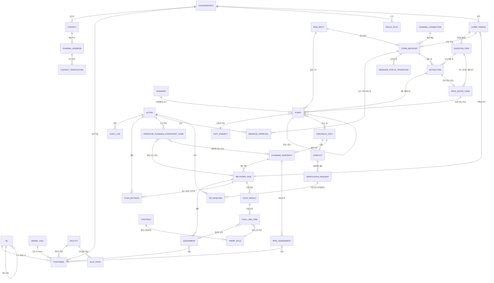

# 21. CERA 개념 데이터 모델 (Conceptual Data Model)

- 상태: **Draft rev.3 — 최종 검토 대기.** 이 문서는 **최종 DB 설계가 아니다.** 개념과 관계만 정한다 (T-073, 2026-09-17)
- 개정 이력: **rev.3 최종 정합성 정리 (2026-09-17, T-078)** — 새 개념·새 요구사항을 추가하지 않고 **남은 표현 불일치만 제거**했다: 후보 개수(미확정 4개) 통일 · 발송 승인의 옛 표현("메시지 승인 필드") 제거 · 계획 결정에 "기존 계획 유지" 포함 · 계산 결과를 **"보존되는 산출 기록"** 으로 용어 정리(Source of Truth 와 혼동 방지) · 작업표 메타 숫자 갱신. / **rev.3 (2026-09-17, T-077)** — **운영자 개입과 재계산의 의미를 추가했다.** ① 위험·비용·복구 계획은 **사람 승인 전에 CERA가 먼저 계산한다** ② 운영자는 **결과 숫자가 아니라 입력을 고친다** ③ 사람의 개입을 **사실 / 요율·상업 조건 / 계획 조건 / 계획 결정** 넷으로 갈랐다 ④ **운영자 계획 조건(OperatorPlanningConstraint)** 을 저장 개념 후보로 추가했다 — **현실 사실이 아니다** ⑤ 계획 입력 스냅샷·복구 계획 실행과의 연결과 재계산 이유 추적을 적었다. **rev.2 의 결정은 하나도 되돌리지 않았다.** / **rev.2 (2026-09-17, T-075)** — 사용자·ChatGPT 검토 반영. **너무 일찍 닫은 개념 5건을 다시 열고**(견적 묶음 · 발송 승인 · 운영 계획 묶음 · 예외 건 · 비용 줄 귀속), **용어를 기존 요구사항과 정렬**(`Ask` → **`QuestionItem`**, `ChannelCredential` → **`ChannelConnection`**), 엔티티 후보 목록·개수를 문서·작업표 전체에서 다시 셌다. **폐기·재설계가 아니라 수정이다** — rev.1의 구조적 결론은 유지한다. / rev.1 (2026-09-17)
- 기준 커밋: `1b97905` (T-071 `docs/19` + T-072 `docs/20` 반영 상태)
- 선행 문서: **`docs/20_data-model-preconditions.md`** — "테이블을 만들기 전에 무엇이 확정돼 있는가"를 가른 문서. 이 문서는 그 판정(20절 18절: 착수 조건 충족)을 받아서 시작한다
- 짝 산출물: **`docs/21_cera-conceptual-data-model.xlsx`** — 같은 내용의 **검토용 작업표**(후보 목록·분류·필터·검토 상태). 역할 구분은 1.3절
- 다음 단계: **논리 DB 설계** (이 문서가 승인된 뒤). 그전에 `docs/20` 19절과 이 문서 24절의 질문에 답해야 한다

> **이 문서에 없는 것**: SQL, CREATE TABLE, 컬럼 목록, PK/FK, 자료형, 인덱스, 마이그레이션, ORM, DB 제품, API endpoint, LLM 공급자·모델, 솔버.
> 그것들은 **논리 설계와 구현 시점의 결정**이며, 지금 정하면 개념이 바뀔 때마다 두 번 고치게 된다.

---

## 1. 목적과 범위

### 1.1 이 단계가 답하는 질문

> **CERA가 현실에서 다루는 데이터가 각각 무엇인가?**
> 무엇이 **그 자체로 존재하는 대상**이고, 무엇이 **대상에 딸린 값**이고, 무엇이 **시간에 따라 변하는 사실**이고, 무엇이 **여러 사실에서 만든 현재 결론**이고, 무엇이 **엔진이 계산한 결과**이고, 무엇이 **사람의 결정**이고, 무엇이 **근거**인가. 그리고 서로 어떤 관계인가.

### 1.2 이 단계가 답하지 않는 질문

| 질문 | 어디서 답하나 |
| --- | --- |
| 테이블을 몇 개 만들까, 컬럼 이름은 무엇인가 | 논리 설계 |
| 어떤 DB 제품·ORM·마이그레이션 도구를 쓰나 | 구현 시점 (ADR-004는 Proposed이고 개념과 무관) |
| 신선도 기준 몇 분, 강도 몇 점, τ·δ·θ는 얼마인가 | 정책 파라미터. `docs/05` 15절, Q-23·Q-24 |
| 어떤 API endpoint로 노출하나 | OpenAPI (ADR-028, T-069) |

### 1.3 Markdown과 Excel의 역할 구분

| | `docs/21_…md` (이 문서) | `docs/21_…xlsx` (작업표) |
| --- | --- | --- |
| 목적 | **왜 그렇게 보는가** — 개념, 관계, 경계, 판정 근거 | **전체 후보를 한눈에 보고 걸러내기** — 목록, 분류, 비교, 검토 상태 |
| 읽는 방식 | 위에서 아래로 읽는 설계 문서 | 정렬·필터로 훑는 검토표 |
| 정본 | **개념의 정의와 판정 근거는 이 문서가 정본이다** | 항목 목록과 **검토 상태**는 작업표가 정본이다 |
| 둘이 어긋나면 | 임의로 한쪽을 덮어쓰지 않는다. **어긋난 항목을 보고하고 사람 검토로 넘긴다** | 같음 |

**작업표의 16개 시트** (데이터 585행, 2026-09-17 rev.3 최종 정합성 정리 기준)

| 시트 | 내용 | 이 문서의 어느 절 |
| --- | --- | --- |
| `01_Overview` | 목적 · 기준 커밋 · 작업 단계 · 주의사항 · 값 목록 | 1절 |
| `02_DomainGlossary` | 용어별 설명 · 왜 필요한가 · 분류 · 범위 · 근거 · 검토 상태 | 3절 |
| `03_ConceptInventory` | 전체 개념의 분류 · 원본/파생 · 변경 빈도 · 이력 · MVP · 결정 상태 | 4절 |
| `04_EntityCandidates` | 독립 엔티티 후보와 **깨지는 기능** | 6절 |
| `05_AttributeCandidates` | 속성 후보 · 값의 모양 · 안정·변동 · 이력 · 출처 | 7절 |
| `06_OperationalFacts` | 사실 키 · 종류 · 계열 · 권한 A 역할 · 신선도·이력 필요 | 8절 |
| `07_Events` | 현실 사건과 감사 기록의 구분 | 9절 |
| `08_CurrentState` | 현재 상태 항목 · 무엇에서 만들어지나 · 물질화 여부 | 10절 |
| `09_CalculatedOutputs` | 계산 결과 · 입력 · 결정론 여부 · 저장 필요성 | 11절 |
| `10_Plans_Decisions` | 계획·결정 산출물과 세 가지 승인의 분리 | 12절 |
| `11_Contracts_Rates_Cost` | 계약·요율·견적·적용요율·예상·계획·실제 비용·환율 | 5.7절 |
| `12_Facilities_Resources` | 시설·자원 후보와 MVP 판정 | 5.2·5.4절 |
| `13_Communication` | 통신 도메인 개념과 **AI 관여 구간** | 14절 |
| `14_Relationships` | 관계 · 개수 후보 · 필수 여부 · 이유 | 15절 |
| `15_ScenarioMapping` | 시나리오 JSON 경로 → 개념 역매핑, **제품 핵심 / 시나리오 전용** | 19절 |
| `16_OpenDecisions` | 열린 결정 · 어느 단계를 막는가 · 현재 제안 · 결정 주체 | 23·24절 |

### 1.4 저장소 근거와 외부 도메인 확장 (`docs/20` 22.7)

이 문서의 모든 판정은 **저장소 문서·데이터·코드**를 근거로 한다. 일반적인 물류 상식으로 빈 곳을 채우지 않았다. 외부 지식을 쓴 곳은 **`[외부확장]`** 으로 표시했다. 표시가 없으면 저장소 근거가 있다는 뜻이다.

검증 태그는 `docs/01` 2절을 따른다: `[VERIFIED]` `[ASSUMPTION]` `[TO VERIFY]`.

---

## 2. 데이터 설계 원칙

### 2.1 반드시 지키는 것 (`docs/20` 3절 A-01~A-24 요약)

| 원칙 | 데이터 모델에서의 뜻 |
| --- | --- |
| **사건은 덧붙이기만** | 사실 주장은 수정·삭제하지 않는다. 정정은 대체 관계를 가진 새 기록 |
| **모든 사건에 출처** | 채널 · 현실 역할 · 주체 · 출처 시각 · 수신 시각 · 입력 품질 · 원문 참조가 없는 사실 주장은 존재할 수 없다 |
| **모든 시각에 시간대** | 시간대 없는 값은 경계에서 거부한다(Asia/Seoul) |
| **금액은 원 단위 정수** | 외화는 환율과 환율 기준일을 함께 남긴 뒤 환산한다 |
| **원문 보존** | 파싱·추출을 원본에서 다시 실행할 수 있어야 한다 |
| **현재 상태는 재생성 가능** | 현재 상태 = (사건 집합, 정책 버전, 기준 시각)의 순수 함수 |
| **사실과 산출물을 섞지 않는다** | 위험·비용·계획은 엔진 산출물이며 사실 저장소에 넣지 않는다 |
| **예정·예상·관측·제안은 다른 사실** | 서로 다른 키를 쓰므로 예정이 관측을 덮어쓸 수 없다 |
| **사실 확인 · 계획 승인 · 발송 승인은 서로를 대신하지 않는다** | 세 가지를 각각 다른 기록으로 남긴다 |
| **AI는 상태·신원·권한·강도를 정하지 않는다** | LLM 출력은 값 후보 + 원문 인용까지다. 엔티티 신원과 사실 키는 DB가 안다 |
| **거래처 → 담당 연락처 → 채널 주소 3단계** | 발송 자격의 세 상태를 한 칸에 합치지 않는다 |

### 2.2 이 문서가 스스로에게 계속 던진 질문 (과설계 방지)

> **"이 데이터를 독립적으로 관리하지 않으면 현재 CERA의 어떤 기능이 실제로 깨지는가?"**

답하지 못하면 독립 엔티티로 올리지 않고 **속성 · 운영 사실 · 값 객체 · 파생 뷰 · 시나리오 전용 · 미래 범위** 가운데 하나로 낮췄다. 6절의 모든 엔티티 후보에는 이 질문의 답이 붙어 있다.

**물류 시스템에 존재한다는 이유만으로 후보에 올리지 않았다.** 22절이 그렇게 제외한 영역 목록이다.

### 2.3 분류 체계 (11종)

| 코드 | 뜻 | 예 |
| --- | --- | --- |
| `ENTITY` | 그 자체로 존재하고 식별되는 대상 | 컨테이너, 거래처, 시설 |
| `ATTRIBUTE` | 다른 개념에 딸린, 비교적 안정적인 값 | 컨테이너 번호, 규격, 시설 유형 |
| `CODE` | 코드값·상태값 후보 | 사실 종류, 출처 채널, 메시지 상태 |
| `OPERATIONAL_FACT` | 시간에 따라 변하는 운영 사실·관측·제안 | "오늘 창고 수용 8대", "15시 트럭 3대 가능" |
| `REAL_WORLD_EVENT` | 현실에서 실제로 일어난 일 | 양하, 반출, 입고 |
| `CURRENT_STATE` | 여러 사실을 조정해 얻은 현재 결론 | 현재 사실, 컨테이너 단계 |
| `CALCULATION` | 엔진 산출물 | 위험 등급, 노출액, 비용 |
| `PLAN` | 의도·결정 결과 | 복구 계획 실행, 배정, 계획 승인 |
| `EXTERNAL_REFERENCE` | 다른 시스템이 발급한 식별자 | 화물관리번호, 외부 메시지 id |
| `EVIDENCE` | 근거·원문·문서 | 수신 원문, 추출 기록, 감사 기록 |
| `DEFERRED` | 지금 정하지 않는다 / 범위 밖 | 개별 차량, 실제 발생 비용 |

> `REAL_WORLD_EVENT`와 `OPERATIONAL_FACT`의 관계에 주의한다. CERA에는 "현실의 사건" 자체를 담는 별도 저장소가 **없다.** 현실의 사건은 **누군가의 주장(Event)** 으로만 들어오고, 그 주장이 말하는 사실이 `milestone.*`(MILESTONE 사실)이다. 즉 `REAL_WORLD_EVENT`는 **사실 종류의 한 갈래**이며 별도 구조가 아니다(9절).

---

## 3. CERA 물류·운영 도메인 용어집

`docs/13_glossary.md`가 용어의 정본이다. 여기서는 **데이터 모델 관점**만 덧붙인다: 이 용어가 데이터로서 무엇인지, 왜 CERA에 필요한지, 언제 필요한지, 얼마나 자주 바뀌는지, 이력이 필요한지.

> 이 표는 **CERA가 실제로 쓰는 용어만** 담는다. 물류에 존재하지만 CERA 기능에 필요 없는 것은 22절에 따로 모았다.

| 용어 (한) | 코드 표기 | 쉬운 설명 | CERA에서 왜 필요한가 | 데이터 분류 | 범위 | 변경 빈도 | 이력 필요 |
| --- | --- | --- | --- | --- | --- | --- | --- |
| 컨테이너 | `container` | 감시·운영 대상인 수입 컨테이너 한 대 | 모든 사실·계획·비용·위험이 이것에 붙는다 | ENTITY | MVP | 거의 없음(등록 후) | 상태는 사실로 |
| B/L (선하증권) | `bl` | 화물의 운송 계약 증서. 여러 컨테이너가 한 장에 묶인다 | 공공 API 조회 키이고, 계약·요율 조건이 여기에 붙는다 | ENTITY | MVP | 거의 없음 | 예 |
| MBL / HBL | `mbl_no` / `hbl_no` | 선사 발행 / 포워더 발행 B/L | 어느 번호로 조회하는지가 출처마다 다르다 | ATTRIBUTE (+ B/L 간 관계) | MVP | 없음 | — |
| 입항 건 | `vessel_call` | 배 한 척의 한 번 입항 | 여러 컨테이너가 같은 배로 온다. 입항 지연이 공통으로 걸린다 | ENTITY | **Next** | 없음 | 예 |
| 시설 | `facility` | 컨테이너가 머무르거나 거쳐 가는 물리적 장소의 상위 개념 | 창고·터미널·ODCY의 식별·위치·운영 시간이 공통이다 | ENTITY (상위) | MVP | 드묾 | 예 |
| 터미널 | `terminal` | 배에서 컨테이너를 내리고 반출입하는 부두 시설 | 컨테이너의 출발지, 보관료·게이트 시간·슬롯의 주인 | ENTITY (시설 종류) | MVP | 드묾 | 예 |
| 창고 | `warehouse` | 화물을 입고하는 목적지 시설 | **수용량 예외의 발생 지점.** CERA 초기 범위의 핵심 | ENTITY (시설 종류) | MVP | 드묾 | 예 |
| ODCY | `odcy` | 부두 밖 컨테이너 장치장 | 창고가 못 받을 때의 임시 대피처. 복구 경로의 핵심 선택지 | ENTITY (시설 종류) | MVP | 드묾 | 예 |
| 목적지 | `destination` | 이 컨테이너가 도착해야 하는 곳 | 어디로 가야 하는지가 계획의 입력이다 | **관계 + 역할** (엔티티 아님, 5.3절) | MVP | 계획마다 | 예 |
| 운송사 | `trucking_company` | 컨테이너를 트럭으로 옮기는 회사 | 트럭 가용량의 주인이고 연락 상대다 | **거래처의 역할** | MVP | 드묾 | 예 |
| 선사 | `shipping_line` | 배를 운항하고 컨테이너를 소유한 회사 | D&D 요율·무료기간의 주인, D/O 발행자 | **거래처의 역할** | MVP | 드묾 | 예 |
| 차량 풀 | `truck_pool` | 한 운송사가 운용하는 트럭 묶음 | 가용 대수 사실이 붙는 주체. 풀이 다르면 합산한다 | ENTITY | MVP | 드묾 | 예 |
| 개별 차량 | `truck` | 트럭 한 대 | 실제 배차 지시 수준이 필요해질 때만 | **DEFERRED** (Q-57, 5.4절) | Next | 드묾 | 예 |
| 반출 슬롯 (VBS) | `slot` | 터미널 반출입 차량 예약 단위 | 반출 가능 시간대 제약 | **터미널의 자원 단위** | MVP(가상값) | 슬롯마다 | 예 |
| 자원 가용량 | `capacity` / `available` | "오늘 창고 8대", "15시 트럭 3대" | **예외 탐지와 복구 계획의 실제 제약** | OPERATIONAL_FACT | MVP | **자주** | 예 (사건으로) |
| 거래처 | `counterparty` | 업무로 연락하는 법인·조직 | 발신자의 역할·권한을 결정론적으로 정하는 정본 | ENTITY | MVP | 드묾 | 예 |
| 담당 연락처 | `contact` | 거래처의 담당자 | 사람이 바뀌고 퇴사한다. 주소의 주인 | ENTITY | MVP | 보통 | 예 |
| 채널 주소 | `channel_address` | 그 담당자의 메일 주소 등 | **발송 자격의 정본**(3상태) | ENTITY | MVP | 보통 | 예 |
| 계약 | `contract` | 화주·선사 간 운송 계약 문서 | 요율 규칙의 근거 원문 | ENTITY | MVP | 드묾 | 예 |
| 요율 규칙 | `tariff_rule` | 계약에서 확정한 D&D·보관 계산 규칙 | **금액 계산의 정본.** 버전이 필요하다 | ENTITY (버전 관리) | MVP | 드묾 | **예 (필수)** |
| 견적 (제안 묶음) | `rate_quote` / `commercial_offer` | 상대가 **한 번에 제시한 상업적 제안 한 건** (금액 + 유효기간 + 조건 + 어느 문의의 회신인지 + 원문) | 제안 단위로 남아 있어야 "누가 언제 무엇을 제안했나"를 설명할 수 있다 | **EVIDENCE 묶음 후보 (저장 형태 미확정)** (5.6절) | MVP | 보통 | 예 |
| 요율 사실 | `rate.*` | 제안에서 추출·검증된 **계산 가능한 개별 값** (보관료 35,000원/일 등) | 비용 계산의 입력 | OPERATIONAL_FACT (TERM) | MVP | 보통 | 예 |
| 무료기간 / LFD | `free_days` / `lfd` | 과금 없이 쓸 수 있는 기간과 그 마지막 날 | 마감까지 남은 시간(위험)의 기준 | CALCULATION (요율 규칙 + 마일스톤) | MVP | — | 예 |
| D&D | `dnd` | 무료기간을 넘겨 쓸 때 선사가 부과하는 비용 | CERA가 줄이려는 비용의 핵심 | CALCULATION | MVP | — | 예 |
| 마일스톤 | `milestone.*` | 양하·통관·반출·입고 같은 사건 시각 | 단계·준비 시각·과금 기산의 근거 | OPERATIONAL_FACT (현실 사건 갈래) | MVP | 사건마다 | 예 |
| 단계 | `phase` | 컨테이너가 지금 어느 국면인지 (10개) | 화면·필터·위험 등급의 요약 | **CURRENT_STATE (파생, 원본 아님)** | MVP | 사실 따라 | 재계산 |
| 예외 | `exception.*` | 그 컨테이너 자체의 문제(통관 보류, 수령 거부) | 반출 불가 판정 | OPERATIONAL_FACT | MVP | 드묾 | 예 |
| 자원 조건 | `condition.*` | 자원 쪽 문제(항만 혼잡 등) | 여러 컨테이너에 동시에 걸린다 | OPERATIONAL_FACT | 예약 | 드묾 | 예 |
| 영향 | `impacts` | 자원 조건이 어느 컨테이너에 걸리는가 | 화면에서 "12대가 영향받음"을 보여준다 | **CALCULATION (저장 안 함)** | MVP | 계산마다 | 아니오 |
| 운영 계획 | `plan.*` (Operational Plan) | 지금 예정돼 있는 픽업·입고 계획 | Baseline의 출발점 | OPERATIONAL_FACT (PLAN 종류) | MVP | 보통 | 예 |
| 복구 계획 | `recovery_plan` | 예외 뒤 CERA가 만든 대체 계획 | 제품의 핵심 산출물 | PLAN (산출물) | MVP | 실행마다 | **예** |
| 계획 입력 스냅샷 | `planning_snapshot` | 엔진에 넣은 입력을 그 시점으로 고정한 묶음 | 계획 재현과 승인 시 입력 불변 확인 | EVIDENCE (불변) | MVP | 실행마다 | 예 |
| 배정 | `assignment` | "이 컨테이너를 이 경로·이 시간에" | 복구 계획의 실행 단위 | PLAN (산출물, 종속) | MVP | 실행마다 | 예 |
| 위험 평가 | `risk_assessment` | 컨테이너별 등급·여유시간·노출액 | 무엇을 먼저 볼지 정한다 | CALCULATION | MVP | 계산마다 | 예 |
| 노출액 | `exposure_krw` | 조치하지 않으면 생길 비용 | 정렬·KPI | CALCULATION | MVP | 계산마다 | 예 |
| 여유시간 | `slack_minutes` | 마감까지 실질적으로 남은 시간 | 등급 판정 | CALCULATION | MVP | 계산마다 | 아니오 |
| 사건 (주장) | `event` | "어느 출처가 무엇을 언제 주장했다" | **모든 사실의 유일한 입구.** 원본 | ENTITY (원본, 덧붙이기) | MVP | 계속 | **예 (필수)** |
| 원문 | `raw_input` | 받은 메일·API 응답·업로드 파일 그대로 | 재파싱·감사·분쟁 대응 | EVIDENCE (원본) | MVP | 계속 | **예 (필수)** |
| 현재 사실 | `canonical_fact` | 한 사실에 대한 지금의 결론 + 상태 + 근거 | 화면·엔진이 보는 값 | CURRENT_STATE (파생, 물질화) | MVP | 계속 | 재생성 |
| 충돌 | `conflict` | 자동으로 정할 근거가 없는 출처 간 차이 | 사람에게 물어야 할 지점 | CURRENT_STATE (파생) | MVP | 드묾 | 재생성 |
| 확인 요청 | `verification_request` | 사람에게 묻는 항목 | 사실 확인 게이트 | **파생 목록 + 원본 처리 이력** (5.9절) | MVP | 보통 | 분리 필요 |
| 문의 스레드 | `comm_thread` | 한 건의 문의 대화 | 회신을 어느 물음에 붙일지 정하는 단위 | ENTITY | MVP | 보통 | 예 |
| **질문 항목** | `question_item` (추출·통신 계약의 필드명은 `ask_id`) | 그 스레드에서 **정확히 무엇을 물었는가** | 회신 값을 결정론적으로 매핑하는 축 | **ENTITY** (요구사항에는 이미 있었으나 **저장 개념에서 빠져 있었다** — 8.4절) | MVP | 보통 | 예 |
| 메시지 | `comm_message` | 보낸/받은 한 통 | 승인·발송·회신의 단위 | ENTITY | MVP | 보통 | 예 |
| 추출 기록 | `extraction` | 회신 본문에서 값을 뽑은 1회의 기록 | 재실행·감사·품질 추적 | EVIDENCE (원본) | MVP | 보통 | 예 |
| 행동 주체 | `actor` | CERA 안에서 행동한 주체 | 승인·확인·결정 기록이 가리킬 대상 | ENTITY (개념만) | MVP | 드묾 | 예 |
| **발송 승인** | `message_approval` | **한 번의 승인 행위 그 자체의 기록** (무엇을 누구에게 보내도 된다고 했는가) | 수정·수신자 변경·계획 변경·만료·취소 때마다 승인이 다시 필요하다 | **DECISION / 감사 보조 기록** (독립 후보, 12.3절) | MVP | 보통 | **예 (필수)** |
| 감사 기록 | `audit_log` | 누가 CERA에서 무엇을 했는가 | 되돌릴 수 없는 행위(발송)의 책임 추적 | EVIDENCE (원본) | MVP | 계속 | **예 (필수)** |
| 활동 타임라인 | `activity` | 사람에게 보여주는 운영 흐름 | 화면 | **조합 뷰** (5.12절, Q-61) | MVP | — | 아니오 |

---

## 4. Concept Inventory — 전체 개념 판정표

`docs/20` 22.6이 분류하라고 지목한 개념 전체다. **"깨지는 기능"** 열이 2.2절 질문의 답이다.

### 4.1 대상·자원

| 개념 | 분류 | 식별 | 원본/파생 | 시간축 | MVP | 판정 근거 · 독립 관리하지 않으면 깨지는 것 |
| --- | --- | --- | --- | --- | --- | --- |
| Container | `ENTITY` | 컨테이너 번호(ISO 6346) | 원본(등록) | 상태는 사실로 | **필수** | 감시·계획·비용·위험의 주체. 없으면 제품이 성립하지 않는다 |
| BL | `ENTITY` | B/L 번호(+ 연도) | 원본(등록) | 아니오 | **필수** | 공공 API가 B/L 단위로 답한다. B/L 단위 관측을 여러 컨테이너에 나눠 적용하는 관계를 표현할 자리가 없어진다. 요율·계약 조건도 B/L·선사 축에 붙는다 |
| VesselCall (입항 건) | `ENTITY` | 항만청코드+입항연도+입항횟수+호출부호 | 원본(등록) | 아니오 | **Next** | 같은 배로 온 컨테이너에 입항 지연이 공통으로 걸린다. 지금은 컨테이너별 도착 예상·실제로 충분하므로 MVP 필수는 아니다 |
| Facility | `ENTITY` (상위) | 시설 id | 원본(등록) | 아니오 | **필수** | 창고·터미널·ODCY의 식별·위치·운영시간이 공통이다. 공통 개념이 없으면 구간(출발 시설 → 도착 시설)과 위치 값을 시설 종류마다 따로 표현해야 한다 |
| Warehouse / Terminal / ODCY | `ENTITY` (시설 종류) | 시설 id | 원본 | 아니오 | **필수** | 용량 차원·요율·규격 제한·보관 제한이 종류마다 다르다(`docs/20` 10.2) |
| Destination | **관계 + 역할** | — | — | 계획 시점 | **필수** | 같은 창고가 어떤 컨테이너에는 목적지, 다른 컨테이너에는 경유지다. 엔티티로 만들면 같은 시설이 두 곳에 생긴다 → **Q-56 결론(5.3절)** |
| Counterparty | `ENTITY` | 거래처 id | 원본(등록) | 아니오 | **필수** | 발신자의 역할·조직을 결정론으로 정하는 정본. 없으면 근거 강도를 계산할 수 없고 Reconciliation 전체가 무너진다. 발송 자격도 여기서 시작한다 |
| Contact | `ENTITY` | 연락처 id | 원본 | 아니오 | **필수** | 담당자가 바뀌고 퇴사한다. 주소만으로는 "누구의 주소인가"를 잃는다 |
| ChannelAddress | `ENTITY` | 주소 id (채널+정규화 주소) | 원본 | 아니오 | **필수** | 발송 자격 3상태의 정본. 주소 단위로 검증·승인·활성이 따로 움직인다 |
| Carrier (선사) | **거래처의 역할** | — | — | — | **필수** | 거래처 등록부가 이미 `SHIPPING_LINE` 역할을 가진다. 선사에 필요한 것(계약 당사자, 요율 조건, 컨테이너의 선사 참조)이 모두 거래처 참조로 표현된다. 별도 엔티티는 같은 조직을 두 곳에 만든다 |
| TruckPool | `ENTITY` | 풀 id | 원본 | 아니오 | **필수** | 가용 대수 사실이 붙는 주체이고, 서로 다른 풀의 가용량은 **합산**한다(`docs/05` 14.2). 풀 구분이 없으면 자사·협력사 가용량을 더할 수 없다 |
| Truck (개별 차량) | `DEFERRED` | — | — | — | **아니오** | **Q-57 결론(5.4절).** MVP 기능(예외 탐지 → 복구 계획 → 연락)은 풀 단위 가용량만으로 성립한다 |
| SlotPool (VBS) | **터미널의 자원 단위** | 터미널 + 슬롯 | 원본 | 슬롯마다 | MVP(가상값) | 슬롯 권한은 터미널에 있다(`docs/05` 3.2). 사실이 붙는 주체로서 식별은 필요하지만 터미널과 독립적으로 존재하지 않는다 |
| Resource Availability | `OPERATIONAL_FACT` | (자원, 사실 키) | **사건에서 파생** | **필수** | **필수** | 마스터가 아니다. "오늘 8대"는 등록 정보가 아니라 **관측·제안**이다(`docs/20` 11.1). 마스터로 만들면 출처·신선도·충돌을 잃는다 |
| Route Leg (구간) | **값 객체** | (출발 시설, 도착 시설) | — | — | **필수** | 운임·이동시간이 붙는 파라미터다. 그 자체로 생애주기가 없다 → 엔티티로 올릴 근거가 없다 |

### 4.2 사실·사건·상태

| 개념 | 분류 | 원본/파생 | MVP | 판정 근거 |
| --- | --- | --- | --- | --- |
| Event (사실 주장) | `ENTITY` **원본, 덧붙이기 전용** | **원본** | **필수** | 모든 사실의 유일한 입구. 이것을 잃으면 현재 상태를 재생성할 수 없다 |
| RawInput (원문) | `EVIDENCE` **원본** | **원본** | **필수** | 재파싱·감사·분쟁 대응. `01` 5.7이 규칙으로 못박았다 |
| Quarantine (거부된 입력) | `EVIDENCE` | 원문의 상태 | **필수** | **사건이 아니다.** 원문에 상태와 사유만 남기고 현재 상태에 영향을 주지 않는다(`docs/05` 4.5) |
| CanonicalFact (현재 사실) | `CURRENT_STATE` **파생, 물질화** | 파생 | **필수** | 저장하는 이유는 성능·변경 감지·설명이다. 언제든 지우고 사건에서 다시 만들 수 있어야 한다 |
| Conflict | `CURRENT_STATE` 파생 | 파생 | **필수** | Reconciliation 결과의 일부 |
| VerificationRequest | **파생 목록 + 원본 처리 이력** | **둘이 섞여 있다** | **필수** | 목록은 파생이지만 사람의 열람·미룸·처리는 파생이 아니다. 파생 테이블을 지우면 처리 이력이 사라진다 → **5.9절, Q-59** |
| Container Phase (단계) | `CURRENT_STATE` **파생, 저장 안 함** | 파생 | **필수** | 사실에서 매번 유도한다. 원본으로 저장하면 순서가 바뀐 사건에서 되감아야 한다(ADR-021) |
| Impacts (영향) | `CALCULATION` **저장 안 함** | 파생 | **필수** | Risk Engine이 계산한다. 사실이 아니다(`docs/04` 2.3) |
| Exception Case (예외 건) | **조합 뷰 + 파생 상태 (현재 기본안)** | 파생 | **필수** | 컨테이너 예외는 사실, 자원 조건은 사실, 영향은 계산이다. **그러나 CERA의 제품 성격이 예외 복구이므로**, 처리 담당·상태·종결·관련 확인·관련 문의·관련 복구 계획을 묶는 **운영 Case가 필요할 가능성이 있다** → **L-10**. **"엔티티가 아니다"라고 닫지 않는다** → 5.11절 |

### 4.3 계획·결정·계산

| 개념 | 분류 | 원본/파생 | MVP | 판정 근거 |
| --- | --- | --- | --- | --- |
| Operational Plan (운영 계획) — **개별 예정 값** | `OPERATIONAL_FACT` (PLAN 종류) | 원본(사건으로) | **필수** | 사용자의 예정은 `plan.*` 사실로 들어온다. 개별 값을 별도 엔티티로 복제하지 않는다. **단 배차 자원을 담을 사실 키가 없다** → 8.4절 F-2 |
| Operational Plan **묶음**(Aggregate · Import Batch · Version) | **미확정 (OPEN)** | 원본 후보 | **미확정** | 현실에서는 여러 컨테이너의 예정이 **하나의 운영계획으로 함께 생성·업로드·수정·교체·버전 관리**될 수 있다. 그 묶음·버전·출처를 담을 자리가 필요할 가능성이 있다 → **L-9**. **"엔티티가 아니다"라고 닫지 않는다** |
| PlanningSnapshot | `EVIDENCE` **불변** | **원본(불변 사본)** | **필수** | 계획 재현과 승인 시 "입력이 그대로인가" 확인. 없으면 승인의 의미가 사라진다 |
| RecoveryRun (복구 계획 실행) | `PLAN` 산출물 | **보존되는 산출 기록** | **필수** | 무엇을 어떤 입력·규칙·시드로 계산했는지가 기록 자체로 가치다. **현실의 Source of Truth 는 아니다**(18절) |
| Plan Version | **RecoveryRun이 곧 버전이다** | — | **필수** | 복구 계획 실행의 상태(제안·승인·대체·반려)가 이미 버전 생애주기를 담는다 → 5.10절 |
| Assignment (배정) | `PLAN` 산출물 (**종속**) | **보존되는 산출 기록** | **필수** | 실행 단위. 그러나 복구 계획 실행 없이 존재하지 않는다 |
| **OperatorPlanningConstraint** (운영자 계획 조건) | **`PLAN` 입력 — 저장 개념 후보 (형태 미확정)** | 원본(사람의 명시적 결정) 후보 | **필수** | 운영자가 최적화에 준 **사용·제외·선호·한도** 조건이다. **현실 사실이 아니다** — 이번 계획에서 제외한 시설을 자원의 가용 사실로 바꾸면 그 시설이 현실에서 못 쓰는 자원처럼 오염된다. 계산 재현과 "왜 결과가 바뀌었나"에 필요하다 → 12.5절, **E-37**, **L-12** |
| PlanDecision (계획 결정) | `PLAN` **원본 결정 기록** | **원본** | **필수** | 복구 계획에 대한 사람의 의사결정 기록이다. 사건이 아니다(A-15) — 현실에 대한 주장이 아니라 CERA 내부 결정이다. **복구안 채택 · 복구안 거부 · 기존 운영 계획 유지(위험 감수)** 를 기록할 수 있어야 한다. **결정 종류 값(enum)은 논리 설계에서 확정한다**(12.5.6절) |
| RiskAssessment | `CALCULATION` | **보존되는 산출 기록** | **필수** | 시점별 비교와 등급 근거. 재계산 가능하지만 "그때 그렇게 판정했다"가 가치다 |
| Cost Result (예상·계획 비용) | `CALCULATION` | **보존되는 산출 기록** | **필수** | 계획과 함께 남는다 |
| Cost Line Item (비용 줄) | `CALCULATION` (**비용 계산 결과의 종속 내역**) | **보존되는 산출 기록** | **필수** | 추적성(NFR-02)이 "화면의 모든 숫자를 근거로 거슬러 올라갈 수 있어야 한다"고 요구한다. 합계만 남기면 이 요구가 깨진다. **귀속은 배정 하나로 고정하지 않는다** — 복구 계획 전체·여러 컨테이너 공통·시설·요율 규칙·요율 사실에 걸릴 수 있다(11.1절) → **Q-60** |
| Money (금액) | **값 객체** | — | **필수** | 원 단위 정수 + (외화면) 원 통화·원 금액·환율·환율 기준일. A-04의 요구를 담을 자리가 현재 없다 → 8.4절 F-3, **Q-58** |
| Actual Cost (실제 발생 비용) | `DEFERRED` | — | Future | `02` 6절·`04` 6.4가 실현 절감을 Pilot 이후로 못박았다 |

### 4.4 통신

| 개념 | 분류 | 원본/파생 | MVP | 판정 근거 |
| --- | --- | --- | --- | --- |
| CommThread (문의 스레드) | `ENTITY` | 원본 | **필수** | CERA가 만든 스레드만 존재한다. 회신을 붙일 단위 |
| **QuestionItem (질문 항목)** | **`ENTITY`** | 원본 | **필수** | **회신 추출의 결정론 축이다.** Backend가 "무엇을 물었는지"를 알고 있어야 LLM 답(`ask_id` + 값)을 대상 엔티티·사실 키로 매핑할 수 있다(`docs/18` D.3). 이 개념이 없으면 LLM이 사실 키를 정하게 되고 ADR-026을 위반한다. **새 업무 개념이 아니다** — 외부 통신 요구사항에 이미 있던 "질문 항목"이 **저장 개념 모델에서 빠져 있었다** → 8.4절 F-1 |
| CommMessage | `ENTITY` | 원본 | **필수** | 승인·발송·회신·멱등의 단위 |
| MessageStatusTransition | `EVIDENCE` (이력) | **원본** | **필수** | 되돌릴 수 없는 행위의 감사. 상태 값만 두면 "언제 왜 바뀌었는가"를 잃는다 |
| **MessageApproval (발송 승인 결정)** | **`DECISION` / 감사 보조 기록 — 독립 불변 기록 후보** | **원본** | **필수** | 사건이 아니다(A-16). **한 번의 승인 행위 자체가 기록이다.** 수정·수신자 변경·계획 변경·만료·취소로 **같은 메시지에 승인 기록이 여러 개 생길 수 있다.** 승인 시점의 수신자·제목·본문·구조화 값·내용 해시·승인자·승인 시각을 함께 고정한다. 메시지의 상태 필드 하나로는 이 생애주기를 담을 수 없다 → 12.3절, **L-11** |
| Send Attempt / Result | **상태 전이 이력으로 표현** | 원본 | **필수** | 시도 횟수·마지막 오류가 메시지에 있고 전이 이력이 경위를 담는다. 별도 엔티티가 필요한지는 논리 설계 판단(L-7) |
| ContactVerification | `ENTITY` | 원본 | **필수** | 1회용 토큰의 발급·만료·사용 기록. 재발송이 이전 토큰을 무효화한다 |
| Extraction (추출 기록) | `EVIDENCE` **원본** | **원본** | **필수** | 1회 추출 = 1행. 재실행하면 새 행. 모델·프롬프트 버전·검증기 결과가 품질 추적의 근거 |
| Extraction Candidate (값 후보) | **추출 기록의 내용** | 원본의 일부 | **필수** | 후보 자체가 별도 생애주기를 갖지 않는다. 사실이 되는 순간 Event다 |
| **ChannelConnection** (옛 이름 `ChannelCredential`) | `ENTITY` (연결 메타만) | 원본 | **필수** | 채널 계정 연결 상태·권한 범위·만료를 관리한다. **비밀값(토큰) 자체를 DB에 넣지 않는다** — 참조(`credential_reference`)와 메타만 둔다(`docs/18` D.1). 이름을 바꾼 이유는 14.4절 |
| Structured Draft Field | **메시지의 내용(값 객체)** | 원본의 일부 | **필수** | 초안 숫자가 어느 계획의 어느 부족분에서 왔는지 포인터(`docs/18` D.2). 숫자 검사가 이것에 기댄다 |

### 4.5 주체·감사

| 개념 | 분류 | 원본/파생 | MVP | 판정 근거 |
| --- | --- | --- | --- | --- |
| Actor | `ENTITY` (**개념만**) | 원본 | **필수** | 승인·확인·결정 기록이 가리킬 대상. **사용자·조직·역할·권한·테넌트 모델은 만들지 않는다**(Q-A6). 저장 구조는 **Q-62** |
| AuditLog | `EVIDENCE` **원본** | **원본** | **필수** | 되돌릴 수 없는 행위(실제 발송)의 책임 추적. 사건과 다른 것이다 |
| Activity Timeline | **조합 뷰** | 파생 | **필수** | **Q-61 결론(5.12절)**: 저장하지 않고 조합한다. 항목의 다섯 갈래가 각각 이미 원본을 가진다 |
| Policy Version | **계산 입력(참조값)** | 원본(설정) | **필수** | 현재 상태가 (사건, **정책 버전**, 기준 시각)의 함수이므로 버전이 값으로 남아야 한다 |
| Scenario | `ENTITY` (**시뮬레이션 자산**) | 원본 | **필수** | 재생 입력. 제품 도메인이 아니라 시뮬레이션 자산이다. 시나리오에서 나온 값은 같은 경로를 타고 표시만 다르다(ADR-018) |

---

## 5. 판정이 갈린 개념 — 근거와 결론

`docs/20` 8~17절이 "개념 설계에서 결정"으로 넘긴 것들이다.

### 5.1 Container 와 B/L 의 관계 (**Q-53 — 개념 수준 결론**)

| 근거 | 내용 |
| --- | --- |
| `docs/04` 1절 ER | 컨테이너 여럿이 B/L 하나에 속하는 다대일로 그려져 있다 |
| `docs/data/code-tables.md` | 혼재(Consol) 코드가 관측돼 있다 → 단순 다대일이 아닐 수 있음을 시사 |
| `AGENTS.md` 초기 범위 | **Import FCL** (컨테이너 단위 화물) |
| `docs/13` | FCL = 컨테이너 단위 화물 / LCL = 혼재 화물 |
| 시나리오 | `bl_ref` 단일 문자열 — fixture 단순화(`docs/20` 9.2) |

**결론 (개념 수준)**

1. **MVP는 컨테이너 : B/L = N : 1 로 본다.** 근거: 초기 범위가 Import **FCL**이고, FCL은 컨테이너 한 대가 하나의 B/L에 속한다. ER도 그렇게 그려져 있다. `[ASSUMPTION]` — 실데이터(T-005·T-006) 확인 전이다.
2. **다대다를 구조적으로 배제하지 않는다.** 혼재(LCL)는 한 컨테이너에 여러 B/L이 들어오는 경우이며 코드표에 그 코드가 실제로 관측돼 있다. LCL은 **현재 범위 밖**이므로 MVP에서 구현하지 않되, 관계를 컨테이너의 B/L 번호 한 칸으로 박아 넣지 않는다 → **L-2**.
3. **MBL / HBL은 B/L의 종류이고, B/L끼리 상위-하위 관계를 가질 수 있다.** 어느 번호가 어느 출처의 조회 키인지는 `[TO VERIFY]` Q-04이므로 **둘 다 보존**한다.
4. **Shipment를 만들지 않는다.** 저장소 어디에도 그 용어가 없다(`docs/20` 9.2). 근거 없이 개념을 늘리지 않는다.
5. 외부 시스템 식별자(화물관리번호·적하목록번호·MSN)의 저장 구조는 **Q-54(논리 설계)** 그대로 둔다.

### 5.2 Facility 공통 개념과 종류

**결론**: 공통 상위 개념 Facility를 쓴다(사용자 결정, `docs/20` 18절 Q-A3). 공통 축은 **식별 · 위치 · 시간 운영 조건**이고, 종류마다 다른 것은 **용량의 차원 · 요율 · 규격 제한 · 보관 제한 · 이동 시간**이다.

| 시설 종류 | 고유한 것 | MVP |
| --- | --- | --- |
| Terminal | 게이트 운영 시간, 보관료, 반출 슬롯 제공 | 필수 |
| Warehouse | 입고 시간대, **일별 수용 대수**, 당일 입고 마감, 받는 규격 | 필수 |
| ODCY | **규격별·일별 수용 대수**, 최대 보관일, 보관·핸들링 요율, 게이트 마감 | 필수 |
| Factory (공장) | — | **예약.** `docs/04` 1절이 목적지를 창고·공장이라 쓰지만 공장은 창고가 아니다. 지금 구조를 정하지 않는다 |
| Empty Depot (반납지) | — | **Future** (`docs/20` 10.3) |

> **테이블 하나에 전부 넣는다는 뜻이 아니다.** 물리·논리 구조(단일 다형 / 공통 + 타입별 상세 / 타입별 분리)는 **Q-55(논리 설계)** 다.

### 5.3 Destination 의 위치 (**Q-56 — 결론**)

| 근거 | 내용 |
| --- | --- |
| `docs/13` | 같은 창고가 어떤 컨테이너에는 목적지이고 다른 컨테이너에는 경유지일 수 있다 |
| 시나리오 | 컨테이너의 운영 계획이 `destination_id`로 시설을 가리킨다 |
| 시나리오 배정 | 출발·경유·도착을 함께 쓴다 (ODCY 경유) |
| `docs/04` 3절 | Warehouse 를 Destination 과 사실상 같게 쓴다 |

**결론: Destination은 독립 엔티티가 아니라 관계에 붙은 역할이다.**
- 목적지는 **(컨테이너 또는 운영 계획) → 시설**을 가리키는 참조 + 이 계획에서의 역할이 목적지라는 뜻이다.
- ODCY 경유가 생기면 같은 컨테이너에 **경유지**와 **목적지**가 함께 생긴다. 배정이 이미 그렇게 표현하고 있다. 역할이 관계에 있다는 증거다.
- Destination을 엔티티로 만들면 같은 창고가 두 곳에 존재하게 된다.
- **남는 것**: 공장이 목적지가 될 때 그것을 시설의 한 종류로 볼지는 5.2절대로 **예약**.

### 5.4 개별 차량이 MVP 필수인가 (**Q-57 — 결론**)

| 근거 | 내용 |
| --- | --- |
| `docs/20` 11.2 | 초안의 개별 차량 필요 결론을 **철회**했다. 검증기가 차량별 근무시간·중복 배차를 검사하는 것은 **시나리오 재현의 요구**이지 제품 요구의 근거가 아니다 |
| 검증 스크립트 | 차량별 근무시간, 같은 시간 중복 배차 금지, 제안 시간대 밖 사용 금지를 검사한다 |
| 시나리오 | 자사 차량 8대는 id와 근무시간을 가진다. 협력사는 차량 목록이 비어 있는데 배정은 차량 id를 쓴다 (**불일치**) |
| `docs/05` 14.2 | 엔진이 쓰는 것은 **풀별·슬롯별 가용 대수의 합**이다 |

**결론: 개별 차량은 MVP 필수가 아니다. 개념 후보로 유지한다.**
- MVP 기능 흐름(수용량 예외 탐지 → 여러 컨테이너 복구 계획 → 자원 부족분 문의 → 회신 반영 → 재계획)은 **운송사 + 차량 풀 + 시간대별 가용 대수**만으로 성립한다. 엔진 입력 계약도 그 수준이다.
- 개별 차량이 필요해지는 시점은 **실제 배차 지시**를 CERA가 만들 때다. 그때 도입한다.
- **개념적으로 넷은 분명히 구분한다** (이것은 확정): 운송사(거래처의 역할) / 차량 풀(자원 주체) / 가용 제안(사실) / 개별 차량(보류).
- 기사(Driver)는 **범위 밖**이다(22절).

### 5.5 Carrier 는 거래처인가 별도 엔티티인가

**결론: 선사(Shipping Line)는 거래처의 한 역할이다.** 별도 엔티티로 만들지 않는다.
- 근거: 거래처 등록부의 역할에 이미 선사가 있고(ADR-028), 권한 매트릭스가 역할 단위로 정의돼 있다(`docs/05` 3.2). 선사에 필요한 것 — 계약 당사자, 요율 규칙의 조건 값, 컨테이너의 선사 참조, D/O 발행자 — 은 모두 거래처 참조로 표현된다.
- **용어 주의**: 한국어 운송사가 선사(Shipping Line)와 육상 운송사(Trucking Company)를 둘 다 가리킨다. 데이터 모델에서는 섞지 않는다.

### 5.6 견적은 사실인가 엔티티인가 — **발견한 이중 표현**

| 근거 | 내용 |
| --- | --- |
| `docs/04` 4.3 | RateQuote 구조체 (제공자·항목·규격·금액·유효기간·조건·출처 사건·상태) |
| `docs/05` 4.3 | `rate.route(...)`, `rate.storage_per_day(T)`, `rate.handling(T)` — **TERM 종류의 사실** |
| `docs/07` 4절 | `rate_quotes` 테이블 **과** `canonical_facts` 둘 다 존재 |

**같은 정보가 두 모양으로 정의돼 있다.** 견적 메일에서 뽑은 보관료는 사실인가 별도 행인가.

**결론 (rev.2 — 세 층으로 나눈다).** rev.1은 "정본은 사실이고 견적은 뷰·값 객체"라고 강하게 닫았다. **그 결론을 완화한다.** 계산에 쓰는 현재 요율의 정본이 현재 사실이라는 것과, 제안 묶음 자체가 필요 없다는 것은 **다른 이야기**다.

| 층 | 이름 | 무엇인가 | 담는 것 | 분류 |
| --- | --- | --- | --- | --- |
| **A** | **RateQuote / Commercial Offer** (제안 묶음) | 상대방이 **특정 시점에 제시한 상업적 제안 한 건** | 누가 · 언제 · 어떤 자원·구간·규격에 대한 것인가 · 금액 · 유효기간 · 조건 · **어느 문의(QuestionItem)에 대한 회신인가** · 어떤 원문에서 왔는가 | **EVIDENCE 묶음 후보** |
| **B** | **Rate Fact** (요율 사실) | 그 제안에서 추출되고 Backend 검증을 통과한 **계산 가능한 개별 사실** | 예: ODCY A 보관료 = 35,000 KRW/일 | `OPERATIONAL_FACT` (TERM) — 사건 → Reconciliation 경로를 탄다 |
| **C** | **Canonical Rate** (현재 요율) | CERA가 **지금 비용 계산에 쓸 판단값** | 값 + 차원별 상태 + 근거 | `CURRENT_STATE` |

- **A와 B를 같은 개념으로 취급하지 않는다.** 제안 묶음 하나가 여러 요율 사실을 낳는다(보관료 · 핸들링료 · 최대 보관일이 한 통의 메일에 함께 온다).
- **같은 금액을 두 개의 Source of Truth로 만들지 않는다.** 계산에 쓰는 값의 정본은 C(현재 사실)이고, A는 **그 값이 어디서 왔는지의 근거**다. 금액을 A와 C에 각각 "진실"로 두는 구조는 금지한다.
- **이번 단계에서 A를 독립 Table·Entity로 확정하지 않는다.**

| 항목 | 값 |
| --- | --- |
| 개념 | RateQuote / Commercial Offer |
| 분류 | **Commercial Offer · Evidence Bundle 후보** |
| Decision Status | **OPEN FOR LOGICAL DESIGN** |
| 계산에 쓰는 현재 요율의 정본 | **Canonical Fact (C층)** |

- 남은 질문: 제안 묶음과 개별 요율 사실의 관계, 유효기간·조건이 어디에 붙는지 → **L-3**(갱신).

### 5.7 계약 / 요율 규칙 / 견적 / 적용 요율 / 비용 — 섞지 않는 일곱

| # | 개념 | 무엇인가 | 분류 | MVP |
| --- | --- | --- | --- | --- |
| 1 | **Contract** | 계약 원문과 그 참조 | ENTITY (원본) | 필수 |
| 2 | **TariffRule** | 계약에서 확정한 계산 규칙. **버전을 가진다** | ENTITY (원본, 버전) | 필수 |
| 3a | **Rate Quote / Commercial Offer** | 상대가 한 번에 제시한 **제안 묶음** (금액 + 유효기간 + 조건 + 근거) | **EVIDENCE 묶음 후보 (OPEN)** (5.6절 A) | 필수 |
| 3b | **Rate Fact** | 그 제안에서 뽑아 검증한 **개별 값** | OPERATIONAL_FACT (5.6절 B) | 필수 |
| 4 | **Applied Rate** | 이 계산에서 실제로 고른 규칙·단가 | **계산 결과의 일부** (규칙 버전 참조) | 필수 |
| 5 | **Expected Cost** | 기준 시각에 예상되는 비용 | CALCULATION | 필수 |
| 6 | **Plan Cost** | 어떤 계획을 실행할 때의 비용 | CALCULATION | 필수 |
| 7 | **Actual Cost** | 실제로 청구·지불된 비용 | **DEFERRED (Future)** | 아니오 |

- **4번이 중요하다.** 요율이 바뀐 뒤 과거 계획을 설명하려면 그때 어느 규칙 버전을 골랐는지가 계산 결과에 남아 있어야 한다. 규칙 선택 우선순위(`docs/04` 4.2)의 **결과**를 기록한다.
- **비용 줄(Cost Line Item)은 보존한다.** 추적성 요구와 검증기의 줄 단위 검사가 근거다. **비용 계산 결과의 종속 내역**이며, 귀속 대상은 배정 하나로 고정하지 않는다(11.1절). 저장 구조와 귀속 방식은 **Q-60**.
- **환율과 환율 기준일**은 금액 값 객체의 일부로 본다(7절 Money). 환율 시계열을 독립 엔티티로 둘 근거는 저장소에 없다 → **Q-58**.

### 5.8 관측 / 예상 / 계획 / 실제 결과 — 섞지 않는 넷

`docs/05` 2.1이 이미 사실 종류로 축을 갈라 놓았다. 개념 모델은 그것을 그대로 쓴다.

| 종류 | 뜻 | 예 | 관측을 이길 수 있나 |
| --- | --- | --- | --- |
| MILESTONE · STATE | **관측한 현실** | 반출 14:10, 통관 수리됨, 창고 수용 8대 | — |
| OFFER | 상대가 약속한 미래 가용 | 15시 2대 가능 | 아니오 (다른 키) |
| PLAN | **CERA 사용자의** 예정 | 픽업 예정 15:00, 입고 예정 10/14 | **절대 아니오** |
| FORECAST | 외부·CERA의 추정 | 도착 예상 시각 | 아니오. 실제가 생기면 판단에서 빠진다 |

- **도착 예상과 실제 입항은 다르다. 계획 입고일과 실제 입고일도 다르다.** 서로 다른 사실 키이므로 구조적으로 보장된다.
- **실제 결과는 별도 개념이 아니다.** 실행 결과는 관측 사실로 들어온다(`docs/06` 7절 G5). 계획대로 됐는지 비교하는 구조는 없고, 실현 절감 측정이 Pilot이므로 지금 문제가 아니다 → Future.

### 5.9 확인 요청 — 파생과 원본이 한 곳에 있다

- `docs/05` 11.2: **요청 목록은 파생**이고, **사용자 처리 이력(열람·미룸)만 따로 저장**한다.
- `docs/20` 7.2가 이것을 위험으로 지목했다: 파생 테이블을 지우면 처리 이력이 사라진다.

**결론: 개념을 둘로 나눈다.**

| 개념 | 분류 | 뜻 |
| --- | --- | --- |
| Verification Request (요청) | **파생** | 지금 기준 시각에 사람에게 물어야 할 항목. 규칙(V1~V9)에서 계산된다 |
| Verification Request Handling (처리 이력) | **원본** | 사람이 언제 열어 보고, 미루고, 어떻게 처리했는가 |

저장 구조는 **Q-59(논리 설계)**.

### 5.10 복구 계획 실행 / 배정 / 계획 버전

**결론: RecoveryRun이 곧 계획 버전이다.** 별도 Plan Version 개념을 만들지 않는다.
- 근거: 복구 계획 실행의 상태(제안 · 승인 · 대체 · 반려)가 이미 버전 생애주기를 담는다. 시나리오도 계획 id + 버전 + 상태 이력을 한 객체에 두고 있고, v2 승인 시 v1이 대체된다.
- **Assignment는 종속 개념**이다. 복구 계획 실행 없이 존재하지 않는다.
- **계획 승인은 별개 원본 기록**이다(A-15). 승인이 계획 객체의 상태 값만 바꾸는 것으로 끝나면 누가 어떤 스냅샷 기준으로 무엇을 인지하고 승인했는지를 잃는다.

### 5.11 예외를 독립 엔티티로 둘 것인가

| 근거 | 내용 |
| --- | --- |
| `docs/04` 2.3 | 세 가지를 명시적으로 분리: 컨테이너 예외(사실) / 자원 조건(사실·유도) / 영향(계산, 저장 안 함) |
| 시나리오 `risk.json` | 예외 객체 하나가 유형·자원·감지 시각·수용량 변화·영향 컨테이너 목록·상태 이력을 한 덩어리로 담는다 |

**현재 기본안: 파생 조합 뷰로 둔다.** 구성 요소가 모두 이미 다른 개념에 있다 — 감지 시각·수용량 변화 = **사실**, 영향받는 컨테이너 목록 = **계산 결과**, 상태 변화 = 사실과 계획의 변화. 시나리오의 예외 객체는 **사람이 하나의 사건으로 인식하는 예외 건**을 보여주는 화면 단위다.

**그러나 "엔티티가 아니다"라고 닫지 않는다 (rev.2).** CERA는 이름 그대로 **예외 복구**가 제품의 본질이고, 현업에서는 예외 하나가 **운영 Case**로 관리될 가능성이 크다. 아래를 한 덩어리로 묶어야 한다면 파생 뷰로는 담을 수 없다.

```text
EX-001  창고 A 수용량 감소
  · 감지 시각 / 감지 근거
  · 영향받은 컨테이너
  · 누가 처리 중인가 (담당)
  · 관련 확인 요청
  · 관련 문의 스레드
  · 관련 복구 계획 실행
  · 언제 해결됐는가
  · 사람이 종결했는가 / 자동으로 종결됐는가
```

- **담당·처리 상태·종결 주체**는 사실에서 유도할 수 없다. 이것이 필요해지면 Exception Case는 파생 뷰가 아니라 **운영 Case**다.
- 판정: **기본안은 파생 뷰, 독립 운영 Case 필요 여부는 OPEN** → **L-10**.
- 종결 근거를 사실에서 유도할지 사람의 선언으로 둘지는 별개 질문이다 → **L-6**.

### 5.12 활동 타임라인을 저장할 것인가 (**Q-61 — 결론**)

시나리오의 활동 항목은 갈래가 다섯이다: 사실 · 상태 · 결과 · 사람 · 연락.

| 갈래 | 원본이 이미 있는가 |
| --- | --- |
| 사실 | **있다** — Event |
| 상태 | **있다** — 현재 사실의 값·상태 변경(변경 카운터) |
| 결과 | **있다** — RecoveryRun, RiskAssessment, CostResult (모두 실행 기록을 남긴다) |
| 사람 | **있다** — 확인 Event, PlanDecision |
| 연락 | **있다** — MessageStatusTransition |

**결론: 활동 타임라인은 저장하지 않고 조합한다.** 다섯 갈래가 모두 이미 원본을 가지므로 새 원본을 만들 근거가 없다.
- **단 성능·화면을 위한 물질화는 열려 있다**(18절 정책). 조건은 두 가지다: ① 원본에서 다시 만들 수 있을 것 ② 원본과 다르면 원본이 이길 것.
- 시나리오의 활동 데이터는 **재생용 파생 데이터**이며 실제 처리 기록이 아니다.

### 5.13 감사 기록과 Operational Event 의 차이

| | Operational Event | Audit Log |
| --- | --- | --- |
| 무엇에 대한 기록인가 | **현실의 업무 사실**에 대한 누군가의 주장 | **CERA 안에서 누가 무엇을 했는가** |
| 예 | 창고 수용량이 8대다, 15시에 2대 가능하다 | 거래처 등록, 주소 승인, 발송 승인, 메일 발송 성공·실패 |
| 현재 상태에 영향 | **준다** (Reconciliation을 탄다) | **주지 않는다** |
| 판정 근거 | `docs/19` 13.1이 이미 표로 갈라 놓았다 | 같음 |

- 회신에서 나온 **운영값**과 사람의 **사실 확인**은 Event다. 거래처 등록·주소 승인·발송·수신 자체는 Audit이다.
- `agent_activity` 라는 기존 스키마 이름은 이번에 바꾸지 않는다. 다만 **새 문서·개념에서 결정론 모듈을 Agent 라고 부르지 않는다**(ADR-029, `docs/06` 1.1절).

---

## 6. 독립 저장 개념 후보 — 최종 목록

4절에서 **독립적으로 식별·저장되는 개념**으로 판정된 것을 모았다. 원본인지 파생인지는 따로 표시한다(파생이어도 물질화해서 저장하므로 저장 개념 후보다).

> **개수 (rev.2 에서 다시 셌다)**
>
> | 구분 | 개수 |
> | --- | --- |
> | 6.1 MVP 저장 개념 후보 | **33** (E-01 ~ E-33) |
> | 6.1 시설 종류 후보 | **3** (E-03a · E-03b · E-03c) |
> | 6.2 개념은 필요하나 저장 형태 미확정 | **4** (E-34 ~ E-37) |
> | 6.3 Next · 보류 | **2** (E-38 · E-39) |
> | 6.4 저장 개념으로 올리지 않은 것 | **16** |
>
> **모든 행에 "독립 관리하지 않으면 깨지는 기능"이 있다**(2.2절 질문의 답). 이 개수는 21절 · 25절 · 부록 A · 작업표 `04_EntityCandidates` · `01_Overview` 와 같아야 한다.

### 6.1 MVP 저장 개념 후보 — 33개

| # | 후보 | 원본/파생 | 쉬운 의미 | 독립 관리하지 않으면 깨지는 CERA 기능 | Decision Status |
| --- | --- | --- | --- | --- | --- |
| E-01 | **Container** | 원본 | 감시 대상 컨테이너 한 대 | 전부. 감시·계획·비용·위험의 주체 | CONFIRMED |
| E-02 | **BL** | 원본 | 화물 운송 계약 증서 | 공공 API 조회(B/L 단위 응답), B/L 단위 관측을 여러 컨테이너에 나눠 적용하는 관계, 선사 요율 조건 | CONFIRMED |
| E-03 | **Facility** | 원본 | 컨테이너가 머무는 장소 | 구간(출발→도착) 표현, 위치 값의 대상, 자원 사실의 주체 | CONFIRMED (구조는 Q-55) |
| E-03a | └ **Warehouse** | 원본 | 입고 목적지 시설 | **수용량 예외 탐지 자체** | CONFIRMED |
| E-03b | └ **Terminal** | 원본 | 부두 시설 | 반출 제약, 터미널 보관료, 슬롯 제공 | CONFIRMED |
| E-03c | └ **ODCY** | 원본 | 부두 밖 장치장 | 복구 경로의 용량·비용 계산 | CONFIRMED |
| E-04 | **Counterparty** | 원본 | 업무로 연락하는 조직 | 발신자 역할·권한 판정 → 근거 강도 → Reconciliation 전체. 그리고 발송 자격 | CONFIRMED |
| E-05 | **Contact** | 원본 | 거래처의 담당자 | 담당자 교체·퇴사 처리, 주소의 소유 관계 | CONFIRMED |
| E-06 | **ChannelAddress** | 원본 | 담당자의 메일 주소 | **실제 발송 자격 판정**(검증·승인·활성 3상태) | CONFIRMED |
| E-07 | **ContactVerification** | 원본 | 주소 소유 확인 기록 | 1회용 토큰의 만료·재발송·무효화 | CONFIRMED |
| E-08 | **TruckPool** | 원본 | 운송사의 트럭 묶음 | 풀별 가용량 합산(자사·협력사 구분) | CONFIRMED |
| E-09 | **Contract** | 원본 | 계약 원문 참조 | 요율 규칙의 근거 추적 | CONFIRMED |
| E-10 | **TariffRule** | 원본(버전) | 확정된 요율·무료기간 계산 규칙 | **금액 계산과 과거 계획의 재현** | CONFIRMED |
| E-11 | **Event** | 원본 | 사실 주장 한 건 | 모든 사실의 입구. 현재 상태 재생성 | CONFIRMED |
| E-12 | **RawInput** | 원본 | 받은 원문 그대로 | 재파싱·감사·분쟁 대응 | CONFIRMED |
| E-13 | **CanonicalFact** | **파생 + 물질화** | 한 사실의 현재 결론 + 상태 + 근거 | 화면·엔진이 매 조회마다 전체를 다시 계산해야 한다. 변경 감지·설명도 불가 | CONFIRMED |
| E-14 | **Conflict** | **파생 + 물질화** | 자동으로 정할 근거가 없는 차이 | 사람에게 물어야 할 지점을 잃는다 | CONFIRMED |
| E-15 | **VerificationRequest** | **파생 + 물질화** | 사람에게 묻는 항목(목록) | 사실 확인 게이트의 대상 목록 | CONFIRMED |
| E-16 | **VerificationRequestHandling** | **원본** | 사람의 열람·미룸·처리 이력 | **파생 목록을 지우면 사람의 처리 이력이 사라진다** | OPEN (Q-59) |
| E-17 | **PlanningSnapshot** | 원본(불변) | 엔진 입력을 고정한 묶음 | 계획 재현, 승인 시 입력 불변 확인 | CONFIRMED |
| E-18 | **RecoveryRun** | 보존되는 산출 기록 | 복구 계획 실행 1회 (= 계획 버전) | 제품의 핵심 산출물. 입력 해시·규칙 버전·시드로 재현 | CONFIRMED |
| E-19 | **Assignment** *(종속)* | 보존되는 산출 기록 | 이 컨테이너를 이 경로로 | 계획의 실행 단위와 자원 사용량 검증 | CONFIRMED |
| E-20 | **PlanDecision** | 원본 | 계획 결정 기록 (채택 · 거부 · 기존 계획 유지) | 누가 어떤 스냅샷 기준으로 무엇을 인지하고 결정했는가 | CONFIRMED (결정 종류 값은 논리 설계) |
| E-21 | **RiskAssessment** | 보존되는 산출 기록 | 위험 평가 결과 1회 | 우선순위 판단의 근거와 시점별 비교 | CONFIRMED |
| E-22 | **CostResult** | 보존되는 산출 기록 | 계획별 비용 계산 결과 | 계획 비교와 절감액의 근거 | CONFIRMED |
| E-23 | **CostLineItem** *(종속)* | 보존되는 산출 기록 | 비용 내역 한 줄 | 화면의 모든 숫자를 근거로 거슬러 올라갈 수 없다(NFR-02) | OPEN (Q-60 — **귀속 대상 미확정**) |
| E-24 | **CommThread** | 원본 | 문의 대화 한 건 | 회신을 붙일 단위, 중복 문의 방지 | CONFIRMED |
| E-25 | **QuestionItem** | 원본 | 그 스레드에서 물은 질문 항목 | **회신 값을 사실 키로 매핑하는 결정론 축.** 없으면 LLM이 사실 키를 정하게 된다(ADR-026 위반) | PROPOSED (L-1) |
| E-26 | **CommMessage** | 원본 | 보낸·받은 한 통 | 승인·발송·멱등·회신 연결 | CONFIRMED |
| E-27 | **MessageApproval** | **원본(결정 기록)** | 한 번의 발송 승인 행위 그 자체 | 재승인·승인 취소·만료·계획 변경 무효화의 이력을 잃는다(12.3절) | PROPOSED (L-11) |
| E-28 | **MessageStatusTransition** | 원본(이력) | 메시지 상태가 바뀐 이력 | 되돌릴 수 없는 발송의 경위 | CONFIRMED |
| E-29 | **Extraction** | 원본 | 회신 추출 1회의 기록 | 재실행·품질 추적·모델 변경 영향 파악 | CONFIRMED |
| E-30 | **ChannelConnection** | 원본(메타만) | 채널 계정 연결의 상태·권한·만료 | 만료·재인증 안내. **비밀값은 담지 않는다** | CONFIRMED (이름은 14.4절) |
| E-31 | **Actor** | 원본(개념만) | CERA 안에서 행동한 주체 | 승인·확인·결정 기록이 가리킬 대상 | CONFIRMED (구조는 Q-62) |
| E-32 | **AuditLog** | 원본 | CERA 안의 행위 기록 | 외부 발송 등 되돌릴 수 없는 행위의 책임 추적 | CONFIRMED |
| E-33 | **Scenario** *(시뮬레이션 자산)* | 원본 | 재생 시나리오 | Prototype·데모·테스트. 제품 도메인이 아니다 | CONFIRMED |

### 6.2 개념은 필요하나 저장 형태를 확정하지 않은 후보 — 4개

**rev.2 에서 다시 연 것들과 rev.3 에서 더한 것이다.** 개념이 필요하다는 것과 독립 테이블이 필요하다는 것은 다른 이야기이므로, 필요성은 인정하고 형태는 논리 설계로 넘긴다.

| # | 후보 | 왜 필요할 수 있나 | 현재 기본안 | Decision Status |
| --- | --- | --- | --- | --- |
| E-34 | **RateQuote / CommercialOffer** (제안 묶음) | "누가 언제 무엇을 어떤 조건으로 제안했는가"를 제안 단위로 설명해야 한다. 한 통의 메일이 여러 요율 사실을 낳는다 | 근거(Evidence) 묶음. **계산에 쓰는 값의 정본은 현재 사실(Canonical Rate)이다** | **OPEN FOR LOGICAL DESIGN** (5.6절, L-3) |
| E-35 | **OperationalPlan Aggregate** (운영 계획 묶음·버전) | 여러 컨테이너의 예정이 하나의 운영계획으로 생성·업로드·수정·교체·버전 관리될 수 있다 | 개별 예정 값은 `plan.*` 사실. 묶음은 아직 만들지 않는다 | **OPEN** (12.4절, L-9) |
| E-36 | **ExceptionCase** (예외 운영 Case) | 담당·처리 상태·종결 주체는 사실에서 유도할 수 없다. CERA는 예외 복구가 본질이다 | 파생 조합 뷰 | **OPEN** (5.11절, L-10) |
| E-37 | **OperatorPlanningConstraint** (운영자 계획 조건) — **rev.3 신규** | 운영자가 "이번 건에서는 ODCY A 를 쓰지 마", "창고 B 를 우선 써", "추가 비용 50만원까지" 처럼 최적화에 준 조건이다. **현실 사실로 기록하면 자원이 오염되고**, 기록하지 않으면 **재계산 이유와 계획 재현을 설명할 수 없다** | 사람의 명시적 결정 기록. **강제 조건과 선호 조건을 표현할 수 있어야 하지만 표현 방식은 정하지 않는다** | **OPEN** (12.5절, L-12) |

### 6.3 Next · 보류 — 2개

| # | 후보 | 지금 깨지지 않는 이유 | 언제 필요한가 | Decision Status |
| --- | --- | --- | --- | --- |
| E-38 | **VesselCall** (입항 건) | 컨테이너별 도착 예상·실제 사실로 충분하다 | 입항 지연이 여러 컨테이너에 공통으로 걸릴 때 | PROPOSED (Next) |
| E-39 | **Truck** (개별 차량) | MVP 기능이 풀 + 시간대별 가용량으로 성립한다 | 실제 배차 지시를 CERA가 만들 때 | DEFERRED (Q-57) |

### 6.4 저장 개념으로 올리지 않은 것 — 16개

| 올리지 않은 것 | 무엇으로 낮췄나 | 이유 |
| --- | --- | --- |
| Destination | **관계 + 역할** | 같은 시설이 계획에 따라 목적지이거나 경유지다 (5.3절) |
| Carrier (선사) | **거래처의 역할** | 등록부가 이미 역할을 가진다 (5.5절) |
| SlotPool | **터미널의 자원 단위** | 슬롯 권한이 터미널에 있다 |
| Resource Capacity · Availability | **OPERATIONAL_FACT** | 마스터가 아니라 관측·제안이다. **운영자의 "이번엔 쓰지 마"를 여기에 쓰지 않는다** — 그것은 계획 조건(E-37)이다 |
| Rate Fact | **OPERATIONAL_FACT** | 요율 사실은 사실 카탈로그에 이미 있다 (제안 묶음과 다른 층, 5.6절) |
| Applied Rate | **계산 결과의 일부** | 비용 계산 결과가 규칙 버전 참조로 담는다 |
| Route Leg (구간) | **값 객체** | 그 자체로 생애주기가 없다 |
| Money · ExchangeRate | **값 객체** | 환율 시계열 요구가 저장소에 없다 (Q-58) |
| Phase · Impacts | **파생 · 계산 (저장 안 함)** | 사실에서 매번 유도한다 |
| Plan Version | **RecoveryRun이 곧 버전** | 상태 생애주기가 이미 있다 (5.10절) |
| Activity Timeline | **조합 뷰** | 다섯 갈래가 모두 원본을 가진다 (5.12절) |
| Operational Plan (개별 예정 값) | **PLAN 종류의 사실** | `plan.*` 사실 카탈로그에 이미 있다. **묶음은 E-35로 열려 있다** |
| Extraction Candidate | **추출 기록의 내용** | 사실이 되는 순간 Event다 |
| Structured Draft Field | **메시지의 내용(값 객체)** | 별도 생애주기가 없다 |
| Shipment | **만들지 않는다** | 저장소에 용어가 없다 |
| Driver (기사) | **범위 밖** | 저장소에 없다 (22절) |

## 7. 속성 후보 (Attribute Candidates)

> **자료형을 정하지 않는다.** 값의 모양만 적는다. 실제 DB 타입은 논리·물리 설계의 것이다.

| 상위 개념 | 속성 | 뜻 | 값의 모양 | 안정·변동 | 이력 필요 | 출처 |
| --- | --- | --- | --- | --- | --- | --- |
| Container | 컨테이너 번호 | 사람이 읽는 업무 식별자 | 코드 (ISO 6346, 체크디지트 검증) | 안정 | — | 등록 |
| Container | 규격·종류 | 20DRY · 40DRY · 40RF | 코드 | 안정 | 예 | 사실 (IDENTITY) |
| Container | 선사 | 거래처 참조 | 참조 | 안정 | 예 | 등록·사실 |
| Container | 화물 설명 | 사람용 메모 | 텍스트 | 안정 | 아니오 | 등록 |
| Container | 업무 우선순위 | 사용자가 정한 중요도 | 코드 | 변동 | 예 | 사용자 입력 |
| BL | MBL 번호 · HBL 번호 | 두 종류의 B/L 번호 | 코드 | 안정 | — | 등록·공공 API |
| BL | B/L 연도 · 종류 | 조회 키의 일부 · 마스터인지 하우스인지 | 연도 · 코드 | 안정 | — | 공공 API |
| BL | 화물관리번호 · 적하목록번호 · MSN | **관세청·해수부가 발급** | 코드 | 안정 | — | **EXTERNAL_REFERENCE** → Q-54 |
| Facility | 시설 id · 이름 · 지역 | 식별과 표시 | 코드 · 텍스트 | 안정 | 예 | 등록 |
| Facility | 시설 종류 | 창고 · 터미널 · ODCY | 코드 | 안정 | — | 등록 |
| Facility | 운영 시간대 | 입고 가능 시간, 게이트 운영 시간 | 시간 구간 목록 | **준안정** | 예 | 등록 또는 사실 |
| Warehouse | 받는 규격 | 허용 규격 목록 | 코드 목록 | 준안정 | 예 | 등록 |
| Warehouse | 당일 입고 마감 시각 | 이 시각 뒤 출발은 당일 입고 불가 | 시각 | 준안정 | 예 | 등록 (**사실일 수도 있다 → L-4**) |
| Warehouse | 평시 일일 수용 대수 | 예외 판단의 기준선 | 정수 | 준안정 | 예 | 등록 |
| ODCY | 최대 보관일 | 며칠까지 둘 수 있나 | 정수 | 준안정 | 예 | **사실** (TERM) |
| ODCY | 받는 규격 · 거부 사유 | 냉동 불가 등 | 코드 목록 · 텍스트 | 준안정 | 예 | 등록 |
| Terminal | 게이트 마감 | 반출 가능 시각의 끝 | 시각 | 준안정 | 예 | 등록 |
| Route Leg | 이동 시간 · 왕복 슬롯 수 | 터미널에서 몇 분, 몇 슬롯 점유 | 정수 | 준안정 | 예 | 등록 `[ASSUMPTION]` (**사실일 수도 있다 → L-4**) |
| TruckPool | 소유 | 자사 · 협력사 | 코드 + 거래처 참조 | 안정 | 예 | 등록 |
| Counterparty | 표시 이름 · 역할 · 활성 | 누구이고 무슨 역할인가 | 텍스트 · 코드 · 참거짓 | 준안정 | 예 | 등록 |
| Contact | 사람 이름 · 팀 · 메모 · 활성 | 담당자 정보 | 텍스트 · 참거짓 | 변동 | 예 | 등록 |
| ChannelAddress | 채널 · 정규화된 주소 | 어디로 보내나 | 코드 · 텍스트 | 준안정 | 예 | 등록 |
| ChannelAddress | **주소 확인 상태** | 그 주소를 통제하는 사람이 응답했나 | 코드 | 변동 | **예** | 검증 흐름 |
| ChannelAddress | **업무 관계 승인 상태** | 사용자가 업무 연락처로 인정했나 | 코드 | 변동 | **예** | 사용자 |
| ChannelAddress | **통신 활성 상태** | 지금 보낼 수 있나 | 코드 | 변동 | **예** | 사용자·정책 |
| TariffRule | 버전 · 상태 · 적용기간 · 우선순위 | 어느 규칙이 언제 적용되나 | 정수 · 코드 · 날짜 구간 | 준안정 | **예** | 계약 확인 |
| TariffRule | 과금 종류 · 기산·종료 사건 · 무료일수 · 일수 계산 방식 · 제외일 · 구간 요율 | 계산 규칙 본문 | 구조체 | 준안정 | **예** | 계약 확인 |
| Event | (필드 24개) | `docs/05` 4.2가 정본 | — | **불변** | — | 어댑터·출처 |
| CommMessage | 제목 · 본문 · 구조화 값 · 본문 해시 · 승인된 본문 해시 | 무엇을 보냈나 · 승인했나 | 텍스트 · 구조체 · 해시 | 승인 후 불변 | 예 | 초안·승인 |
| CommMessage | 외부 메시지 id · 외부 회신 참조 | 채널이 발급한 식별자 | 코드 | 불변 | 예 | **EXTERNAL_REFERENCE** |
| CommMessage | 멱등 키 · 시도 횟수 · 마지막 오류 | 중복 발송 방지와 재시도 | 코드 · 정수 · 구조체 | 변동 | 예 | Backend |
| Money (값 객체) | 원화 금액 · 원 통화 · 원 금액 · 환율 · 환율 기준일 | A-04를 담는 자리 | 정수 + 코드 + 정수 + 수 + 날짜 | — | 예 | 계산 |

---

## 8. 운영 사실 · 관측 (Operational Facts)

### 8.1 사실의 종류 (`docs/05` 2.1 — 개념 모델은 그대로 따른다)

| 종류 | 뜻 | 신선도 적용 | 관측을 이길 수 있나 |
| --- | --- | --- | --- |
| `MILESTONE` | 한 번 일어나면 되돌아가지 않는 사건과 그 시각 | 값이 있으면 해당 없음 | — |
| `STATE` | 지금 이 순간의 값 | 적용 | — |
| `OFFER` | 특정 미래 시간창의 가용·약속 | 적용 + 시간창 지나면 만료 | 아니오 |
| `TERM` | 적용기간이 있는 조건 (요율·최대 보관일) | 적용기간으로 판단 | 아니오 |
| `IDENTITY` | 식별·연결 정보 | 적용 안 함 | — |
| `PLAN` | **CERA 사용자의** 예정 | 적용 안 함 | **절대 아니오** |
| `FORECAST` | 외부·CERA의 추정 | 적용 | 아니오 (실제가 생기면 빠진다) |

### 8.2 사실이 붙는 주체 (Fact Subject)

| 주체 | 사실 예 |
| --- | --- |
| Container | 마일스톤 11종, 통관 상태, 위치, 예외, 예정, 도착 예상, B/L 연결, 규격 |
| Warehouse | 일별 수용 대수, 입고 시간대, 일일 집계 보고값 |
| TruckPool | 슬롯별 가용 대수, 구간 운임 |
| ODCY | 규격별·일별 수용 대수, 최대 보관일, 보관·핸들링 요율 |
| Terminal | 보관료, 자원 조건(혼잡·기상), 슬롯 가용 |
| Contract | 요율 규칙 조건 |
| BL | B/L 단위 관측이 여러 컨테이너에 나눠 적용될 때의 주체 |

### 8.3 사실 계열 (Fact Family) — 권한·신선도의 묶음 단위

`identity` · `vessel` · `terminal_in` · `customs` · `release` · `terminal_out` · `odcy_stay` · `delivery` · `empty_return` · `warehouse_capacity` · `truck_availability` · `yard_capacity` · `slot_availability` · `rate` · `contract_terms` · `plan`

- 권한은 **사실 계열 × 역할**로 정한다. 같은 사람도 사실에 따라 권한이 다르다(창고 담당자는 수용량의 권한자지만 통관 상태의 권한자가 아니다).
- 자기 소유 자원일 때만 최고 권한이다. 남의 자원에 대한 말은 약해진다.

### 8.4 사실 카탈로그에서 발견한 빈 자리 (**새로 발견한 것**)

| # | 빈 자리 | 왜 문제인가 | 제안 (확정 아님) |
| --- | --- | --- | --- |
| **F-1** | **QuestionItem(질문 항목)을 담을 자리가 없다** | **새 업무 개념이 아니다.** 외부 통신 요구사항과 `docs/18` D.3의 추출 계약에는 이미 "질문 항목"(`ask_id`)이 있는데, **저장 개념 모델에만 빠져 있었다.** 스레드에는 자원 부족분 참조 하나뿐이다. 질문 항목이 저장되지 않으면 Backend가 답을 사실 키로 매핑할 수 없고, 결국 LLM이 사실 키를 내게 된다(ADR-026 위반) | 질문 항목을 스레드의 종속 개념으로 둔다 → **L-1** |
| **F-2** | **운영 계획의 배차 자원을 담을 사실 키가 없다** | 시나리오의 운영 계획에는 차량 id가 있는데 사실 카탈로그의 `plan.*`는 픽업 예정 시각과 입고 예정일 둘뿐이다 | 개별 차량이 MVP가 아니므로(5.4절) **차량이 아니라 풀·슬롯 수준**으로 표현할지 결정해야 한다 → **L-5** |
| **F-3** | **환율·환율 기준일을 담을 자리가 없다** | A-04가 규칙으로 요구하는데 구조가 없다. 요율 규칙에 통화 필드는 실제로 있다 | 금액 값 객체에 포함 (7절 Money) → **Q-58** |
| **F-4** | **비용 줄을 담을 자리가 없다** | 검증기가 금액 = 수량 × 단가 와 합계를 줄 단위로 검사하는데 저장 스키마에는 합계만 있다 | 비용 계산 결과의 종속 내역으로 보존. **귀속 대상을 배정 하나로 고정하지 않는다** → **Q-60** |
| **F-5** | **시설의 운영 조건이 마스터인지 사실인지 갈리지 않았다** | 입고 시간대·최대 보관일은 사실 카탈로그에 있는데 받는 규격·당일 마감·이동 시간·왕복 슬롯은 없다. 오늘만 마감이 당겨졌다는 관측이 생기면 사실이어야 한다 | 준안정 조건은 마스터, 날짜·슬롯별로 바뀌면 사실 → **L-4** |
| **F-6** | **제안 묶음(견적 한 건)을 담을 자리가 없다** | 요율 사실은 사실 카탈로그에 있는데, **"누가 언제 무엇을 제안했고 유효기간·조건이 무엇인가"** 를 제안 단위로 담을 자리가 없다(5.6절 A층) | 제안 묶음을 근거(Evidence) 후보로 둔다 → **L-3** |
| **F-7** | **발송 승인 기록을 담을 자리가 없다** | 요구사항은 재승인·승인 취소·승인 만료·계획 변경 시 무효화를 요구하는데, 메시지의 승인 필드 하나로는 **승인 기록이 여러 개 생기는 생애주기**를 담을 수 없다(12.3절) | 승인을 독립 불변 결정 기록 후보로 둔다 → **L-11** |
| **F-8** | **여러 컨테이너의 예정을 묶는 자리가 없다** | 운영 계획이 묶음 단위로 생성·업로드·수정·교체·버전 관리될 수 있는데 `plan.*` 개별 사실만 있다 | 묶음·버전·출처 개념을 후보로 둔다 → **L-9** |

---

## 9. 현실 사건 (Real-world Events) — 관측으로만 들어온다

> **CERA에는 현실의 사건 자체를 담는 저장소가 없다.** 현실의 사건은 **누군가의 주장**으로만 들어오고, 그 주장이 말하는 사실이 마일스톤이다. 이것이 CERA가 System of Record가 아니라 System of Decision인 이유다.

| 현실에서 일어난 일 | 사실 키 | 사실 계열 | Operational Event 인가 | 감사 기록과의 차이 |
| --- | --- | --- | --- | --- |
| 배가 도착했다 | `milestone.ata` | vessel | 예 | 감사와 무관 |
| 컨테이너를 배에서 내렸다 | `milestone.discharged_at` | terminal_in | 예 | 무관 |
| 수입신고를 했다 · 수리됐다 | `milestone.customs_declared_at` · `customs_cleared_at` | customs | 예 | 무관 |
| D/O가 발행됐다 | `milestone.do_released_at` | release | 예 | 무관 |
| 터미널에서 반출했다 | `milestone.gate_out_at` | terminal_out | 예 | 무관 |
| ODCY에 반입·반출했다 | `milestone.odcy_in_at` · `odcy_out_at` | odcy_stay | 예 | 무관 |
| 창고에 입고했다 | `milestone.delivered_at` | delivery | 예 | 무관 |
| 적출했다 · 공컨을 반납했다 | `milestone.devanned_at` · `empty_returned_at` | delivery · empty_return | 예 | 무관 |
| 창고 수용량이 줄었다 | `capacity.day(D)` (STATE) | warehouse_capacity | 예 | 무관 |
| 운송사가 트럭 가용을 알려 줬다 | `available.slot(S)` (OFFER) | truck_availability | 예 | 무관 |
| **사용자가 거래처를 등록했다** | — | — | **아니오** | **감사 기록** |
| **사용자가 주소를 승인했다** | — | — | **아니오** | **감사 기록** |
| **사용자가 발송을 승인했다** | — | — | **아니오** | **발송 승인 결정 기록(MessageApproval) + 감사 기록** |
| **메일이 실제로 발송됐다 · 실패했다** | — | — | **아니오** | **감사 기록 + 메시지 상태 전이** |
| **사람이 사실을 확인했다** | (확인 기록) | — | **예 (확인 부류)** | 사실 상태를 바꾼다 |
| **사람이 계획을 결정했다** (채택 · 거부 · 기존 계획 유지) | — | — | **아니오** | **결정 기록** (A-15) |

**세 부류의 사실 주장** (`docs/05` 4.1):

| 부류 | 뜻 |
| --- | --- |
| `OBSERVATION` | 출처가 사실 하나를 주장 |
| `CORRECTION` | 이전 주장이 **틀렸다**며 대체 (대체 대상 필수) |
| `VERIFICATION` | 사람이 다른 주장을 확인·거절·취소 |

> 현실이 바뀌었다(수용량 20 → 8)와 입력이 틀렸다(10이 아니라 8)를 구분한다. 구분하지 않으면 과거 재현과 감사가 맞지 않는다.

---

## 10. 현재 상태 (Canonical · Current State)

### 10.1 무엇으로 만들어지는가

```text
사실 주장(Event) 여러 건
  → 제외 (거절·대체·권한 없음·기준 시각 이후)
  → 근거 강도 계산 (채널 × 권한 × 확인 × 입력 품질)
  → 근거 시각·신선도 계산
  → 사실 종류별 선택 규칙 (최근 우선 + 강도 가드 / 마일스톤 규칙)
  → 동시 충돌 · 교차 일관성 · 불리한 큰 변경 보류
  → 현재 사실 (값 + 차원별 상태 + 근거 + 규칙 추적 + 설명)
```

### 10.2 현재 사실의 상태는 **한 값이 아니라 여러 차원**이다 (ADR-020)

| 차원 | 무엇을 말하나 | 무엇이 바꾸나 |
| --- | --- | --- |
| 값 보증 | 이 값을 누가 보증하나 | 새 주장, 사람 확인 |
| 신선도 | 얼마나 오래됐나 (모름도 한 값) | 시계(기준 시각), 근거 시각 품질 |
| 충돌 | 다툼이 있나 | 새 주장, 사람 확인 |
| 보류 | 불리한 큰 변경이 확인을 기다리나 | 보류 규칙, 사람 확인 |
| **결정 가능성** | **엔진이 이 값으로 판단해도 되나** | 위 네 차원 + 사실의 중요도 |

- **한 값으로 합치지 않는다.** 현실에는 조합이 있다: 사람이 확인했지만 어제 값이다, 공공 API 값인데 사람 입력과 다툰다. 합치면 판단 근거를 잃는다.
- **엔진은 결정 가능성 하나만 보면 된다.** 그것이 이 분리의 실용적 이유다.
- **모른다와 오래됐다는 다른 주장이다.** 근거 시각 자체를 모르면 신선도는 모름이고 나이를 계산하지 않는다.

### 10.3 현재 상태 목록

| 현재 상태 항목 | 어떤 사실에서 만들어지나 | 원본인가 | 재계산 가능 | 물질화 |
| --- | --- | --- | --- | --- |
| 현재 사실 (값 + 5차원 + 근거 + 규칙 추적 + 설명) | 그 사실 키의 모든 주장 | **아니다 (파생)** | 예 | **한다** (성능·변경 감지·설명) |
| 충돌 | Reconciliation 결과 | 아니다 | 예 | 한다 |
| 확인 요청 (목록) | 규칙 V1~V9 | 아니다 | 예 | 한다 |
| 확인 요청 처리 이력 | **사람의 처리** | **원본이다** | 아니오 | — |
| 컨테이너 단계 | 마일스톤 + 통관 상태 | 아니다 | 예 | **하지 않는다** (캐시는 가능) |
| 활성 예외 목록 | 참인 예외 사실 | 아니다 | 예 | 하지 않는다 |
| 자원 영향 | 자원 사실 + 현재 계획 (**Risk Engine 계산**) | 아니다 | 예 | 하지 않는다 |
| 반출 가능 시각 | 양하·통관 수리·D/O + 통관 보류 예외 | 아니다 | 예 | 하지 않는다 |
| 엔티티 뷰 조립값 (최근 근거 시각, 최악 결정 가능성, 잔여 수용) | 사실 묶음 | 아니다 | 예 | 하지 않는다 |
| 사건 수준의 확인 상태 · 대체 상태 · 역할 | 확인·정정 주장 | **아니다 (기준 시각마다 계산)** | 예 | 하지 않는다 |
| 예외 건 | 사실 + 영향 + 계획 변화 | 아니다 | 예 | 하지 않는다 |
| 활동 타임라인 | 다섯 원본의 조합 | 아니다 | 예 | 가능 (5.12절) |

---

## 11. 계산 결과 (Calculated Outputs)

| 산출물 | 입력 | 결정론인가 | 원본인가 | 저장 필요 | 재계산 가능 |
| --- | --- | --- | --- | --- | --- |
| **LFD** (무료기간 마지막 날) | 요율 규칙 버전 + 기산 마일스톤 + 제외일·휴일 | **예** | 아니다 | 계획·위험과 함께 | 예 (규칙 버전이 남아 있으면) |
| **Slack Time** (실질 여유시간) | 다음 마감 − 기준 시각 − 트럭 리드타임 − 슬롯 대기 − 게이트 버퍼 − 작업 버퍼 | **예** | 아니다 | 아니오 (평가에 포함) | 예 |
| **Risk Grade** (등급) | 여유시간 + 자원 영향 + 예외 + 상태 불확실성 | **예** | 아니다 | **예** (시점별 비교·근거) | 예 |
| **Exposure** (노출액) | Baseline 비용 − 정상 직송 비용 | **예** | 아니다 | **예** | 예 |
| **Impacts** (자원 영향) | 자원 사실 + 현재 계획 | **예** | 아니다 | **아니오** | 예 |
| **Expected Cost** (예상 비용) | 요율 규칙 + 견적 사실 + 경로 + 일수 | **예** | 아니다 | **예** (계획과 함께) | 예 |
| **Cost Result / Cost Breakdown** (비용 계산 결과) | 계획 · 배정 · 자원 · 요율 규칙 | **예** | 아니다 | **예** | 예 |
| **Cost Line Item** (비용 줄) | 항목 · 수량 · 단가 · 근거 + **귀속 참조** | **예** | 아니다 | **예** (추적성) | 예 |
| **Plan Cost · Baseline Cost** | 계획별 비용 합 | **예** | 아니다 | **예** | 예 |
| **Potential Saving** (절감 가능액) | Baseline 비용 − 복구 계획 비용 | **예** | 아니다 | **예** | 예 |
| **Residual Exposure** (잔여 노출) | 복구 계획 비용 − 정상 비용 | **예** | 아니다 | **예** | 예 |
| **Realized Saving** (실현 절감) | 실제 실행 결과 | — | — | **Future** | — |

**비용 세 가지를 구분한다** (`docs/03` FR-OPR-10)

| 이름 | 뜻 | 상태 |
| --- | --- | --- |
| **예상 비용** (Estimated · Expected Cost) | **현재 입력**으로 CERA가 계산한 값 | MVP |
| **계획 비용** (Plan Cost) | **특정 복구 계획을 실행한다고 가정**한 계산 값 | MVP |
| **실제 비용** (Actual Cost) | 실제로 청구·지불된 금액 | **Future (범위 밖)** |

> 화면·문서에서 **예상 비용을 확정 청구액처럼 쓰지 않는다.** 그리고 **CERA는 결제·정산 시스템이 아니다** — 결제·송금·Invoice 정산·회계 처리·자동 비용 집행은 하지 않는다(`docs/03` FR-OPR-12).

**위험 표현의 경계** — 현재 위험은 **등급 · 여유시간 · 노출액 · 자원 제약 · 데이터 불확실성 · 주요 위험 원인**의 **결정론적 평가**다. **"사고 확률 N%" 같은 통계적 확률 예측은 현재 기능이 아니다**(`docs/03` FR-OPR-11). 확률 모델이 추가될 수 있지만 현재 요구사항과 구분한다.

- **이 계산은 사람 승인 전에 이미 돌아간다.** 위험·비용·복구 계획은 운영자가 승인해야 비로소 만들어지는 것이 아니라, CERA가 먼저 계산해 제시하는 것이다. 사람의 승인은 그 결과를 **채택하는 결정**이다(12.5절).
- **모든 숫자는 결정론 엔진에서만 나온다.** LLM은 금액·일수·등급·최적 배치를 계산하지 않는다(ADR-008).
- **계산 결과에 재현 정보를 함께 남긴다**: 입력 해시, 정책 버전, 규칙 버전, 시드, 기준 시각, 스냅샷 해시. 이것이 있어야 그때 왜 그렇게 계산했는지에 답할 수 있다.
- **Baseline도 계산 결과다.** 사용자의 운영 계획을 새 제약 아래에서 그대로 밀고 갈 때 무슨 일이 생기는지를 계산한 것이며, 원래 계획 그 자체가 아니다.

---

## 12. 계획 · 결정 산출물 (Plans · Decisions)

| 개념 | 무엇인가 | 분류 | 불변인가 | 관계 |
| --- | --- | --- | --- | --- |
| **Operational Plan** | 지금 예정돼 있는 픽업·입고 계획 (사용자의 것) | `OPERATIONAL_FACT` (PLAN) | 아니오 (새 주장으로 바뀐다) | 컨테이너의 사실 |
| **PlanningSnapshot** | 엔진에 넣은 입력을 그 시점으로 고정한 묶음 | `EVIDENCE` | **불변** | 복구 계획 실행의 입력 |
| **RecoveryRun** | 복구 계획 실행 1회 (= 계획 버전) | `PLAN` 산출물 | 실행 결과는 불변, 상태는 변한다 | 스냅샷 하나를 입력으로, 배정 여럿을 산출 |
| **Assignment** | 이 컨테이너를 이 경로·이 시각·이 자원으로 | `PLAN` 산출물 (종속) | 불변 | 복구 계획 실행에 속한다 |
| **PlanDecision** | 계획 승인 또는 반려 | `PLAN` **원본 결정 기록** | **불변, 덧붙이기** | 실행 + 스냅샷 해시를 가리킨다 |
| **MessageApproval** | 발송 승인 결정 (한 번의 승인 행위) | `DECISION` **독립 불변 기록 후보** | **불변, 덧붙이기** | 메시지 + 승인 시점의 내용 해시 + Actor |

### 12.1 계획 승인이 사건이 아닌 이유 (A-15)

계획 승인은 **현실에 대한 주장이 아니다.** 이 스냅샷 기준으로 이 계획을 실행해도 된다는 CERA 내부 결정이다. 사건으로 넣으면 승인했으니 입력 사실이 확인된 것이라는 잘못된 연결이 생긴다.

### 12.2 세 가지 승인·확인은 서로를 대신하지 않는다 (A-17)

| | 사실 확인 | 계획 승인 | 발송 승인 |
| --- | --- | --- | --- |
| 묻는 것 | 이 사실이 현실인가 | 이 계획을 실행해도 되는가 | 이 내용을 이 상대에게 보내도 되는가 |
| 대상 | 사실 주장 · 현재 사실 | 복구 계획 실행 + 스냅샷 | 메시지 |
| 기록되는 곳 | 사실 주장(확인 부류) | 결정 기록(PlanDecision) | **발송 승인 결정 기록(MessageApproval) + 감사 기록** |
| 사실 상태를 바꾸나 | **바꾼다** | **바꾸지 않는다** | 바꾸지 않는다 |

- 계획을 승인해도 잠정 입력은 잠정으로 남는다. 승인자는 확인되지 않은 입력으로 알고 승인했음을 명시해야 한다.
- 승인 시점에 입력을 다시 계산해 스냅샷과 값이 다르면 승인을 거부하고 재최적화를 요구한다.

---

### 12.3 발송 승인을 독립 기록 후보로 올린 이유 (rev.2)

rev.1은 발송 승인을 **메시지의 승인 필드 + 감사 기록**으로만 봤다. 그러면 담을 수 없는 것이 있다.

외부 통신 요구사항이 실제로 요구하는 것:

```text
승인 시점에 고정되어야 하는 것
  · 승인한 수신자
  · 승인한 제목
  · 승인한 본문
  · 승인한 구조화 값
  · 승인 내용 해시
  · 승인자
  · 승인 시각

승인이 다시 필요해지는 경우
  · 본문 수정
  · 수신자 변경
  · 계획 교체 (승인 무효화)
  · 승인 만료
  · 사용자가 승인을 취소
```

**한 메시지에 승인 기록이 여러 개 생긴다.**

```text
승인 #1  →  본문 수정        →  더 이상 유효하지 않음
승인 #2  →  기한 경과        →  만료
승인 #3  →  발송             →  실제로 쓰인 승인
```

메시지에 `approved_by` · `approved_at` 컬럼 한 벌만 두면 **#1과 #2가 사라진다.** "왜 두 번 승인했는가", "무엇이 바뀌어서 다시 승인했는가"를 설명할 수 없다.

| | MessageApproval | AuditLog |
| --- | --- | --- |
| 무엇을 기록하나 | **무엇을 승인했는가** (그때의 수신자·본문·해시) | **누가 시스템에서 어떤 행위를 했는가** |
| 불변인가 | 예 (덧붙이기) | 예 (덧붙이기) |
| 관계 | 감사 기록이 이 승인을 가리킬 수 있다 | 승인 외의 모든 행위도 담는다 |

- **둘은 연결될 수 있지만 같은 개념이 아니다.** 하나로 합치면 "승인 내용"과 "행위 로그"가 섞인다.
- **이번 단계에서 별도 DB 테이블을 확정하지 않는다.** 분류는 **DECISION / 감사 보조 기록**이고 저장 형태는 **L-11**.

### 12.4 운영 계획을 다시 열어 둔 이유 (rev.2)

개별 예정 값(`plan.pickup_at` · `plan.destination_day`)이 PLAN 종류의 **사실**이라는 것은 유지한다. 그러나 다음이 남는다.

```text
운영계획 A (업로드 2026-10-12, 운영자 작성)
  · C001  13:00 픽업
  · C002  14:00 픽업
  · C003  창고 A 입고
```

현실에서는 여러 컨테이너의 예정이 **하나의 묶음으로 함께 생성·업로드·수정·교체·버전 관리**될 수 있다. 그렇다면 필요한 것은:

- 이 예정들이 **어느 묶음에서 왔는가** (출처·업로드 단위)
- 묶음의 **버전** (교체됐는가)
- 묶음 단위 **되돌리기**

이것은 개별 사실만으로는 표현되지 않는다.

**판정**: 개별 예정 값은 사실이다. **묶음·버전·출처 개념이 필요한지는 OPEN**(E-35, **L-9**). rev.1의 "별도 엔티티 불필요"라는 단정은 철회한다.

### 12.5 운영자 개입과 재계산 (rev.3)

`docs/03` 2.6.1절(`FR-OPR-01~12`)의 개념 대응이다. **CERA가 먼저 계산하고, 운영자는 결과 숫자가 아니라 입력을 고치고, 그러면 다시 계산된다.**

#### 12.5.1 계산은 승인 전에 이미 돌아간다

```text
현재 사실 + 요율·상업 조건 + 운영 계획 + 운영자 계획 조건 + 기준 시각
  → 계획 입력 스냅샷 고정
  → 위험 평가 · 비용 계산 · 복구 계획 실행
  → 운영자에게 제시   ← 여기까지 사람 승인이 필요하지 않다
```

- 위험 평가·예상 비용·복구 계획은 **엔진 산출물**이고, 사람의 승인은 그 결과를 **채택하는 결정**이다.
- **계획 승인은 "이 계산이 현실이다"라는 확인이 아니다.** "현재 입력과 계산 결과를 보고 이 복구 계획을 채택한다"는 의사결정이다. 사실 확인 · 계획 승인 · 발송 승인이 서로를 대신하지 않는다는 원칙(12.2절, A-17)은 그대로다.

#### 12.5.2 운영자 개입 네 가지 — 개념이 서로 다르다

| 구분 | 예 | 개념 | 경로 | 현실 사실인가 |
| --- | --- | --- | --- | --- |
| **A. 사실 입력·정정** | "창고 B는 오늘 20대 받을 수 있다" | `OPERATIONAL_FACT` | 사건 → Reconciliation → 현재 사실 | **예** |
| **B. 요율·상업 조건 입력** | "우리 제2창고라 보관료 0원" | `OPERATIONAL_FACT` (TERM, 요율 사실) — 필요하면 제안 묶음(E-34)과 함께 | 사건 → Reconciliation → 현재 요율 | **예** (상대의 주장이든 자사 조건이든 출처가 있는 사실이다) |
| **C. 계획 조건** | "이번 건에서는 ODCY A 제외", "창고 B 우선", "추가 비용 50만원까지" | **`OperatorPlanningConstraint` (E-37)** | 최적화 입력 | **아니다** |
| **D. 계획 결정** | "이 안으로 간다" / "안 쓴다" / "이번엔 그냥 둔다" | `PlanDecision` (E-20) | 결정 기록 | 아니다 |

**넷을 한 경로로 합치지 않는다.** 합치면 두 가지가 깨진다.

1. **결과 숫자를 직접 고치게 된다.** 그러면 "왜 이 금액인가"를 설명할 수 없고 재현도 안 된다.
2. **계획 조건이 현실 자원을 오염시킨다.** 이번 계획에서만 제외한 시설이 현실에서 못 쓰는 자원이 된다.

#### 12.5.3 결과를 고치지 않고 입력을 고친다

```text
CERA 초기 계산
  창고 A 부족 → ODCY A 경유 · 보관료 350,000원(예상) · 위험 HIGH

운영자
  "창고 B는 우리 제2창고다. 오늘 20대 받을 수 있고 보관료는 0원이다."

CERA
  ① 창고 B 수용 사실을 새 사건으로        (A)
  ② 창고 B 보관 요율 0원을 비용 근거로     (B)
  ③ 350,000원을 직접 고치지 않는다
  ④ 새 입력 집합으로 재계산

재계산 결과 (예)
  창고 B 직송 · 보관료 0 · 운송 180,000 → 예상 합계 180,000원
  "왜 180,000원인가"를 요율·사실 근거까지 되짚을 수 있다
```

- **계산 결과는 계속 계산 결과다.** 운영자가 개입해도 위험·비용은 `CALCULATION` 이고 현실 사실이 되지 않는다(4.3절, 11절).
- 사실 입력은 **기존 사건을 덮어쓰지 않는다.** "값이 달라졌다"는 새 관측이고 "이전 입력이 틀렸다"는 정정이며, 둘은 다른 사건 부류다(9절).

#### 12.5.4 계획 조건은 현실 사실이 아니다

```text
운영자: "이번 건에서는 ODCY A를 쓰지 마."

하지 않는 것
  ODCY A 의 capacity / available 사실을 0 또는 사용 불가로 기록
  → 이번 계획에서만 제외한 시설이 현실에서 못 쓰는 자원처럼 오염된다
  → 다음 건에서도 ODCY A 가 후보에서 빠진다

하는 것
  이번 복구 계획 실행의 운영자 계획 조건으로 "ODCY A 제외"를 기록하고 재최적화
  → 자원의 가용 사실은 그대로다
  → 이전 실행과 새 실행의 차이가 "계획 조건이 추가됐다"로 설명된다
```

**운영자 계획 조건(E-37)이 표현해야 하는 것** — 의미 예시이며 **값 목록(enum)을 확정하는 것이 아니다.**

| 성격 | 예 |
| --- | --- |
| 특정 시설·자원 **제외** | "이번엔 ODCY A 안 씀" |
| 특정 시설·자원 **사용 요구** | "창고 B 를 써" |
| **선호** | "가능하면 창고 B 우선" |
| 특정 경로 제외 | "터미널 대기는 안 됨" |
| 유지해야 하는 업무 날짜 | "오늘 입고일은 바꾸지 마" |
| 허용 가능한 추가 비용 **한도** | "추가 50만원까지" |

- **강제 조건과 선호 조건을 표현할 수 있어야 한다.** "창고 B만"과 "가능하면 창고 B 우선"은 다르다. **구체 표현·가중치·솔버 형식은 이 단계에서 정하지 않는다** → **L-12**.
- 조건의 적용 범위(이번 실행만 / 이 예외 건 / 이 컨테이너 / 세션)와 유효 기간, 변경·해제 이력도 **정하지 않는다** → **L-12**.

#### 12.5.5 계획 입력 스냅샷·복구 계획 실행과의 연결

계획 조건은 **계산 재현에 영향을 준다.** 따라서 개념적으로 계획 입력 스냅샷은 그 계산에 적용된 것을 **재현 가능한 형태로 담거나 참조**해야 한다.

| 스냅샷이 고정하는 것 | 이유 |
| --- | --- |
| 현재 사실 (값 + 상태 + 근거) | 입력 불변 확인 |
| 요율·상업 조건 (적용 규칙 버전 포함) | 금액 재현 |
| 운영 계획 (`plan.*`) | Baseline 의 출발점 |
| **운영자 계획 조건** | **같은 사실이어도 조건이 다르면 결과가 다르다** |
| 정책·규칙 버전, 기준 시각 | 결정론 |

**재계산 이유를 설명할 수 있어야 한다.**

```text
복구 계획 실행 v1 : ODCY A 사용 가능        (계획 조건 없음)
운영자           : "ODCY A 제외"
복구 계획 실행 v2 : ODCY A 제외 조건 포함
  → 두 실행은 구분되고, 차이가 "계획 조건이 추가됐다"로 설명된다
  → 사실은 하나도 바뀌지 않았다
```

- **계획 조건이 달라지면 같은 입력 스냅샷으로 볼 수 없다.** 조건이 스냅샷의 일부인지 별도 참조인지는 **논리 설계**에서 정한다(L-12).
- 결과가 왜 바뀌었는지는 세 축으로 설명된다: **사실이 바뀌었나 · 요율이 바뀌었나 · 계획 조건이 바뀌었나**(`docs/03` FR-OPR-08).

#### 12.5.6 "아무 조치도 하지 않는다"도 결정이다

CERA는 복구안 하나를 반드시 승인해야 하는 시스템이 아니다. "이 위험은 감수한다", "비용 차이가 작으니 기존 계획 유지" 는 정당한 선택이다.

- 개념 수준 정본: **`PlanDecision` 은 복구 계획에 대한 사람의 의사결정 기록**이고, **복구안 채택 · 복구안 거부 · 기존 운영 계획 유지(위험 감수)** 를 기록할 수 있어야 한다. **정확한 결정 종류 값(enum)은 논리 설계에서 확정한다.**
- **구분해야 할 것**: "사용자가 아직 아무 행동도 하지 않은 상태"와 "사용자가 검토한 뒤 의도적으로 기존 계획을 유지하기로 결정한 상태"는 **다르다**. 앞은 결정이 없는 것이고 뒤는 결정 기록이 있는 것이다. **이 둘을 어떻게 표현할지는 논리 설계의 고려사항**이며 지금 값으로 확정하지 않는다.
- 어느 경우든 **사실 확인이 아니다.** 승인해도 잠정 입력은 잠정으로 남는다(12.2절).

## 13. 근거 · 원문 (Evidence · Raw Input)

| 개념 | 무엇인가 | 왜 원본인가 |
| --- | --- | --- |
| **RawInput** | 받은 원문 그대로 (메일 원문, API 응답 본문, 업로드 파일) | 재파싱·감사·분쟁 대응. 잃으면 복구 불가 |
| **Quarantine 상태** | 받았지만 사실로 받아들이지 않은 원문 | **사건이 아니다.** 현재 상태에 영향을 주지 않고 사유만 남는다 |
| **Extraction** | 비정형 본문에서 값을 뽑은 1회의 기록 (모델·프롬프트 버전·스키마 버전·입력 해시·출력·검증기 결과·결과 종류) | 같은 원문을 다시 뽑아도 **새 행**. 모델을 바꿨을 때 과거 추출을 설명할 수 있어야 한다 |
| **필드별 원문 인용** | 각 값이 원문의 어느 문장에서 왔는가 | 인용이 원문에 그대로 있는지 대조하는 검증의 입력 |
| **PlanningSnapshot** | 엔진 입력의 고정 사본 | 계획 재현 |
| **AuditLog** | CERA 안의 행위 기록 | 되돌릴 수 없는 행위의 책임 추적 |
| **Attachment** | 회신에 붙은 파일 | **보관만 한다.** 해석은 범위 밖 (Future) |
| **Policy · Rule Version** | 그때 적용한 정책·규칙의 버전 | 재현성의 필수 입력 |

> **추출 결과는 사실이 아니다.** 값 후보 + 원문 인용까지다. Backend 검증기와 등록부·권한·강도를 지나 사실 주장이 되고, 그다음 Reconciliation을 탄다.

---

## 14. 통신 도메인 (Communication)

### 14.1 등록부 3단계와 발송 자격 (ADR-028 **Accepted**)

```text
Counterparty (거래처: 역할 TRUCKING)
  └─ Contact (담당자: 배차팀)
       └─ ChannelAddress (메일 주소, 채널 GMAIL)
            ├─ 주소 확인 상태      ← 그 주소를 통제하는 사람이 응답했다
            ├─ 업무 관계 승인 상태  ← 사용자가 업무 연락처로 인정했다
            └─ 통신 활성 상태      ← 지금 보낼 수 있다
```

- **세 상태를 한 칸에 합치지 않는다.** 서로 다른 질문이고 바꾸는 주체가 다르다.
- **발송 자격은 세 상태의 AND**이고, 거래처 활성과 (개발 환경이면) 수신자 제한까지 함께 본다. **승인 시점과 발송 직전에 각각 검사한다.**
- **이메일 확인의 의미는 그 주소를 통제하는 사람이 응답했다까지다.** 법적 권한을 뜻하지 않는다. 문서·UI에 그 이상으로 쓰지 않는다.
- **AI는 이 판정에 어떤 형태로도 참여하지 않는다.**

### 14.2 통신 개념 목록

| 개념 | 분류 | MVP | 비고 |
| --- | --- | --- | --- |
| Counterparty · Contact · ChannelAddress | `ENTITY` 세 개 | 필수 | 역할 판정과 발송 자격의 정본 |
| ContactVerification | `ENTITY` | 필수 | 1회용 토큰(해시로 보관), 만료·재발송 시 이전 토큰 무효화 |
| CommThread | `ENTITY` | 필수 | CERA가 만든 스레드만 존재한다 |
| **QuestionItem (질문 항목)** | `ENTITY` | 필수 | 무엇을 물었는가 + 답의 모양 + 단위 + 대상 시간대. 회신 매핑의 축. **추출 계약의 필드명은 `ask_id`** (14.4절) |
| CommMessage | `ENTITY` | 필수 | 방향(보냄·받음), 상태, 본문, 구조화 값, 승인 내용 해시, 외부 id, 멱등 키 |
| MessageStatusTransition | `EVIDENCE` | 필수 | 상태가 언제·왜·누구에 의해 바뀌었나 |
| Extraction | `EVIDENCE` | 필수 | 추출 1회 = 1행 |
| Structured Draft Field | 값 객체 | 필수 | 초안 숫자의 출처 포인터(어느 실행의 어느 부족분에서 왔는가) |
| **ChannelConnection** | `ENTITY` (연결 메타만) | 필수 | **비밀값은 DB에 넣지 않는다.** 참조와 메타만 (14.4절) |
| **MessageApproval** | `DECISION` 독립 기록 후보 | 필수 | 한 번의 승인 행위 자체가 기록이다. 재승인·취소·만료로 여러 건이 생긴다 (12.3절) |
| 확인 메일 | **메시지 종류의 하나** | 필수 | 업무 메시지가 아니다. 발송 승인 게이트 밖에 있는 유일한 발송 |

### 14.3 회신에서 사실이 되는 경로 (경계가 핵심이다)

```text
받은 원문 보존
  → (비정형 본문이면) 추출: 문의 항목 id + 값 + 원문 인용        ← LLM이 관여하는 유일한 구간
  → 인용 대조 · 단위·타입·범위 검사                              ← 결정론
  → 문의 항목 + 시간대 → 대상 엔티티 · 사실 키 해석               ← 결정론 (DB가 아는 것)
  → 발신 주소 → 담당자 → 거래처 → 역할·조직                      ← 결정론 (등록부)
  → 권한 매트릭스 + 강도표 → 근거 강도                            ← 결정론 (정책)
  → 사실 주장 생성 → Reconciliation → 현재 사실
```

- **구조화 채널(폼·포털·TMS·CSV)은 이 경로에서 추출 구간을 건너뛴다.** LLM 호출 기준은 입력이 비정형인가이지 값이 자주 바뀌는가가 아니다(ADR-026).
- 스레드가 묻지 않은 것에 대한 주장은 **매핑되지 않은 문장**으로만 남는다. 사실 주장을 만들지 않고 필요하면 확인 요청을 만든다.
- 미등록·미매칭 발신자는 **격리**된다. 모호할 때 LLM에게 발신자 신원을 묻는 경로는 **폐기됐다**(`docs/11` 5절).

---

### 14.4 이름 정리 (rev.2)

| 개념 이름 (정본) | 이전 이름 | 왜 바꿨나 | 계약·코드에서의 이름 |
| --- | --- | --- | --- |
| **QuestionItem** (질문 항목) | `Ask` / 문의 항목 | 외부 통신 요구사항에 이미 **"질문 항목"** 이라는 용어가 있었다. rev.1이 이것을 `Ask`라는 **새 도메인 개념처럼** 적어 용어가 갈라졌다. 새로 발견된 것은 개념이 아니라 **저장 자리의 부재**다 | **추출·통신 계약의 필드명 `ask_id`는 그대로 둔다.** 이미 `docs/18` D.3의 계약에 들어가 있고, 계약을 이번에 임의로 깨지 않는다. 이름 통일 여부는 논리·API 설계에서 검토한다 |
| **ChannelConnection** | `ChannelCredential` | 옛 이름은 **비밀값(credential)을 DB에 담는 것처럼** 읽힌다. 실제 원칙은 "비밀값은 넣지 않고 참조와 메타만 둔다"다. 담는 것은 **연결 상태·권한 범위·만료**이므로 연결(Connection)이 정확하다 | 내부에 `credential_reference` · `secret_reference` 개념이 있을 수 있다. **비밀값 자체를 저장하는 구조는 금지한다.** 실제 컬럼은 이번에 정하지 않는다 |

> **주의**: `docs/18`·`docs/19`·ADR 본문의 기존 표기는 **그때의 기록**이므로 이번에 고쳐 쓰지 않았다. 정본 개념 이름은 이 문서가 기준이고, 옛 이름을 만나면 위 표로 대응한다.

## 15. 개념 관계 (Conceptual Relationships)

> **PK·FK를 정하지 않는다.** 관계의 방향과 개수, 필수 여부, 그 이유만 적는다. 개수에 `[ASSUMPTION]`이 붙은 것은 실데이터·현업 확인이 필요한 것이다.

| From | 관계 | To | 개수 (후보) | 필수 | 이유 |
| --- | --- | --- | --- | --- | --- |
| Container | 속한다 | BL | N : 1 `[ASSUMPTION]` | 예 | Import FCL 전제 (5.1절). LCL은 범위 밖 |
| BL | 하위 B/L을 가진다 | BL | 1 : N | 아니오 | MBL과 HBL의 관계 |
| Container | 실려 왔다 | VesselCall | N : 1 | 아니오 | Next. 입항 지연이 공통으로 걸린다 |
| Container | 목적지로 향한다 | Facility | N : 1 (역할 = 목적지) | 예 | 5.3절. 경유지는 배정이 표현한다 |
| Container | 선사 | Counterparty (선사 역할) | N : 1 | 예 | 요율·D/O의 주체 |
| Facility | 종류를 가진다 | Warehouse · Terminal · ODCY | 1 : 1 | 예 | 5.2절. 저장 구조는 Q-55 |
| TruckPool | 소유된다 | Counterparty (운송사 역할) | N : 1 | 예 | 자사 풀은 운영자 조직 |
| Terminal | 제공한다 | SlotPool | 1 : N | 아니오 | 슬롯 권한이 터미널에 있다 |
| Event | 주장한다 | (사실 주체, 사실 키) | N : 1 | 예 | 여러 주장이 한 사실을 두고 경쟁한다 |
| Event | 함께 영향을 준다 | Container 여럿 | 1 : N | 아니오 | B/L 단위 관측을 여러 컨테이너에 나눠 적용 |
| Event | 대체한다 | Event | N : 1 | 아니오 | 정정 (대상은 활성이어야 한다) |
| Event | 확인·거절한다 | Event 여럿 | N : M | 아니오 | 사람 확인 |
| Event | 근거로 삼는다 | RawInput | N : 1 | 예 | 한 원문이 여러 주장이 될 수 있다 |
| CanonicalFact | 이긴 근거 | Event | 1 : 1 | 예 | 왜 이 값인가 |
| CanonicalFact | 진 근거·다른 근거 | Event 여럿 | 1 : N | 아니오 | 역할별 목록 (대체됨·기각됨·다툼 중 등) |
| CanonicalFact | 가질 수 있다 | Conflict | 1 : 0..1 | 아니오 | 자동으로 정할 근거가 없을 때 |
| Conflict | 일으킨다 | VerificationRequest | 1 : N | 아니오 | 사람에게 묻는다 |
| VerificationRequest | 가진다 | 처리 이력 (원본) | 1 : N | 아니오 | 5.9절 |
| PlanningSnapshot | 고정한다 | CanonicalFact 여럿 | 1 : N (사본) | 예 | 불변 사본이다. 참조가 아니다 |
| RecoveryRun | 입력으로 쓴다 | PlanningSnapshot | N : 1 | 예 | 재현의 기준 |
| RecoveryRun | 산출한다 | Assignment | 1 : N | 예 | 실행 단위 |
| Assignment | 대상 | Container | N : 1 | 예 | 한 계획에서 컨테이너당 하나 |
| Assignment | 사용한다 | TruckPool · Facility · Slot | N : M | 예 | 자원 사용량 검증의 근거 |
| RecoveryRun | 산출한다 | CostResult | 1 : N | 예 | 계획 비용·Baseline 비용의 계산 기록 |
| CostResult | 가진다 | CostLineItem | 1 : N | 예 | **비용 줄은 비용 계산 결과의 내역이다** |
| CostLineItem | 귀속된다 (선택) | Assignment | N : 0..1 | **아니오** | **일부 줄만 특정 배정에 귀속된다.** 계획 전체·여러 컨테이너 공통 비용도 있다 (Q-60) |
| CostLineItem | 귀속·참조한다 (선택) | Container · Facility · TruckPool | N : 0..M | 아니오 | 어느 대상 때문에 생긴 비용인지 (Q-60) |
| CostLineItem | 적용했다 | TariffRule 버전 | N : 0..1 | 아니오 | 적용 요율의 기록 (5.7절 4번) |
| CostLineItem | 근거로 가리킨다 | Rate Fact · 제안 묶음 후보 | N : 0..M | 아니오 | 견적에서 온 단가의 근거 (Q-60) |
| **OperatorPlanningConstraint** | 적용된다 (후보) | RecoveryRun · PlanningSnapshot | N : M | 아니오 | **같은 사실이어도 조건이 다르면 결과가 다르다.** 범위·유효기간은 미정 (E-37, L-12) |
| **OperatorPlanningConstraint** | 행위자 | Actor | N : 1 | 예 | 누가 이 조건을 줬나 |
| **OperatorPlanningConstraint** | 가리킨다 (선택) | Facility · TruckPool · Route Leg · Container | N : 0..M | 아니오 | 무엇을 제외·선호·요구하는가. **자원의 가용 사실을 바꾸지 않는다** |
| PlanDecision | 대상 | RecoveryRun + 스냅샷 해시 | N : 1 | 예 | 승인의 대상은 계획 + 입력이다 |
| RiskAssessment | 대상 | Container | N : 1 | 예 | 실행 단위로 묶인다 |
| TariffRule | 근거 | Contract | N : 1 | 예 | 요율의 출처 |
| TariffRule | 조건으로 가리킨다 | Counterparty(선사) · 항만 · 규격 | N : 1 | 아니오 | 규칙 선택의 조건 |
| Counterparty | 가진다 | Contact | 1 : N | 예 | 담당자 여럿 |
| Contact | 가진다 | ChannelAddress | 1 : N | 예 | 주소 여럿 |
| ChannelAddress | 가진다 | ContactVerification | 1 : N | 아니오 | 재발송하면 새 기록 |
| CommThread | 상대 | Counterparty | N : 1 | 예 | 누구에게 물었나 |
| CommThread | 가진다 | **QuestionItem** | 1 : N | 예 | 무엇을 물었나 |
| CommThread | 가진다 | CommMessage | 1 : N | 예 | 보냄·받음 |
| CommThread | 근거로 가리킨다 | RecoveryRun의 자원 부족분 | N : 1 | 아니오 | 왜 물었나 |
| CommMessage | 가진다 | **MessageApproval** | 1 : N | 아니오 | **한 메시지에 승인 기록이 여러 개 생길 수 있다**(12.3절) |
| MessageApproval | 행위자 | Actor | N : 1 | 예 | 누가 승인했나 |
| CommMessage | 가진다 | MessageStatusTransition | 1 : N | 예 | 상태 이력 |
| CommMessage | 근거 | RawInput | 1 : 0..1 | 받은 메시지는 예 | 원문 보존 |
| CommMessage | 낳는다 | Extraction | 1 : N | 아니오 | 재실행하면 새 기록 |
| Extraction | 답한다 | **QuestionItem** | N : 1 | 예 | 매핑의 축 |
| Extraction | 만든다 | Event 여럿 | 1 : N | 아니오 | 검증을 통과한 값만 |
| Extraction | 낳는다 (후보) | **제안 묶음 (RateQuote / CommercialOffer)** | N : 0..1 | 아니오 | 견적 회신 한 통 = 제안 한 건. **저장 형태 미확정** (E-34, L-3) |
| 제안 묶음 (후보) | 낳는다 | Rate Fact 여럿 | 1 : N | 아니오 | 한 제안이 보관료·핸들링료·최대 보관일을 함께 담는다 (5.6절) |
| 제안 묶음 (후보) | 답한다 | QuestionItem | N : 0..1 | 아니오 | 어느 문의에 대한 제안인가 |
| AuditLog | 행위자 | Actor | N : 1 | 예 | 책임 추적 |
| PlanDecision · 확인 요청 처리 | 행위자 | Actor | N : 1 | 예 | 누가 결정했나 |
| Scenario | 낳는다 | Event 여럿 (시뮬레이션 표시) | 1 : N | 아니오 | 실제 입력과 같은 경로 (ADR-018) |

---

## 16. 개념 관계도 (Conceptual ERD)

> **SQL 테이블 ERD가 아니다.** 개념과 관계만 그린 것이며, 상자 하나가 테이블 하나라는 뜻이 **아니다**.
> 이름 끝에 `_CAND` 가 붙은 것은 **저장 형태를 확정하지 않은 후보**(6.2절)다. 확정 엔티티와 구분해서 읽는다.



**도식에 일부러 넣지 않은 것**

| 넣지 않은 것 | 이유 |
| --- | --- |
| 단계 · 영향 · 활동 타임라인 | 파생·조합이므로 개념 관계도의 상자가 아니다 |
| **ExceptionCase** | 현재 기본안이 파생 뷰다. **확정 엔티티처럼 그리지 않는다** (E-36, L-10) |
| **OperationalPlan Aggregate** | 필요 여부가 OPEN이다. **확정 엔티티처럼 그리지 않는다** (E-35, L-9) |
| Operational Plan (개별 예정 값) | 컨테이너의 PLAN 사실이므로 `FACT_SUBJECT` 아래에 있다 |
| **운영자 계획 조건** | `_CAND` 로 표시해 **확정 엔티티와 구분**했다. 자원 상자와 직접 연결하지 않은 것은 **자원의 가용 사실을 바꾸지 않는다**는 뜻이다 (12.5.4절) |
| Rate Fact | 요율 사실은 `EVENT` → `CANONICAL_FACT` 경로를 탄다. 별 상자를 만들지 않았다 |

`FACT_SUBJECT`는 테이블이 아니라 **사실이 붙는 주체의 자리**다: 컨테이너 · B/L · 창고 · 터미널 · ODCY · 차량 풀 · 슬롯 풀 · 계약.

## 17. 생애주기 (Lifecycle)

### 17.1 컨테이너

```text
ARRIVING → DISCHARGED → CUSTOMS_PENDING → CUSTOMS_CLEARED → PICKUP_READY
        → IN_TRANSIT → (TEMP_STORAGE) → DELIVERED → EMPTY_RETURN_PENDING → COMPLETED
```

- **단계는 저장하는 상태가 아니라 사실에서 매번 유도하는 값이다.** 순서가 바뀐 관측(입항 전 통관, 늦게 온 이력)이 와도 매번 다시 유도하므로 결과가 같다.
- **모르는 것을 심사 중으로 추정하지 않는다.** 통관 정보가 없으면 양하 완료 단계다.
- 단계 옆에 **근거 품질**을 함께 보여준다. 반출됨(근거: 운영자 확인)과 반출됨(근거: 공공 API · 오래됨)은 다른 정보다.
- **예외는 단계와 동시에 존재할 수 있다.** 단계 목록을 늘려 예외를 표현하지 않는다.

### 17.2 운영 사실 (현재 사실)

```text
값 없음 → (첫 주장) 값 있음
        → 더 최근 주장 → 값 교체 (옛 주장은 대체됨으로 남는다)
        → 약한 새 주장 vs 강한 신선 주장 → 값 유지 + 다툼 + 확인 요청
        → 불리한 큰 변경(약한 근거) → 값 유지 + 보류 + 최우선 확인 요청
        → 시간 경과 → 신선 → 늙음 → 오래됨 (값은 유지, 신선도만 바뀜)
        → 근거 시각을 모름 → 신선도 모름 (오래됐다고 단정하지 않는다)
        → 제안의 시간창 경과 → 만료 (이력으로만 남는다)
        → 정정 → 옛 주장 대체됨
```

**값은 지우지 않는다.** 오래됐거나 다투는 중이어도 값은 유지하고 상태 차원으로 표시한다. 엔진은 결정 가능성으로 판단한다.

### 17.3 복구 계획

```text
예외 감지(사실 변화) → 위험 평가 → 계획 입력 스냅샷 고정 → 복구 계획 실행 v1 (제안)
  → [승인 차단 확인] [입력 불변 확인] [잠정 입력 인지] → 승인
  → 입력 사실 변화 → 입력 변경 표시 → 재최적화 → v2 (제안) → 승인 → v1은 대체됨
```

- 승인 뒤에도 **잠정 입력은 잠정으로 남는다.** 승인은 사실 확인이 아니다.
- 입력이 바뀌면 승인된 계획이 자동으로 무효가 되지 않고 **입력 변경으로 표시**되며, 비용 변화가 기준을 넘으면 확인 요청이 생긴다.

### 17.4 통신 (메시지)

```text
초안 → (숫자 검사 실패면 차단) → 승인 대기 → 승인됨 → 발송 대기 → 발송됨
                                                      → 실패 (사유 코드, 재시도 가능 여부)
받음 → (발신자 미등록·미매칭이면 격리) → 스레드 연결 → 추출 → 값 후보 → 검증 → 사실 주장
```

- **승인한 내용과 실제로 보낸 내용이 같아야 한다.** 승인 후 본문이 바뀌면 다시 승인해야 한다(승인 내용 해시).
- **같은 승인으로 두 번 보내지 않는다**(멱등 키).
- 계획이 교체되면 아직 보내지 않은 초안은 무효가 되어야 한다.

### 17.5 연락처 확인

```text
거래처 등록 → 담당자 + 주소 등록 (관계 승인 대기)
  → 확인 메일 발송 (주소 확인 대기)   ← 업무 메시지가 아니다. 발송 승인 게이트 밖
  → 상대가 링크 클릭 → 토큰 검증(만료·1회용·주소 일치) → 주소 확인됨
  → 사용자가 관계 승인 → 승인됨 → 통신 활성 → 업무 메시지 발송 가능
  (만료·실패 → 재발송 시 이전 토큰 무효화)
```

---

## 18. Source of Truth · 이력 정책

**세 가지를 구분한다.** 저장 금지가 아니라 **진실의 원천으로 삼지 말 것**이다.

| 구분 | 뜻 | 조건 |
| --- | --- | --- |
| **Source of Truth** (원본) | 잃으면 복구할 수 없다 | 덧붙이기만, 삭제·수정 금지 |
| **Derived** (파생) | 원본에서 다시 만들 수 있다 | 언제든 지우고 재생성 가능해야 한다 |
| **Materializable** (물질화 가능) | 파생이지만 성능·변경감지·설명을 위해 저장한다 | ① 원본에서 재생성 가능 ② 원본과 다르면 원본이 이긴다 |

> **용어 주의 — "보존되는 산출 기록"**: 복구 계획 실행 · 배정 · 위험 평가 · 비용 계산 결과 · 비용 줄은 **계산 결과**이지만 그때의 결과 자체를 이력으로 보존한다(재현·비교·감사 가치). **Source of Truth(원본 기록)가 아니다.** 원본 기록은 사건 · 원문 · 계획 결정 · 발송 승인 결정 · 확인 요청 처리 이력처럼 **잃으면 복구할 수 없는 것**이다. 문서 전체에서 이 구분으로 읽는다.

### 18.1 판정표

| 대상 | Source of Truth | Derived | Materializable | 근거 |
| --- | --- | --- | --- | --- |
| RawInput (원문) | **예** | — | — | `01` 5.7 |
| Event (사실 주장) | **예** | — | — | `01` 5.4 |
| PlanDecision (계획 승인) | **예** | — | — | A-15 |
| MessageApproval (발송 승인 결정) · AuditLog | **예** | — | — | A-16 |
| Extraction (추출 기록) | **예** | — | — | 재실행 추적 |
| PlanningSnapshot | **예** (불변 사본) | — | — | 계획 재현 |
| 등록 정보 (컨테이너·시설·자원·거래처·연락처·계약) | **예** | — | — | 마스터 |
| TariffRule (버전) | **예** | — | — | 과거 계획 설명 |
| 확인 요청 **처리 이력** | **예** | — | — | `05` 11.2 (**주의 지점**) |
| CanonicalFact | 아니오 | 예 | **한다** | `05` 9.4 · 13절 |
| └ 신선도 · 결정 가능성 | 아니오 | 예 | **한다 (파생 쪽에만)** | **사건에는 저장하지 않는다** |
| Conflict | 아니오 | 예 | 한다 | `07` 4절 |
| 확인 요청 (목록) | 아니오 | 예 | 한다 | `05` 11.2 |
| RiskAssessment · RecoveryRun · Assignment · CostResult · Cost Line Item | 아니오 (계산 결과) | 예 | **한다** | 재현·감사·비교 기록 자체가 가치. 이것을 **보존되는 산출 기록**이라고 부른다 — **Source of Truth 가 아니다**(4.3·6.1절과 같은 뜻) |
| 컨테이너 단계 | **아니오** | 예 | 가능 (캐시) | `04` 2.2 |
| 자원 영향 | **아니오** | 예 | 가능 | `04` 2.3 |
| 엔티티 뷰 조립값 (반출 가능 시각, 최악 결정 가능성, 최근 근거 시각, 잔여 수용) | **아니오** | 예 | 가능 | `05` 9.2 |
| 사건 수준 확인 상태 · 대체 상태 · 역할 | **아니오** | 예 | 가능 | `05` 6.1 (**사건 필드로 저장하면 불변·재현성이 깨진다**) |
| 활동 타임라인 | **아니오** | 예 | 가능 | 5.12절 |
| 예외 건 | **아니오** | 예 | 가능 | 5.11절 |

### 18.2 이력이 필요한 이유별 분류

| 왜 이력이 필요한가 | 대상 |
| --- | --- |
| **과거 시점을 재현해야 한다** | 사건, 원문, 정책·규칙 버전, 스냅샷 |
| **되돌릴 수 없는 행위의 책임** | 발송 승인·발송 결과·감사 기록, 주소 승인 |
| **판단의 근거를 설명해야 한다** | 현재 사실의 근거 목록·규칙 추적, 계산 결과의 입력 해시 |
| **시점 비교가 제품 기능이다** | 위험 평가, 계획 버전, 수용량 변화 |
| **사람의 결정을 잃으면 안 된다** | 계획 승인, 확인 요청 처리 이력, 사실 확인 |
| 이력이 필요 없다 | 여유시간, 자원 영향, 조립값, 활동 타임라인 |

---

## 19. 30대 시나리오 역매핑

시나리오 데이터는 **합성 fixture**이고 결과 종류가 `SCENARIO_RESULT`다. 개념 모델은 시나리오에 맞추지 않는다. 아래 표의 **제품 핵심 / 시나리오 전용** 열이 그 경계다.

### 19.1 파일별 매핑

| 파일 · 경로 | 현재 의미 | 개념 매핑 | 제품 핵심 / 시나리오 전용 | 불일치 · 조치 |
| --- | --- | --- | --- | --- |
| `containers.json` `containers[].container_no` | 컨테이너 번호 | Container 식별 속성 | 핵심 | — |
| `containers[].bl_ref` | B/L 참조 (단일 문자열) | BL 참조 | 핵심 | **참조 대상 B/L 데이터가 없다(고아 참조).** fixture 단순화 → 정식 fixture(T-037)에서 보완 |
| `containers[].size_type` · `carrier` | 규격 · 선사 | 사실(IDENTITY) · 거래처 참조 | 핵심 | — |
| `containers[].lfd` | 무료기간 마지막 날 | **CALCULATION** (요율 규칙 + 마일스톤) | 핵심 | 시나리오는 계산 결과를 미리 적어 둔 값이다. 제품에서는 계산된다 |
| `containers[].phase` | 단계 | **CURRENT_STATE (파생)** | 핵심 | 시나리오는 미리 적어 두었다. 제품에서는 사실에서 유도한다 |
| `containers[].facts[].trust` | 값의 출처·상태 묶음 | 현재 사실의 차원들 | 핵심 | `trust.category`(PUBLIC·HUMAN_VERIFIED·EXTRACTED)는 **화면 표시용 묶음**이며 정본 축이 아니다 |
| `containers[].original_plan` | 지금 예정된 계획 (목적지·날짜·출발시각·차량) | Operational Plan (PLAN 사실) | 핵심 | **차량 id를 담을 사실 키가 없다** (8.4절 F-2) |
| `containers[].business_priority` · `cargo` · `group` | 업무 우선순위 · 화물 · 묶음 | 속성 / **시나리오 전용**(`group`) | 혼재 | `group`은 시나리오 구성용 |
| `resources.json` `warehouses[].facts_timeline[]` | 단계별 수용량 사실 | OPERATIONAL_FACT (STATE) | 핵심 | — |
| `warehouses[]` 운영 조건 (평시 수용량·입고 시간대·받는 규격·당일 마감·이동 시간) | 시설 운영 조건 | Facility 속성 (일부는 사실일 수 있음) | 구조는 핵심 / 값은 시나리오 | **마스터인지 사실인지 갈리지 않았다** (8.4절 F-5) |
| `odcys[].max_days` · `rates` | 최대 보관일 · 요율 | 사실 (TERM) | 핵심 | — |
| `odcys[].round_trip_slots` · `gate_close` | 왕복 슬롯 · 게이트 마감 | Route Leg 속성 · 시설 속성 | 구조는 핵심 / 값은 `[ASSUMPTION]` | 같음 (F-5) |
| `truck_pools[].trucks[]` | 개별 차량 8대 | **DEFERRED** (Q-57) | **시나리오 구현 상세일 수 있다** | 협력사는 차량 목록이 비었는데 배정은 차량 id를 쓴다 → **불일치 X-3** |
| `truck_pools[].facts_timeline[]` | 슬롯별 가용 제안 | OPERATIONAL_FACT (OFFER) | 핵심 | — |
| `resources.json` `rates` | 요율 자리표시 | 사실(TERM) 또는 요율 규칙 | 구조는 핵심 / **값은 전부 `[ASSUMPTION]`** | 검증기가 태그를 강제한다 |
| `events.json` `events[]` | 17건의 사실 주장 | Event | 핵심 | 필드가 정본(24개)의 부분집합이다(화면용) |
| `events[].source_role` | 발신자 역할 | 거래처 역할 | 핵심 | 시나리오는 `TRUCKER`, **정본은 `TRUCKING`** → **불일치 X-1** |
| `verifications.json` `requests[]` | 확인 요청 7건 | 확인 요청 (파생) + 처리 이력 | 핵심 | 생성·종료 단계는 시나리오 재생 축 |
| `communications.json` `threads[]` | 문의 스레드 3건 | CommThread | 핵심 | 상대가 **문자열 이름**이다. 제품에서는 거래처 참조 |
| `threads[].messages[].structured.source` | 초안 숫자의 출처 | Structured Draft Field | 핵심 | `docs/18` D.2가 이미 구조로 바꿨다 |
| `threads[].messages[].extraction` | 추출 결과 | Extraction | 핵심 | **방식이 SIMULATED — LLM 미실행.** 실제 추출이 아니다 |
| `threads[].messages[].status_timeline[]` | 상태 전이 + 승인자·승인 시각 | MessageStatusTransition + **MessageApproval** | 핵심 | 승인 정보가 상태 이력 안에 섞여 있다. 제품에서는 **승인이 독립 기록**이다 (12.3절) |
| `plans.json` `original_plan.moves[]` | 원래 계획의 이동 | Operational Plan | 핵심 | 같음 (F-2) |
| `plans.json` `baseline` | 비교 기준 | **CALCULATION** | 핵심 | 계획이 아니라 계산 결과다 |
| `plans[].actions[].cost_breakdown[]` | 비용 내역 줄 | CostResult → CostLineItem | 핵심 | **저장 구조와 귀속이 정본에 없다.** 시나리오는 배정 안에 넣었지만 계획 전체·공통 비용도 있다 (F-4, Q-60) |
| `plans[].provisional_inputs[].ref` | 잠정 입력 참조 | (자원, 사실 키) 참조 | 핵심 | **문자열 복합키는 fixture 표현 편의**다. 개념에서는 관계 |
| `plans[].provisional_inputs[].fact_key` | 사실 키 | 사실 키 | 핵심 | 표기가 정본과 다르다 → **불일치 X-2** |
| `plans[].binding_constraints[].ref` | 제약 참조 (자원@날짜) | (자원, 날짜) 관계 | 핵심 | 같은 문자열 복합키 문제 |
| `plans[].resource_gaps[]` | 자원 부족분 | 계산 결과 + **문의의 근거** | 핵심 | 스레드가 이것을 가리킨다. **QuestionItem 이 여기서 만들어진다** (F-1) |
| `plans[].status_timeline[]` | 계획 상태 이력 | RecoveryRun 상태 + PlanDecision | 핵심 | 승인 정보(승인자·인지한 잠정 입력)는 **별도 결정 기록**이어야 한다 |
| `plans.cost_scope.delivery_day_rule` | 계획이 입고일을 바꾸지 않는다 | — | **시나리오 전용** | 정본 문서에 제품 규칙으로 **없다.** 승격하지 않는다(2026-09-16 결정) |
| `risk.json` `states.RS*.assessments[]` | 컨테이너별 위험 평가 | RiskAssessment | 핵심 | 위험 상태 id는 시나리오 재생 축 |
| `risk.json` `grade_rules` · `exposure_basis` | 등급 규칙 | **정책 파라미터** | 구조는 핵심 / 값은 `[ASSUMPTION]` | T-035에서 명세 |
| `risk.json` `exceptions[]` | 예외 건 1건 | **조합 뷰** (5.11절) | 화면 단위로서 핵심 | 독립 원본으로 저장하지 않는다 |
| `activity.json` `items[]` | 활동 타임라인 15건 | **조합 뷰** (Q-61) | 화면 | 재생용 파생 데이터다 |
| `scenario.json` `steps[].kpi` | 단계별 KPI | 조립값 | **시나리오 + 화면** | 검증기가 다른 파일과의 항등을 강제한다 |
| 모든 파일의 시뮬레이션 표시 | 시뮬레이션 여부 | 사건·결과의 표시 필드 | 핵심 | 규칙 9 (`01` 5.8) |

### 19.2 검증 스크립트 규칙: 전역 규칙과 시나리오 전용 규칙

`docs/20` 16절의 5분류를 **CERA 전체 불변 규칙**과 **현재 시나리오 전용**으로 다시 갈랐다.

| 검증 규칙 | A. CERA 전체 불변 | B. 현재 시나리오 전용 | 근거 |
| --- | --- | --- | --- |
| 금액은 0 이상 정수 | **A (전역)** | — | `01` 5.3 |
| 모든 시각에 시간대 오프셋 | **A (전역)** | — | `01` 5.2 |
| 컨테이너 번호 형식·체크디지트 | **A (Container 규칙)** | — | 식별자 유효성 |
| 참조 무결성 (사건 id·단계 id 존재) | **A (전역)** | — | 관계 무결성 |
| 가정값에 검증 태그 | **A (전역, 문서·데이터 규칙)** | — | `01` 2절 |
| 금액 = 수량 × 단가, 합계 = 줄의 합 | **A (산술 항등)** | — | 계산 일관성 |
| 사용량은 수용량을 넘을 수 없다 | **A (업무 규칙)** | — | 자원 제약 |
| 시설이 받지 않는 규격 사용 금지 | **A (업무 규칙)** | — | 자원 적합성 |
| 보관일수는 최대 보관일을 넘을 수 없다 | **A (업무 규칙)** | — | 자원 제약 |
| 시점별 유효 사실 = 기준 시각 이하 중 가장 나중 값 | **A (시간 모델)** | — | `05` 5·9절 |
| **외부 차량은 실제 제안이 도착한 뒤에만 쓸 수 있다** | **A (중요한 제품 규칙)** | — | `05` R12와 같은 원칙 |
| 제안된 시간대 밖 사용 금지 | **A (제안의 시간창)** | — | `05` 2.1 |
| 같은 차량 같은 시간 이중 배정 금지 | **A (자원 배타성)** — 단 **개별 차량이 도입될 때만 적용** | 현재는 시나리오가 차량 단위라서 검사된다 | Q-57 |
| 차량 근무시간 밖 배정 금지 | 같음 | 같음 | Q-57 |
| 컨테이너 수 30 | — | **B** | 시나리오 규모 |
| 창고 당일 마감 16:00 | 마감이 있다 = A | **값 16:00 = B** | `docs/20` 16.D |
| ODCY 왕복 2슬롯 | 구조 = A | **값 = B** | `[ASSUMPTION]` 주석 |
| 협력사 차량의 특정 회신 시각 | — | **B** | 회신 내용 |
| **복구 계획이 입고일을 바꾸지 않는다** | — | **B (제품 규칙 아님)** | 정본에 없다. 승격 금지 |
| 협력사 차량을 접두어로 판별 | — | **B (명명 규칙)** | fixture |
| KPI 합 · 등급별 개수 · 노출액 합 항등 | — | **B (fixture 자기 일관성)** | 화면 품질 |
| 금지 발표 문구 검사 | **A (문서·UI 규칙)** | — | `01` 4절 |

---

## 20. 외부 통신 요구사항 역매핑

`docs/19`의 요구사항 그룹이 이 개념 모델의 어디에 앉는지 확인한다. **개념이 빠져 있으면 요구사항을 구현할 수 없다.**

| 요구사항 그룹 | 무엇을 요구하나 | 개념 모델의 자리 | 빠진 것 |
| --- | --- | --- | --- |
| `FR-CPY` 거래처·연락처·주소 | 3단계 등록과 생애주기 | E-04 · E-05 · E-06 | 없음 |
| (견적 회신) | 누가 언제 무엇을 어떤 조건으로 제안했나 | **E-34 제안 묶음 후보** | 저장 형태 미확정 → **L-3** |
| `FR-EVF` 이메일 확인 | 1회용 토큰, 만료, 재발송 | E-07 · E-30 | 없음 |
| `FR-ELG` 발송 자격 | 세 상태의 AND, 발송 직전 재검사 | ChannelAddress의 세 상태 (14.1절) | 없음 |
| `FR-APV` 승인 | 건별 승인, 승인 내용 고정 | **E-27 MessageApproval** + 감사 (12.2·12.3절) | 없음 (rev.2에서 보강) |
| `FR-APV` 승인 생애주기 | 재승인 · 승인 취소 · 만료 · 계획 변경 시 무효화 | **E-27 MessageApproval** | rev.1에는 독립 기록이 없었다 → **L-11** |
| `FR-SND` 실제 발송 | 멱등, 재시도, 실패 사유 | E-26 · E-28 | 별도 발송 시도 엔티티 필요 여부 → **L-7** |
| `FR-INB` 회신 수신 | 원문 보존, 스레드 연결, 격리 | E-12 · E-24 · Quarantine (13절) | 없음 |
| `FR-XAI` AI 추출 계약 | 질문 항목 id(`ask_id`) + 값 + 원문 인용 | **E-25 QuestionItem** · E-29 | 요구사항의 **질문 항목이 저장 개념에서 빠져 있었다** → F-1 |
| `FR-STC` 구조화 채널 | LLM 우회 | 14.3절의 분기 | 없음 |
| `FR-EVL` 사건·상태 반영 | 최소 subset으로 사건 → Reconciliation | E-11 · E-13 · 10절 | 없음 |
| `FR-AUD` 감사 | 되돌릴 수 없는 행위 추적 | E-32 AuditLog + E-31 Actor | Actor의 구조는 Q-62 |
| `FR-UI` 화면 | 상태 이름, 실패 표시 | 현재 상태 + 상태 전이 | 없음 |
| `NFR` 비기능 | 원문 보존, 재현, 검증기 | 18절 정책 + E-29 | 없음 |

**이번 슬라이스가 쓰는 사실 키(최소 집합)** 는 `docs/18` D.4가 이미 정했다: 트럭 슬롯 가용 · ODCY 규격별 일별 수용 · 최대 보관일 · ODCY 보관 요율 · 창고 일별 수용. **컨테이너 사실은 이번 추출 대상이 아니다.**

---

## 21. MVP · Next · Future 구분

### 21.1 MVP (첫 구현이 다루는 개념)

**33개** (6.1절과 같은 목록·같은 개수다. 시설 종류 후보 3개는 따로 센다.)

```text
대상·자원 (4 + 시설 종류 3)
  Container · BL · Facility (└ Warehouse · Terminal · ODCY) · TruckPool

거래처·통신 준비 (4)
  Counterparty · Contact · ChannelAddress · ContactVerification

계약·요율 (2)
  Contract · TariffRule

사건·상태 (6)
  Event · RawInput · CanonicalFact · Conflict · VerificationRequest · VerificationRequestHandling

계획·계산 (7)
  PlanningSnapshot · RecoveryRun · Assignment · PlanDecision · RiskAssessment · CostResult · CostLineItem

외부 통신 (7)
  CommThread · QuestionItem · CommMessage · MessageApproval · MessageStatusTransition · Extraction · ChannelConnection

주체·감사·시뮬레이션 (3)
  Actor · AuditLog · Scenario
```

**MVP 범위이지만 저장 형태를 확정하지 않은 후보 4개**(6.2절): RateQuote/CommercialOffer · OperationalPlan Aggregate · ExceptionCase · **OperatorPlanningConstraint**

### 21.2 Next (구조를 막지 않지만 아직 만들지 않는 것)

| 개념 | 왜 미루나 | 언제 필요한가 |
| --- | --- | --- |
| VesselCall (입항 건) | 컨테이너별 도착 사실로 충분하다 | 입항 지연이 여러 컨테이너에 공통으로 걸릴 때 |
| Truck (개별 차량) | 풀 단위로 성립한다 (Q-57) | 실제 배차 지시를 CERA가 만들 때 |
| 자원 조건 (항만 혼잡·기상) | PoC 예약 코드 | 리드타임 가정에 반영할 때 |
| 구조화 채널 (포털·TMS) | 첫 채널은 메일 | 상대가 폼·시스템으로 답할 때 |
| Factory (목적지로서의 공장) | 창고와 다르다 | 공장 입고가 범위에 들어올 때 |

### 21.3 Future (지금 구조를 정하지 않는다)

실제 발생 비용 · 계획 대비 실행 비교 · 실현 절감 측정 · 공컨 반납지 · 항만·위치 계층 · 냉동 플러그 자원 · 첨부 해석 · 다국어 회신 · 멀티테넌시·조직 계층 · 상대방 포털 입력의 출처 모델(Q-46)

---

## 22. CERA에서 명시적으로 제외하는 물류 영역

> **물류 시스템에 있다는 이유만으로 데이터 모델에 넣지 않는다.** 아래는 실제 물류 업무이지만 **CERA의 기능에 필요하지 않다.** 필요해지면 그때 근거를 들고 추가한다.

| 제외 영역 | 왜 제외하나 |
| --- | --- |
| 기사(Driver) 인사·근태·급여 | CERA는 사람을 배차하지 않는다. 저장소에 개념 자체가 없다 |
| 차량 정비·점검·검사 이력 | 가용 대수라는 사실만 필요하다 |
| 주유·유류비·연비 관리 | 비용 모델은 운임·보관·과금만 다룬다 |
| 창고 내부 rack·bin 위치·재고 최적화 | CERA는 창고에 **몇 대 들어갈 수 있는가**만 본다 |
| 창고 재고 수량·유통기한·로트 관리 | 화물 내용물은 범위 밖이다 |
| 세관 신고서 작성·제출 시스템 | CERA는 통관 **상태를 관측**할 뿐 신고하지 않는다 |
| 관세·부가세 계산과 납부 | 비용 모델에 없다 |
| 회계·Invoice·정산·세금계산서 | 실제 발생 비용 자체가 Future다 |
| 선복 예약(부킹)·수출 업무 | 초기 범위는 **수입** FCL이다 |
| 화물 보험·클레임·손해사정 | 저장소에 없다 |
| 위험물 규제 판정·신고 | 규격 제한(받는지 여부)으로만 다룬다 |
| 컨테이너 수리·세척 | 공컨 반납 시각만 본다 |
| 선박 스케줄 관리·항로 최적화 | 도착 예상·실제만 관측한다 |
| 화주 계약 협상·영업 관리(CRM) | 거래처는 **연락 상대**로만 필요하다 |
| 급여·조직·권한 체계 | Actor 개념만 둔다. 인증·권한 모델은 만들지 않는다 |
| 창고·터미널 장비(크레인·리치스태커) 운용 | 자원 제약을 대수·용량으로만 표현한다 |
| 실시간 차량 위치(GPS) 추적 | 위치는 사실(코드값)로 관측한다. 좌표 추적은 범위 밖 |
| 다중 화주·다중 법인 분리 | Future |

---

## 23. 아직 결정하면 안 되는 사항

| ID | 무엇 | 왜 지금 정하지 않나 |
| --- | --- | --- |
| **M-6 · Q-40** | 값이 같은 새 회신이 신선도를 갱신하는가 | 출처 권한·근거 강도·확인 상태·현재 충돌·사실 종류를 함께 보는 **Backend 정책 문제**다. 실제 회신을 보기 전에 정하면 틀린다. **AI가 결정하지 않는다** |
| **Q-46** | 상대방이 포털·모바일 링크로 직접 입력한 값의 출처 모델 | 이름을 먼저 정하면 축이 섞인다. 경로 · 현실 역할 · 입력 주체를 분리해야 하고, **채널 하나로 근거 강도를 자동 결정하지 않는다** |
| **Q-44** | 근거 시각 선택 규칙의 세부 | 첫 회신을 저장하기 전에 사용자가 정해야 한다. 개념 모델은 근거 시각이 세 단계 폴백으로 정해지고 품질이 함께 남는다까지만 쓴다 |
| **Q-45** | 실제 메일 보관 기간·파기 정책 | 실제 메일을 받기 전에 사용자가 정해야 한다. 개념 모델은 원문을 보존한다까지만 쓴다 |
| 기술 선택 | DB 제품 · ORM · 마이그레이션 · 언어 · 프레임워크 · 큐 · LLM 공급자·모델 · 솔버 · 배포 | `docs/19` 23절과 `docs/20` 6.2절이 요구사항이 아니라 구현 시점 선택으로 분류했다 |
| 정책 파라미터 값 | 신선도 기준 · 강도 점수 · 동시로 보는 시간차 · 마일스톤 허용 오차 · 변경 임계값 · 위험 등급 경계 · 토큰 유효기간 | 현업 검증 전 임시값이다 (Q-23·Q-24) |
| 식별자 형식 | 내부 id의 형식·접두 규칙 | 논리 설계의 것이다. fixture의 id 접두 불일치는 DB 문제가 아니다 |
| 시나리오 값 | 30대 · 8대 · 16:00 · 2슬롯 · 모든 요율 | 제품 제약으로 승격하지 않는다 |

---

## 24. 논리 DB 설계 전에 결정해야 할 질문

### 24.1 `docs/20` 19절이 이미 등록한 것 (그대로 유지)

| 질문 | 내용 | 이 문서가 좁힌 것 |
| --- | --- | --- |
| **Q-54** | 화물관리번호·적하목록번호·MSN의 저장 구조 | **외부 시스템 식별자**로 분류했다(7절). B/L 속성인지 분리인지는 논리 설계 |
| **Q-55** | Facility의 물리 구조 | 공통 축(식별·위치·시간 운영 조건)과 종류별 축(용량 차원·요율·제한)을 갈랐다(5.2절) |
| **Q-58** | 환율·환율 기준일의 저장 위치 | **금액 값 객체의 일부**로 보는 방향을 제안했다(7절) |
| **Q-59** | 확인 요청의 파생 목록과 사람 처리 이력 분리 | **개념을 둘로 나눴다**(5.9절). 저장 구조는 논리 설계 |
| **Q-60** | 비용 내역 줄의 저장 구조 **와 귀속 대상** | **보존은 확정**했다. **rev.2에서 귀속을 완화했다** — 비용 줄은 **비용 계산 결과(CostResult)의 종속 내역**이고, 일부만 특정 배정에 귀속된다. 계획 전체·여러 컨테이너 공통 비용·시설·요율 규칙·요율 사실에도 귀속·참조될 수 있다. **PK/FK를 지금 정하지 않는다**(15절) |
| **Q-62** | Actor의 실제 저장 구조 | 개념만 도입. 구조는 논리 설계 |
| **Q-63** | 사실 키에 날짜·시간창을 인코딩하는 방식 유지 여부 | 개념에서는 (자원, 날짜) · (자원, 시간대) **관계**로 표현했다. 문자열 인코딩은 표현 방식의 문제다 |

### 24.2 이 문서가 새로 만든 질문

| ID | 질문 | 왜 중요한가 | 어디서 답하나 |
| --- | --- | --- | --- |
| **L-1** | **QuestionItem(질문 항목)을 어떻게 보관하는가** | 회신 값을 사실 키로 매핑하는 결정론 축이다. 없으면 LLM이 사실 키를 정하게 되어 ADR-026을 위반한다. **개념 이름은 `QuestionItem`, 추출 계약의 필드명은 `ask_id`** — 이름 통일 여부도 함께 본다(14.4절) | 논리 설계 (T-069에서 바로 필요) |
| **L-2** | 컨테이너와 B/L의 다대다(혼재)를 구조로 열어 둘지, MVP에서 다대일로 박을지 | LCL이 들어오면 되돌리기 어렵다. 지금은 Import FCL 전제다 | 논리 설계 + 실데이터(T-005·T-006) |
| **L-3** | **제안 묶음(RateQuote / CommercialOffer)을 어떻게 보관하고 개별 요율 사실과 어떻게 연결하는가** | 5.6절이 세 층(제안 묶음 / 요율 사실 / 현재 요율)으로 나눴다. 유효기간·조건·제안 주체·어느 문의의 회신인지가 제안 단위로 남아야 한다. **같은 금액을 두 Source of Truth로 만들지 않는 것**이 제약이다 | 논리 설계 |
| **L-3b** | **운영자가 직접 입력한 요율·상업 조건의 적용 대상(scope)과 적용 기간(validity)을 어떻게 표현하는가** | "우리 제2창고라 보관료 0원" 이 항상 적용되는지 / 특정 기간인지 / 특정 계약·고객·컨테이너인지 / 이번 예외·실행에서만인지가 미정이다. 정하지 않으면 **한 번의 0원 입력이 영구 현재 요율처럼 남는다**. 상대의 견적과 **같은 요율 사실 경로**를 타는 것은 확정이다(12.5.2 B) | 논리 설계 (L-3 과 함께) |
| **L-4** | 시설의 운영 조건(받는 규격·당일 마감·이동 시간·왕복 슬롯)이 마스터인가 사실인가 | 오늘만 마감이 당겨졌다는 관측이 생기면 사실이어야 한다. 마스터로 박으면 그 관측을 받을 수 없다 | 논리 설계 + 현업 검증 |
| **L-5** | 운영 계획의 배차 자원을 어느 수준으로 표현할지 (차량 · 풀 · 슬롯) | 개별 차량이 MVP가 아니므로(Q-57) 계획 사실에 차량 id를 넣을 수 없다 | 논리 설계 |
| **L-6** | 예외 건의 종결을 사실에서 유도할지 사람의 종결 선언으로 둘지 | 5.11절에서 예외를 조합 뷰로 판정했다. 언제 해소됐는지의 근거가 필요하다 | 논리 설계 |
| **L-7** | 발송 시도를 별도 개념으로 둘지 상태 전이 이력으로 충분한지 | 재시도·부분 실패의 표현력 문제다 | 논리 설계 (T-069) |
| **L-8** | 시나리오 전용 데이터를 제품 저장소와 같은 곳에 둘지 분리할지 | 표시 필드로만 구분하면(ADR-018) 같은 저장소를 쓴다는 뜻이 되는데, 그 판단이 명시된 적이 없다 | 논리 설계 |
| **L-9** | **여러 컨테이너의 PLAN 사실을 묶는 Aggregate · Import Batch · Version 개념이 필요한가** | 운영 계획이 묶음으로 생성·업로드·수정·교체될 수 있다. 묶음·버전·출처가 없으면 "어느 계획에서 온 예정인가"와 묶음 단위 되돌리기를 표현할 수 없다 (12.4절, E-35) | 논리 설계 + 현업 검증 |
| **L-10** | **ExceptionCase를 파생 뷰로 유지할지, 처리 담당·상태·종결·관련 계획·관련 통신을 묶는 운영 Case가 필요한가** | 담당·처리 상태·종결 주체는 사실에서 유도할 수 없다. CERA는 예외 복구가 제품의 본질이다 (5.11절, E-36) | 논리 설계 + 현업 검증 |
| **L-12** | **운영자 계획 조건(OperatorPlanningConstraint)을 어떻게 표현·보관하는가** | 적용 범위(복구 계획 실행 / 예외 건 / 컨테이너 / 세션) · 유효 기간 · **강제 조건과 선호 조건의 구분** · 변경·해제 이력 · 계획 입력 스냅샷에 담는 방식이 모두 미정이다. 지금 정하면 솔버 형식까지 끌려온다 | 논리 설계 + 최적화 설계 |
| **L-11** | **MessageApproval을 독립 불변 결정 기록으로 어떻게 표현하는가** | 재승인·승인 취소·만료·계획 변경 무효화로 한 메시지에 승인 기록이 여러 개 생긴다. 메시지의 승인 컬럼 한 벌로는 이력을 잃는다. AuditLog와 구분해야 한다 (12.3절, E-27) | 논리 설계 — T-069 |

### 24.3 이 문서가 발견한 문서·데이터 불일치 (조치 대상)

| # | 위치 | 불일치 | 조치 |
| --- | --- | --- | --- |
| **X-1** | 시나리오의 발신자 역할 값 | 시나리오는 `TRUCKER`, 정본은 `TRUCKING` (`docs/05` 3.1) | 시나리오 수정 대상 (T-037 또는 별도) — **이번에 제품 데이터를 고치지 않았다** |
| **X-2** | 시나리오의 사실 키 표기 | 규격·요율 파라미터 표기가 정본 문법과 다르다 | 같음 |
| **X-3** | 시나리오 협력사 차량 목록이 비었는데 배정이 차량 id를 쓴다 | 개별 차량 없이 차량 id를 쓴다 | Q-57 결론에 맞춰 시나리오 표현 정리 |
| **X-4** | `docs/04` 4.3 견적 구조체 vs `docs/05` 4.3 요율 사실 | 같은 정보의 이중 표현 | 5.6절 판정을 `docs/04`에 반영 (T-070) |
| **X-5** | `docs/04` 1절 엔티티 표·ER | 거래처·연락처·채널 주소·Facility·Actor·QuestionItem·MessageApproval이 없고 Message 정의 위치가 틀렸다 | **개념 모델 승인 뒤 T-070에서 한 번에** (`docs/20` 6.3절 방침 그대로) |
| **X-6** | 구간 표기 2종 | fixture 표현 불일치 | 개념에서는 (출발 시설, 도착 시설) 관계 |
| **X-7** | `docs/13_glossary.md` | **Operational Plan** 항목이 개별 예정 값만 설명한다. rev.2 에서 묶음·버전 개념을 열어 뒀다(E-35) | 용어집에 묶음이 OPEN 임을 덧붙인다 → **T-070** |
| **X-8** | `docs/18_external-communication.md` D.1·E.4 | 발송 승인을 `comm_messages` 의 승인 필드로만 두고, 채널 메타 테이블 이름이 `channel_credentials` 다 | rev.2 의 **MessageApproval** 과 **ChannelConnection** 으로 정렬 → **T-070**. **ADR·RFC 본문은 그때의 기록이므로 이번에 다시 쓰지 않았다** |
| **X-9** | `docs/04_domain-model.md` 1절 · `docs/13` | 견적(RateQuote)이 단일 구조체로만 설명된다 | rev.2 의 세 층(제안 묶음 / 요율 사실 / 현재 요율)으로 정렬 → **T-070** (X-4 와 같은 작업) |
| **X-7** | `docs/13_glossary.md` | **Operational Plan** 항목이 개별 예정 값만 설명한다. rev.2 에서 묶음·버전 개념을 열어 뒀다(E-35) | 용어집에 묶음이 OPEN 임을 덧붙인다 → **T-070** |
| **X-8** | `docs/18_external-communication.md` D.1·E.4 | 발송 승인을 `comm_messages` 의 승인 필드로만 두고, 채널 메타 테이블 이름이 `channel_credentials` 다 | rev.2 의 **MessageApproval** 과 **ChannelConnection** 으로 정렬 → **T-070**. **ADR·RFC 본문은 그때의 기록이므로 이번에 다시 쓰지 않았다** |
| **X-9** | `docs/04_domain-model.md` 1절 · `docs/13` | 견적(RateQuote)이 단일 구조체로만 설명된다 | rev.2 의 세 층(제안 묶음 / 요율 사실 / 현재 요율)으로 정렬 → **T-070** (X-4 와 같은 작업) |

---

## 25. Minimum Conceptual Model — 첫 DB 구현에 반드시 필요한 최소 개념

두 단계로 나눈다. 첫 슬라이스를 시작하는 데 필요한 것과 MVP 전체에 필요한 것이 다르다.
**개수는 6.1절·21.1절과 일치한다: 16 + 17 = 33.**

### 25.1 외부 통신 첫 슬라이스(T-069)를 시작하는 최소 집합 — 16개

```text
Actor
Counterparty · Contact · ChannelAddress · ContactVerification · ChannelConnection
CommThread · QuestionItem · CommMessage · MessageApproval · MessageStatusTransition
RawInput · Extraction
Event · CanonicalFact
AuditLog
```

- 이것만으로 **문의 초안 → 승인 → 발송 → 회신 → 추출 → 사실 주장 → 현재 사실 → 화면**의 한 바퀴가 성립한다.
- rev.1 대비 바뀐 것: `Ask` → **`QuestionItem`**, `ChannelCredential` → **`ChannelConnection`**, **`MessageApproval` 추가**(15 → 16).
- **자원 사실의 주체(창고·ODCY·트럭 풀)** 는 이미 등록돼 있다고 가정할 수 있다(사실이 붙을 자리만 필요하다).
- Reconciliation은 `docs/18` F.5대로 **이번 기능이 필요한 최소 subset**만 쓴다.
- 견적 회신을 다룰 때 **제안 묶음(E-34)** 이 필요해질 수 있다. 첫 슬라이스는 요율 사실만으로 시작하고, 제안 단위 보관이 필요해지는 시점에 L-3을 답한다.

### 25.2 MVP 전체의 최소 집합 — 위에 더해 17개 (+ 시설 종류 3)

```text
Container · BL
Facility (└ Warehouse · Terminal · ODCY) · TruckPool
Contract · TariffRule
Conflict · VerificationRequest · VerificationRequestHandling
PlanningSnapshot · RecoveryRun · Assignment · PlanDecision · RiskAssessment
CostResult · CostLineItem
Scenario
```

### 25.3 최소 집합에 **넣지 않은 것** (다시 확인)

| 넣지 않은 것 | 상태 |
| --- | --- |
| Truck(개별 차량) · VesselCall | Next · 보류 (6.3절) |
| RateQuote / CommercialOffer · OperationalPlan Aggregate · ExceptionCase · **OperatorPlanningConstraint** | **필요할 수 있으나 저장 형태 미확정** (6.2절) — 최소 집합에는 넣지 않되 닫지도 않았다. 운영자 계획 조건은 재계산 이유 추적에 필요하므로 **논리 설계에서 가장 먼저 답할 것 중 하나**다 (L-12) |
| Destination · Carrier(선사) · SlotPool | 역할 · 종속 자원 단위 |
| Resource Availability · Rate Fact · Applied Rate | 사실 · 계산 결과의 일부 |
| Phase · Impacts · ActivityTimeline | 파생 (저장하지 않음) |
| Plan Version | RecoveryRun이 곧 버전 |
| Money · RouteLeg · StructuredDraftField | 값 객체 |
| Actual Cost · Shipment · Driver | Future · 만들지 않음 · 범위 밖 |

## 부록 A. 이 문서의 판정 요약 (한 장)

| 질문 | 결론 |
| --- | --- |
| B/L은 독립 개념인가 | **예.** MVP는 컨테이너 : B/L = N:1 (Import FCL 전제, `[ASSUMPTION]`). 혼재는 범위 밖이되 구조로 배제하지 않는다 |
| Shipment가 필요한가 | **아니다.** 저장소에 근거가 없다 |
| Facility 상위 개념을 쓰는가 | **예.** 테이블 하나라는 뜻은 아니다 |
| Destination은 엔티티인가 | **아니다.** 관계에 붙은 역할이다 |
| 선사는 별도 엔티티인가 | **아니다.** 거래처의 역할이다 |
| 개별 차량이 MVP 필수인가 | **아니다.** 풀 + 시간대별 가용량으로 성립한다 |
| 자원 가용량은 마스터인가 | **아니다.** 관측·제안 사실이다 |
| 견적은 독립 엔티티인가 | **rev.2: 확정하지 않는다.** 제안 묶음(근거) / 요율 사실 / 현재 요율 **세 층**으로 나눴고, 묶음의 저장 형태는 논리 설계로 넘겼다 (E-34, L-3) |
| 비용 줄을 보존하는가 | **예.** 추적성 요구 때문이다. **rev.2: 귀속을 배정 하나로 고정하지 않는다** — 비용 계산 결과의 내역이고 일부만 배정에 귀속된다 (Q-60) |
| 예외는 독립 엔티티인가 | **기본안은 파생 조합 뷰.** 단 **rev.2에서 닫지 않았다** — 담당·처리 상태·종결이 필요하면 운영 Case다 (E-36, L-10) |
| 계획 버전이 별도 개념인가 | **아니다.** 복구 계획 실행이 곧 버전이다 |
| 활동 타임라인을 저장하는가 | **아니다.** 조합한다 (물질화는 가능) |
| 단계·영향은 원본인가 | **아니다.** 파생이며 진실의 원천이 아니다 |
| 확인 요청은 파생인가 | 목록은 파생, **사람 처리 이력은 원본**이다 |
| 운영 계획은 엔티티인가 | **개별 예정 값은 사실이다.** 단 **rev.2에서 묶음·버전은 열어 뒀다** (E-35, L-9) |
| 발송 승인은 메시지의 필드인가 | **rev.2: 독립 불변 결정 기록 후보로 올렸다.** 재승인·취소·만료로 한 메시지에 승인이 여러 건 생긴다 (E-27, L-11) |
| 저장 개념에서 빠져 있던 것은 | **QuestionItem(질문 항목)** — 외부 통신 요구사항에는 이미 있던 개념인데 저장 모델에만 자리가 없었다. **새 업무 개념이 아니다** |
| 이름을 바꾼 것은 | `Ask` → **`QuestionItem`**, `ChannelCredential` → **`ChannelConnection`** (14.4절). **계약 필드 `ask_id`는 그대로 둔다** |
| 위험·비용·복구 계획은 언제 계산되나 | **사람 승인 전에 CERA가 먼저 계산한다.** 승인은 그 결과를 채택하는 결정이다 (12.5.1절) |
| 운영자가 계산 결과 숫자를 고칠 수 있나 | **아니다.** 결과를 만든 **입력**(사실 · 요율·상업 조건 · 계획 조건)을 고치고 재계산한다 (12.5.3절) |
| "이번엔 ODCY A 쓰지 마"는 현실 사실인가 | **아니다.** 운영자 계획 조건이다. 자원의 가용 사실을 바꾸면 그 시설이 현실에서 못 쓰는 자원처럼 오염된다 (12.5.4절) |
| 아무 조치도 하지 않는 것은 허용되나 | **허용된다.** 복구안 하나를 반드시 승인해야 하는 시스템이 아니다 (12.5.6절) |
| 위험은 확률인가 | **아니다.** 등급·여유시간·노출액·자원 제약·데이터 불확실성·원인의 **결정론적 평가**다. 통계적 확률 예측은 현재 기능이 아니다 (11절) |
| 예상 비용은 청구액인가 | **아니다.** 예상 비용 / 계획 비용 / **실제 비용(Future)** 을 구분한다. CERA는 결제·정산 시스템이 아니다 (11절) |
| 엔티티 후보는 몇 개인가 | **MVP 33개**(+ 시설 종류 3) · **저장 형태 미확정 4개** · **Next·보류 2개** · **올리지 않은 것 16개** (6절) |

---

## 부록 B. 문서 상태와 다음 단계

- 이 문서는 **Draft**이고 **사람 검토 대기**다. 승인 전에는 `docs/04`·`docs/07`을 고치지 않는다(`docs/20` 6.3절 방침).
- **rev.2 에서 무엇이 바뀌었는지**는 4행 개정 이력과 아래 목록을 본다. 구조적 결론(사건 append-only · 원문 보존 · 사건 → 현재 사실 · 재생성 가능 · 현실/계획/계산 분리 · Facility 상위 개념 · Destination 역할 · 차량 풀 중심 · 개별 차량 비필수 · Actor 개념만 · 사건과 감사 분리 · 활동 타임라인 파생 · 단계·영향 파생 · 계획 스냅샷 · 복구실행/배정/승인 분리 · AI는 값 후보와 인용까지)은 **그대로 유지했다**.

| rev.2 변경 | 어디 |
| --- | --- |
| `Ask` → **`QuestionItem`** (새 개념이 아니라 빠져 있던 저장 자리) | 3 · 4.4 · 6 · 8.4 · 14.4 · 15 · 16 · 19 · 20 · 24 · 25 |
| 견적을 **세 층**으로 분리, 제안 묶음은 **OPEN** | 3 · 4.3 · 5.6 · 5.7 · 6.2 · 15 · 16 · 24 |
| **MessageApproval** 을 독립 불변 결정 기록 후보로 | 3 · 4.4 · 6.1 · 12.1~12.3 · 14 · 15 · 16 · 20 · 24 |
| **운영 계획 묶음**을 다시 OPEN | 4.3 · 6.2 · 12.4 · 24 |
| **ExceptionCase** 를 다시 OPEN | 4.2 · 5.11 · 6.2 · 16 · 24 |
| **비용 줄 귀속** 완화 (CostResult → CostLineItem, 배정은 선택) | 4.3 · 5.7 · 8.4 · 11 · 15 · 16 · 19 · 24 |
| `ChannelCredential` → **`ChannelConnection`** | 3 · 4.4 · 6.1 · 14.4 · 16 · 25 |
| 엔티티 후보 목록·개수 **전면 재계산** (MVP 33) | 6 · 21 · 25 · 부록 A · 작업표 |

| rev.3 변경 (추가만, rev.2 를 되돌리지 않았다) | 어디 |
| --- | --- |
| **CERA 선계산** — 위험·비용·복구 계획은 사람 승인 전에 계산된다 | 11 · 12.5.1 |
| **결과 숫자를 고치지 않고 입력을 고친다** | 12.5.3 · 부록 A |
| **운영자 개입 4종 분리** (사실 / 요율·상업 조건 / 계획 조건 / 계획 결정) | 4.3 · 12.5.2 |
| **OperatorPlanningConstraint (E-37)** 저장 개념 후보 추가 — **현실 사실이 아니다** | 4.3 · 6.2 · 6.4 · 12.5.4 · 15 · 16 · 25.3 |
| **계획 입력 스냅샷·복구 계획 실행 연결과 재계산 이유 추적** | 12.5.5 |
| **무조치도 결정** | 4.3 · 12.5.6 |
| **예상 / 계획 / 실제 비용 구분**, 결제·정산 범위 밖 | 11 · 부록 A |
| **위험은 확률이 아니라 결정론적 평가** | 11 · 부록 A |
| 신규 질문 **L-12** | 24.2 |

- 검토해야 할 것: 6절 엔티티 후보 목록(과설계 여부), 5절의 판정 근거, **12.5절 운영자 개입·재계산**, 21절 MVP 구분, 25절 최소 집합, 24.2절 새 질문 **13개(L-1 · L-2 · L-3 · L-3b · L-4 ~ L-12)**.
- 승인되면: ① 논리 DB 설계 착수(Q-54·55·58·59·60·62·63 + **L-1~L-12 (+ L-3b)**) ② T-070에서 `docs/04`·`docs/07` 동기화 ③ T-069 외부 통신 구현 계획(Q-44·Q-45를 사용자가 먼저 정해야 한다).
- **이 문서도, 짝이 되는 작업표(xlsx)도, RPG 스타일 Preview(xlsx)도 최종 DB 스키마가 아니다.** 셋 다 논리 설계로 넘어가기 위한 검토 산출물이다.

| 산출물 | 역할 |
| --- | --- |
| `docs/21_cera-conceptual-data-model.md` | **개념의 정의와 판정 근거 (정본)** |
| `docs/21_cera-conceptual-data-model.xlsx` | **개념 검토 작업표** — 후보 목록·분류·필터·검토 상태 (16 시트) |
| `docs/21_cera-db-template-preview.xlsx` | **DB 명세 형태 Preview** — 테이블·컬럼·타입·키 후보를 읽기 쉽게 본 것. **확정 스키마가 아니다** |
