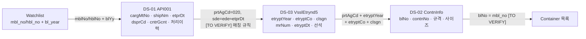

# 필드 사전 (Field Dictionary) v0.1

- 상태: Draft v0.1 (T-004 산출물, 사람 검토 전)
- 최종 수정: 2026-09-11 (기획 v0.2 재정렬: 참조 경로 갱신, 아래 v0.2 읽기 주석 추가. 확인된 사실은 바꾸지 않음)
- 관련: `../11_data-sources.md`(출처 카탈로그·조인), `../05_event-and-state.md`(Event·Canonical State), `../04_domain-model.md`, `code-tables.md`(코드값·에러코드), `../15_open-questions.md`
- 범위: DS-01 관세청 화물통관진행정보(15126268), DS-02 해양수산부 외항화물컨테이너정보(15131742). 조인에 꼭 필요한 DS-03 후보(15006353)는 요약만 적는다.

> **기획 v0.2에서 읽는 법 (2026-09-11)**
> 이 문서는 T-004(기획 v0.1 시점)에 작성했다. 공식 명세에서 확인한 사실(`[VERIFIED]`)은 그대로 유효하다. 다만 **공공 API는 더는 진실원천이 아니다**(ADR-011). 여기 적힌 매핑은 공공 API 어댑터가 만드는 **`source_type = PUBLIC_API` Event 후보**를 뜻한다. 그 값이 Canonical State가 될지는 Reconciliation이 정한다(`../05_event-and-state.md`). 역할은 자동 초기화, 교차 검증, 히스토리 보강으로 제한된다.
>
> | 이 문서의 v0.1 표기 | v0.2에서 읽는 법 |
> | --- | --- |
> | `ContainerState.<필드>` | Canonical State의 컨테이너 사실 `<필드>` (fact_key) |
> | `ContainerEvent`, `ContainerEvent.occurred_at` | Event (`subject.type = CONTAINER`), `source_event_time` |
> | `ContainerEvent.attributes.*` | Event `payload.*` |
> | `observed_at` | `received_at` |
> | provenance.kind `USER_INPUT` / `TARIFF_DOC` / `SIMULATED` / `DERIVED` | `source_type = HUMAN_UI`·`FILE_IMPORT` / `DOCUMENT` + LLM 추출 → 확정 TariffRule / `is_simulated` / 엔진 산출물 (T-032, `../05_event-and-state.md` 3.1) |
> | 공공 API 매핑의 권한·강도 | DS-01은 `source_role = CUSTOMS_SYSTEM`, DS-02·03은 `PORT_SYSTEM`. 권한 A여도 근거 강도 최대 2, 신선도는 응답 속 발생 시각 기준 (`../05_event-and-state.md` 3.3, 5.2) |
> | S0~S9, S1·S2·S5 등 상태 코드 | `../04_domain-model.md` 2.2의 단계 이름(S1 = DISCHARGED, S5 = IN_TRANSIT 등). 공공 API 필드는 단계가 아니라 마일스톤·`customs.status` 사실을 채운다 |
> | V0.1 / V2 | PoC / Scale (`../CHANGELOG.md` 5절) |
> | T-007 / T-008 / T-009 | T-032 / T-033 / T-042 |

---

## 0. 읽는 법

### 0.1 태그

| 표기 | 의미 |
| --- | --- |
| `[VERIFIED S-nn]` | 0.2절의 1차 출처 S-nn에서 직접 확인했다. 확인일은 0.2절 표에 있다 |
| `[TO VERIFY]` | 1차 출처에서 확인하지 못했다. 실제 응답(T-005, T-006)이나 기관 문의로 확인해야 한다 |
| `[ASSUMPTION]` | CERA가 구현을 위해 세운 가정이다. 바꿀 조건을 함께 적는다 |

- 블로그, 개인 GitHub, Q&A는 **VERIFIED 근거로 쓰지 않는다**. 참고했으면 0.3절에 적고 태그는 `[TO VERIFY]`로 둔다.
- 공식 문서의 "항목구분" 표기: `1` 필수, `0` 옵션, `0..n` 0건 이상 반복. 이 문서의 `nullable` 열은 이 값과 공식 샘플에서 관측한 빈 태그를 근거로 적는다.

### 0.2 1차 출처 (모두 확인일 2026-09-11)

| ID | 출처 | 위치 | 비고 |
| --- | --- | --- | --- |
| S-01 | 공공데이터포털 `관세청_화물통관진행정보` 상세 페이지 | https://www.data.go.kr/data/15126268/openapi.do | API 유형 `LINK`, XML, 등록 2024-01-05, 수정 2026-02-05 |
| S-02 | `화물통관진행정보_OpenAPI 연계가이드.docx` (본문 제목: 국가관세종합정보시스템 OPEN API 연계 가이드 v3.6) | S-01의 참고문서 (포털 첨부 `FILE_000000003596276`) | 파일 수정일 2026-02-05, SHA-256 `fc0fc6f2f548273c07747556ca7e3f063bfb5187b92831c0bd140d8f975d3aa9`. **문서에 "관세청의 사전 승인 없이 복사·전재·배포·사용 금지" 문구가 있다** → 저장소에 원본을 두지 않고, 샘플 원문도 옮기지 않는다(Q-17) |
| S-03 | 공공데이터포털 `해양수산부_외항화물컨테이너정보` 상세 페이지 + 페이지에 포함된 Swagger 2.0 명세 + 포털 공통 에러코드 표 | https://www.data.go.kr/data/15131742/openapi.do | API 유형 `REST`, XML, 등록 2024-08-12, 수정 2025-07-31 |
| S-04 | `DAT211_오픈API활용가이드_외항화물컨테이너정보.docx` | S-03의 참고문서 (포털 첨부 `FILE_000000002987029`) | 파일 수정일 2024-08-14, SHA-256 `9c4c77db08ff9561a10a779d89455d8335b98057a4a6d31b77ba6c85b40b7f2e` |
| S-05 | 공공데이터포털 `해양수산부_선박운항정보` 상세 페이지 + Swagger 2.0 | https://www.data.go.kr/data/15006353/openapi.do | DS-03 후보. 등록 2018-07-17, 수정 2025-11-03 |
| S-06 | `DAT211_오픈API활용가이드_선박운항정보.docx` | S-05의 참고문서 (포털 첨부 `FILE_000000003107653`) | 파일 수정일 2025-03-10, SHA-256 `200dbc831dce2af3100854998ed8fc0ad864c0696d26abe3d9ec6f0fc54e8a82` |
| S-07 | 공공데이터포털 `해양수산부_컨테이너반출입정보_20230112` 파일데이터 페이지 | https://www.data.go.kr/data/15011649/fileData.do | 4.1절 정정 근거 |
| S-09 | **새** `해양수산부_외항화물컨테이너정보` 오픈API 활용가이드(PDF) | S-03 페이지 참고문서 (포털 첨부 `FILE_000000007709092`, 포털 수정 2026-10-06) | 확인일 2026-10-22, SHA-256 `758037193394676b87478e1387e21684155705477d16f2709747f6163a7b1fa2`. S-04 를 대체한다 |
| S-10 | **새** `해양수산부_선박운항정보` 오픈API 활용가이드(PDF) | S-05 페이지 참고문서 (포털 첨부 `FILE_000000007708406`, 포털 수정 2026-10-06) | 확인일 2026-10-22, SHA-256 `be41b0d4dc657aae584143c03c3fc7834e478f6d5a8cbdad86183512b50801df`. S-06 을 대체한다 |
| S-08 | **인증키 없이** 보낸 GET 1회씩에 대한 각 API의 실제 응답 (2026-09-11) | 3개 엔드포인트 | 엔드포인트가 살아 있다는 것과 오류 응답 형식만 확인. 데이터는 받지 않음 |

- 포털 첨부 파일은 `https://www.data.go.kr/cmm/cmm/fileDownload.do?atchFileId=<ID>&fileDetailSn=1`로 받을 수 있었다(2026-09-11). 공식 문서가 바뀌었는지는 SHA-256을 비교해 확인한다.
- 원본 docx는 저장소에 커밋하지 않는다. 필요하면 위 경로에서 다시 받는다.

### 0.3 참고만 한 2차 출처 (VERIFIED 근거 아님)

| 출처 | 쓴 곳 |
| --- | --- |
| https://www.autooffice.io/knowhow/unipass-bl-status-update (블로그) | T-000에서 DS-01 엔드포인트 추정에 썼다. 이번에 S-02로 대체해 **더는 근거로 쓰지 않는다** |

---

## 1. 한눈에 보기

| 항목 | DS-01 관세청 화물통관진행정보 | DS-02 해양수산부 외항화물컨테이너정보 |
| --- | --- | --- |
| 데이터셋 ID / API명 | 15126268 / UNI-PASS API001 `retrieveCargCsclPrgsInfo` | 15131742 / `CargFrghtContnOut` › 상세기능 `ContnInfo` |
| 조회 키 | **화물 단위**: 화물관리번호, 또는 MBL/HBL + B/L 연도 | **선박 입항 건 단위**: 항만청코드 + 입항연도 + 입항횟수 + 호출부호 |
| 한 번에 얻는 것 | B/L 1건의 통관 진행상태 + 처리이력(반출입 일시, 장치장) | 한 입항 건의 적하목록에 있는 B/L–컨테이너 목록(규격·사이즈) |
| CERA 핵심 용도 | 통관 상태(S2/S3), 반출(S5) 이벤트와 일시, 장치 위치 | Watchlist 보강(B/L → 컨테이너 목록, 장비 규격), 조인 키 |
| 컨테이너별 이벤트 일시 | 처리이력은 **화물(B/L) 단위**다. 컨테이너별 여부 `[TO VERIFY]` | 공식 명세에 **컨테이너별 반출입 일시 필드가 없다** `[VERIFIED S-03, S-04]` |
| 인증키 | UNI-PASS 인증키 `crkyCn` | 공공데이터포털 `serviceKey` |

> **기존 계획과 달라진 점**: v0.1 데이터 전략 문서(현재 삭제, `../CHANGELOG.md` D-7)는 DS-02가 B/L 번호로 조회되고 컨테이너 단위 반출입 **이벤트**(S1·S5·S9)를 준다고 가정했다. 공식 명세상 DS-02는 선박 입항 건으로 조회하고, 응답 시각 필드는 `etryndDt`(입출항일시) 하나뿐이다. 그래서 DS-02는 **상태 이벤트 출처가 아니라 적하목록(B/L↔컨테이너) 출처**로 다시 분류한다. 반출 이벤트의 1차 후보는 DS-01 처리이력이다.

---

## 2. DS-01 관세청 화물통관진행정보 (UNI-PASS API001)

### 2.1 기본 정보

| 항목 | 내용 | 태그 |
| --- | --- | --- |
| 공식 데이터셋 ID / API명 | 15126268 / `관세청_화물통관진행정보`, UNI-PASS 서비스 ID `API001`, 영문 서비스명 `retrieveCargCsclPrgsInfo` | `[VERIFIED S-01, S-02]` |
| 제공기관 | 관세청 (포털 관리부서: 데이터담당관) | `[VERIFIED S-01]` |
| 공식 URL | S-01 | `[VERIFIED S-01]` |
| API 유형 / 포맷 | 포털 표기 `LINK`(포털은 안내만 하고 호출은 UNI-PASS로 한다) / XML. 가이드상 REST, XML | `[VERIFIED S-01, S-02]` |
| 인증 방식 | UNI-PASS 회원가입 → `My메뉴 > 서비스관리 > OpenAPI사용관리`에서 신청하면 즉시 승인되고 인증키가 발급된다. 쿼리 파라미터 `crkyCn`으로 보낸다 | `[VERIFIED S-01, S-02, S-08]` |
| 공공데이터포털 활용신청 필요 여부 | 포털에 "활용신청" 절차(개발 자동승인/운영 심의승인)가 표시되지만, 실제 키는 UNI-PASS에서 받는다. 포털 신청이 따로 필요한지는 불명 | `[TO VERIFY]` |
| endpoint (운영) | `https://unipass.customs.go.kr:38010/ext/rest/cargCsclPrgsInfoQry/retrieveCargCsclPrgsInfo` | `[VERIFIED S-02, S-08]` |
| endpoint (개발) | `https://tunipass.customs.go.kr:38010/ext/rest/cargCsclPrgsInfoQry` (+ `/retrieveCargCsclPrgsInfo`) | `[VERIFIED S-02]` 기본 경로. 개발계 전체 경로는 `[TO VERIFY]` |
| HTTP method | GET (가이드 예시가 모두 GET 쿼리스트링) | `[VERIFIED S-02, S-08]` |
| 전송 | SSL. TLS 1.2 이상 권고. **IP로는 호출할 수 없고 도메인명으로만** 호출 | `[VERIFIED S-02]` |
| 페이지네이션 | 없음. 결과가 1건이면 상세, 여러 건이면 목록을 준다. `ntceInfo`가 `[N00]`으로 시작하면 목록 응답이다 → 목록의 화물관리번호로 다시 호출해 상세를 받는다 | `[VERIFIED S-02]` |
| 호출 한도 | 포털: "해당 기관의 정책에 따라 트래픽 수는 상이할 수 있음". 가이드에는 수치가 없다 | `[TO VERIFY]` Q-05 |
| 조회 가능 기간 | 데이터 보관주기 정책에 따라 2023-06-17부터 **3년 이내 데이터만** 조회 가능 | `[VERIFIED S-01, S-02]` |
| 갱신주기 / 실시간성 | 공식 문서에 적힌 값이 없다 | `[TO VERIFY]` R-1 |
| 공식 샘플 | 가이드 3.2.1에 request URI 1건과 응답 1건(항공 화물, 마스킹됨)이 있다. 저작권 문구 때문에 원문은 옮기지 않고 2.4절에 **구조만** 적는다 | `[VERIFIED S-02]` |
| 에러 | 모든 오류는 `tCnt = -1`이고 `ntceInfo`에 한글 메시지가 들어간다. 오류여도 **HTTP 200**이 온다 | `[VERIFIED S-02]`, HTTP 200은 `[VERIFIED S-08]` |
| 공식 활용가이드 | `화물통관진행정보_OpenAPI 연계가이드.docx` (연계 가이드 v3.6) | `[VERIFIED S-01, S-02]` |

### 2.2 요청 파라미터

| 파라미터 | 국문 | 타입(크기) | 필수 | 설명 | CERA 입력 출처 | 태그 |
| --- | --- | --- | --- | --- | --- | --- |
| `crkyCn` | 인증키 | string | **필수** | UNI-PASS에서 발급한 인증키 | `.env` `UNIPASS_API_KEY` | `[VERIFIED S-02 예시, S-08 "인증키(crkyCn)는 필수입력입니다."]` |
| `cargMtNo` | 화물관리번호 | string(19) | 옵션(0) | 15~19자리 | 목록 응답에서 얻은 값, DS-01 이전 응답 | `[VERIFIED S-02]` |
| `mblNo` | MBL번호 | string(20) | 옵션(0) | Master B/L No | Watchlist `mbl_no` | `[VERIFIED S-02]` |
| `hblNo` | HBL번호 | string(20) | 옵션(0) | House B/L No | Watchlist `hbl_no` | `[VERIFIED S-02]` |
| `blYy` | BL 년도 | string(4) | 조건부 | 입항년도. MBL 또는 HBL을 넣으면 **필수** | Watchlist `bl_year` | `[VERIFIED S-02]` |

- 네 개가 모두 옵션으로 표기돼 있지만, 실제로는 `cargMtNo` 하나 **또는** (`mblNo`|`hblNo`) + `blYy`가 있어야 한다 `[VERIFIED S-02]`.
- MBL과 HBL을 함께 보냈을 때의 동작은 `[TO VERIFY]`.

### 2.3 응답 구조

```text
cargCsclPrgsInfoQryRtnVo            (루트)
├─ ntceInfo                          오류·안내 메시지. 정상이면 빈 태그
├─ cargCsclPrgsInfoQryVo       ×1    화물 기본정보 + 현재 진행상태 (2.4.1)
├─ tCnt                              레코드 수. 오류면 -1
└─ cargCsclPrgsInfoDtlQryVo    ×0..n 처리이력 (2.4.2)
```

- 루트·기본정보·처리이력 요소 이름과 `ntceInfo`/`tCnt`의 위치는 `[VERIFIED S-02 샘플 구조, S-08]`.
- 목록 응답(`[N00]`)의 요소 이름은 가이드에 한글 항목명(화물관리번호, MBL, HBL, 입항일자, 양륙항코드·명, 선사항공사부호·명)만 있고 태그명은 없다 `[TO VERIFY]`.
- 가이드 샘플에는 명세표에 없는 `entsKoreNm` 태그가 있다(명세·샘플 불일치). 파서는 **모르는 태그를 무시**하고 원본에는 그대로 남긴다 `[VERIFIED S-02]`.
- 타입: 가이드에는 크기만 있고 자료형이 없다. XML 텍스트이므로 모두 문자열로 받고, 정규화 단계에서 변환한다 `[ASSUMPTION]`.
- **nullable**: 명세표는 기본정보 필드를 모두 필수(1)로 표시하지만, 공식 샘플에서 `vydf`, `msrm`, `spcnCargCd`, `cntrNo`, `agnc`가 빈 태그였다 `[VERIFIED S-02]`. 그래서 **모든 필드를 nullable로 파싱하고 빈 문자열은 null로 바꾼다** `[ASSUMPTION]`.
- 일시 형식: `etprDt` 8자리(YYYYMMDD), `prcsDttm`·`rlbrDttm` 14자리(YYYYMMDDHHMMSS로 추정)이고 **타임존 표기가 없다**. 정규화할 때 `Asia/Seoul`을 붙인다 `[ASSUMPTION]`, 형식·타임존은 `[TO VERIFY]` Q-19.

### 2.4 응답 필드 + CERA Mapping

열 설명: `→ 정규화 필드`는 파서가 만드는 이름(`../13_glossary.md` 표기)이다. `도메인 엔티티`는 v0.1 도메인 모델 기준 위치다(v0.2 읽는 법은 문서 맨 위 주석). `엔진 용도`는 상태·비용·위험 엔진에서 어떻게 쓰는지다. `미사용`은 V0.1에서 원본만 보관하고 계산에 쓰지 않는다는 뜻이다.

#### 2.4.1 화물 기본정보 `cargCsclPrgsInfoQryVo`

| 공식 필드 | 국문 | 크기 | 구분 | nullable | → 정규화 필드 | 도메인 엔티티 | 엔진 용도 | 태그 |
| --- | --- | --- | --- | --- | --- | --- | --- | --- |
| `cargMtNo` | 화물관리번호 | 19 | 1 | N | `cargo_mgmt_no` | `ContainerState.bl.cargo_mgmt_no` | 재조회 키. DS-02/03 조인 후보(5절) | `[VERIFIED S-02]` |
| `mblNo` | MBL번호 | 20 | 1 | Y | `mbl_no` | `ContainerState.bl.mbl_no` | Watchlist 대조, DS-02 `blNo` 매칭 | `[VERIFIED S-02]` |
| `hblNo` | HBL번호 | 20 | 1 | Y | `hbl_no` | `ContainerState.bl.hbl_no` | Watchlist 대조 | `[VERIFIED S-02]` |
| `csclPrgsStts` | 통관진행상태 | 300 | 1 | Y | `customs_status_text` | `ContainerEvent`(원천) → `milestones.customs_cleared_at` 등 | **상태 엔진**: S2/S3 판정 입력. 값 목록은 `code-tables.md` 2.2 | `[VERIFIED S-02]` 필드. 값 목록 `[TO VERIFY]` |
| `prgsStts` | 진행상태 | 300 | 1 | Y | `cargo_status_text` | `ContainerEvent`(원천) | 상태 엔진 보조(반출완료 등) | `[VERIFIED S-02]` 필드. 값 목록 `[TO VERIFY]` |
| `prgsStCd` | 진행상태코드 | 6 | 1 | Y | `cargo_status_code` | `ContainerEvent.attributes` | 상태 엔진 보조. 텍스트보다 코드로 판정하는 편이 안정적이지만 **코드표를 못 찾았다** | `[VERIFIED S-02]` 필드. 코드표 `[TO VERIFY]` |
| `prcsDttm` | 처리일시 | 14 | 1 | Y | `status_processed_at` | `ContainerEvent.occurred_at` 후보 | 현재 상태가 언제 바뀌었는지. R-1 지연 측정 입력 | `[VERIFIED S-02]` 필드. 의미(마지막 처리 시각인지) `[TO VERIFY]` |
| `etprDt` | 입항일자 | 8 | 1 | Y | `arrival_date` | `milestones.ata`(날짜 단위) 후보 | **LFD**: 기산일이 입항·양하 기준인 Tariff의 대체값. DS-03 조회 날짜 | `[VERIFIED S-02]` 필드. 실제 입항인지 예정인지 `[TO VERIFY]` |
| `etprCstm` | 입항세관 | 75 | 1 | Y | `arrival_customs_office` | 원본 | 미사용(표시) | `[VERIFIED S-02]` |
| `dsprCd` / `dsprNm` | 양륙항코드 / 명 | 5 / 200 | 1 | Y | `discharge_port` | `ContainerState.port` | ADR-010 범위 필터(부산만) | `[VERIFIED S-02]` 필드. 부산 코드값 `[TO VERIFY]` |
| `ldprCd` / `ldprNm` | 적재항코드 / 명 | 5 / 200 | 1 | Y | `loading_port` | 원본 | 미사용(표시) | `[VERIFIED S-02]` |
| `lodCntyCd` | 적출국가코드 | 2 | 1 | Y | — | 원본 | 미사용 | `[VERIFIED S-02]` |
| `shipNm` | 선박명 | 75 | 1 | Y | `vessel_name` | `ContainerState.vessel.name` | DS-03 입항 건 매칭(선박명 대조) | `[VERIFIED S-02]` |
| `vydf` | 항차 | 7 | 1 | Y | `voyage` | `ContainerState.vessel.voyage` | 표시·매칭 보조 | `[VERIFIED S-02]` (샘플 빈 태그) |
| `shipNat` / `shipNatNm` | 선박국적 / 명 | 2 / 300 | 1 | Y | — | 원본 | 미사용 | `[VERIFIED S-02]` |
| `shcoFlcoSgn` / `shcoFlco` | 선사항공사부호 / 명 | 4 / 150 | 1 | Y | `carrier_code_customs` | `ContainerState.carrier` 후보 | **Tariff 선택**(선사 → TariffRule). 관세청 부호 → CERA 선사 코드 매핑표 필요 | `[VERIFIED S-02]` 필드. 매핑 `[TO VERIFY]` |
| `agnc` | 대리점 | 150 | 1 | Y | — | 원본 | 미사용 | `[VERIFIED S-02]` (샘플 빈 태그) |
| `frwrSgn` / `frwrEntsConm` | 포워더부호 / 명 | 4 / 150 | 1 | Y | `forwarder_code` | 원본 | 미사용(표시). 업체 정보라 fixture에서 마스킹 | `[VERIFIED S-02]` |
| `cargTp` | 화물구분 | 150 | 1 | Y | `cargo_type_text` | 원본 | 범위 필터(수입 여부) 후보 | `[VERIFIED S-02]` 필드. 값 목록 `[TO VERIFY]` |
| `blPt` / `blPtNm` | B/L유형 / 명 | 1 / 300 | 1 | Y | `bl_type` | 원본 | FCL/LCL 범위 필터(ADR-010) 후보 | `[VERIFIED S-02]` 필드. 코드 의미 `[TO VERIFY]` |
| `cntrGcnt` | 컨테이너개수 | 10 | 1 | Y | `container_count` | `ContainerState`(B/L 수준 속성) | Watchlist·DS-02 컨테이너 목록과 개수 대조 | `[VERIFIED S-02]` |
| `cntrNo` | 컨테이너번호 | 11 | 1 | Y | `container_no` | `ContainerState.container_no` | Watchlist 대조. **필드가 1개뿐이라 여러 컨테이너 B/L에서 무엇이 오는지 불명** | `[VERIFIED S-02]` 필드. 다건 동작 `[TO VERIFY]` Q-20 |
| `spcnCargCd` | 특수화물코드 | 4 | 1 | Y | `special_cargo_code` | `equipment.is_dg`·Reefer 후보 | 경로 적합성 제약(Reefer, 위험물) 후보 | `[VERIFIED S-02]` 필드. 코드 의미 `[TO VERIFY]` |
| `mtTrgtCargYnNm` | 관리대상화물여부명 | 100 | 1 | Y | `inspection_target_flag` | `exceptions`(CUSTOMS_HOLD 후보) | **위험 엔진**: 반출 가능 시점이 불확실한 화물. 등급 상향 후보 | `[VERIFIED S-02]` 필드. 의미·값 `[TO VERIFY]` |
| `rlseDtyPridPassTpcd` | 반출의무과태료여부 | 2 | 1 | Y | `release_duty_penalty_flag` | 위험 플래그 | **위험 엔진**: 보세구역 장치기간 초과 신호(D&D와 별개인 비용 위험) | `[VERIFIED S-02]` 필드. 값 의미 `[TO VERIFY]` |
| `dclrDelyAdtxYn` | 신고지연가산세여부 | 2 | 1 | Y | `declaration_delay_flag` | 원본 | 미사용(표시) | `[VERIFIED S-02]` |
| `prnm` | 품명 | 300 | 1 | Y | `commodity` | 원본 | 미사용. 영업정보라 fixture에서 마스킹 | `[VERIFIED S-02]` |
| `pckGcnt` / `pckUt` | 포장개수 / 단위 | 10 / 2 | 1 | Y | — | 원본 | 미사용 | `[VERIFIED S-02]` |
| `ttwg` / `wghtUt` | 총중량 / 중량단위 | 19 / 2 | 1 | Y | — | 원본 | 미사용 | `[VERIFIED S-02]` |
| `msrm` | 용적 | 19 | 1 | Y | — | 원본 | 미사용 | `[VERIFIED S-02]` |

#### 2.4.2 처리이력 `cargCsclPrgsInfoDtlQryVo` (0..n)

**반출입 일시와 장치장을 주는 유일한 공식 필드 묶음**이다. 한 행이 곧 `ContainerEvent` 한 건의 후보다. 이력은 화물(B/L) 단위이므로, 여러 컨테이너 B/L에서 컨테이너별 반출을 구분할 수 있는지는 `[TO VERIFY]`(Q-20)다.

| 공식 필드 | 국문 | 크기 | 구분 | nullable | → 정규화 필드 | 도메인 엔티티 | 엔진 용도 | 태그 |
| --- | --- | --- | --- | --- | --- | --- | --- | --- |
| `cargTrcnRelaBsopTpcd` | 처리구분 | 300 | 0..n | Y | `history_type_text` → `event_type` | `ContainerEvent.event_type` | **상태 엔진**: 처리구분 → 이벤트 매핑(`code-tables.md` 2.4). 공식 샘플에서 확인한 값은 `반출신고` 하나 | `[VERIFIED S-02]` 필드. 값 목록 `[TO VERIFY]` Q-12 |
| `rlbrDttm` | 반출입일시 | 14 | 0..n | Y | `occurred_at` | `ContainerEvent.occurred_at` → `milestones.gate_out_at` 등 | **상태·LFD·위험**: 반출 시각으로 Demurrage 시계를 멈추고 Detention 시계를 시작. R-1 지연 측정(`observed_at − occurred_at`) | `[VERIFIED S-02]` 필드. 형식·타임존 `[TO VERIFY]` Q-19 |
| `prcsDttm` | 처리일시 | 14 | 0..n | Y | `processed_at` | `ContainerEvent.attributes.processed_at` | 반출입 외 처리(신고·수리 등)의 발생 시각 후보 | `[VERIFIED S-02]` 필드. `rlbrDttm`과의 차이 `[TO VERIFY]` |
| `rlbrCn` | 반출입내용 | 500 | 0..n | Y | `history_note` | `ContainerEvent.attributes.note` | 표시, 이벤트 분류 보조 | `[VERIFIED S-02]` |
| `shedSgn` | 장치장부호 | 8 | 0..n | Y | `location_code` | `ContainerEvent.attributes.location_code` → `ContainerState.terminal` 후보 | 장치 위치(터미널/ODCY) 식별. ODCY 반입 판정(S6) 후보 | `[VERIFIED S-02]` 필드. 부호 → 터미널 매핑 `[TO VERIFY]` (UNI-PASS API005 장치장 정보 후보, T-030) |
| `shedNm` | 장치장명 | 150 | 0..n | Y | `location_name` | `ContainerEvent.attributes.location` | 표시 | `[VERIFIED S-02]` |
| `dclrNo` | 신고번호 | 40 | 0..n | Y | `declaration_no` | `ContainerEvent.attributes` | 미사용. fixture에서 마스킹 | `[VERIFIED S-02]` |
| `rlbrBssNo` | 반출입근거번호 | 30 | 0..n | Y | `release_basis_no` | `ContainerEvent.attributes` | 이벤트 멱등 키 보조 후보 | `[VERIFIED S-02]` |
| `pckGcnt` / `pckUt` | 포장개수 / 단위 | 10 / 2 | 0..n | Y | `history_pkg_count` | `ContainerEvent.attributes` | 분할 반출 감지 후보 | `[VERIFIED S-02]` |
| `wght` / `wghtUt` | 중량 / 단위 | 19 / 2 | 0..n | Y | `history_weight` | `ContainerEvent.attributes` | 분할 반출 감지 후보 | `[VERIFIED S-02]` |
| `bfhnGdncCn` | 사전안내내용 | 4000 | 0..n | Y | — | 원본 | 미사용 | `[VERIFIED S-02]` |

### 2.5 공통 봉투 필드

| 공식 필드 | 의미 | 파서 처리 | 태그 |
| --- | --- | --- | --- |
| `ntceInfo` | 오류·안내 메시지(한글). 정상 상세 응답이면 빈 태그 | 빈 값 → 정상. `[N00]`로 시작 → 목록 응답. 그 밖의 값 → 오류(`code-tables.md` 3.1) | `[VERIFIED S-02, S-08]` |
| `tCnt` | 응답 레코드 수. 오류면 `-1` | `-1`이면 오류로 처리. HTTP 상태코드로 판정하지 않는다 | `[VERIFIED S-02, S-08]` |

---

## 3. DS-02 해양수산부 외항화물컨테이너정보

### 3.1 기본 정보

> **2026-10-22 재확인(T-102)**: DS-02 · DS-03 포털 수정일이 2026-10-06 으로 바뀌고 참고문서가 새 PDF(S-09 · S-10)로 교체됐다. 필드 구성은 같다. **크기가 다른 필드**(새 가이드가 정본): `entrpsCd` 9 → **7**(요청 · 응답) · `vsslNm` 20 → **40** · `mrNum` 40 → **11** · `blNo` 40 → **20** · `entrpsNm` 30 → **40**. 옛 docx(S-04)를 보관하지 않아 옛 가이드가 달랐는지 이 사전이 잘못 옮겼는지는 확인할 수 없다. 아래 표는 새 가이드 값으로 고쳤다. CERA 저장 크기는 여유를 둔다(`bl.bl_no` 40 · `vessel_call.vessel_name` 40).

| 항목 | 내용 | 태그 |
| --- | --- | --- |
| 공식 데이터셋 ID / API명 | 15131742 / `해양수산부_외항화물컨테이너정보`, API 영문명 `CargFrghtContnOut`, 상세기능 `ContnInfo`(외항화물컨테이너정보 조회) | `[VERIFIED S-03, S-04]` |
| 제공기관 | 해양수산부 (해운물류국 항만물류산업과) | `[VERIFIED S-03, S-04]` |
| 공식 URL | S-03 | `[VERIFIED S-03]` |
| API 유형 / 포맷 | REST(GET) / XML. Swagger `produces: application/xml` | `[VERIFIED S-03, S-04]` |
| 인증 방식 | 공공데이터포털 `serviceKey`(URL 인코딩). 개발단계 자동승인, 운영단계 심의승인 | `[VERIFIED S-03, S-04]` |
| endpoint | `https://apis.data.go.kr/1192000/CargFrghtContnOut/ContnInfo` | `[VERIFIED S-03 Swagger host·path, S-08]` |
| 스킴 | 가이드는 `http://`, "전송 레벨 암호화 없음"으로 적었다. 하지만 Swagger는 `https`·`http`를 모두 적었고, https 호출이 실제로 응답했다 → **https 사용** | `[VERIFIED S-03, S-04, S-08]` |
| HTTP method | GET | `[VERIFIED S-03, S-04]` |
| 페이지네이션 | `pageNo`(기본 1), `numOfRows`(기본 10, **최대 50**). 응답에 `totalCount`, `pageNo`, `numOfRows` | `[VERIFIED S-03, S-04]` |
| 호출 한도 | 개발계정 1,000 / 운영계정은 활용사례를 등록하고 신청하면 늘릴 수 있음. 초당 최대 30 tps, 최대 메시지 15,000 byte, 평균 응답 1,000 ms | `[VERIFIED S-03, S-04]`. 1,000의 **단위**는 포털 공통 에러 설명(22번 "일일 호출 허용량")으로 보아 일 단위로 추정 → `[TO VERIFY]` Q-05 |
| 조회 가능 기간 | 공식 문서에 없음. 가이드 샘플은 2021년 입항 건 | `[TO VERIFY]` |
| 갱신주기 / 실시간성 | 가이드 표기 "데이터 갱신주기: **실시간**". 실제 반영 지연은 측정 전 | 표기는 `[VERIFIED S-04]`, 실제 지연은 `[TO VERIFY]` R-1 |
| 서비스 시작 | 2024-08-12 (버전 1.0) | `[VERIFIED S-04]` |
| 공식 샘플 | 가이드 d)절에 요청 URL 1건과 응답 2건(광양, 2021년)이 있다. 3.4절에 식별자를 마스킹해 옮긴다 | `[VERIFIED S-04]` |
| 에러 | 정상은 `resultCode=00`, `resultMsg=NORMAL_SERVICE`. 게이트웨이 오류는 **다른 봉투**(`OpenAPI_ServiceResponse/cmmMsgHeader`)와 HTTP 401 등으로 온다. 코드표는 가이드와 포털이 서로 다르다 → `code-tables.md` 3.2 | `[VERIFIED S-03, S-04, S-08]` |
| 공식 활용가이드 | `DAT211_오픈API활용가이드_외항화물컨테이너정보.docx` | `[VERIFIED S-03, S-04]` |
| 백엔드 | Swagger 메타데이터상 원천은 PORT-MIS(`new.portmis.go.kr/.../carg/frghtContn/out`)다. CERA는 포털 게이트웨이만 호출한다 | `[VERIFIED S-03]` |

### 3.2 요청 파라미터

| 파라미터 | 국문 | 타입(크기) | 필수 | 공식 샘플값 | 설명 | CERA 입력 출처 | 태그 |
| --- | --- | --- | --- | --- | --- | --- | --- |
| `serviceKey` | 인증키 | string(100) | **필수** | — | 공공데이터포털 인증키(URL 인코딩) | `.env` `DATA_GO_KR_SERVICE_KEY` | `[VERIFIED S-03, S-04, S-08]` |
| `prtAgCd` | 항만청코드 | string(3) | **필수** | `622`(광양) | 검색할 항만청 코드. 부산은 `020` | ADR-010 → `020` 고정 | `[VERIFIED S-04]`. 부산=`020`은 `[VERIFIED S-06 샘플]` |
| `etryptYear` | 입항연도 | string(4) | **필수** | `2021` | 선박의 입항연도 | DS-03 응답 `etryptYear` | `[VERIFIED S-03, S-04]` |
| `etryptCo` | 입항횟수 | string(3) | **필수** | `001` | 선박의 입항횟수(0 채움 3자리) | DS-03 응답 `etryptCo` | `[VERIFIED S-03, S-04]` |
| `clsgn` | 호출부호 | string(10) | **필수** | (샘플 호출부호) | 선박 호출부호 | DS-03 응답 `clsgn` | `[VERIFIED S-03, S-04]` |
| `entrpsCd` | 업체코드 | string(7) | 옵션 | (샘플 업체코드) | 조회 업체코드 필터 | 선사·대리점 코드 매핑표 `[TO VERIFY]` | `[VERIFIED S-03, S-04]` |
| `numOfRows` | 한 페이지 결과 수 | string(4) | 옵션 | `10` | 최대 50 | 50 고정 `[ASSUMPTION]` | `[VERIFIED S-03, S-04]` |
| `pageNo` | 페이지 번호 | string(4) | 옵션 | `1` | 페이지 번호 | 파서가 `totalCount`로 반복 | `[VERIFIED S-03, S-04]` |

> **조회 키 정정**: B/L 번호나 컨테이너 번호로는 조회할 수 없다. 반드시 **선박 입항 건**(`prtAgCd`, `etryptYear`, `etryptCo`, `clsgn`)을 알아야 한다 `[VERIFIED S-03, S-04]`. 이 값은 DS-03에서 얻는다(5절).

### 3.3 응답 필드 + CERA Mapping

응답 구조: `response > header{resultCode, resultMsg} + body{items > item ×n, numOfRows, pageNo, totalCount}` `[VERIFIED S-03, S-04]`. Swagger는 모든 필드를 `string`으로 정의한다 `[VERIFIED S-03]`.

| 공식 필드 | 국문 | 크기 | 구분 | nullable | → 정규화 필드 | 도메인 엔티티 | 엔진 용도 | 태그 |
| --- | --- | --- | --- | --- | --- | --- | --- | --- |
| `prtAgCd` | 항구청코드 | 3 | 1 | N | `port_authority_code` | `VesselCall`(제안, 7절) | 조회 키 되돌림 확인 | `[VERIFIED S-03, S-04]` |
| `prtAgNm` | 항구청명 | 10 | 1 | N | — | 원본 | 미사용(표시) | `[VERIFIED S-03, S-04]` |
| `etryptYear` | 입항년도 | 4 | 1 | N | `call_year` | `VesselCall` | 조회 키 | `[VERIFIED S-03, S-04]` |
| `etryptCo` | 입항횟수 | 3 | 1 | N | `call_seq` | `VesselCall` | 조회 키 | `[VERIFIED S-03, S-04]` |
| `clsgn` | 호출부호 | 10 | 1 | N | `call_sign` | `ContainerState.vessel.call_sign` | 조회 키, 선박 식별 | `[VERIFIED S-03, S-04]` |
| `vsslNm` | 선박명 | 40 | 0 | Y | `vessel_name` | `ContainerState.vessel.name` | DS-01 `shipNm` 대조 | `[VERIFIED S-03, S-04]` |
| `mrNum` | 적하목록관리번호 | 11 | 1 | N | `manifest_no` | `ContainerState.bl.manifest_no`(제안) | DS-01 화물관리번호 조인 후보(5절) | `[VERIFIED S-03, S-04]` |
| `blNo` | BL번호 | 20 | 1 | N | `bl_no` → `mbl_no` 후보 | `ContainerState.bl` | **Watchlist 매칭 키**: 이 행이 감시 대상 B/L의 컨테이너인지 판정. MBL인지 HBL인지 `[TO VERIFY]` | `[VERIFIED S-03, S-04]` 필드 |
| `msnNo` | MSN번호 | 4 | 1 | N | `msn` | `ContainerState.bl.msn`(제안) | 조인 보조 | `[VERIFIED S-03, S-04]` |
| `etryndDt` | 입출항일시 | 25 | 0 | Y | `vessel_call_at` | `VesselCall` / `milestones.ata` 후보 | LFD 기산 대체값 후보. **컨테이너 이벤트 일시가 아니라 선박 입출항 일시다** | `[VERIFIED S-03, S-04]` 필드, 형식 ISO 8601 `+09:00`(샘플). 입항인지 출항인지 `[TO VERIFY]` |
| `tkinTkoutSe` | 반입반출구분 | 2 | 1 | N | `manifest_direction` | 원본 → 범위 필터 | ADR-010 수입 필터 후보. 샘플 `II` = `수입` | `[VERIFIED S-04 샘플]`. 전체 코드와 의미(수출입 구분인지 게이트 반출입인지) `[TO VERIFY]` Q-18 |
| `tkinTkoutNm` | 반입반출구분명 | 4 | 0 | Y | — | 원본 | 표시 | `[VERIFIED S-03, S-04]` |
| `entrpsCd` | 업체코드 | 7 | 0 | Y | `company_code` | `ContainerState.carrier` 후보 | Tariff 선택 후보(업체 → 선사). 샘플 업체명은 선사 한국법인 | `[VERIFIED S-03, S-04]` 필드. 선사 매핑 `[TO VERIFY]` |
| `entrpsNm` | 업체명 | 40 | 0 | Y | `company_name` | 원본 | 표시 | `[VERIFIED S-03, S-09]` |
| `contnNo` | 컨테이너번호 | 25 | 1 | N | `container_no` | `ContainerState.container_no` | **Watchlist 보강**: B/L → 컨테이너 목록. ISO 6346 체크디지트 검증 | `[VERIFIED S-03, S-04]` |
| `contnStndrd` | 컨테이너규격 | 5 | 0 | Y | `iso_size_type` | `ContainerState.equipment.type` | **Tariff 선택**(장비 종류별 요율), 경로 적합성(Reefer 등). 샘플 `22GP` | `[VERIFIED S-04 샘플]`. ISO 6346 사이즈·타입 코드인지 `[TO VERIFY]` |
| `contnSize` | 컨테이너사이즈 | 2 | 0 | Y | `size_ft` | `ContainerState.equipment.size` | Tariff 선택, TEU 환산(ODCY 용량) | `[VERIFIED S-03, S-04]`. 샘플 `20` |
| `resultCode` / `resultMsg` | 응답결과 코드 / 메시지 | 2 / 50 | 1 | N | — | 수집 로그 | `00` / `NORMAL_SERVICE`이면 정상 | `[VERIFIED S-04]` |
| `numOfRows` / `pageNo` / `totalCount` | 페이지 정보 | 4 / 4 / 40 | 1 | N | — | 수집 로그 | 페이지 반복 | `[VERIFIED S-03, S-04]` |

### 3.4 공식 샘플 (식별자 마스킹)

```text
GET https://apis.data.go.kr/1192000/CargFrghtContnOut/ContnInfo
    ?serviceKey=<URL 인코딩된 키>&pageNo=1&numOfRows=2
    &prtAgCd=622&etryptYear=2021&etryptCo=001&clsgn=<호출부호>&entrpsCd=<업체코드>
```

```xml
<response>
  <header><resultCode>00</resultCode><resultMsg>NORMAL_SERVICE</resultMsg></header>
  <body>
    <items>
      <item>
        <prtAgCd>622</prtAgCd><prtAgNm>광양</prtAgNm>
        <etryptYear>2021</etryptYear><etryptCo>001</etryptCo><clsgn>*****</clsgn>
        <vsslNm>*****</vsslNm><mrNum>21KMTC****I</mrNum><blNo>COAU**********</blNo><msnNo>****</msnNo>
        <etryndDt>2021-01-05T20:00:00+09:00</etryndDt>
        <tkinTkoutSe>II</tkinTkoutSe><tkinTkoutNm>수입</tkinTkoutNm>
        <entrpsCd>*******</entrpsCd><entrpsNm>(선사 한국법인명)</entrpsNm>
        <contnNo>CAIU*******</contnNo><contnStndrd>22GP</contnStndrd><contnSize>20</contnSize>
      </item>
      <!-- 두 번째 item은 contnNo만 다르다 -->
    </items>
    <numOfRows>2</numOfRows><pageNo>1</pageNo><totalCount>83</totalCount>
  </body>
</response>
```

출처: S-04 d)절. 마스킹은 CERA가 했다(`01_project-rules.md` 6절).

### 3.5 운영상 시사점

- **한 입항 건 = 페이지 여러 개**: 공식 샘플의 한 입항 건은 83행이다. `numOfRows` 최대가 50이므로 입항 건마다 `ceil(totalCount/50)`번 호출해야 한다 `[VERIFIED S-04]`. 부산 대형선의 행 수는 `[TO VERIFY]`.
- **폴링 대상이 아니다**: 이벤트 일시가 없으므로 입항 건마다 한두 번 받아서 캐시하는 **적하목록 스냅샷**으로 쓴다 `[ASSUMPTION]`. 개발계정 1,000건은 이 용도로 쓴다. `entrpsCd` 필터로 호출 수를 줄일 수 있는지는 `[TO VERIFY]`.
- **R-1 측정 대상 변경**: DS-02로는 `occurred_at`(컨테이너 이벤트 발생 시각)을 얻을 수 없다. 반영 지연 측정은 DS-01 처리이력(`rlbrDttm` 대비 처음 관측 시각)으로 옮긴다(T-006 갱신).

---

## 4. 관련 데이터셋 정리

### 4.1 15011649 정정 (기존 기록 오류)

| 항목 | 내용 | 태그 |
| --- | --- | --- |
| 기존 기록 | "data.go.kr/dataset/15011649 → 404" | T-000 기록 |
| 정정 | 옛 URL 형식 `/dataset/15011649`는 404가 맞다. 하지만 **데이터셋은 없어지지 않았다**. `https://www.data.go.kr/data/15011649/fileData.do`에 `해양수산부_컨테이너반출입정보_20230112`로 있다 | `[VERIFIED S-07]` |
| 유형 | **파일데이터(XLSX)**. 오픈API가 아니다. 전체 100행, 업데이트 주기 "수시(1회성 데이터)", 제공형태 "기관자체에서 다운로드" → PORT-MIS 통합화물정보 화면으로 연결. 등록 2018-05-14, 수정 2025-12-09 | `[VERIFIED S-07]` |
| CERA 판단 | 기계 호출과 폴링이 필요한 CERA의 운영 State 출처로 쓸 수 없다. **현재 오픈API 후보는 15131742**다. 15131742가 15011649의 공식 후속 데이터셋인지는 문서상 근거가 없다 | 판단 `[ASSUMPTION]`, 후속 관계 `[TO VERIFY]` |
| 참고 | PORT-MIS 화면 조회 조건(청코드, 호출부호, 입항횟수 = 연도 4자리 + 차수 3자리)이 15131742의 요청 키와 같은 체계다 | `[VERIFIED S-07, S-04]` |

### 4.2 DS-03 후보: 해양수산부_선박운항정보 (15006353)

DS-02를 호출하려면 입항 건 키가 필요해서 조사했다. 여기서는 조인에 필요한 필드만 적고, 전체 필드 사전은 T-030에서 만든다.

| 항목 | 내용 | 태그 |
| --- | --- | --- |
| API | `VsslEtrynd5` › 상세기능 `Info5`(선박입출항신고조회). REST GET, XML, `serviceKey` | `[VERIFIED S-05, S-06]` |
| endpoint | `https://apis.data.go.kr/1192000/VsslEtrynd5/Info5` | `[VERIFIED S-05, S-08]` |
| 요청 | 필수: `serviceKey`, `prtAgCd`(부산 `020`), `sde`·`ede`(검색 시작·종료일 YYYYMMDD). 옵션: `deGb`(`I` 입항일 기준(기본) / `O` 출항일 기준), `clsgn`, `numOfRows`(최대 50), `pageNo` | `[VERIFIED S-06]` |
| 조인에 쓰는 응답 필드 | `prtAgCd`, `etryptYear`, `etryptCo`, `clsgn`, `vsslNm`, `vsslKndCd`/`Nm`(선박종류, 예: 풀컨테이너선), `details > detail`의 `etryndNm`(입항/출항), `etryptDt`(입항일시), `tkoffDt`(출항일시), `laidupFcltyNm`(계선시설, 예: 부두·선석), `mrNum`(적하목록관리번호), `tkoffPrrrnDt`(출항예정일시) | `[VERIFIED S-06]` |
| CERA 용도 | ① DS-02 조회 키 확보 ② `milestones.ata` 후보(`etryptDt`) ③ 선석 → 터미널 추정(`laidupFcltyNm`) `[TO VERIFY]` | 용도는 `[ASSUMPTION]` |
| 한도 | 개발계정 10,000, 운영 자동승인, 30 tps | `[VERIFIED S-05, S-06]` |
| 갱신주기 | 가이드 표기 "실시간" | `[VERIFIED S-06]` 표기 |
| 2026-10-22 재확인(S-10) | 응답 `details > detail` 마다 `reqstSeNm`(신청구분, 예: 최종) · `etryndNm`(입항/출항) · `mrNum`(입항 상세 = 수입 적하목록 `…I`, 출항 상세 = 수출 `…E`). `etryptDt` · `tkoffDt` 는 ISO 8601 + `+09:00`, **`tkoffPrrrnDt`(출항예정) · `dstnEtryptDt` 는 오프셋 없는 `YYYY-MM-DD HH:mm:ss`** → CERA 는 Asia/Seoul 로 보고 `tz_assumed` 를 남긴다. CERA 사용(T-102): 입항 건 키 · 선명 · 입항 상세의 `etryptDt`(→ `ARRIVAL_DECLARED` 입항 신고 일시 — 실제 입항 마일스톤 아님) · 계선 시설(`LOCATION_REPORTED`) · 수입 `mrNum`(외부 식별자). 나머지는 원문에만 | `[VERIFIED S-10]` |
| 미확인 | `etryptDt`가 실제 입항인지 신고상 예정인지, 입항 전 신고로 **ETA**를 얻을 수 있는지 | `[TO VERIFY]` |

### 4.3 DS-04 부산항 체인포털

- 공개 오픈API 명세를 1차 출처에서 찾지 못했다. 체인포털 웹(`chainportal.co.kr`)은 스크립트로 그리는 앱이라 정적 수집으로 안내 내용을 확인할 수 없었고, 공공데이터포털 검색에서도 체인포털 API를 찾지 못했다. `[TO VERIFY]` Q-21. 사람이 부산항만공사에 문의해야 할 수 있다.

### 4.4 UNI-PASS의 다른 API (후보만, 명세 미확인)

S-02의 서비스 목록에는 API001 말고도 CERA에 쓸 만한 서비스가 있다. **이번 가이드에는 API001 명세만 있어서** 나머지는 이름만 확인했다 `[VERIFIED S-02 목록]`. 파라미터·응답은 `[TO VERIFY]`(T-030).

| ID | 서비스명 | CERA 기대 용도 |
| --- | --- | --- |
| API020 | 컨테이너내역조회 (컨테이너번호, 규격, 봉인번호) | B/L → 컨테이너 목록(DS-02 대안) |
| API021 | 입항보고내역조회(해상) (적하목록관리번호, 호출번호 등) | 입항 건 키 확보(DS-03 대안) |
| API024 | 입출항보고내역조회 | ATA |
| API038 | 하선신고 목록조회 | **양하(S1) 이벤트** 후보 |
| API047 | 보세구역별 외국물품 장치기간 정보 | 장치기간·보관료 위험 |
| API048 | 수입물품 보세구역 반출신고 정보 | **반출(S5) 이벤트** 후보 |
| API005 | 장치장 정보 (보세구역 부호·주소) | `shedSgn` → 터미널/ODCY 매핑 |

---

## 5. 조인 경로 (B/L → 컨테이너 → 입항 건)



| 단계 | 방법 | 근거 / 태그 |
| --- | --- | --- |
| ① B/L → 화물관리번호 | DS-01을 MBL/HBL + 연도로 호출 | `[VERIFIED S-02]` |
| ② 화물 → 입항 건 | DS-03을 부산(`020`) + 입항일자 전후로 조회한 뒤, (a) 선박명 `shipNm` ≈ `vsslNm` 또는 (b) `mrNum`과 화물관리번호의 관계로 매칭 | 조회 방법은 `[VERIFIED S-06]`, 매칭 규칙은 `[TO VERIFY]` Q-04 |
| ③ 입항 건 → 컨테이너 | DS-02를 입항 건 키로 조회하고 `blNo`로 거른다 | 조회 방법은 `[VERIFIED S-04]`, `blNo`가 MBL/HBL 중 무엇인지는 `[TO VERIFY]` |

- **화물관리번호 구성 가설**: 공식 문서에는 "15~19자리"라는 설명만 있다 `[VERIFIED S-02]`. DS-02 샘플의 `mrNum`은 11자, `msnNo`는 4자로 합하면 15자라서 "화물관리번호 = 적하목록관리번호 + MSN (+ HSN)" 가설과 길이가 맞는다. 하지만 **공식 근거가 없는 추정**이다 `[TO VERIFY]` Q-04. T-005의 실제 응답으로 확인하기 전에는 코드에 넣지 않는다.
- 두 코드 체계를 섞지 않는다: DS-01의 항구 코드는 `dsprCd`(5자리, UN/LOCODE 형식으로 추정 `[TO VERIFY]`)이고, DS-02·03은 `prtAgCd`(3자리 항만청코드)다.

---

## 6. 공공 API가 제공하지 않는 데이터

아래 항목은 공식 명세 어디에도 해당 필드가 없다(DS-01·02·03 기준, `[VERIFIED S-02, S-04, S-06]`에서 필드가 **없음**을 확인). **공공 API가 준다고 가정하지 않는다.**

| 데이터 | CERA 용도 | 대체 출처 (provenance.kind) | 비고 |
| --- | --- | --- | --- |
| Free Time (`free_days`) | LFD 계산 | `TARIFF_DOC` / `USER_INPUT` | 선사 Tariff, 화주 특약 |
| LFD (`lfd`) | 위험 엔진의 마감 | `DERIVED` | Tariff 엔진이 기산 이벤트 + Free Time으로 계산 |
| D&D Tariff 요율 | 비용 엔진 | `TARIFF_DOC` | T-029, T-033 |
| 화주 특약 | 규칙 선택 | `USER_INPUT` | 계약 추출(LLM) + 사람 확인 (v0.2: PoC부터) |
| ODCY 잔여용량·요율 | 최적화 제약·비용 | `SIMULATED` | PoC 가정값. v0.2: ODCY 회신 메일(EMAIL_EXTRACTED) |
| 트럭 가용성·운임 | 최적화 제약·비용 | `SIMULATED` | v0.2: 운송사 회신 메일(EMAIL_EXTRACTED) |
| VBS 슬롯 가용량(읽기) | 최적화 제약 | `SIMULATED` | 공개 API 미확인(DS-04) |
| VBS 예약(쓰기) | — | **구현 금지(Scale 전)** | `01_project-rules.md` 6절 |
| D/O 발행·운임 결제 여부 | S4 PICKUP_READY 판정 | `USER_INPUT` | Q-11 |
| 목적지 입고 가능 시간·용량 | 최적화 제약 | `USER_INPUT` | |
| 목적지 도착, 적출 시각 | S7, S8 | `USER_INPUT` | 이후 TMS |
| 공컨테이너 반납 시각 | S9, Detention 종료 | `USER_INPUT` | DS-02에 컨테이너별 일시 필드가 없다(Q-13) |
| **컨테이너별** 터미널 반출 시각 | S5, Demurrage 종료 | DS-01 처리이력(**B/L 단위**) + `USER_INPUT` | 여러 컨테이너 B/L의 분할 반출 `[TO VERIFY]` Q-20 |
| 양하(하선) 시각 | S1, Demurrage 기산 | 공식 필드 없음 → DS-01 처리이력 값 확인 필요, UNI-PASS API038 후보 | `[TO VERIFY]` Q-12, T-030 |
| 선박 ETA(입항 전) | S0, 예상 LFD | 공식 필드 확인 안 됨 → `USER_INPUT` | DS-03 입항 전 신고 여부 `[TO VERIFY]` |
| 터미널 보관료 요율 | 비용 항목 | `[TO VERIFY]` 터미널 공시 | |
| D&D 환산 환율 | 외화 Tariff → KRW | `USER_INPUT` | UNI-PASS API012 관세환율은 D&D 정산 환율과 다를 수 있다 `[TO VERIFY]` |
| 화주(수하인) | `consignee_id` | `USER_INPUT` | DS-01 명세표에 수하인 필드 없음(샘플의 `entsKoreNm`은 명세 밖 태그) |

---

## 7. ContainerState 필드 커버리지 (역매핑)

v0.1 `05_domain-model.md` 3.2절(현 `../04_domain-model.md`, `../05_event-and-state.md`)의 각 필드가 어디서 오는지 적는다. 스키마 확정은 T-032에서 한다. 이 표는 T-032의 입력이다. v0.2에서 "1차 출처"는 **공공 API 기준의 후보 출처**라는 뜻이다. 사람 확인과 메일 회신이 더 높은 우선순위를 가질 수 있다(ADR-012).

| ContainerState 필드 | 1차 출처 | 보조 출처 | 상태 |
| --- | --- | --- | --- |
| `container_no` | Watchlist | DS-02 `contnNo`, DS-01 `cntrNo`(단건) | 출처 확보 |
| `bl.mbl_no` / `hbl_no` / `bl_year` | Watchlist | DS-01 `mblNo`/`hblNo`, DS-02 `blNo` | 출처 확보 |
| `bl.cargo_mgmt_no` | DS-01 `cargMtNo` | — | 출처 확보 |
| `carrier` | Watchlist | DS-01 `shcoFlcoSgn`, DS-02 `entrpsCd` | 코드 매핑 `[TO VERIFY]` |
| `consignee_id` | Watchlist | — | 공공 API 없음 |
| `vessel.name` / `call_sign` / `voyage` | DS-03 `vsslNm`/`clsgn` | DS-01 `shipNm`/`vydf`, DS-02 | 출처 확보 |
| `port` | 설정(부산 고정, ADR-010) | DS-01 `dsprCd`, DS-02/03 `prtAgCd` | 코드값 `[TO VERIFY]` |
| `terminal` | — | DS-01 처리이력 `shedSgn`/`shedNm`, DS-03 `laidupFcltyNm` | 매핑 `[TO VERIFY]` |
| `equipment.size` / `type` | DS-02 `contnSize` / `contnStndrd` | Watchlist | `type` 코드 체계 `[TO VERIFY]` |
| `equipment.is_dg` | Watchlist | DS-01 `spcnCargCd` | 코드 의미 `[TO VERIFY]` |
| `destination_id` | Watchlist | — | 공공 API 없음 |
| `milestones.eta` | `USER_INPUT` | DS-03 입항 전 신고 | `[TO VERIFY]` |
| `milestones.ata` | DS-03 `etryptDt` | DS-01 `etprDt`(날짜), DS-02 `etryndDt` | 실제/예정 구분 `[TO VERIFY]` |
| `milestones.discharged_at` | — | DS-01 처리이력(값 미확인), API038 | **공식 필드 미확인** `[TO VERIFY]` |
| `milestones.customs_declared_at` | DS-01 처리이력(값 미확인) | — | `[TO VERIFY]` |
| `milestones.customs_cleared_at` | DS-01 `csclPrgsStts` + `prcsDttm` 또는 처리이력 | — | 필드 확보, 판정 규칙 `[TO VERIFY]` |
| `milestones.do_released_at` | `USER_INPUT` | — | 공공 API 없음 |
| `milestones.gate_out_at` | DS-01 처리이력 `반출신고` 행의 `rlbrDttm` | `USER_INPUT` | 필드와 값 존재 `[VERIFIED S-02]`. B/L 단위 한계 Q-20 |
| `milestones.odcy_in_at` / `odcy_out_at` | DS-01 처리이력(다른 장치장의 반입·반출) | `USER_INPUT` | `[TO VERIFY]` |
| `milestones.delivered_at` / `devanned_at` / `empty_returned_at` | `USER_INPUT` | — | 공공 API 없음 |
| `exceptions[CUSTOMS_HOLD]` | DS-01 `mtTrgtCargYnNm`, `prgsStCd` | `USER_INPUT` | 의미 `[TO VERIFY]` |
| `last_seen_at` | 수집기 `fetched_at` | — | CERA 내부 |
| `planned_pickup_at` | `USER_INPUT` | — | 공공 API 없음 |

> **S1 DISCHARGED 관련**: 상태 유도 규칙상 S1에 도달할 수 없는 문제는 이 태스크에서 고치지 않는다. Q-22로 기록했고 T-032(옛 T-007/T-009)에서 처리한다. 위 표대로 양하 시각의 공식 출처도 아직 확인되지 않았다는 점을 함께 고려해야 한다.

### 7.1 T-032(옛 T-007)에 넘길 스키마 제안 (확정 아님)

- `VesselCall { port_authority_code, call_year, call_seq, call_sign, vessel_name, arrived_at, berth }`: DS-02 조회 키. ContainerState가 참조한다.
- `bl.manifest_no`, `bl.msn`: DS-02와 조인하는 데 쓴다.
- `customs.status_text`, `customs.status_code`, `customs.inspection_target`, `customs.release_duty_penalty`: DS-01 원천값 보존(엔진은 정규화된 이벤트만 사용).
- 원천 코드는 정규화 필드와 **따로** 보관한다(코드표가 확정되면 다시 해석할 수 있게).

---

## 8. 파서 구현 규칙 (T-102 · T-106 입력 — 옛 T-005/T-006 은 DEPRECATED)

> 구현: `back/src/public-data/parsing/` · `normalization/`(T-102). 규칙 1~6 을 따른다. 데이터 없음은 **`00` + 0건**만으로 판정한다(2026-10-22 live 관측). 포털 공통표의 `03` 은 관측되지 않아 데이터 없음 규칙으로 쓰지 않는다 — 오면 UPSTREAM_ERROR 로 남겨 확인한다.


1. **오류 판정은 봉투로 한다.** UNI-PASS는 HTTP 200 + `tCnt=-1`로 오류를 알린다. 공공데이터포털은 게이트웨이 오류일 때 루트가 `OpenAPI_ServiceResponse`로 바뀐다 `[VERIFIED S-08]`. HTTP 상태코드만 보고 성공이라고 판단하지 않는다.
2. **포털 에러코드는 숫자가 아니라 `errMsg` 문자열로 분기한다.** 가이드와 포털 표에서 같은 숫자가 다른 의미로 쓰인다(`code-tables.md` 3.2).
3. **빈 태그는 null**로 바꾸고, 모르는 태그는 버리지 않고 원본에 남긴다.
4. **타임존 없는 일시는 경계에서 거부**하는 것이 규칙이지만(`01_project-rules.md` 5절), UNI-PASS의 14자리 일시는 원래 타임존이 없다. 파서가 `Asia/Seoul`을 붙이고 provenance에 `tz_assumed: true`를 남긴다 `[ASSUMPTION]` Q-19.
5. **페이지 반복**: DS-02·03은 `totalCount`로 끝을 판단한다. 호출 수는 수집 로그에 남긴다(Q-05).
6. **테스트는 fixture로만** 한다. 실제 응답은 `data/raw/`에 두고 마스킹본만 `data/fixtures/`에 둔다.

## 9. 실제 응답 확인 (T-102 live smoke · 2026-10-22)

> `CERA_PUBLIC_DATA_MODE=live` · 부산(`020`) · DS-03 2026-10-21~22 · 2026-10-22, DS-02 입항 건 4개. 원문은 `data/raw/`(gitignore)에만 있다 — 아래는 **모양 통계**이고 식별자는 적지 않는다. `[VERIFIED live 2026-10-22]`

| 항목 | 가이드 · 앞선 가정 | 실제 응답 | 처리 |
| --- | --- | --- | --- |
| 결과 코드 · 페이지 | `00` 정상, `numOfRows` 최대 50, `totalCount` | DS-03 181건 = 4쪽(50 · 50 · 50 · 31) · DS-02 1,227행 · 291행 — `numOfRows` · `pageNo` · `totalCount` 모두 있음, 모든 쪽 `00` | 그대로 |
| 데이터 없음 | `03` = 데이터 없음 `[ASSUMPTION]` | **`00` + `totalCount 0` + 빈 `items`**(DS-02 두 입항 건). `03` 은 관측되지 않았다 | **`00` + 0건만 NO_DATA.** `03` 은 데이터 없음으로 보지 않고 UPSTREAM_ERROR 로 남긴다(의미 `[TO VERIFY]`) |
| DS-03 신청구분 `reqstSeNm` | 샘플은 `최종` | **`최초` · `변경` · `최종`** 세 값. 입항 건마다 입항 상세 1건(+ 출항 상세 0~1건) | 신청구분을 사건 payload 에 남기고, `최종` 이 아니면 신뢰도 **LOW**(`DECLARATION_NOT_FINAL`) |
| DS-03 계선 시설 코드 | 3자리 영숫자 | 320건 중 11건이 **`*` 로 시작**(조선소 · 묘박지 · 기타 등 이름) | 코드를 지어내지 않고 `LOCATION_REPORTED` 를 **이름만**(코드 null · 원래 코드는 payload), 신뢰도 LOW |
| DS-03 일시 | `etryptDt` · `tkoffDt` ISO + `+09:00`, 예정 일시는 오프셋 없음 | 같다(`tkoffPrrrnDt` · `dstnEtryptDt` = `YYYY-MM-DD HH:mm:ss`) | 그대로(Asia/Seoul 가정 · `tz_assumed`) |
| DS-03 입항 일시의 뜻 | 실제 입항인지 `[TO VERIFY]` | 181건 중 35건이 받은 시각보다 **미래** — 입항 **신고** 일시다(예정 포함) | **`ARRIVAL_DECLARED`** 하나(지난 · 앞은 payload `relative_to_received`). 실제 입항 마일스톤(`milestone.arrived`)으로 쓰지 않는다 |
| DS-03 nullable | — | 출항지 · 차항지 · 목적지 · 입항목적 일부 빈 값, `mrNum` 은 상세 320건 중 94건 빈 값 | 그대로(null) |
| DS-02 `tkinTkoutSe` (Q-18) | 샘플 `II = 수입` | **`II` 1:수입 · `IT` 3:수입환적 · `OO` 2:수출 · `OT` 4:수출환적**(이름 앞에 번호) — 적하목록의 수출입 · 환적 구분이다(게이트 반출입 아님) | 수입(`II`)만. 1,291행 중 409행 |
| DS-02 규격 `contnStndrd` | ISO 6346 | 옛 ISO 그룹 표기 — `22GP` · `45GP` · `44GP` · `42RE` · `22RE` · `45RE` · `22TN` · `22PC` · `22UT` · `45U1` 등 | 변환 규칙 그대로(G = 일반 · R = 냉동 · 그 밖 OTHER). `44GP` 는 높이 4 → 40DRY `[TO VERIFY]`(현업에서 하이큐브로 쓰는지) |
| DS-02 크기 · 길이 | 새 가이드 크기 | 관측 최대: `blNo` 16 · `entrpsCd` 7 · `vsslNm` 14 · `mrNum` 11 · `contnNo` 11 · `contnSize` 20 · 40 · 45 | 가이드 크기 안. 컨테이너 번호 모양 위반 0 · 체크 숫자 불일치 0 |
| 큰 입항 건 | — | 1,227행 = 25쪽 — 페이지 상한 20(1,000행)에 걸려 `truncated` | 상한 그대로(개발 계정 DS-02 1,000건/일 보호). 큰 입항 건은 상한을 올리거나 나눠 받는 판단이 필요 |
