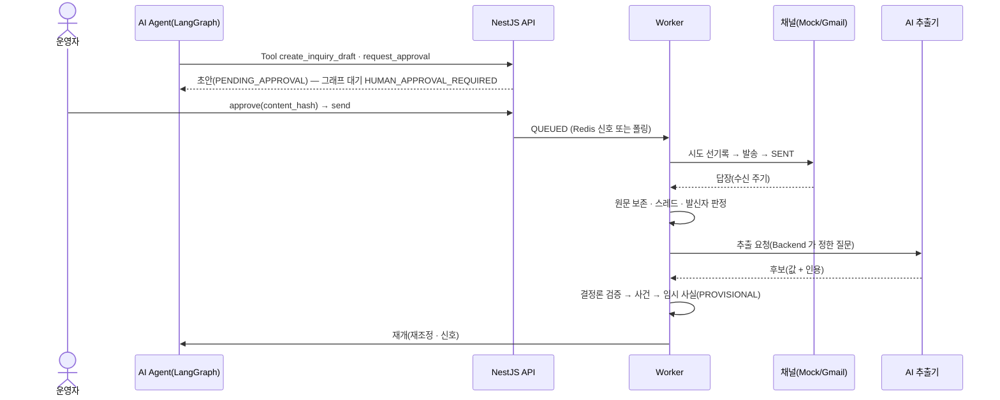
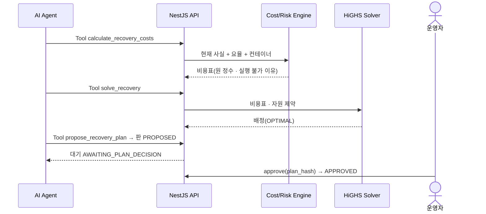
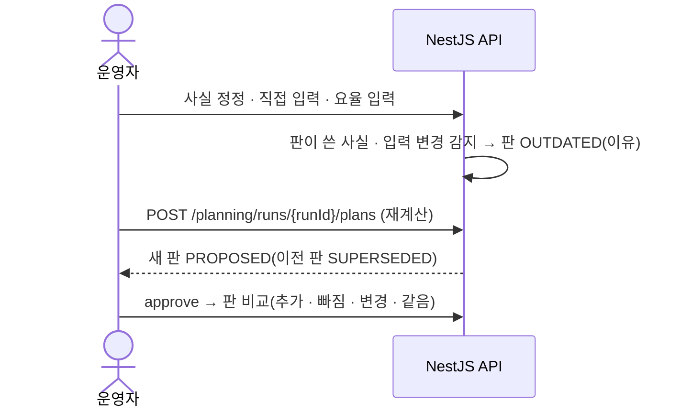
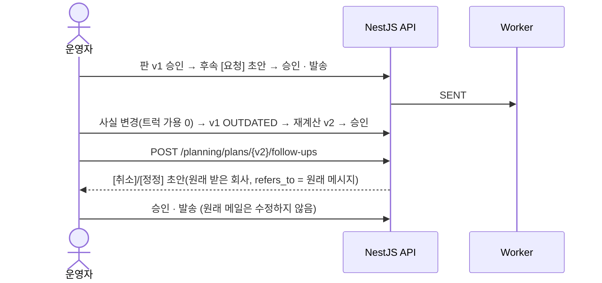
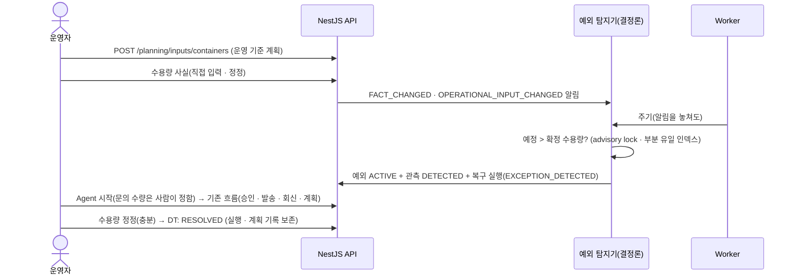
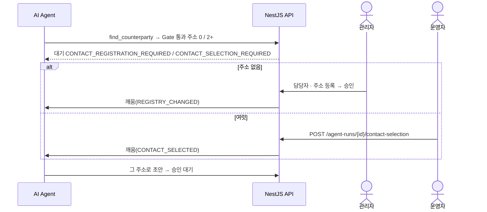

# 03. CERA 유스케이스 분석서

| 항목 | 내용 |
| --- | --- |
| 문서 상태 | 확정(2026-10-28 구현 기준) |
| 기준 | HEAD `5881529` + T-132 · T-133 · 감사 액션 정본 `back/src/persistence/catalog.ts` · Agent 그래프 `ai/cera_ai/agent/graph.py` |
| 관련 문서 | [02 요구사항](02_requirements-analysis.md) · [07 API](07_interface-api.md) · [05 DB](05_data-model-and-tables.md) · [09 추적성](09_traceability-matrix.md) · [11 용어집](11_glossary.md) |

## 1. Actor

### 1.1 사람 Actor

| Actor | 코드 | 설명 |
| --- | --- | --- |
| 관리자 | `ADMIN` | 운영자 권한 + 등록부 변경 + 사용자 관리 |
| 운영자 | `OPERATOR` | 예외 복구 업무 전체(등록부 변경 · 사용자 관리 제외) |
| 현장 담당자 | `FIELD_OPERATOR` | 조회 + 현장 값 직접 입력 |
| 데모 방문자 | `DEMO_VISITOR` | 공개 포트폴리오 체험(운영 입력 · 공공데이터 제외) |

### 1.2 시스템 Actor

| Actor | 실체 | 하는 일 | 하지 않는 일 |
| --- | --- | --- | --- |
| AI Agent | Python LangGraph 그래프(`AI_AGENT` actor) | 공백 확인 · 다음 행동 선택 · Tool 호출로 초안 · 승인 대기 요청 · 계산 · 판 저장 | 승인 · 발송 · 사실 확정 · DB 직접 접근 |
| AI 추출기 | AI Server `/v1/extractions/reply` | 답장에서 값 후보 + 인용 | 값 판정 · 저장 |
| Worker | NestJS Worker 프로세스(`SYSTEM` actor) | 발송 · 수신 · 추출 요청 · 사실 재판정 · Agent 재조정 · 예외 탐지 주기 | 사람 결정 |
| 예외 탐지기 | `ExceptionDetectorService`(API · Worker, `SYSTEM` actor) | 운영 기준 계획 vs 수용량 사실 비교 · 예외 기록 · 복구 실행 생성 · 해소 | LLM 사용 · Agent 시작 · 외부 연락 |
| 외부 거래처 | 운송사 · ODCY · 창고 | 메일로 답장 | — |
| Gmail | Google Gmail API | 실제 메일 송수신 채널 | — |
| Mock 채널 | 파일 기반 보낸 편지함 · 수신함 | 시연 · 시험 송수신 | — |
| 공공데이터 제공자 | data.go.kr(해양수산부 DS-02 · DS-03) | 선박 입항 · 적하목록 응답 | — |
| LLM 공급자 | 녹화 재생 · Gemini 등 | 추출 응답 | — |

## 2. 유스케이스 목록

| ID | 이름 | 주 Actor | 우선 | 상태 |
| --- | --- | --- | --- | --- |
| UC-01 | 로그인 · 데모 시작 | 사람 전체 | P0 | 구현 |
| UC-02 | 복구 실행 생성 | 운영자 | P1 | 구현(실제 실행) · 시나리오는 시드 |
| UC-03 | Agent 실행 | 운영자 | P0 | 구현 |
| UC-04 | 정보 공백 탐지 | AI Agent(+ Backend) | P0 | 구현 |
| UC-05 | 거래처 문의 준비 | AI Agent · 운영자 | P0 | 구현 |
| UC-06 | 문의 승인 | 운영자 | P0 | 구현 |
| UC-07 | 문의 발송 | 운영자 → Worker | P0 | 구현 |
| UC-08 | 회신 수신 | Worker | P0 | 구현 |
| UC-09 | AI 회신 추출 | Worker → AI 추출기 | P0 | 구현 |
| UC-10 | 사람 회신 검토 · 재추출 | 운영자 | P1 | 구현 |
| UC-11 | 사실 직접 입력 | 운영자 · 현장 담당자 | P0 | 구현 |
| UC-12 | 사실 확인 · 거절 · 정정 · 철회 | 운영자 | P0 | 구현 |
| UC-13 | 입력 준비도 확인 | 운영자 | P1 | 구현 |
| UC-14 | 복구 계획 계산 | AI Agent · 운영자 | P0 | 구현 |
| UC-15 | 계획 승인 | 운영자 | P0 | 구현 |
| UC-16 | 후속 요청 | 운영자 | P0 | 구현 |
| UC-17 | 운영 정보 변경 → 계획 무효 | 운영자 · 시스템 | P0 | 구현 |
| UC-18 | 재계획 | 운영자 · AI Agent | P0 | 구현 |
| UC-19 | 정정 요청 | 운영자 | P1 | 구현 |
| UC-20 | 취소 요청 | 운영자 | P1 | 구현 |
| UC-21 | 연락처 등록 | 관리자 | P1 | 구현 |
| UC-22 | 연락처(받는 주소) 선택 | 운영자 | P0 | 구현 |
| UC-23 | 연락처 중지 · 비활성 · 거절 | 관리자 | P1 | 구현 |
| UC-24 | 운영 데이터 일괄 입력 | 운영자 | P1 | 구현 |
| UC-25 | 공공데이터 조회 | 운영자 | P2 | 구현(키 필요) |
| UC-26 | 사용자 관리 | 관리자 | P1 | 구현(API 만, 화면 없음) |
| UC-27 | 운영 기준 계획 입력 | 운영자 | P1 | 구현(T-132) |
| UC-28 | 예외 자동 탐지 → 복구 실행 | 예외 탐지기 | P0 | 구현(T-132) |
| UC-29 | 시설 · 트럭 풀 등록 | 관리자 | P1 | 구현(T-132) |
| UC-30 | 운영 Dashboard · 시스템 상태 확인 | 관리자 · 운영자 | P1 | 구현(T-133) |

T-132 에서 UC-27 · 28 · 29, T-133 에서 UC-30 을 더했다. 원 지시의 후보 중 바꾼 것: "Truth 확정"은 실제 동작이 확인 · 거절 · 정정 · 철회 네 가지라 UC-12 로 묶었고, "Planning Input 검증"은 입력 자체(UC-24)와 계산 가능 여부 확인(UC-13)으로 나눴다. UC-25 · UC-26 은 실제 구현이 있어 추가했다.

## 3. 유스케이스 상세

공통: 모든 사람 행동은 Backend Guard 의 권한 검사를 받고(화면 숨김과 무관), 요청마다 `request_id` 가 붙는다. "감사"는 `audit_log.action` 값이다.

### UC-01 로그인 · 데모 시작
- 목적: 사람 행위자를 세션으로 정한다
- Primary: 사람 사용자 · Secondary: 없음 · Trigger: 화면 첫 진입
- 사전조건: 활성 계정(데모 시작은 포트폴리오 모드 + 데모 계정)
- Main: ① 아이디 · 비밀번호 입력 ② Backend 대조 · 세션 발급 ③ 쿠키 저장 ④ `/auth/me` 로 역할 · 권한을 받아 화면이 버튼을 정함
- Alternative: 포트폴리오 모드면 로그인 화면 대신 소개 + [데모 시작] → `POST /auth/demo-session` → `/demo`
- Exception: 401 `INVALID_CREDENTIALS` · 429 `LOGIN_RATE_LIMITED` · 429 `RATE_LIMITED`(포트폴리오)
- Postconditions: 세션 행(지문) 생성
- 요구사항: FR-AUTH-001 · 002 · 004 · 006 · API: `POST /auth/login` · `POST /auth/logout` · `GET /auth/me` · `GET · POST /auth/demo-session`
- 데이터: `user_account` · `user_session` · 권한: `PUBLIC` · 감사: `AUTH_LOGIN` · `AUTH_LOGOUT`

### UC-02 복구 실행 생성
- 목적: 예외 한 건을 판단할 실행 단위를 만든다
- Primary: 운영자 · Trigger: 예외 인지(창고 수용량 부족은 UC-28 이 자동으로 만든다 — 그 밖의 경우)
- Main(실제 실행): ① [+ 새 실제 실행] ② `POST /planning/runs` → 스냅숏 + 실행(`OPERATOR_REQUEST`, `contains_simulated=false`) ③ 운영 입력(UC-24)으로 이어 감
- Alternative(시뮬레이션): 시드(`npm run db:seed`)가 시나리오 실행(`EXCEPTION_DETECTED`)을 만든다
- Exception: 403(권한 없음 — 현장 담당자 · 데모 방문자)
- 요구사항: FR-RUN-001 · 002 · 003 · API: `POST · GET /planning/runs` · 데이터: `planning_snapshot` · `recovery_run` · 권한: `planning.input` · 감사: `LIVE_RUN_CREATED`

### UC-03 Agent 실행
- 목적: 정보 확인부터 계획 제안까지 자동 진행하되 사람 결정 지점에서 멈춘다
- Primary: 운영자 · Secondary: AI Agent · AI Server · Trigger: 실행 선택 → [Agent 시작]
- 사전조건: 실행 존재 · Agent Tool 사용 설정(`CERA_AGENT_TOOLS_ENABLED`) · AI Server 가동
- Main: ① `POST /agent-runs`(목표 · `plan_recovery`) ② `POST /agent-runs/{id}/start` ③ 그래프: 맥락 읽기 → (공공데이터) → 공백 판정(UC-04) → 다음 행동 ④ 문의 필요 → UC-05 → 승인 대기에서 멈춤 ⑤ 사람 행동 · 외부 기록 변화 때마다 재개 ⑥ 공백이 없으면 계산(UC-14) → 계획 결정 대기 ⑦ 승인되면 완료
- Alternative: 연락처 없음 → `CONTACT_REGISTRATION_REQUIRED`(UC-21) · 여럿 → `CONTACT_SELECTION_REQUIRED`(UC-22) · 답장에서 값 못 얻음 → `REPLY_REVIEW_REQUIRED`(UC-10) · 임시 사실 → `AWAITING_FACT_VERIFICATION` · 계획 OUTDATED → 다시 맥락 읽기
- Exception: AI Server 일시 장애 → `WAITING_RUNTIME`(재시도 3회) → 상한이면 `FAILED` · 비상 상한(단계 100 · Tool 50) → `FAILED` · 사람 취소 → `CANCELLED`
- Postconditions: Agent 실행 · 단계 · Tool 호출 · 체크포인트 기록
- 요구사항: FR-AGENT-001~008 · API: `/agent-runs*` · 데이터: `agent_run` · `agent_step` · `agent_tool_call` · `agent_checkpoint(_write)` · 권한: `agent_run.manage` · 감사: `APPROVAL_REQUESTED` · `PLAN_PROPOSED`(Tool 결과)

### UC-04 정보 공백 탐지
- 목적: 계획에 필요한데 없는 사실을 정한다
- Primary: AI Agent(Tool 호출) · 판정 주체: Backend 결정론 · Trigger: 그래프의 `inspect_gaps`
- Main: ① Tool `get_information_gaps` ② Backend 가 계획 날짜의 창고 · ODCY 수용량, 협력 트럭 시간대 가용을 현재 사실과 대조 ③ 공백마다 상태 · 소유 거래처 · 추천 문의 종류 반환
- Exception: 실행이 없거나 다른 실행이면 Tool 거부(`REJECTED`)
- 요구사항: FR-AGENT-002 · API: `POST /internal/agent-tools/get_information_gaps` · 데이터: `canonical_fact` · `facility` · `truck_pool` · `comm_message` · 감사: 없음(Tool 호출 기록 `agent_tool_call`)

### UC-05 거래처 문의 준비
- 목적: 공백을 채울 문의 초안을 정확한 상대에게 만든다
- Primary: AI Agent(또는 운영자 직접) · Trigger: 다음 행동 = `COMMUNICATION`
- Main: ① 소유 거래처 찾기(Tool `find_counterparty`) ② Gate 를 통과한 주소가 하나면 그 주소 ③ 초안 생성(Tool `create_inquiry_draft` — 구조화 값 · 숫자 검사) ④ 승인 대기열(Tool `request_approval`) ⑤ 그래프 대기 `HUMAN_APPROVAL_REQUIRED`
- Alternative: 사람이 화면 · API 로 초안을 만든다(`POST /communication/drafts`) · 숫자 검사 실패 → `HUMAN_ACTION_REQUIRED` → 사람이 수정(`POST .../revisions`)
- Exception: 주소 0 → UC-21 · 여럿 → UC-22 · Gate 막힘 403
- 요구사항: FR-COMM-001~003 · FR-REG-007 · API: `POST /communication/drafts` · `/revisions` · 데이터: `comm_thread` · `comm_message` · `question_item` · `comm_message_structured_field` · 권한: `communication.draft` · 감사: `APPROVAL_REQUESTED`

### UC-06 문의 승인
- 목적: 외부로 나갈 내용을 사람이 확인한다
- Primary: 운영자 · Trigger: 할 일 "문의 초안 승인이 필요합니다"
- 사전조건: `PENDING_APPROVAL`, 숫자 검사 통과, Gate 통과
- Main: ① 받는 사람 · 내용 · 숫자 확인 ② `POST /communication/drafts/{id}/approve {content_hash}` ③ 승인 행 + 받는 주소 · 구조화 값 사본 고정 ④ 상태 `APPROVED` ⑤ Agent 대기 사유 → `AWAITING_SEND_REQUEST`
- Alternative: 반려(`/reject`) → `REJECTED` · 승인 취소(`/approvals/{id}/revoke`) → `REVOKED`
- Exception: 409 `CONTENT_CHANGED` · 403 Gate · 승인 기한 만료 · Agent · 시스템 행위자 승인 시도 → DB 거부
- 요구사항: FR-COMM-004 · 데이터: `message_approval` · `message_approval_structured_field` · `message_status_transition` · 권한: `communication.approve` · 감사: `MESSAGE_APPROVED` · `MESSAGE_REJECTED` · `APPROVAL_REVOKED`

### UC-07 문의 발송
- Primary: 운영자 → Worker · Trigger: [발송 요청]
- Main: ① `POST /communication/drafts/{id}/send` ② 잠금 상태에서 승인 · 지문 · Gate · 계획 무효 재확인 → `QUEUED` ③ 실행 큐 신호(Redis) 또는 폴링으로 Worker 가 집음 ④ 시도 선기록 → 채널 발송 → 결과 → `SENT`
- Alternative: 발송 차단 스위치 → 대기 유지 · Redis 없음 → 폴링으로 같은 결과
- Exception: 일시 실패 → 재시도(최대 5) · 영구 실패 → `DELIVERY_FAILED` · 결과 모름 → 화해 · 포트폴리오 실채널 → 403
- 요구사항: FR-COMM-005~007 · 009 · 010 · 데이터: `message_status_transition` · `send_attempt` · 권한: `communication.send` · 감사: `SEND_REQUESTED` · `SEND_DEQUEUED` · `MESSAGE_SENT` · `SEND_FAILED` · `SEND_RECONCILED`

### UC-08 회신 수신
- Primary: Worker · Secondary: 외부 거래처 · Gmail/Mock · Trigger: Worker 수신 주기
- Main: ① 수신함 읽기 ② 원문을 내용 저장소에 보존 · `raw_input` ③ 스레드 연결 · 발신자 판정 ④ INBOUND 메시지 저장 · 원 메시지 `REPLIED` ⑤ 추출 대기
- Alternative: 보류 — 스레드 없음 · 모호 · 미등록 발신자 · 비활성 · 미확인 · 미승인 · 다른 회사 · 다른 담당자 · Mock/Real 불일치(AI 에 보내지 않음)
- Exception: 날짜 없음 · 해석 불가 · 수신 시각보다 미래 → 날짜 거부 기록 · 중복 → UNIQUE 로 무시
- 요구사항: FR-COMM-008 · API: `GET /communication/inbound` · 데이터: `raw_input` · `comm_message` · 감사: `INBOUND_RECEIVED` · `INBOUND_HELD_*` · `INBOUND_DATE_REJECTED_*`

### UC-09 AI 회신 추출
- Primary: Worker · Secondary: AI Server · LLM 공급자
- Main: ① Backend 가 물은 질문으로 추출 요청 ② AI 가 후보(값 · 인용) ③ 결정론 검증 ④ 통과 + 승격 조건 → 사건(OBSERVATION) → 임시 사실 ⑤ Agent 깨움
- Alternative: 후보 없음(변화 없음 · 거절 · 해석 불가 · 값 없음) · 검증 탈락 → 사실 없음 · 사람 검토
- Exception: 공급자 실패 → 자동 재시도(3회, 간격) → `EXTRACTION_PROVIDER_FAILED` 등 기록 → `REPLY_REVIEW_REQUIRED`
- 요구사항: FR-EXT-001~003 · 005 · FR-TRUTH-001 · 데이터: `extraction` · `event` · `event_entity_link` · `canonical_fact` · 감사: `EXTRACTION_COMPLETED` · `EXTRACTION_NO_CANDIDATE_*` · `FACT_PROVISIONAL_CREATED`

### UC-10 사람 회신 검토 · 재추출
- Primary: 운영자 · Trigger: 할 일 "답장이 왔지만 AI 가 내용을 확정하지 못했습니다"
- Main: ① 원문 · 실패 이유 · 시도 횟수 확인 ② [다시 추출] → `POST /communication/inbound/{id}/extraction/retry` ③ 사람 요청 시도가 기록됨
- Alternative: 다시 실패 → UC-11 직접 입력 → 답장은 "처리 완료"로 표시
- 요구사항: FR-EXT-004 · 데이터: `extraction_retry_request` · `extraction` · 권한: `extraction.retry` · 감사: `REPLY_EXTRACTION_RETRY_REQUESTED`

### UC-11 사실 직접 입력
- Primary: 운영자 · 현장 담당자 · 데모 방문자
- Main: ① 종류(시설 수용량 · 트럭 시간대) · 대상 · 날짜 · 값 · 출처 메모 ② `POST /truth/facts/manual` ③ `raw_input`(HUMAN_UI) + 사건 → 바로 확정 ④ 계획이 기대던 값이면 OUTDATED(UC-17) · Agent 깨움
- 요구사항: FR-TRUTH-004 · 권한: `truth.manual_entry` · 감사: `FACT_ENTERED_MANUALLY`

### UC-12 사실 확인 · 거절 · 정정 · 철회
- Primary: 운영자 · Trigger: 할 일 "임시 값의 확인이 필요합니다"
- Main: [확인] → VERIFICATION 사건 → `CONFIRMED` · 이전 판 무효(근거 변경) → 새 판
- Alternative: [거절] → 그 사건 제외 · [정정] (새 값) → CORRECTION 사건 · [철회] → 값 없는 CORRECTION(사람만)
- Exception: 현장 담당자 · Agent · 시스템 → 403 · 이미 처리된 사건 → 409
- 요구사항: FR-TRUTH-003 · 005 · API: `POST /truth/events/{eventId}/confirm|reject|correct|revoke` · 데이터: `event` · `event_verification_target` · `canonical_fact` · 권한: `truth.review` · 감사: `FACT_CONFIRMED` · `FACT_REJECTED` · `FACT_CORRECTED` · `FACT_REVOKED`

### UC-13 입력 준비도 확인
- Primary: 운영자 · Main: `GET /planning/runs/{runId}/input-readiness` → READY / NOT_READY + 빠진 값(필드 단위)
- Exception: NOT_READY 에서 계산 요청 → 409
- 요구사항: FR-INPUT-004

### UC-14 복구 계획 계산
- Primary: AI Agent(Tool) 또는 운영자(재계산)
- Main: ① 비용 · 위험 계산(Tool `calculate_recovery_costs` / `GET .../costs`) ② Solver(Tool `solve_recovery`) ③ 새 판 저장(Tool `propose_recovery_plan` / `POST .../plans`) — 이전 판 `SUPERSEDED` ④ Agent 대기 `AWAITING_PLAN_DECISION`
- Alternative: 해 없음 → `INFEASIBLE` 판(이유 표시)
- 요구사항: FR-PLAN-001~003 · 006 · FR-SOLVER-001 · 데이터: `recovery_plan` · `recovery_plan_item` · `planning_snapshot` · 권한: `plan.recalculate` · 감사: `PLAN_PROPOSED`

### UC-15 계획 승인
- Primary: 운영자 · Main: 판 · KPI · 컨테이너별 조치 확인 → `POST /planning/plans/{planId}/approve {plan_hash}` → `APPROVED` → Agent 완료
- Exception: 해시 불일치 · 이미 밀린 판 · OUTDATED → 409
- Postconditions: 승인은 결정 기록이며 배차 · 발송은 일어나지 않는다
- 요구사항: FR-PLAN-004 · 권한: `plan.approve` · 감사: `PLAN_APPROVED`

### UC-16 후속 요청
- Primary: 운영자 · Main: [필요한 초안 만들기] → `POST /planning/plans/{planId}/follow-ups` → 조치마다 `[요청]` 초안(승인 대기) → UC-06 · UC-07
- Alternative: 자사 트럭만 쓴 판 → 외부 연락 없음 · 주소 없음 → `NO_ELIGIBLE_CONTACT` · 여럿 → UC-22
- 요구사항: FR-FU-001 · 004 · 데이터: `plan_follow_up` · `comm_message` · 권한: `communication.draft`

### UC-17 운영 정보 변경 → 계획 무효
- Primary: 운영자(사실 정정 · 직접 입력 · 요율 입력) · 시스템
- Main: ① 판이 기대던 사실 · 입력이 바뀜 ② 판 `OUTDATED` + 이유 ③ 화면 "다시 계산해야 합니다" ④ Agent 는 맥락 다시 읽기
- 요구사항: FR-PLAN-005 · 데이터: `recovery_plan` · 감사: `PLAN_OUTDATED`

### UC-18 재계획
- Primary: 운영자 · Main: [지금 사실로 다시 계산] → `POST /planning/runs/{runId}/plans` → 새 판 → UC-15 → 판 비교(추가 · 빠짐 · 변경 · 같음)
- 요구사항: FR-PLAN-006 · 권한: `plan.recalculate`

### UC-19 정정 요청 / UC-20 취소 요청
- Primary: 운영자 · Trigger: 새 판 승인 뒤 [필요한 초안 만들기]
- Main: 이미 보낸 후속과 새 판을 비교 → 수량이 바뀌면 `[정정]`(이전 수량 포함), 빠지면 `[취소]` 초안을 **원래 받은 회사**로 → 승인 · 발송. 원래 보낸 메일은 그대로
- Alternative: 원래 받은 주소가 중지 · 퇴사 → 같은 회사의 다른 담당 · 여럿이면 UC-22
- Exception: 이전 판 기반 초안의 승인은 무효(`PLAN_SUPERSEDED`)
- 요구사항: FR-FU-002 · 003 · FR-COMM-011 · 데이터: `plan_follow_up`(`follow_up_kind`, `refers_to_message_id`, delta)

### UC-21 연락처 등록
- Primary: 관리자 · Trigger: `CONTACT_REGISTRATION_REQUIRED`
- Main: ① (필요하면) 거래처 등록 · 시설 운영사 지정 ② 담당자 · 주소 등록("CERA 밖에서 확인함") ③ 주소 승인 ④ 대기를 풀 수 있으면 Agent 깨움(`REGISTRY_CHANGED`) → 그 주소로 초안
- Exception: 운영자 · 현장 담당자 → 403 · 중복 → 409 · 미승인 주소로는 깨우지 않음
- 요구사항: FR-REG-002~004 · 006 · 009 · API: `POST /registry/counterparties` · `/contacts` · `/addresses/{id}/approve` · `PATCH /registry/facilities/{id}/operator` · 권한: `registry.manage` · 감사: `COUNTERPARTY_CREATED` · `CONTACT_CREATED` · `CONTACT_ADDRESS_APPROVED` · `FACILITY_OPERATOR_SET`

### UC-22 연락처(받는 주소) 선택
- Primary: 운영자 · Trigger: `CONTACT_SELECTION_REQUIRED`
- Main: ① 그 회사의 담당자 목록(쓸 수 없는 주소는 상태와 함께 보이되 선택 불가, 처음에 아무것도 선택 안 됨) ② 하나 선택 → `POST /agent-runs/{id}/contact-selection` 또는 `POST /planning/plans/{id}/follow-ups/contact-selection` ③ Backend 재판정 ④ Agent 재개(`CONTACT_SELECTED`) · 또는 후속 초안 생성
- Exception: 422 `WRONG_COUNTERPARTY` · `ROLE_MISMATCH` · `SIMULATION_MISMATCH` · 403 Gate · 409 대기 아님 · 현장 담당자 403
- 요구사항: FR-REG-008 · 009 · 데이터: `contact_selection` · 권한: `contact.select` · 감사: `CONTACT_SELECTED`

### UC-23 연락처 중지 · 비활성 · 거절
- Primary: 관리자 · Main: 주소 `PAUSED` · `INACTIVE` · 거절, 담당자 비활성 → 이후 초안 · 발송 직전 Gate 에서 막힘(이미 승인된 초안 포함)
- 요구사항: FR-REG-004 · 005 · API: `PATCH /registry/addresses/{id}/status` · `POST .../reject` · `PATCH /registry/contacts/{id}` · 감사: `CONTACT_ADDRESS_STATUS_CHANGED` · `CONTACT_ADDRESS_REJECTED` · `CONTACT_STATUS_CHANGED`

### UC-24 운영 데이터 일괄 입력
- Primary: 운영자 · 사전조건: 실제 실행
- Main: ① CSV · 행 입력 ② 검증만(dry-run) → 행 · 필드 · 이유 표, 저장 안 됨 표시 ③ 오류 0 + 같은 내용으로 저장 ④ 준비도 갱신 ⑤ 요율 변경이면 승인된 판 OUTDATED
- Exception: 오류가 있으면 저장 거부 · 권한 없음 403
- 요구사항: FR-INPUT-001~003 · API: `POST /planning/runs/{runId}/inputs/containers` · `POST /planning/inputs/rates` · `POST /planning/inputs/facility-profiles` · 데이터: `planning_input_batch` · `planning_container_record` · `tariff_rate` · `facility_planning_profile` · 권한: `planning.input` · 감사: `PLANNING_INPUT_IMPORTED`

### UC-25 공공데이터 조회
- Primary: 운영자(또는 Agent Tool `get_vessel_calls` · `get_container_manifest`) · Secondary: data.go.kr
- Main: 기간 → 입항 선박 → 선박별 적하목록 → 원본 보존 · 정규화
- Exception: 키 없음 `PUBLIC_DATA_KEY_MISSING` · 상류 오류 · 파싱 오류 → 조회 기록 + 시스템 오류
- 요구사항: FR-PUB-001~003 · 권한: `public_data.fetch` · 감사: `PUBLIC_DATA_FETCHED`

### UC-26 사용자 관리
- Primary: 관리자 · Main: 사용자 생성 · 역할 · 활성 · 비밀번호 변경(세션 끊김)
- Exception: 409 `LOGIN_ID_TAKEN` · `CANNOT_DEMOTE_SELF`
- 요구사항: FR-AUTH-005 · API: `/admin/users*` · 권한: `users.manage` · 감사: `USER_CREATED` · `USER_UPDATED`

### UC-27 운영 기준 계획 입력
- Primary: 운영자 · 목적: 원래 반입 계획을 실행 없이 넣어 탐지기의 기준으로 삼는다
- Main: ① CSV · 행 → `POST /planning/inputs/containers`(검증만 → 저장) ② 판 · 멱등 규칙 그대로 ③ `OPERATIONAL_INPUT_CHANGED` → UC-28
- Alternative: 일부 컨테이너 철회(`status = WITHDRAWN` 새 판) → 예정 감소 → UC-28 해소
- 요구사항: FR-INPUT-005 · 권한: `planning.input` · 감사: `PLANNING_INPUT_IMPORTED`

### UC-28 예외 자동 탐지 → 복구 실행
- Primary: 예외 탐지기 · Trigger: 사실 변경 알림(`FACT_CHANGED`) · 운영 입력 변경 알림 · Worker 주기
- 사전조건: `CERA_EXCEPTION_DETECTION=on` · SYSTEM actor
- Main: ① 범위별(LIVE · 시나리오) 창고 × 날짜 예정 수 · 수용량 사실 판정 ② 부족 + 근거 CONFIRMED → 예외 ACTIVE + 관측 DETECTED ③ 복구 실행 자동 생성(입력 옮겨 적기) ④ 운영 콘솔 할 일 "자동 탐지된 예외 — Agent 시작이 필요합니다" ⑤ 사람이 수량을 정해 Agent 시작(UC-03)
- Alternative: 임시 사실 → 예외만(실행 없음) — 사람이 확인하면 실행 생성 · 수용량 변화 → CHANGED · 충분해짐 · 예정 0 · 날짜 경과 → RESOLVED(실행 · 계획 보존) · 다시 부족 → 새 예외
- Exception: 수용량 사실 없음 · 오래됨 · 철회 · 검토 필요 → 판단 불가(새 예외 없음 · 해소 없음) · 탐지 꺼짐 → `POST /exceptions/detect` 409
- 요구사항: FR-DETECT-001~005 · API: `GET /exceptions*` · `POST /exceptions/detect` · `GET /planning/runs` · 데이터: `operational_exception` · `operational_exception_observation` · `recovery_run` · 감사: `EXCEPTION_DETECTED` · `EXCEPTION_RUN_CREATED` · `EXCEPTION_RESOLVED`

### UC-29 시설 · 트럭 풀 등록
- Primary: 관리자 · Main: `POST /registry/facilities` · `POST /registry/truck-pools`(협력은 소유 운송사) → 운영 입력 · 수용량 사실이 가리킬 대상 · Exception: 같은 이름 409 · 권한 없음 403
- 요구사항: FR-REG-010 · 권한: `registry.manage` · 감사: `FACILITY_CREATED` · `TRUCK_POOL_CREATED`

### UC-30 운영 Dashboard · 시스템 상태 확인
- Primary: 관리자 · 운영자(`system.monitor`) · 목적: 화물 예외와 함께 CERA 자체가 일하고 있는지 한 화면에서 확인
- Main: ① 로그인 → 운영 콘솔(모드 배지) ② 지금 해야 할 일(자동 탐지 실행 = "복구 조사를 시작해 주세요" [Agent 시작]) ③ 현재 예외(진행 중 · 해소 · 이력) → 복구 실행 열기 ④ 시스템 상태(전체 상태 + 이유 · 핵심 · 외부 연동 · 대기 작업) — 5초마다 다시 읽음
- Alternative: Redis 장애 → DEGRADED "PostgreSQL 폴링으로 운영 중 · 업무 데이터 손실 없음" · AI 장애 → DEGRADED(사람 검토 · 직접 입력) · Worker 멈춤 → ACTION_REQUIRED "Worker 를 다시 시작하세요" · Gmail 인증 거부 → ACTION_REQUIRED
- Exception: 권한 없음(데모 방문자 · 현장 담당자) → 403, 화면은 "서비스 연결됨" 한 줄만
- 요구사항: FR-OPS-004 · 005 · 006 · API: `GET /ops/system-status` · `GET /exceptions*` · `GET /planning/runs` · 데이터: `runtime_heartbeat` 외 기존 기록(읽기만)

## 4. 주요 시퀀스

### A. 문의 → 발송 → 회신 → 사실

### B. 사실 → 비용 → Solver → 계획

### C. 사실 변경 → OUTDATED → 재계획

### D. 보낸 요청 → 계획 변경 → 정정 · 취소

### F. 운영 데이터 → 예외 자동 탐지 → 복구 실행 (T-132)

### E. 연락처 없음 · 여럿 → 사람 해결

