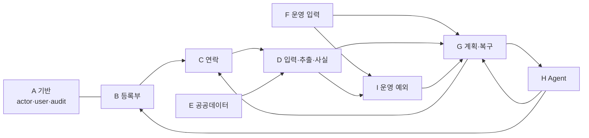
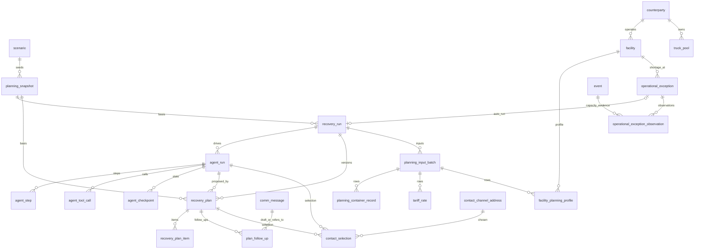

# 05. CERA 데이터 모델 및 테이블 설계서

| 항목 | 내용 |
| --- | --- |
| 문서 상태 | 확정(2026-10-28 구현 기준) |
| 정본 | 스키마 `back/src/db/schema/*.ts` · migration `back/drizzle/migrations/0000~0039`(M01~M40) · 트리거 · 권한 = custom migration(M07~M40 중 guard · permissions). 이 문서의 숫자는 **migration 이 모두 적용된 PostgreSQL 카탈로그에서 직접 읽은 값**이다 |
| 부록 | **[부록 A. 테이블 · 컬럼 전체 명세(자동 생성)](05a_appendix-table-columns.md)** — 54표 · 662컬럼의 타입 · NULL · Default · PK/FK · UNIQUE · CHECK · INDEX · TRIGGER 전부 |
| 관련 문서 | [04 데이터 분석](04_data-analysis.md) · [06 아키텍처](06_system-architecture.md) · 설계 이력 [`docs/21`](../21_cera-conceptual-data-model.md)(개념) · [`docs/22`](../22_cera-logical-data-model.md)(논리) · [`docs/24`](../24_cera-physical-data-model.md)(물리 — 22절 표별 명세는 시험 `schema-catalog.test.ts` 가 실제 DB 와 대조) |

## 1. 개요

| 항목 | 값 |
| --- | --- |
| DBMS | PostgreSQL 18.6(판 고정) · ORM Drizzle · 스키마 `cera` |
| 테이블 | **54** |
| 컬럼 | **662** |
| FK | **116** |
| CHECK | **300**(코드값은 ENUM 타입이 아니라 `CHECK IN`) |
| UNIQUE 제약 | 39 |
| 별도 인덱스 | 73(부분 유일 인덱스 포함) |
| 트리거 | **142**(TRUNCATE 거부 41 · UPDATE/DELETE 거부 28 · 컬럼 보호 19 · DELETE 거부 16 · 업무 불변식 가드 38) |
| migration | 40개(M01~M40). 생성 SQL 검토 후 기록 · `push` 금지(ADR-034) |
| 역할 | `cera_owner`(migration 소유) · `cera_app`(실행 앱 — 표마다 필요한 권한만, DDL · 트리거 해제 불가) |

## 2. 도메인 분류

| 도메인 | 표 | 수 |
| --- | --- | ---: |
| A. 기반 · 인증 · 감사 | `actor` · `user_account` · `user_session` · `audit_log` · `system_error` · `scenario` | 6 |
| B. 등록부 | `counterparty` · `counterparty_contact` · `contact_channel_address` · `facility` · `truck_pool` · `contact_selection` | 6 |
| C. 연락(Communication) | `comm_thread` · `question_item` · `comm_message` · `comm_message_question` · `comm_message_structured_field` · `message_approval` · `message_approval_structured_field` · `message_status_transition` · `send_attempt` | 9 |
| D. 입력 · 추출 · 사실(Truth) | `raw_input` · `extraction` · `extraction_retry_request` · `event` · `event_entity_link` · `event_verification_target` · `canonical_fact` · `conflict` · `verification_request` · `verification_request_handling` | 10 |
| E. 공공데이터 · 화물 식별 | `public_data_fetch` · `vessel_call` · `container` · `bl` · `container_bl` · `external_identifier` | 6 |
| F. 운영 입력(Planning Input) | `planning_input_batch` · `planning_container_record` · `tariff_rate` · `facility_planning_profile` | 4 |
| G. 계획 · 복구 | `planning_snapshot` · `recovery_run` · `recovery_plan` · `recovery_plan_item` · `plan_follow_up` | 5 |
| H. Agent 실행 | `agent_run` · `agent_step` · `agent_tool_call` · `agent_checkpoint` · `agent_checkpoint_write` | 5 |
| I. 운영 예외(T-132) | `operational_exception` · `operational_exception_observation` | 2 |
| J. 실행 상태(T-133) | `runtime_heartbeat` | 1 |

## 3. 테이블 상세

열 설명: **변경** = 앱 역할로 할 수 있는 변경(A = append-only, UPDATE · DELETE 거부 / L = 정해진 컬럼만 · 한 번만 채움 / U = 갱신 가능 · 삭제 불가 / D = 파생 표, 갱신 · 삭제 가능). 숫자는 UNIQUE · CHECK · INDEX 개수. 전체 컬럼 · 제약 정의는 [부록 A](05a_appendix-table-columns.md).

### A. 기반 · 인증 · 감사

| 표 | 한글명 · 목적 | PK | FK → | 주요 컬럼 · 상태값 | U/CK/IX | 트리거 | 변경 | 관련 기능 |
| --- | --- | --- | --- | --- | --- | --- | --- | --- |
| `actor` | 행위자 — 사람 · 시스템 · AI Agent 를 하나의 주체로 | `actor_id` | — | `actor_type`(`HUMAN` · `SYSTEM` · `AI_AGENT`, 불변) · `display_name` · `is_active` | 0/1/0 | 컬럼 보호 · TRUNCATE 거부 | L | 모든 기록의 "누가" |
| `user_account` | 사용자 계정 — HUMAN actor 하나에 계정 하나 | `user_id` | `actor` | `login_id` · `role`(`ADMIN` · `OPERATOR` · `FIELD_OPERATOR` · `DEMO_VISITOR`) · `password_hash`(scrypt) · `is_active` | 2/4/0 | 계정 가드 · 컬럼 보호 · DELETE 거부 | L | FR-AUTH-001 · 005 |
| `user_session` | 로그인 세션 — 토큰 지문만 | `session_id` | `user_account` | `token_hash`(sha256) · `expires_at` · `revoked_at` | 1/3/1 | 세션 가드 · 컬럼 보호 · DELETE 거부 | L | FR-AUTH-001 |
| `audit_log` | 감사 기록 | `audit_id` | `actor` | `action` · `target_type` · `target_id` · `result`(`SUCCESS` · `FAILURE`) · `occurred_at` · `is_simulated` | 0/3/3 | UPDATE/DELETE · TRUNCATE 거부 | A | FR-AUDIT-001 |
| `system_error` | 시스템 오류 기록(메시지 · 스택 없음) | `error_id` | `scenario` | `error_boundary`(`API_REQUEST` · `INTEGRATION` · `BACKGROUND_JOB`) · `error_category` · `error_code` · `safe_error_message` · `retryable` · `request_id` · `trace_id` | 0/7/4 | UPDATE/DELETE · TRUNCATE 거부 | A | FR-AUDIT-002 |
| `scenario` | 시나리오 — 합성 데이터 묶음 | `scenario_id` | — | `scenario_name` · `as_of_base` | 0/0/0 | TRUNCATE 거부 | U | 시뮬레이션 표시 |

### B. 등록부

| 표 | 한글명 · 목적 | PK | FK → | 주요 컬럼 · 상태값 | U/CK/IX | 트리거 | 변경 | 관련 기능 |
| --- | --- | --- | --- | --- | --- | --- | --- | --- |
| `counterparty` | 거래처 | `counterparty_id` | — | `display_name` · `source_role`(`TRUCKING` · `ODCY` · `WAREHOUSE` · `SHIPPING_LINE` · `TERMINAL`) · 활성 | 0/1/0 | TRUNCATE 거부 | U | FR-REG-001 · 002 |
| `counterparty_contact` | 담당자 | `contact_id` | `counterparty` | `person_name` · 활성 | 1/0/1 | 컬럼 보호 | L | FR-REG-003 · 005 |
| `contact_channel_address` | 연락 주소 | `address_id` | `counterparty_contact` · `actor`(승인자) | `channel_type`(`GMAIL` · `MOCK` · `PORTAL`) · `normalized_address` · `email_verification_status` · `relationship_status` · `communication_status` · `approved_at` | 2/7/1 | 컬럼 보호 | L | FR-REG-003~005 · 007 |
| `facility` | 시설(창고 · 터미널 · ODCY) | `facility_id` | `counterparty`(운영사) | `facility_type` · `facility_name` · `operator_counterparty_id` | 0/1/0 | TRUNCATE 거부 | U | FR-REG-006 |
| `truck_pool` | 트럭 풀(자사 · 협력) | `truck_pool_id` | `counterparty`(소유 운송사) | `pool_name` · `ownership`(`OWN` · `PARTNER`) | 0/1/1 | TRUNCATE 거부 | U | 공백 · 후속 |
| `contact_selection` | 받는 주소 사람 선택(M34 · M35) | `selection_id` | `agent_run` · `recovery_plan` · `contact_channel_address` · `actor` | `scope_type`(`AGENT_RUN` · `PLAN_FOLLOW_UP`) · `subject_type`(`FACILITY` · `TRUCK_POOL`) · `action_key` · `note` | 0/3/2 | UPDATE/DELETE · TRUNCATE 거부 | A | FR-REG-008 |

### C. 연락(Communication)

| 표 | 한글명 · 목적 | PK | FK → | 주요 컬럼 · 상태값 | U/CK/IX | 트리거 | 변경 | 관련 기능 |
| --- | --- | --- | --- | --- | --- | --- | --- | --- |
| `comm_thread` | 대화 스레드(거래처 · 담당자 · 실행) | `thread_id` | `counterparty` · `counterparty_contact` · `recovery_run` · `scenario` | `purpose`(`CAPACITY_CHECK` · `SLOT_REQUEST` 등) · `thread_status`(`OPEN` · `WAITING_REPLY` · `ANSWERED` · `CLOSED`) · `external_thread_id` · `last_activity_at` | 2/6/2 | 한 번만 채움 · 컬럼 보호 · DELETE 거부 | L | FR-COMM-001 · 008 |
| `question_item` | 질문 — 무엇을(개체 · 사실 키 · 범위) 물었나 | `question_item_id` | `comm_thread` | `ask_id` · `question_type`(`CAPACITY` · `SLOT` 등) · `target_entity_type` · `target_entity_id` · `target_fact_key` · `expected_unit` · `question_status`(`DRAFTED` · `SENT` · `ANSWERED` · `UNANSWERED` · `CANCELLED`) | 1/9/1 | 컬럼 보호 · DELETE 거부 | L | 추출 질문 · 공백 |
| `comm_message` | 메시지(보낸 문의 · 받은 회신) | `message_id` | `comm_thread` · `contact_channel_address`(받는 주소) · `message_approval`(현재 승인) · `scenario` | `direction`(`OUTBOUND` · `INBOUND`) · `message_kind` · `current_status`(`MESSAGE_STATUS`) · `content_hash` · `message_content_ref`(ContentStore) · `drafted_by`(`AI_DRAFT` · `HUMAN` · `TEMPLATE`) · `external_message_id` · `from_address` · `sent_at` · `received_at` · `is_simulated` | 3/14/3 | 한 번만 채움 · 컬럼 보호 · DELETE 거부 | L | FR-COMM-001 · 005 · 008 |
| `comm_message_question` | 메시지 ↔ 질문 연결 | (`message_id`, `question_item_id`) | `comm_message` · `question_item` | — | 0/0/1 | 자식 삽입 가드 · UPDATE/DELETE 거부 | A | 추출 질문 |
| `comm_message_structured_field` | 메시지의 구조화 값(정본) | (`message_id`, `field_key`) | `comm_message` · `question_item` · `recovery_run`(출처 실행) | 값(숫자 · 글) · 단위 · `source_path`(계획 값 출처) | 0/4/2 | 승인 사본 검사 · UPDATE/DELETE 거부 | A | FR-COMM-001 · 002 |
| `message_approval` | 발송 승인 | `approval_id` | `comm_message` · `actor` · `recovery_run`(계획 기반 승인) · 자기(무효화 대상) | `decision`(`APPROVAL_DECISION`) · `approved_content_hash` · `approved_to_address_id` · `expires_at` · `invalidation_cause` | 2/10/2 | 승인 삽입 · 결정 가드 · 사본 검사 · UPDATE/DELETE 거부 | A | FR-COMM-004 · 011 |
| `message_approval_structured_field` | 승인 시점 구조화 값 사본 | (`approval_id`, `field_key`) | `message_approval` · `question_item` · `recovery_run` | 승인된 값 · 단위 | 0/3/0 | 사본 삽입 가드 · UPDATE/DELETE 거부 | A | FR-COMM-004 |
| `message_status_transition` | 메시지 상태 전이 기록 | `transition_id` | `comm_message` · `send_attempt` · `actor` | `status` · `occurred_at` · `note` — 삽입 시 `comm_message.current_status` 반영(트리거) | 0/1/1 | 전이 가드 · 상태 반영 · UPDATE/DELETE 거부 | A | FR-COMM-005 · 006 |
| `send_attempt` | 발송 시도(Outbox) | `send_attempt_id` | `comm_message` · `message_approval` | `attempt_no` · `idempotency_key` · `sent_content_hash` · `result`(`SEND_RESULT`) · `error_code` · `provider_message_id` · `started_at` · `finished_at` | 3/10/5 | 삽입 · 결과 가드(결과 한 번) · DELETE 거부 | L | FR-COMM-006 |

### D. 입력 · 추출 · 사실(Truth)

| 표 | 한글명 · 목적 | PK | FK → | 주요 컬럼 · 상태값 | U/CK/IX | 트리거 | 변경 | 관련 기능 |
| --- | --- | --- | --- | --- | --- | --- | --- | --- |
| `raw_input` | 원천 입력 — 모든 사건의 출처 | `raw_input_id` | `actor`(수집자) | `source_type`(`HUMAN_UI` · `FILE_IMPORT` · `EMAIL` · `PUBLIC_API` 등) · `source_name` · `source_record_key` · 내용 참조 · 해시 · `received_at` · `is_simulated` | 2/5/1 | UPDATE/DELETE · TRUNCATE 거부 | A | 모든 수집 |
| `extraction` | AI 추출 후보 | `extraction_id` | `comm_message` · `raw_input` · `event`(만든 사건) · `actor`(검토자) | `ask_id` · `candidate_value_text` · `candidate_unit` · 인용 참조 · `model_version` · `review_status`(`PENDING` · `ACCEPTED` · `REJECTED` · `SUPERSEDED`) · `validator_result` | 0/10/3 | 수락 · 검토 가드 · 컬럼 보호 · DELETE 거부 | L | FR-EXT-001~003 · FR-TRUTH-001 |
| `extraction_retry_request` | 사람의 재추출 요청 | `retry_request_id` | `comm_message` · `actor` | 요청 시각 · 이유 | 1/3/1 | UPDATE/DELETE 거부 | A | FR-EXT-004 |
| `event` | 사건 — 출처 · 근거가 있는 관측 · 정정 · 확인 | `event_id` | `raw_input` · `extraction` · `actor` · `counterparty`(단언한 거래처) · 자기(대체 · 철회) · `scenario` | `event_class`(`OBSERVATION` · `CORRECTION` · `VERIFICATION`) · `fact_kind` · `fact_key` · 값(`value_*`) · `extraction_method`(`DIRECT` · `RULE_PARSED` · `LLM_EXTRACTED` · `CALCULATED`) · `source_type` · `source_event_time` · `received_at` · `supersedes_event_id` · `verification_action` · `idempotency_key` | 1/26/6 | 삽입 · 권위 · 철회 가드 · 링크 검사 · UPDATE/DELETE 거부 | A | FR-TRUTH-001 · 003 · 004 |
| `event_entity_link` | 사건 ↔ 개체(시설 · 트럭 풀 · 컨테이너 등) | (`event_id`, `entity_type`, `entity_id`) | `event` | `link_role`(`SUBJECT` · `CONTEXT`) | 0/2/2 | 링크 가드 · UPDATE/DELETE 거부 | A | 사실 대상 |
| `event_verification_target` | 확인 사건 ↔ 대상 사건 | (`verification_event_id`, `target_event_id`, `target_role`) | `event` ×2 | `target_role`(`TARGET` · `OVERRULED`) | 1/1/1 | 링크 검사 · UPDATE/DELETE 거부 | A | FR-TRUTH-003 |
| `canonical_fact` | 현재 사실(파생 — 다시 계산 가능) | (개체 유형, 개체 id, 사실 키, 적용 범위 유형 · 참조, `is_simulated`) | `event`(이긴 사건) · `scenario` | 값 · 단위 · `valid_from/until` · `value_status` · `verification_basis` · `evidence_strength` · `freshness_status` · `conflict_status` · `hold_status` · `decision_usability` · `computed_as_of` | 0/21/3 | 확정 가드(확정 값 근거 검사) | D | FR-TRUTH-002 · 005 · 006 |
| `conflict` | 충돌(파생) | `conflict_id` | `scenario` | 대상 사실 · `conflict_type` · `event_ids` · `severity` · `blocks_automation` | 0/8/1 | — | D | FR-TRUTH-007 |
| `verification_request` | 확인 요청(파생) | `verification_request_id` | `conflict` · `scenario` | 대상 · 상태 | 1/8/2 | — | D | FR-TRUTH-007 |
| `verification_request_handling` | 확인 요청 처리 기록 | `handling_id` | `actor` · `event`(해소 사건) · `question_item` | `handling_type`(`ACKNOWLEDGED` · `ASKED_EXTERNAL` · `RESOLVED` 등) | 0/2/1 | 삽입 가드 · UPDATE/DELETE 거부 | A | [향후] 전용 API 없음 |

### E. 공공데이터 · 화물 식별

| 표 | 한글명 · 목적 | PK | FK → | 주요 컬럼 | U/CK/IX | 트리거 | 변경 | 관련 기능 |
| --- | --- | --- | --- | --- | --- | --- | --- | --- |
| `public_data_fetch` | 공공데이터 조회 기록 | `fetch_id` | `raw_input` · `actor` | `provider`(`DATA_GO_KR` · `UNIPASS`) · `dataset` · `mode`(`LIVE` · `REPLAY`) · `outcome` · 페이지 · 건수 | 1/9/1 | UPDATE/DELETE 거부 | A | FR-PUB-001~003 |
| `vessel_call` | 선박 입항(항차) | `vessel_call_id` | `raw_input`(최초 출처) | 선박 · 항차 · 입항 일시 | 1/4/0 | 컬럼 보호 · DELETE 거부 | L | FR-PUB-001 |
| `container` | 컨테이너 | `container_id` | `vessel_call` · `raw_input` | `container_no` · `size_type`(`20DRY` · `40HC` 등) | 1/2/1 | 컬럼 보호 · DELETE 거부 | L | FR-PUB-002 · FR-INPUT-001 |
| `bl` | B/L | `bl_id` | 자기(상위 B/L) · `counterparty`(선사) · `raw_input` | `bl_no` · `bl_type`(`MASTER` · `HOUSE` · `UNKNOWN`) | 1/4/0 | 컬럼 보호 · DELETE 거부 | L | FR-PUB-002 |
| `container_bl` | 컨테이너 ↔ B/L | (`container_id`, `bl_id`) | `container` · `bl` | `link_role`(`PRIMARY` · `CONSOLIDATED`) | 0/1/2 | UPDATE/DELETE 거부 | A | FR-PUB-002 |
| `external_identifier` | 외부 식별자(화물관리번호 · MSN 등) | `external_identifier_id` | `event` · `raw_input` | `owner_type` · `issuing_system`(`KCS` · `MOF`) · `id_type` · 값 | 1/3/1 | 삽입 가드 · UPDATE/DELETE 거부 | A | FR-PUB-002 |

### F. 운영 입력

| 표 | 한글명 · 목적 | PK | FK → | 주요 컬럼 | U/CK/IX | 트리거 | 변경 | 관련 기능 |
| --- | --- | --- | --- | --- | --- | --- | --- | --- |
| `planning_input_batch` | 입력 묶음(한 번의 저장) | `batch_id` | `recovery_run`(NULL = 실행 밖) · `actor` | `input_kind`(`CONTAINERS` · `RATES` · `FACILITY_PROFILES`) · `source_type`(`CSV` · `ROWS`) · `content_hash` · `row_count` · `accepted_count` | 1/5/0 | UPDATE/DELETE 거부 | A | FR-INPUT-001~003 |
| `planning_container_record` | 실제 실행의 컨테이너 기록 · `recovery_run_id` NULL = 운영 기준 계획(T-132, M37) | `record_id` | `planning_input_batch` · `recovery_run`(NULL 가능) · `container` · `facility`(목적지) · 자기(대체) | `container_no` · `size_type` · `priority`(`CRITICAL` · `HIGH` · `NORMAL`) · `lfd` · `destination_facility_id` · `planned_day` · `record_status`(`ACTIVE` · `WITHDRAWN`) | 1/6/1 | UPDATE/DELETE 거부 | A | FR-INPUT-001 · FR-INPUT-005 |
| `tariff_rate` | 계약 요율 | `rate_id` | `planning_input_batch` · 자기(대체) | `rate_type`(`TARIFF_RATE_TYPE`) · `from_ref` · `to_ref` · `size_type` · `amount` · `unit`(`KRW` · `DAY`) · `effective_from/until` · `record_status` | 1/7/1 | UPDATE/DELETE 거부 | A | FR-INPUT-002 · FR-PLAN-001 |
| `facility_planning_profile` | 시설 계획 정보 | `profile_id` | `facility` · `planning_input_batch` · 자기(대체) | `accepts` · `open_from_hour` · `last_departure_hour` · `trip_hours` · `max_storage_days` · `record_status` | 1/5/1 | UPDATE/DELETE 거부 | A | FR-INPUT-003 |

### G. 계획 · 복구

| 표 | 한글명 · 목적 | PK | FK → | 주요 컬럼 · 상태값 | U/CK/IX | 트리거 | 변경 | 관련 기능 |
| --- | --- | --- | --- | --- | --- | --- | --- | --- |
| `planning_snapshot` | 계획 기준 스냅숏 | `snapshot_id` | `scenario` | `as_of` · `fact_fingerprint` · 규칙 · 요율 · 정책 판 · `contains_simulated` | 1/3/0 | UPDATE/DELETE 거부 | A | 실행 · 판의 기준 |
| `recovery_run` | 복구 실행 | `run_id` | `planning_snapshot` · 자기(이전 실행) | `trigger_type`(`RUN_TRIGGER_TYPE`) · `trigger_ref` · `run_status` · `contains_simulated` · `executed_at` | 0/7/2 | UPDATE/DELETE 거부 | A | FR-RUN-001~003 |
| `recovery_plan` | 복구 계획 판 | `plan_id` | `recovery_run`(`case_run_id`) · `planning_snapshot` · `agent_run` · 자기(`superseded_by_plan_id`) · `actor`(승인 · 생성) · `scenario` | `version` · `plan_status`(`PLAN_STATUS`) · `solver_status` · `input_hash` · `plan_hash` · `objective_krw` · `base_cost_krw` · `risk_penalty_krw` · `baseline_total_krw` · `saving_krw` · `outdated_reasons` · `approved_at` · `cost_ms` · `solve_ms` | 1/17/3 | 계획 가드 · 컬럼 보호 · DELETE 거부 | L | FR-PLAN-003~006 |
| `recovery_plan_item` | 컨테이너별 조치 | (`plan_id`, `container_ref`) | `recovery_plan` | `action`(`PLAN_ACTION`) · `target_ref` · `destination_ref` · `delivery_day` · `truck_ref` · `base_cost_krw` · `risk_penalty_krw` · `total_krw` | 0/3/0 | UPDATE/DELETE 거부 | A | FR-SOLVER-001 |
| `plan_follow_up` | 후속 요청 연결(M26 · M33) | `follow_up_id` | `recovery_plan` · `comm_message`(초안) · `comm_message`(`refers_to_message_id` — 원래 보낸 메시지) · `actor` | `action_key` · `follow_up_kind`(`REQUEST` · `CORRECTION` · `CANCELLATION`) | 2/1/1 | UPDATE/DELETE 거부 | A | FR-FU-001~003 |

### H. Agent 실행

| 표 | 한글명 · 목적 | PK | FK → | 주요 컬럼 · 상태값 | U/CK/IX | 트리거 | 변경 | 관련 기능 |
| --- | --- | --- | --- | --- | --- | --- | --- | --- |
| `agent_run` | Agent 실행 | `agent_run_id` | `recovery_run` · `actor`(만든 사람 · Agent actor) | `status`(`AGENT_RUN_STATUS`) · `current_node` · `waiting_reason` · `pending_ref_type/id` · `last_error_code` · `runtime_attempts` · `next_attempt_at` · `parameters` · `result_summary` | 0/9/2 | 실행 가드 · 컬럼 보호 · DELETE 거부 | L | FR-AGENT-001~008 |
| `agent_step` | 그래프 단계 기록 | `step_id` | `agent_run` · `agent_tool_call` | `seq` · `kind`(`START` · `NODE` · `INTERRUPT` · `RESUME` · `TERMINAL`) · `node` · `outcome` · `duration_ms` · `trace_id` | 1/8/0 | UPDATE/DELETE 거부 | A | 관측 · 기록 탭 |
| `agent_tool_call` | Tool 호출 기록 | `tool_call_id` | `agent_run` | `tool_name` · `category`(`READ` · `EXTERNAL_READ` · `COMPUTE` · `PROPOSE` · `REQUEST`) · `idempotency_key` · `status`(`STARTED` · `SUCCEEDED` · `FAILED` · `REJECTED`) | 0/10/2 | 호출 가드 · 컬럼 보호 · DELETE 거부 | L | FR-AGENT-006 |
| `agent_checkpoint` | LangGraph 체크포인트(실행 상태) | `checkpoint_row_id` | `agent_run` | 체크포인트 id · 부모 · 내용 참조(`AGENT_CHECKPOINT`) | 1/4/0 | 런타임 삽입 가드 · UPDATE/DELETE 거부 | A | FR-AGENT-004 · 005 |
| `agent_checkpoint_write` | 체크포인트 중간 쓰기 | (`agent_run_id`, ns, checkpoint, task, idx) | `agent_run` | 채널 · 값 참조 | 0/3/1 | 삽입 · 갱신 가드 · DELETE 거부 | L | 위와 같음 |

### I. 운영 예외 (T-132 · M37 · M38)

| 표 | 한글명 · 목적 | PK | FK → | 주요 컬럼 · 상태값 | U/CK/IX | 트리거 | 변경 | 관련 기능 |
| --- | --- | --- | --- | --- | --- | --- | --- | --- |
| `operational_exception` | 운영 예외(탐지기가 찾은 문제 하나) | `exception_id` | `facility` · `scenario` · `recovery_run`(UNIQUE) | `exception_type`(`WAREHOUSE_CAPACITY_SHORTAGE`) · `scope`(`LIVE` · `SCENARIO`) · `window_day` · `status`(`ACTIVE` · `RESOLVED`) · `basis`(`CONFIRMED` · `PROVISIONAL`) · `scheduled_demand` · `capacity` · `shortage` · `detected_at` · `resolved_at` | 1/8/2(진행 중 정체 부분 유일 인덱스) | 예외 가드(RESOLVED 끝 · 시각 역행 거부) · 컬럼 보호 · 실행 한 번 채움 · DELETE · TRUNCATE 거부 | L | FR-DETECT-001~005 |
| `operational_exception_observation` | 예외 관측 기록(근거가 바뀔 때마다 한 행) | `observation_id` | `operational_exception` · `event`(`capacity_event_id`) | `kind`(`DETECTED` · `CHANGED` · `RESOLVED` · `INDETERMINATE`) · 예정 · 수용량 · 부족 · `capacity_state` · `evidence`(jsonb — 넘치는 컨테이너 · 입력 묶음 · 기준 시각) · `evidence_hash` | 0/4/1 | UPDATE/DELETE 거부 | A | FR-DETECT-001 · 004 |

### J. 실행 상태 (T-133 · M39 · M40)

| 표 | 한글명 · 목적 | PK | FK → | 주요 컬럼 · 상태값 | U/CK/IX | 트리거 | 변경 | 관련 기능 |
| --- | --- | --- | --- | --- | --- | --- | --- | --- |
| `runtime_heartbeat` | Worker heartbeat — 운영 화면이 DB 로 "Worker 가 일하나"를 판단 | `component`(`WORKER`) | — | `instance_id` · `started_at` · `last_seen_at` · `last_cycle_ms` · `last_cycle_errors` · `queue_consumer` · `cycle_detail`(실패 단계 · 채널별 수신 확인 코드) | 0/3/0 | 컬럼 보호(종류 고정) · DELETE · TRUNCATE 거부 | L | FR-OPS-004 · 005 |

## 4. ER 관계

### 4.1 전체 도메인 관계



### 4.2 연락 · 추출 · 사실

```mermaid
erDiagram
  counterparty ||--o{ counterparty_contact : has
  counterparty_contact ||--o{ contact_channel_address : has
  counterparty ||--o{ comm_thread : with
  recovery_run ||--o{ comm_thread : related
  comm_thread ||--o{ question_item : asks
  comm_thread ||--o{ comm_message : contains
  contact_channel_address ||--o{ comm_message : to
  comm_message ||--o{ comm_message_structured_field : values
  comm_message ||--o{ message_approval : approvals
  message_approval ||--o{ message_approval_structured_field : copies
  comm_message ||--o{ message_status_transition : history
  comm_message ||--o{ send_attempt : attempts
  comm_message ||--o{ extraction : extracted
  raw_input ||--o{ extraction : source
  extraction ||--o| event : creates
  raw_input ||--o{ event : source
  event ||--o{ event_entity_link : about
  event ||--o{ event_verification_target : verifies
  event ||--o{ canonical_fact : wins
```

### 4.3 계획 · 운영 입력 · Agent



## 5. 핵심 관계 설명

| 관계 | 설명(실제 FK) |
| --- | --- |
| Recovery Run ↔ Agent Run | `agent_run.recovery_run_id → recovery_run`. 실행 하나에 Agent 실행 여러 번(취소 · 실패 뒤 다시). 계획 판은 만든 Agent 실행을 `recovery_plan.agent_run_id` 로 가리킨다 |
| Communication ↔ Reply | 보낸 문의와 회신은 같은 표(`comm_message`, `direction`)이고 같은 `comm_thread` 로 묶인다. 수신 판정이 스레드 · 발신자를 등록부와 대조해 연결한다 |
| Reply ↔ Extraction | `extraction.message_id → comm_message`(회신) · `extraction.raw_input_id → raw_input`(원문). 후보 하나 = 행 하나 |
| Candidate ↔ Truth | 승격되면 `event.extraction_id → extraction` · `extraction.created_event_id → event`(양방향). 현재 값은 `canonical_fact.winning_event_id → event` — 파생이므로 사건이 바뀌면 다시 계산 |
| Recovery Plan ↔ Items | `recovery_plan_item.plan_id`. 판은 `version` 으로 쌓이고 새 판이 생기면 `superseded_by_plan_id` |
| Plan ↔ Input Snapshot | `recovery_plan.snapshot_id → planning_snapshot`(as_of · 사실 지문) + `input_hash` · `plan_hash`. 쓴 사실이 바뀌면 `outdated_reasons` |
| Facility ↔ Counterparty | `facility.operator_counterparty_id`. 문의 · 후속은 이 운영사 주소로만 |
| Counterparty ↔ Contact | `counterparty_contact.counterparty_id` → `contact_channel_address.contact_id`. 상태 3축(확인 · 관계 · 통신) |
| Plan ↔ Follow-up | `plan_follow_up.plan_id` · `message_id`(초안) · `refers_to_message_id`(정정 · 취소의 원래 메시지) |
| Exception ↔ Run(T-132) | `operational_exception.recovery_run_id → recovery_run`(UNIQUE · 한 번만 채움) — 예외 하나에 자동 실행 하나. 실행은 `trigger_type = EXCEPTION_DETECTED` · `trigger_ref = EXCEPTION:<id>` 로 되가리킨다. 근거는 관측 기록의 `capacity_event_id → event` |
| Audit / Event | 감사(`audit_log`)는 "누가 무엇을 했나", 사건(`event`)은 "무엇이 관측됐나". 둘 다 append-only 이고 따로 둔다 |
| 시뮬레이션 분리 | 여러 FK 가 `is_simulated` / `contains_simulated` 를 함께 건다(예: `comm_message (thread_id, channel_type, is_simulated) → comm_thread`). 시뮬레이션 기록과 실제 기록이 섞여 연결될 수 없다 |

## 6. Append-only 설계

28표가 UPDATE · DELETE 를, 41표가 TRUNCATE 를 트리거로 거부한다(앱 역할 권한도 INSERT · SELECT 만). 정해진 컬럼만 바꿀 수 있는 표 19개는 컬럼 보호 · 한 번만 채움 트리거가 지킨다.

| 대상 | 왜 덮어쓰지 않나 |
| --- | --- |
| 사건(Truth history) | 값이 바뀐 이유 · 이전 값 · 누가 확인 · 정정했는지가 판단 근거다. 정정 · 철회도 새 사건(`CORRECTION`)이다 |
| 승인 | 무엇을(지문) · 누구에게(주소) · 어떤 값으로 승인했는지 고정해야 발송 직전 비교가 의미 있다. 취소 · 무효도 새 행 |
| 메시지 상태 · 발송 시도 | 상태 전이 기록이 정본이고 현재 상태는 트리거가 반영한다. 발송 결과는 한 번만 기록(중복 발송 판정 근거) |
| 계획 판 · 항목 | 판을 고치지 않고 새 판을 만든다. 승인된 판과 비교(판 비교 · 정정 · 취소)가 가능하다 |
| 후속 · 받는 주소 선택 | 다시 고르면 새 행(가장 최근이 선택) — 선택 이력이 남는다 |
| 운영 입력 | 요율 · 컨테이너 변경은 새 행(`supersedes_*`) — 판이 어떤 입력을 썼는지 남는다 |
| 감사 | 감사 기록은 고칠 수 없어야 한다 |
| 운영 예외 | 예외는 지우지 않고 `RESOLVED` 로 끝낸다(다시 부족하면 새 예외). 왜 그렇게 판단했는지는 관측 기록이 남긴다 — 해소돼도 실행 · 계획 기록은 그대로 |

예외: `canonical_fact` · `conflict` · `verification_request` 는 **파생 표**라 다시 계산할 때 갱신 · 삭제한다(정본은 사건).

## 7. ID · 시간 정책

| 항목 | 구현 |
| --- | --- |
| ID | UUID(`uuid` 174 컬럼). **DB 기본값 없음** — 앱이 UUIDv7 을 만든다(`back/src/shared/id/uuid.ts`, 시험 `unit/uuid.test.ts` 가 판 7 · variant 검사). 시드는 고정 UUIDv7 |
| 시각 | `timestamp(3) with time zone`(64 컬럼, `*_at`). 화면 · 업무 날짜는 Asia/Seoul(+09:00) |
| 기준 시각 | 핵심 로직은 현재 시각을 직접 읽지 않고 `as_of` 를 주입받는다(사실 조회 · 비용 계산 · 계획 스냅숏). 시계는 `CLOCK` 주입 |
| 금액 | `bigint` 원 정수(`*_krw` 11 컬럼 + `tariff_rate.amount`) |
| 내용 참조 | `cref:v1:<범주>:<uuidv7>` + 해시(범주: `RAW_INPUT_PAYLOAD` · `COMM_MESSAGE_CONTENT` · `MESSAGE_APPROVAL_CONTENT` · `EXTRACTION_SOURCE_QUOTE` · `AGENT_CHECKPOINT`) |
| 해시 | `sha256:<64 hex>` 형식 CHECK(내용 · 토큰 · 사실 지문) |
